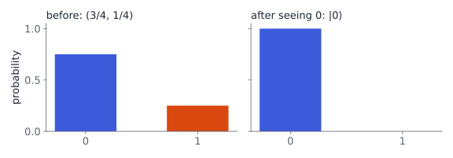
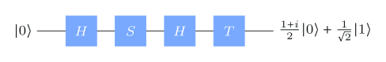

# Classical information

## Classical states and probability vectors



A system $\mathsf X$ has a finite set $\Sigma$ of **classical states**: a bit has $\Sigma=\{0,1\}$, a die $\Sigma=\{1,\dots,6\}$.

When our knowledge of $\mathsf X$ is uncertain, we describe it by a **probabilistic state**, written as a column vector indexed by $\Sigma$:

$$
\Pr(\mathsf X=0)=\tfrac34,\;\Pr(\mathsf X=1)=\tfrac14
\quad\longleftrightarrow\quad
\begin{pmatrix}\tfrac34\\[1mm]\tfrac14\end{pmatrix}.
$$

::: {.box}
[Probability vector]{.box-title}
Nonnegative real entries that sum to $1$.
:::

The uncertainty is in *our knowledge*: the system itself is in one classical state at any moment.

## Dirac notation

The **standard basis** vector $\ket a$ has a $1$ in entry $a$ and $0$ elsewhere:

$$
\ket0=\begin{pmatrix}1\\0\end{pmatrix},\qquad \ket1=\begin{pmatrix}0\\1\end{pmatrix},
\qquad\text{so}\qquad
\begin{pmatrix}\tfrac34\\[1mm]\tfrac14\end{pmatrix}=\tfrac34\ket0+\tfrac14\ket1 .
$$

- $\ket\psi$ ("ket"): a column vector.
- $\bra\psi$ ("bra"): the **conjugate transpose**, a row vector. $\;\bra0=\begin{pmatrix}1&0\end{pmatrix}$.
- $\braket{a}{b}$ is a number; $\ket a\bra b$ is a matrix with a $1$ in position $(a,b)$.

## Measuring a probabilistic state

Looking at the system reveals one classical state $a$, with probability equal to entry $a$ of the vector.

. . .

Afterwards our knowledge changes: the state becomes $\ket a$ (we now know it).

{width="72%"}

::: {.aside-note}
Nothing physical happens to the system. Only our knowledge of it changes.
:::

## Operations: stochastic matrices

**Deterministic** operations are functions $f:\Sigma\to\Sigma$, acting as $M\ket a=\ket{f(a)}$. For a bit there are four:

$$
\begin{aligned}
M_1&=\begin{pmatrix}1&1\\0&0\end{pmatrix}\ (\text{always }0), &
M_2&=\begin{pmatrix}1&0\\0&1\end{pmatrix}\ (\text{identity}),\\[1mm]
M_3&=\begin{pmatrix}0&1\\1&0\end{pmatrix}\ (\text{NOT}), &
M_4&=\begin{pmatrix}0&0\\1&1\end{pmatrix}\ (\text{always }1).
\end{aligned}
$$

. . .

**Probabilistic** operations are **stochastic matrices**: every column is a probability vector. Example: with probability ½ reset to $0$, otherwise do nothing:

$$
\tfrac12 M_1+\tfrac12 M_2=\begin{pmatrix}1&\tfrac12\\0&\tfrac12\end{pmatrix}.
$$

## Composing operations

Apply $M$ first, then $N$: the combined operation is $NM$ (read right to left).

$$
N(M\ket\psi)=(NM)\ket\psi .
$$

. . .

**Order matters.** Matrix multiplication is not commutative:

$$
M_3M_1=\begin{pmatrix}0&0\\1&1\end{pmatrix}=M_4
\qquad\ne\qquad
M_1M_3=\begin{pmatrix}1&1\\0&0\end{pmatrix}=M_1 .
$$

("Reset, then flip" always gives $1$; "flip, then reset" always gives $0$.)

# Quantum information

## Quantum state vectors

::: {.box}
[Quantum state vector]{.box-title}
A column vector of **complex** numbers whose **Euclidean norm is $1$**:
$\;\norm{\ket\psi}=\sqrt{\sum_a\abs{\alpha_a}^2}=1.$
:::

Examples for a qubit ($\Sigma=\{0,1\}$):

$$
\ket+=\tfrac1{\sqrt2}\ket0+\tfrac1{\sqrt2}\ket1,\qquad
\ket-=\tfrac1{\sqrt2}\ket0-\tfrac1{\sqrt2}\ket1,\qquad
\tfrac{1+2i}{3}\ket0-\tfrac23\ket1 .
$$

Compared to classical: entries can be **negative or complex**, and it is the **squares of absolute values** that sum to $1$.

## Standard basis measurements

Measuring $\ket\psi=\sum_a\alpha_a\ket a$ gives outcome $a$ with probability $\abs{\alpha_a}^2$, and the state becomes $\ket a$.

. . .

- $\ket+$ and $\ket-$: each outcome with probability ½. These two states look identical under this measurement.
- $\tfrac{1+2i}{3}\ket0-\tfrac23\ket1$: outcome $0$ with probability $\abs{1+2i}^2/9=5/9$, outcome $1$ with probability $4/9$.

. . .

Measuring again gives the same answer: after the first measurement the state *is* $\ket a$.

## Unitary operations

A matrix $U$ is **unitary** if $U^\dagger U=\mathbb I$ (equivalently $UU^\dagger=\mathbb I$). Exactly these matrices preserve the norm of every vector, so they map quantum states to quantum states.

:::: {.columns}
::: {.column width="55%"}
$$
\begin{aligned}
X&=\begin{pmatrix}0&1\\1&0\end{pmatrix}&
Y&=\begin{pmatrix}0&-i\\i&0\end{pmatrix}&
Z&=\begin{pmatrix}1&0\\0&-1\end{pmatrix}\\[2mm]
H&=\tfrac1{\sqrt2}\begin{pmatrix}1&1\\1&-1\end{pmatrix}&
S&=\begin{pmatrix}1&0\\0&i\end{pmatrix}&
T&=\begin{pmatrix}1&0\\0&\tfrac{1+i}{\sqrt2}\end{pmatrix}
\end{aligned}
$$
:::
::: {.column width="45%"}
- $X,Y,Z$: the **Pauli** matrices. $X$ is a bit flip, $Z$ a phase flip.
- $H$: the **Hadamard** operation. $H\ket0=\ket+$, $H\ket1=\ket-$.
- $S,T$: **phase** operations $\begin{pmatrix}1&0\\0&e^{i\theta}\end{pmatrix}$ with $\theta=\tfrac\pi2,\tfrac\pi4$.
:::
::::

## Interference: $H$ undoes itself

$$
H\ket+=\tfrac1{\sqrt2}H\ket0+\tfrac1{\sqrt2}H\ket1=\tfrac12\bigl(\ket0+\ket1\bigr)+\tfrac12\bigl(\ket0-\ket1\bigr)=\ket0 .
$$

The $\ket1$ contributions **cancel**. That cannot happen with probabilities, which are never negative.

. . .

- Classically: a fair coin flip twice in a row is still a fair coin.
- Quantum: "random-looking" $\ket+$ goes back to the definite $\ket0$. Measuring in between would destroy this: the measured state is $\ket0$ or $\ket1$, and $H$ then gives $\ket\pm$ again.

## Composing unitaries

As before, $U$ then $V$ is $VU$. For example $HSH$ is a square root of NOT:

$$
HSH=\frac{1}{2}\begin{pmatrix}1+i&1-i\\1-i&1+i\end{pmatrix},
\qquad (HSH)^2=X .
$$

. . .

A longer example: start in $\ket0$, apply $H$, then $S$, $H$, $T$:

{width="62%"}

$$
TH\,SH\ket0=\frac{1+i}{2}\ket0+\frac1{\sqrt2}\ket1 .
$$

## Try it: one qubit {.scrollable}

```{ojs}
//| echo: false
viewof theta = Inputs.range([0, 180], {step: 1, value: 60, label: "θ (degrees)"})
viewof phi = Inputs.range([0, 360], {step: 1, value: 0, label: "φ (degrees)"})
viewof gate = Inputs.radio(["none", "X", "Z", "H", "S", "T"], {value: "H", label: "then apply"})
```

```{ojs}
//| echo: false
qubit = {
  const t = theta * Math.PI / 360, p = phi * Math.PI / 180;
  // amplitudes as [re, im]
  let a = [Math.cos(t), 0], b = [Math.sin(t) * Math.cos(p), Math.sin(t) * Math.sin(p)];
  const r = Math.SQRT1_2, mul = (z, w) => [z[0]*w[0] - z[1]*w[1], z[0]*w[1] + z[1]*w[0]];
  const before = [a, b];
  if (gate === "X") [a, b] = [b, a];
  if (gate === "Z") b = [-b[0], -b[1]];
  if (gate === "H") [a, b] = [[r*(a[0]+b[0]), r*(a[1]+b[1])], [r*(a[0]-b[0]), r*(a[1]-b[1])]];
  if (gate === "S") b = mul(b, [0, 1]);
  if (gate === "T") b = mul(b, [r, r]);
  const p2 = z => z[0]**2 + z[1]**2;
  const fmt = z => `${z[0].toFixed(3)}${z[1] < 0 ? " − " : " + "}${Math.abs(z[1]).toFixed(3)}i`;
  return {before, after: [a, b], fmt,
    rows: [{state: "before", outcome: "0", p: p2(before[0])}, {state: "before", outcome: "1", p: p2(before[1])},
           {state: "after " + gate, outcome: "0", p: p2(a)}, {state: "after " + gate, outcome: "1", p: p2(b)}]};
}
html`<p style="font-size:0.7em">
|ψ⟩ = (${qubit.fmt(qubit.before[0])})|0⟩ + (${qubit.fmt(qubit.before[1])})|1⟩<br>
after ${gate}: (${qubit.fmt(qubit.after[0])})|0⟩ + (${qubit.fmt(qubit.after[1])})|1⟩</p>`
Plot.plot({
  width: 900, height: 230, marginLeft: 90,
  x: {domain: [0, 1], label: "probability of the outcome →", grid: true},
  y: {label: null},
  fy: {label: null},
  color: {domain: ["0", "1"], range: ["#3b5bdb", "#d9480f"], legend: true},
  marks: [Plot.barX(qubit.rows, {x: "p", y: "outcome", fy: "state", fill: "outcome"}), Plot.ruleX([0])]
})
```

$\ket\psi=\cos\tfrac\theta2\ket0+e^{i\varphi}\sin\tfrac\theta2\ket1$. Try $\theta=90^\circ$ with $\varphi=0$ and $180^\circ$ ($\ket\pm$): identical probabilities before $H$, opposite after.

## In Qiskit

```python
from qiskit.quantum_info import Statevector, Operator
from numpy import sqrt

v = Statevector([(1 + 2.0j) / 3, -2 / 3])
v.is_valid()                       # True: norm 1
outcome, state = v.measure()       # simulate one standard basis measurement
v.sample_counts(1000)              # e.g. {'0': 556, '1': 444}

H = Operator([[1 / sqrt(2), 1 / sqrt(2)], [1 / sqrt(2), -1 / sqrt(2)]])
S = Operator([[1, 0], [0, 1.0j]])
w = Statevector([1, 0]).evolve(H).evolve(S)    # S H |0>
```

`QuantumCircuit(1)` with `circuit.h(0)`, `circuit.s(0)`, … builds the same sequence as a circuit; `Operator.from_circuit(circuit)` gives its unitary matrix.

## Recap

| | Classical (probabilistic) | Quantum |
|---|---|---|
| State | probability vector: entries $\ge0$, sum $=1$ | complex vector, Euclidean norm $=1$ |
| Measurement | outcome $a$ with probability $p_a$ | outcome $a$ with probability $\abs{\alpha_a}^2$ |
| Operations | stochastic matrices | unitary matrices |
| After measuring $a$ | state becomes $\ket a$ | state becomes $\ket a$ |

Negative and complex entries allow **interference**, which has no classical counterpart.

::: {.aside-note}
Adapted from *Basics of Quantum Information* by John Watrous, © IBM Corp., [CC BY-SA 4.0](https://creativecommons.org/licenses/by-sa/4.0/). [Original lesson](https://quantum.cloud.ibm.com/learning/en/courses/basics-of-quantum-information/single-systems/introduction).
:::
