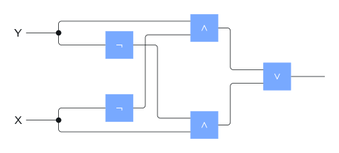
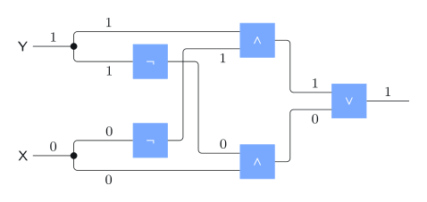
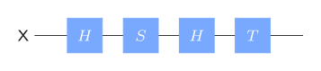
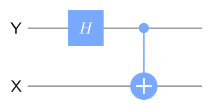
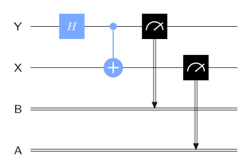
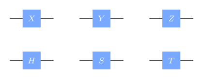
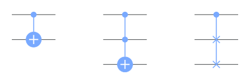
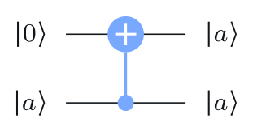
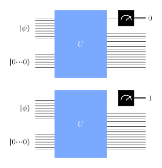

# Circuits

## Boolean circuits



A **circuit**: wires carry information, gates act on it, and the graph has **no cycles**: information flows one way, from left to right.

:::: {.columns}
::: {.column width="50%"}
{width="95%"}
:::
::: {.column width="50%"}
{width="95%"}
:::
::::

AND ($\wedge$), OR ($\vee$), NOT ($\neg$) and FANOUT (a dot that copies a bit). This circuit computes the XOR of its two inputs.

::: {.aside-note}
Other circuit models (arithmetic circuits, for instance) follow the same pattern with different gates.
:::

## Quantum circuits

Wires are **qubits**, gates are **unitary operations** (plus measurements), read left to right.

{width="46%"}

The circuit applies $H$, then $S$, then $H$, then $T$: as a matrix, $THSH$ (right to left).

. . .

::: {.box}
[Qiskit's ordering convention]{.box-title}
The **top** qubit has index $0$ and is written **rightmost**: a circuit with wires $\mathsf X$ (bottom) and $\mathsf Y$ (top) acts on $(\mathsf X,\mathsf Y)$, with $\ket{xy}$ meaning $\mathsf X=x$, $\mathsf Y=y$.
:::

## An e-bit, gate by gate

:::: {.columns}
::: {.column width="40%"}
{width="100%"}
:::
::: {.column width="60%"}
Start in $\ket{00}$.

1. $H$ on the top qubit $\mathsf Y$: the operation $\mathbb I\otimes H$, giving $\ket0\ket+$.
2. CNOT with control $\mathsf Y$, target $\mathsf X$:

$$
\frac{\ket{00}+\ket{01}}{\sqrt2}\;\mapsto\;\frac{\ket{00}+\ket{11}}{\sqrt2}=\ket{\phi^+}.
$$
:::
::::

CNOT: $\ket a\ket b\mapsto\ket{a\oplus b}\ket b$, with the control $b$ on top.

## Measurements in circuits

{width="46%"}

A meter symbol is a standard basis measurement; the result goes to a **classical bit** (double wire). Here both outcomes are $00$ or $11$, with probability ½ each.

## The gate collection

{width="34%"}

Single-qubit gates $X,Y,Z,H,S,T$; two- and three-qubit gates CNOT, Toffoli and swap; and a controlled version of any unitary:

{width="44%"}

# Inner products and projections

## Inner products

$$
\braket{\psi}{\phi}=\sum_a\overline{\alpha_a}\,\beta_a
\qquad\text{for }\ket\psi=\sum_a\alpha_a\ket a,\ \ket\phi=\sum_a\beta_a\ket a .
$$

- $\braket{\psi}{\psi}=\norm{\ket\psi}^2$; quantum states have $\braket\psi\psi=1$.
- Conjugate symmetry $\braket\phi\psi=\overline{\braket\psi\phi}$; linear in the second argument.
- $\abs{\braket\psi\phi}\le\norm{\ket\psi}\norm{\ket\phi}$ (Cauchy–Schwarz).

. . .

**Orthogonal:** $\braket\psi\phi=0$. **Orthonormal set:** unit vectors, pairwise orthogonal. Example: $\{\ket+,\ket-\}$, the four Bell states.

::: {.box}
A square matrix is **unitary** $\iff$ its columns form an orthonormal basis. Every orthonormal set extends to an orthonormal basis.
:::

## Projections

A **projection** is a square matrix with $\Pi=\Pi^\dagger=\Pi^2$. For a unit vector $\ket\psi$, $\;\ket\psi\bra\psi$ is a projection, and so is $\mathbb I-\ket\psi\bra\psi$.

::: {.box}
[Projective measurement]{.box-title}
Projections $\{\Pi_0,\dots,\Pi_{m-1}\}$ with $\Pi_0+\cdots+\Pi_{m-1}=\mathbb I$. On $\ket\psi$, outcome $k$ appears with probability $\norm{\Pi_k\ket\psi}^2$, and the state becomes
$$
\frac{\Pi_k\ket\psi}{\norm{\Pi_k\ket\psi}} .
$$
:::

- Standard basis measurement: $\Pi_a=\ket a\bra a$.
- Measuring one of two systems: $\Pi_a=\ket a\bra a\otimes\mathbb I$. Same formula as Lecture 2.
- Any projective measurement can be **implemented** with a unitary, extra qubits, and a standard basis measurement.

# Limitations on quantum information

## Global phases are irrelevant

$\ket\psi$ and $e^{i\theta}\ket\psi$ give the same probabilities for **every** measurement, before or after any unitary:

$$
\norm{\Pi\,U e^{i\theta}\ket\psi}^2=\abs{e^{i\theta}}^2\norm{\Pi U\ket\psi}^2=\norm{\Pi U\ket\psi}^2 .
$$

So they are the **same physical state**.

. . .

A **relative** phase is different: $\ket+$ and $\ket-$ differ by a phase on one term only, and $H$ maps them to the distinguishable $\ket0$ and $\ket1$.

## No-cloning

::: {.box}
[No-cloning theorem]{.box-title}
There is no state $\ket\phi$ and unitary $U$ with $U\bigl(\ket\psi\otimes\ket\phi\bigr)=\ket\psi\otimes\ket\psi$ for **every** state $\ket\psi$.
:::

**Proof sketch.** Suppose $U$ clones $\ket\psi$ and $\ket\chi$. Unitaries preserve inner products, so

$$
\braket\psi\chi\braket\phi\phi=\braket\psi\chi^2
\;\Longrightarrow\;
\braket\psi\chi\in\{0,1\}.
$$

Two states that are neither orthogonal nor equal (like $\ket0$ and $\ket+$) cannot both be cloned.

## Copying is not cloning

:::: {.columns}
::: {.column width="35%"}
{width="90%"}
:::
::: {.column width="65%"}
Classical states **can** be copied: a CNOT onto $\ket0$ maps $\ket a\mapsto\ket a\ket a$ for $a\in\{0,1\}$.

On a superposition it does something else:

$$
\ket+\otimes\ket0\;\mapsto\;\ket{\phi^+}\ne\ket+\ket+ .
$$

Copying the standard basis is allowed because those states are orthogonal, exactly the case the proof leaves open.
:::
::::

## Non-orthogonal states can't be told apart

:::: {.columns}
::: {.column width="35%"}
{width="100%"}
:::
::: {.column width="65%"}
Suppose a unitary $U$ and a final measurement output $0$ on $\ket\psi$ and $1$ on $\ket\phi$, always. Then

$$
U\ket{0\cdots0}\ket\psi=\ket{\gamma_0}\ket0,
\qquad
U\ket{0\cdots0}\ket\phi=\ket{\delta_1}\ket1,
$$

and comparing inner products gives $\braket\psi\phi=\braket{\gamma_0}{\delta_1}\braket01=0$.

**Perfect discrimination $\iff$ orthogonal.**
:::
::::

## Recap

1. **Circuits** are acyclic: wires carry (qu)bits, gates act left to right. In Qiskit the top qubit is rightmost in $\ket{\cdots}$.
2. $H$ then CNOT on $\ket{00}$ prepares an **e-bit**.
3. **Inner products** define orthogonality; unitary $\iff$ orthonormal columns.
4. **Projective measurements** $\{\Pi_k\}$ generalize standard basis measurements.
5. Three limits: **global phases** are unobservable, unknown states **cannot be cloned**, and **non-orthogonal states cannot be perfectly discriminated**.

::: {.aside-note}
Adapted from *Basics of Quantum Information* by John Watrous, © IBM Corp., [CC BY-SA 4.0](https://creativecommons.org/licenses/by-sa/4.0/). [Original lesson](https://quantum.cloud.ibm.com/learning/en/courses/basics-of-quantum-information/quantum-circuits/introduction).
:::
