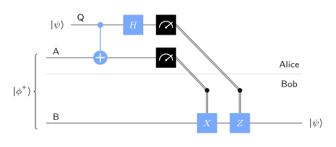
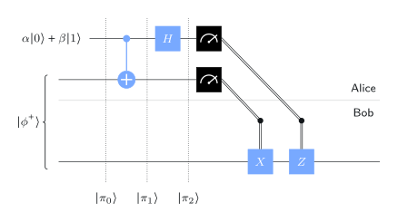
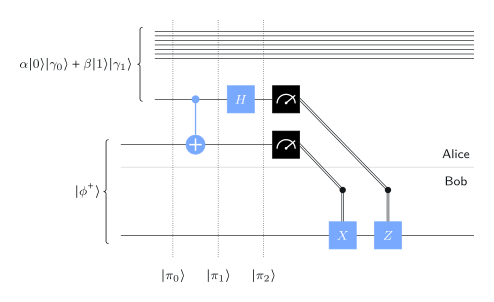
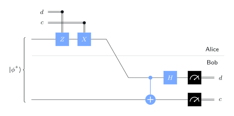

# Entanglement as a resource

## Alice and Bob



Two parties in separate labs. Throughout, they **share an e-bit**: Alice holds qubit $\mathsf A$, Bob holds qubit $\mathsf B$, and $(\mathsf A,\mathsf B)$ is in

$$
\ket{\phi^+}=\frac{\ket{00}+\ket{11}}{\sqrt2}.
$$

Three things they can do with it:

- **Teleportation:** 1 e-bit + 2 classical bits → send 1 **qubit**.
- **Superdense coding:** 1 e-bit + 1 qubit → send 2 **classical bits**.
- **CHSH game:** win a cooperative game more often than any classical strategy can, **without communicating**.

::: {.aside-note}
An e-bit is consumed by each use: after the protocol it is no longer entangled.
:::

# Quantum teleportation

## The protocol

{width="58%"}

Alice wants to send the state of qubit $\mathsf Q$ (unknown to her) to Bob, using only classical communication.

1. Alice applies CNOT (control $\mathsf Q$, target $\mathsf A$), then $H$ to $\mathsf Q$.
2. Alice measures $\mathsf A\to a$ and $\mathsf Q\to b$, and sends $a,b$ to Bob.
3. Bob applies $X$ if $a=1$, then $Z$ if $b=1$.

## Why it works

{width="34%"}

With $\mathsf Q$ in $\alpha\ket0+\beta\ket1$ and qubits ordered $(\mathsf B,\mathsf A,\mathsf Q)$, after Alice's two gates:

$$
\begin{aligned}
\ket{\pi_2}=\;&\tfrac12\bigl(\alpha\ket0+\beta\ket1\bigr)\ket{00}
+\tfrac12\bigl(\alpha\ket0-\beta\ket1\bigr)\ket{01}\\
+\;&\tfrac12\bigl(\alpha\ket1+\beta\ket0\bigr)\ket{10}
+\tfrac12\bigl(\alpha\ket1-\beta\ket0\bigr)\ket{11}.
\end{aligned}
$$

Each outcome $ab$ has probability $\tfrac14$ and leaves $\mathsf B$ in a known distortion of the state, which Bob's $X$ and/or $Z$ undoes.

## What teleportation does and doesn't do

- Bob ends with **exactly** the state of $\mathsf Q$, including any entanglement $\mathsf Q$ had with other systems.

{width="38%"}

- **No cloning:** $\mathsf Q$ ends in $\ket b$; the original is gone.
- **No faster-than-light signal:** before Bob gets $a,b$, his qubit looks completely random.
- The e-bit is **burned**: $\mathsf A$ ends in $\ket a$, unentangled.

# Superdense coding

## The protocol

:::: {.columns}
::: {.column width="48%"}
{width="100%"}
:::
::: {.column width="52%"}
Alice wants to send two classical bits $c,d$ by sending Bob **one qubit**.

1. If $d=1$, Alice applies $Z$ to $\mathsf A$. If $c=1$, she applies $X$.
2. She sends $\mathsf A$ to Bob.
3. Bob applies CNOT (control $\mathsf A$, target $\mathsf B$) and $H$ to $\mathsf A$, then measures: $\mathsf B\to c$, $\mathsf A\to d$.
:::
::::

## Why it works

Alice's operations choose one of the four Bell states:

$$
\begin{aligned}
(\mathbb I\otimes\mathbb I)\ket{\phi^+}&=\ket{\phi^+}, &
(\mathbb I\otimes Z)\ket{\phi^+}&=\ket{\phi^-},\\
(\mathbb I\otimes X)\ket{\phi^+}&=\ket{\psi^+}, &
(\mathbb I\otimes XZ)\ket{\phi^+}&=\ket{\psi^-}.
\end{aligned}
$$

Bob's CNOT and $H$ map the Bell basis back to the standard basis:

$$
\ket{\phi^+}\mapsto\ket{00},\quad
\ket{\phi^-}\mapsto\ket{01},\quad
\ket{\psi^+}\mapsto\ket{10},\quad
\ket{\psi^-}\mapsto-\ket{11}.
$$

So Bob reads $cd$ with certainty. Teleportation and superdense coding are mirror images: each trades one resource for the other with the help of an e-bit.

# The CHSH game

## Nonlocal games

:::: {.columns}
::: {.column width="42%"}
{width="100%"}
:::
::: {.column width="58%"}
A referee sends Alice a question $x$ and Bob a question $y$. They answer $a$ and $b$ **without communicating**. The referee decides win or lose.

**CHSH:** $x,y$ uniformly random bits; they win if

$$
a\oplus b=x\wedge y .
$$

| $(x,y)$ | win | lose |
|---|---|---|
| $(0,0),(0,1),(1,0)$ | $a=b$ | $a\ne b$ |
| $(1,1)$ | $a\ne b$ | $a=b$ |
:::
::::

## Classical strategies: at most 3/4

A **deterministic** strategy is a pair of functions $a(x)$, $b(y)$. Winning all four question pairs would require

$$
a(0)\oplus b(0)=0,\quad a(0)\oplus b(1)=0,\quad a(1)\oplus b(0)=0,\quad a(1)\oplus b(1)=1 .
$$

XOR of all four left sides is $0$ (each value appears twice); of the right sides, $1$. **Contradiction:** at most 3 of 4 can win, so the winning probability is $\le\tfrac34$.

. . .

A **probabilistic** strategy is a random choice of deterministic strategy, so it averages to at most $\tfrac34$ too. (Answer $a=b=0$ always: exactly $\tfrac34$.)

## The quantum strategy

Define $\ket{\psi_\theta}=\cos\theta\ket0+\sin\theta\ket1$ and the unitary $U_\theta=\ket0\bra{\psi_\theta}+\ket1\bra{\psi_{\theta+\pi/2}}$ (rotate $\ket{\psi_\theta}$ to $\ket0$).

:::: {.columns}
::: {.column width="45%"}
{width="100%"}
:::
::: {.column width="55%"}
Sharing $\ket{\phi^+}$:

- **Alice:** $U_0$ if $x=0$, $U_{\pi/4}$ if $x=1$; measure, answer $a$.
- **Bob:** $U_{\pi/8}$ if $y=0$, $U_{-\pi/8}$ if $y=1$; measure, answer $b$.

Key formula: $\Pr(a=b)=\cos^2(\alpha-\beta)$ for Alice's angle $\alpha$ and Bob's $\beta$.
:::
::::

## Every question wins with probability ≈ 0.85

| $(x,y)$ | angles $(\alpha,\beta)$ | need | probability |
|---|---|---|---|
| $(0,0)$ | $(0,\ \pi/8)$ | $a=b$ | $\cos^2(\pi/8)$ |
| $(0,1)$ | $(0,\ -\pi/8)$ | $a=b$ | $\cos^2(\pi/8)$ |
| $(1,0)$ | $(\pi/4,\ \pi/8)$ | $a=b$ | $\cos^2(\pi/8)$ |
| $(1,1)$ | $(\pi/4,\ -\pi/8)$ | $a\ne b$ | $\sin^2(3\pi/8)=\cos^2(\pi/8)$ |

$$
\Pr(\text{win})=\cos^2\!\bigl(\tfrac\pi8\bigr)=\frac{2+\sqrt2}{4}\approx0.854>\tfrac34 .
$$

::: {.notes}
Geometric picture: Alice's and Bob's measurement bases are pairs of
perpendicular lines at angles $\alpha$ and $\beta$. For three question pairs
the bases are $\pi/8$ apart (answers likely equal); for $(1,1)$ they are
$3\pi/8$ apart (answers likely different). No strategy, quantum or not,
beats $\cos^2(\pi/8)$ (Tsirelson's bound).
:::

## Try it: choose the angles {.scrollable}

```{ojs}
//| echo: false
viewof a0 = Inputs.range([-90, 90], {step: 0.5, value: 0, label: "Alice, x = 0 (degrees)"})
viewof a1 = Inputs.range([-90, 90], {step: 0.5, value: 45, label: "Alice, x = 1"})
viewof b0 = Inputs.range([-90, 90], {step: 0.5, value: 22.5, label: "Bob, y = 0"})
viewof b1 = Inputs.range([-90, 90], {step: 0.5, value: -22.5, label: "Bob, y = 1"})
```

```{ojs}
//| echo: false
chsh = {
  const r = Math.PI / 180, al = [a0 * r, a1 * r], be = [b0 * r, b1 * r];
  const rows = [];
  for (const x of [0, 1]) for (const y of [0, 1]) {
    const same = Math.cos(al[x] - be[y]) ** 2;
    rows.push({q: `(${x},${y})`, p: (x & y) ? 1 - same : same});
  }
  return {rows, win: rows.reduce((s, d) => s + d.p, 0) / 4};
}
Plot.plot({
  width: 900, height: 230, marginLeft: 60,
  x: {domain: [0, 1], label: "probability of winning →", grid: true},
  y: {label: "(x,y)"},
  marks: [
    Plot.barX(chsh.rows, {x: "p", y: "q", fill: "#3b5bdb"}),
    Plot.ruleX([0.75], {stroke: "#d9480f", strokeDasharray: "5 4", strokeWidth: 2})
  ]
})
html`<p style="font-size:0.8em">Overall winning probability: <strong>${chsh.win.toFixed(4)}</strong>
${chsh.win > 0.75 + 1e-9 ? "(beats the classical ¾)" : "(no better than classical)"}</p>`
```

Dashed line: the classical limit ¾. The defaults are the strategy above; try moving Bob's angles to $0$ to see it drop.

## Recap

1. An **e-bit** shared in advance is a resource that each protocol consumes.
2. **Teleportation:** e-bit + 2 classical bits sends a qubit. No cloning, no faster-than-light signalling.
3. **Superdense coding:** e-bit + 1 qubit sends 2 classical bits, by choosing one of the four Bell states.
4. **CHSH game:** classical strategies win with probability at most $\tfrac34$; sharing an e-bit wins with $\cos^2(\pi/8)\approx0.85$. Entanglement creates correlations no classical model can reproduce.

::: {.aside-note}
Adapted from *Basics of Quantum Information* by John Watrous, © IBM Corp., [CC BY-SA 4.0](https://creativecommons.org/licenses/by-sa/4.0/). [Original lesson](https://quantum.cloud.ibm.com/learning/en/courses/basics-of-quantum-information/entanglement-in-action/introduction).
:::
