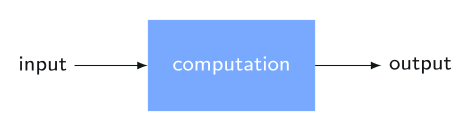
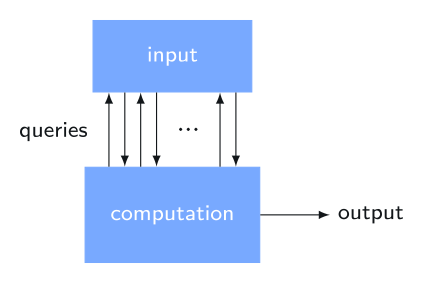
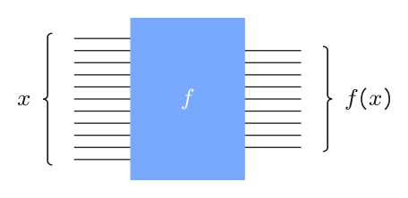
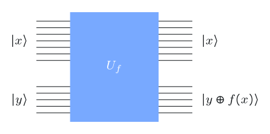
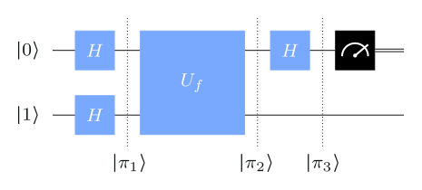
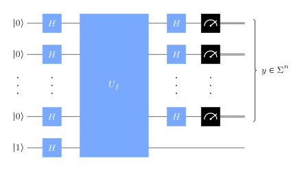
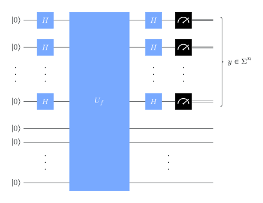
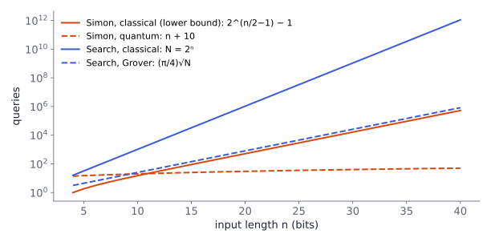

# The query model

## Input you can only ask about



:::: {.columns}
::: {.column width="50%"}
**Standard model.** The whole input is handed to the computation as a binary string.

{width="75%"}
:::
::: {.column width="50%"}
**Query model.** The input is a *function* $f$, hidden in a black box (an *oracle*). The computation learns about it only by asking: "what is $f(x)$?"

{width="50%"}
:::
::::

Throughout, $\Sigma=\{0,1\}$ and the input is a function $f:\Sigma^n\to\Sigma^m$.
**Cost = number of queries.** All other work is free.

::: {.notes}
Think of $f$ as random access to a table of $2^n$ entries. The model is
unrealistic on purpose: it isolates one resource so that quantum and classical
algorithms can be compared exactly, with provable lower bounds. Shor's
algorithm grew out of an idea first seen here (Simon's algorithm).
:::

## Four example problems

- **OR.** $f:\Sigma^n\to\Sigma$. Output $1$ if some $x$ has $f(x)=1$, else $0$.
- **Parity.** $f:\Sigma^n\to\Sigma$. Output the parity of $\abs{\{x: f(x)=1\}}$: the XOR of all $2^n$ bits.
- **Minimum.** $f:\Sigma^n\to\Sigma^m$. Output the lexicographically smallest value $f(x)$.
- **Unique search.** $f:\Sigma^n\to\Sigma$, *promised* that exactly one $z$ has $f(z)=1$. Find $z$.

. . .

A **promise** restricts the inputs. On inputs that break it ("don't care" inputs), an algorithm may do anything.

::: {.aside-note}
Some query problems are deliberately artificial. They still matter: they show where the extremes of quantum advantage lie.
:::

## Query gates

:::: {.columns}
::: {.column width="45%"}
**Classical:** a gate that simply computes $f$. The query count is the number of these gates.

{width="80%"}
:::
::: {.column width="55%"}
**Quantum:** computing $f$ in place is not unitary in general, so instead

$$
U_f\,\ket{y}\ket{x}=\ket{y\oplus f(x)}\ket{x}
$$

{width="55%"}
:::
::::

$U_f$ is its own inverse and permutes standard basis states, so it is a **permutation matrix**: always unitary. It can be applied to superpositions of inputs.

::: {.notes}
$\oplus$ is bitwise XOR, e.g. $001\oplus101=100$. We ignore how hard $U_f$ is to
build: preparing the box is part of preparing the input. Qiskit orders qubits
right to left, so the top qubit $x$ is written on the right: $\ket{y}\ket{x}$.
:::

# Deutsch's algorithm

## Deutsch's problem

Four functions from one bit to one bit:

$$
\begin{array}{c|c} a & f_1(a)\\\hline 0&0\\1&0\end{array}\qquad
\begin{array}{c|c} a & f_2(a)\\\hline 0&0\\1&1\end{array}\qquad
\begin{array}{c|c} a & f_3(a)\\\hline 0&1\\1&0\end{array}\qquad
\begin{array}{c|c} a & f_4(a)\\\hline 0&1\\1&1\end{array}
$$

$f_1,f_4$ are **constant**; $f_2,f_3$ are **balanced**.

::: {.box}
[Deutsch's problem]{.box-title}
Input: $f:\Sigma\to\Sigma$. \
Output: $0$ if $f$ is constant, $1$ if balanced. Equivalently, compute $f(0)\oplus f(1)$.
:::

Classically, **2 queries** are necessary: one bit tells you nothing about the parity of two.

## The circuit: one query

{width="55%"}

The two Hadamards prepare

$$
\ket{\pi_1}=\ket{-}\ket{+}=\tfrac12\bigl(\ket0-\ket1\bigr)\ket0+\tfrac12\bigl(\ket0-\ket1\bigr)\ket1
$$

## After the query

Since $\ket{0\oplus a}-\ket{1\oplus a}=(-1)^a\bigl(\ket0-\ket1\bigr)$ for both $a\in\Sigma$, the query gives

$$
\ket{\pi_2}=\ket{-}\otimes\frac{(-1)^{f(0)}\ket0+(-1)^{f(1)}\ket1}{\sqrt2}
=(-1)^{f(0)}\ket{-}\otimes\begin{cases}\ket{+} & f(0)\oplus f(1)=0\\ \ket{-} & f(0)\oplus f(1)=1\end{cases}
$$

The final Hadamard maps $\ket{\pm}$ to $\ket0,\ket1$: **the measurement gives $f(0)\oplus f(1)$ with certainty.**

## Phase kickback

$U_f$ writes into the *bottom* qubit, yet only the *top* qubit changed. Why?

$$
\ket{b\oplus c}=X^c\ket b
\quad\Longrightarrow\quad
U_f\bigl(\ket{\psi}\ket a\bigr)=\bigl(X^{f(a)}\ket\psi\bigr)\ket a .
$$

. . .

Because $X\ket-=-\ket-$ ($\ket-$ is an eigenvector of $X$ with eigenvalue $-1$):

$$
U_f\bigl(\ket-\ket a\bigr)=(-1)^{f(a)}\ket-\ket a .
$$

The function value becomes a **phase** on the control register. This idea returns in phase estimation (Lecture 3) and Grover's algorithm (Lecture 4).

## In Qiskit

```{.python code-line-numbers="|1-7|9-15"}
def deutsch_function(case: int):          # query gate for f_1 ... f_4
    if case not in [1, 2, 3, 4]:
        raise ValueError("`case` must be 1, 2, 3, or 4.")
    f = QuantumCircuit(2)
    if case in [2, 3]: f.cx(0, 1)          # balanced: copy x onto y
    if case in [3, 4]: f.x(1)              # f(0) = 1: flip y
    return f

def compile_circuit(function: QuantumCircuit):
    n = function.num_qubits - 1
    qc = QuantumCircuit(n + 1, n)
    qc.x(n); qc.h(range(n + 1))            # prepare |-> |+...+>
    qc.compose(function, inplace=True)     # one query
    qc.h(range(n)); qc.measure(range(n), range(n))
    return qc
```

Run `compile_circuit(deutsch_function(3))` on `AerSimulator` with one shot: outcome `0` means constant, `1` balanced. The same `compile_circuit` serves Deutsch–Jozsa.

# Deutsch–Jozsa

## The problem and the circuit

::: {.box}
[Deutsch–Jozsa problem]{.box-title}
Input: $f:\Sigma^n\to\Sigma$. \
Promise: $f$ is constant or balanced (exactly half the inputs map to $1$). \
Output: $0$ if constant, $1$ if balanced.
:::

{width="38%"}

Output $0$ if every measured bit is $0$, otherwise $1$. **One query.**

## Hadamards on $n$ qubits

$$
H^{\otimes n}\ket{x}=\frac{1}{\sqrt{2^n}}\sum_{y\in\Sigma^n}(-1)^{x\cdot y}\ket y,
\qquad x\cdot y=x_{n-1}y_{n-1}\oplus\cdots\oplus x_0y_0 .
$$

. . .

Trace the circuit: Hadamards, query (phase kickback), Hadamards:

$$
\ket-\otimes\frac{1}{2^n}\sum_{y\in\Sigma^n}\Biggl(\sum_{x\in\Sigma^n}(-1)^{f(x)+x\cdot y}\Biggr)\ket y .
$$

. . .

Probability of measuring $y=0^n$:

$$
\Biggl\lvert\frac1{2^n}\sum_{x\in\Sigma^n}(-1)^{f(x)}\Biggr\rvert^2=
\begin{cases}1 & f \text{ constant}\\ 0 & f\text{ balanced.}\end{cases}
$$

## How hard is it classically?

- **Deterministic:** $2^{n-1}+1$ queries in the worst case. After $2^{n-1}$ equal answers, $f$ could still be either.
- **Randomized:** query $k$ random inputs; answer "constant" if all agree. Never wrong on constant $f$; wrong on balanced $f$ with probability $2^{-k+1}$. With $k=11$, correct more than 99.9% of the time.

. . .

So the gap is huge against deterministic algorithms but **modest against randomized ones**. We want an advantage that survives randomness.

## Bernstein–Vazirani: same circuit, new problem

::: {.box}
[Bernstein–Vazirani problem]{.box-title}
Input: $f:\Sigma^n\to\Sigma$. \
Promise: $f(x)=s\cdot x$ for some $s\in\Sigma^n$. \
Output: $s$.
:::

The Deutsch–Jozsa circuit leaves the register in

$$
\ket-\otimes\frac{1}{2^n}\sum_{y}\sum_{x}(-1)^{(s\oplus y)\cdot x}\ket y=\ket-\otimes\ket s,
$$

since the inner sum vanishes unless $s\oplus y=0^n$. **One query reveals $s$.**

Classically each query reveals at most one bit of $s$, so **$n$ queries** are needed (and suffice: query $f$ on $0\cdots010\cdots0$).

::: {.notes}
Often called "the Bernstein–Vazirani algorithm", but the algorithm is
Deutsch–Jozsa's. Bernstein and Vazirani went on to a recursive version of the
problem (recursive Fourier sampling), the first super-polynomial separation
against randomized algorithms.
:::

# Simon's algorithm

## Simon's problem

::: {.box}
[Simon's problem]{.box-title}
Input: $f:\Sigma^n\to\Sigma^m$. \
Promise: there is an $s\in\Sigma^n$ with
$\;f(x)=f(y)\iff x=y \text{ or } x\oplus s=y.$ \
Output: $s$.
:::

- $s=0^n$: $f$ is one-to-one.
- $s\ne0^n$: $f$ is two-to-one, and the colliding pairs are exactly $\{x,\,x\oplus s\}$.

The task is to find the "hidden XOR-mask" $s$. The problem is artificial, but it inspired Shor's factoring algorithm.

## The circuit

:::: {.columns}
::: {.column width="45%"}
{width="100%"}
:::
::: {.column width="55%"}
Before measurement:

$$
\frac{1}{2^n}\sum_{y\in\Sigma^n}\sum_{x\in\Sigma^n}(-1)^{x\cdot y}\ket{f(x)}\ket y
$$

Outcome probabilities:

$$
p(y)=\begin{cases}
2^{-(n-1)} & y\cdot s=0\\
0 & y\cdot s=1
\end{cases}
\qquad (s\neq0^n)
$$

and uniform $2^{-n}$ when $s=0^n$.

**Each run gives a random $y$ orthogonal to $s$** (mod 2).
:::
::::

::: {.notes}
Derivation: group the $x$'s by their value $z=f(x)$. For $s\ne0^n$ each $z$ in the
range has two preimages $w$ and $w\oplus s$, and the amplitude of $\ket z\ket y$
is $2^{-n}\bigl((-1)^{w\cdot y}+(-1)^{(w\oplus s)\cdot y}\bigr)$, which is
$2^{-n}\cdot2(-1)^{w\cdot y}$ if $s\cdot y=0$ and $0$ otherwise. Summing the
squared amplitudes over the $2^{n-1}$ values $z$ gives $2^{-(n-1)}$.
:::

## Classical post-processing

Run the circuit $k=n+10$ times; stack the outcomes $y^1,\dots,y^k$ as rows of a binary matrix $M$:

$$
M\,v\equiv 0 \pmod 2,\qquad v=(s_{n-1},\dots,s_0)^{\top}.
$$

- Solve for the null space of $M$ over $\mathbb Z_2$ with Gaussian elimination (polynomial time).
- With $k=n+r$ runs, the null space is exactly $\{0^n,s\}$ with probability at least $1-2^{-r}$; for $r=10$ that is above 99.9%.
- Its nonzero element is $s$. If the null space is just $\{0^n\}$, then $s=0^n$.

## The advantage is exponential

:::: {.columns}
::: {.column width="55%"}
{width="100%"}
:::
::: {.column width="45%"}
- **Quantum:** $O(n)$ queries, success probability above 99.9%.
- **Classical, even randomized:** with fewer than $2^{n/2-1}-1$ queries, any algorithm fails with probability at least $1/2$.

Intuition: classically you learn nothing until two queries collide, which takes about $\sqrt{2^n}$ queries (birthday paradox).
:::
::::

## Recap

1. **The query model** counts queries to a black-box function; quantum queries are unitary $U_f$ and act on superpositions.
2. **Phase kickback** with $\ket-$ turns $f(x)$ into a phase $(-1)^{f(x)}$.
3. **Deutsch / Deutsch–Jozsa:** 1 query vs. 2, or vs. $2^{n-1}+1$ deterministic queries; but randomized classical algorithms do almost as well.
4. **Bernstein–Vazirani:** 1 query vs. $n$.
5. **Simon:** $O(n)$ queries vs. exponentially many, *even for randomized algorithms*: the first robust exponential separation, and the template for Shor.

::: {.aside-note}
Adapted from *Fundamentals of Quantum Algorithms* by John Watrous, © IBM Corp., [CC BY-SA 4.0](https://creativecommons.org/licenses/by-sa/4.0/). [Original lesson](https://quantum.cloud.ibm.com/learning/en/courses/fundamentals-of-quantum-algorithms/quantum-query-algorithms/introduction).
:::
