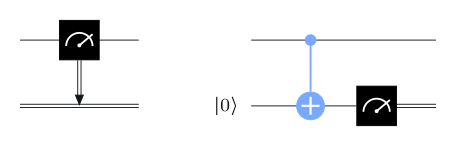
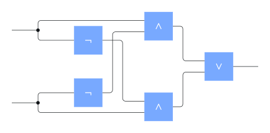
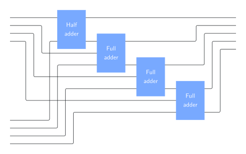
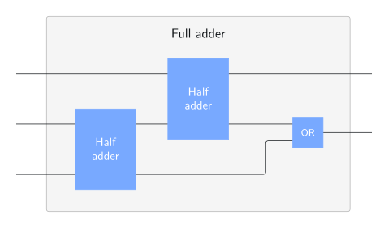
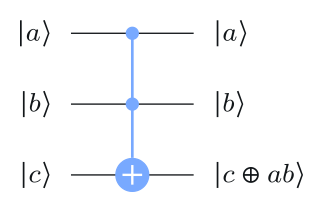
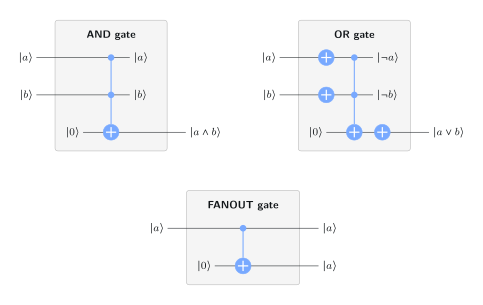
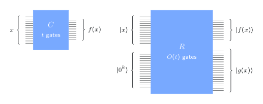
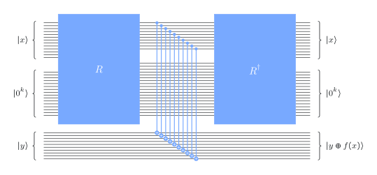
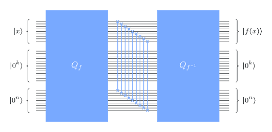

# Some problems are out of reach

## Factoring



::: {.box}
[Integer factorization]{.box-title}
Input: an integer $N\ge2$. \
Output: the prime factorization of $N$, e.g. $12=2^2\cdot3$.
:::

- Unique up to order (fundamental theorem of arithmetic).
- Small numbers: instant (`sympy.ntheory.factorint`).
- **RSA1024**, a 309-digit (1024-bit) number from the RSA Factoring Challenge: its factors are still unknown.
- **RSA250** (829 bits) was factored in 2020 with the *number field sieve*: thousands of CPU core-years.

RSA public-key cryptography is secure only if factoring is hard.

## GCD: a cousin that is easy

::: {.box}
[Greatest common divisor]{.box-title}
Input: nonnegative integers $N,M$, not both zero. \
Output: the largest integer dividing both.
:::

**Euclid's algorithm:** replace $(N,M)$ by $(M,\;N \bmod M)$ until $M=0$.

```python
def gcd(N, M):
    while M != 0:
        N, M = M, N % M
    return N
```

`math.gcd(RSA1024, RSA1024 + 2)` returns instantly. Same kind of input, same size, completely different difficulty. Making "difficulty" precise is the job of this lecture.

# Measuring computational cost

## Encodings and elementary operations

**Input length** = number of bits. An integer $N\ge1$ needs $\lfloor\log_2 N\rfloor+1$ bits, so $n\approx\log_2 N$. Cost is always a function of $n$, not of $N$.

. . .

**Elementary operations** = gates from a fixed set.

:::: {.columns}
::: {.column width="50%"}
**Quantum (default set)**

- $X, Y, Z, H, S, S^\dagger, T, T^\dagger$
- CNOT
- standard basis measurements

**Universal**: approximates any unitary to any accuracy (no promise about how many gates).
:::
::: {.column width="50%"}
**Boolean**

- AND, OR, NOT, FANOUT

Universal for deterministic computations. (AND and OR convert into each other by De Morgan's laws.)
:::
::::

## Deferred measurement

{width="45%"}

A mid-circuit measurement can be replaced by a CNOT onto a fresh $\ket0$ qubit, measured at the end. Any later classical control uses that qubit as a quantum control instead.

So every quantum computation can be written as **one unitary, then measure everything.**

## Size and depth

:::: {.columns}
::: {.column width="45%"}
{width="100%"}
:::
::: {.column width="55%"}
- **Size** = number of gates. Here: 7 (counting the FANOUTs). This is our main measure of cost.
- **Depth** = longest path from an input to an output. Here: 4. Measures time when gates run in parallel.
- One can weight gates differently (e.g., count only $T$ gates or CNOTs), but for asymptotics this rarely matters.
:::
::::

::: {.notes}
Much is unknown about depth; for example, the depth needed to compute GCDs is
an open question. The course mostly uses size.
:::

## Families of circuits

A circuit has a fixed number of input bits. A *problem* has inputs of every length, so an algorithm is a **family** $\{C_1, C_2, C_3,\dots\}$, with $C_n$ handling $n$-bit inputs.

**Cost** of the algorithm: the function $n\mapsto\operatorname{size}(C_n)$.

. . .

Big-O: $g(n)=O(h(n))$ if there are $c>0$ and $n_0$ with $g(n)\le c\cdot h(n)$ for all $n\ge n_0$. Example: $17n^3-257n^2+65537=O(n^3)$.

::: {.aside-note}
We also require the family to be *uniform*: some efficient classical procedure can write down $C_n$ given $n$. Otherwise a circuit could hide the answer to a hard problem in its design.
:::

## Example: adding two $n$-bit numbers

:::: {.columns}
::: {.column width="55%"}
{width="100%"}
:::
::: {.column width="45%"}
A chain of one half adder and $n-1$ full adders, each of constant size.

{width="75%"}

$$\operatorname{size}(C_n)=O(n).$$
:::
::::

## The cost of familiar arithmetic

| Problem | Standard algorithm | Best known (asymptotic) |
|---|---|---|
| Addition | $O(n)$ | $O(n)$ |
| Multiplication | $O(n^2)$ | $O(n\,\lgn n\,\lgn\lgn n)$ (Schönhage–Strassen) |
| Division with remainder | $O(n^2)$ | like multiplication |
| GCD (Euclid) | $O(n^2)$ | $O(n(\lgn n)^2\lgn\lgn n)$ |
| Modular exponentiation $N^K \bmod M$ | $O(n^3)$ | sub-cubic |
| **Factoring** (trial division) | $O(n^2\,2^{n/2})$ | $2^{O(n^{1/3}(\lgn n)^{2/3})}$ (number field sieve, heuristic) |

Modular exponentiation is fast because of **repeated squaring**: $N^{K}$ needs only about $\lgn K$ squarings and multiplications mod $M$.

## Polynomial vs. exponential

- **Polynomial cost** $O(n^c)$ for a constant $c$: treated, as a first approximation, as *efficient*.
- **Exponential cost**: everything known for factoring, even the number field sieve.

. . .

Shor's algorithm (Lecture 3) factors with **polynomial-size quantum circuits**. No polynomial classical algorithm is known.

::: {.aside-note}
"Polynomial = efficient" is a loose abstraction: $n^{1000}$ is useless and constants matter. And a circuit model hides a cost of its own: someone must design the circuit for each $n$ (the uniformity condition).
:::

# Classical computations on quantum computers

## Toffoli gates are enough

:::: {.columns}
::: {.column width="35%"}
{width="100%"}
:::
::: {.column width="65%"}
$\ket a\ket b\ket c\mapsto\ket a\ket b\ket{c\oplus ab}$. Itself buildable from $O(1)$ gates of the default set.

{width="68%"}

AND, OR (De Morgan), FANOUT all fit; NOT is an $X$ gate.
:::
::::

## Gate-by-gate simulation leaves garbage

{width="56%"}

A Boolean circuit $C$ with $t$ gates becomes a quantum circuit $R$ with $O(t)$ gates:

$$
R\,\ket{0^k}\ket{x}=\ket{g(x)}\ket{f(x)}
$$

where the $k$ workspace qubits end in a **garbage** state $\ket{g(x)}$. Harmless classically, but garbage **ruins interference** inside a quantum algorithm.

## Cleaning up the garbage

{width="40%"}

Run $R$, copy the output onto fresh qubits with CNOTs, then run $R^{-1}$:

$$
Q\,\ket{y}\ket{0^k}\ket{x}=\ket{y\oplus f(x)}\ket{0^k}\ket{x}
$$

This is the **query gate** $U_f$ of Lecture 1, built from $O(t)$ elementary gates: an efficient classical algorithm for $f$ gives an efficient $U_f$.

## Invertible functions

If $f$ is a bijection and both $f$ and $f^{-1}$ have efficient circuits, we can even compute **in place**, $\ket{x}\mapsto\ket{f(x)}$:

{width="50%"}

Apply $Q_f$, swap the registers, then apply $Q_{f^{-1}}$ to erase $x$. Shor's algorithm uses this for $x\mapsto ax \bmod N$.

## Recap

1. Cost = **number of elementary gates** as a function of the **input length** $n$.
2. Arithmetic (addition, multiplication, division, GCD, modular exponentiation) costs **polynomial** size; the best known classical factoring algorithms cost **exponential** size.
3. **Deferred measurement:** any quantum circuit is a unitary followed by measurements.
4. Any Boolean circuit of size $t$ becomes a **garbage-free quantum circuit** of size $O(t)$, which realizes the query gate $U_f$. Invertible $f$ can be computed in place.

::: {.aside-note}
Adapted from *Fundamentals of Quantum Algorithms* by John Watrous, © IBM Corp., [CC BY-SA 4.0](https://creativecommons.org/licenses/by-sa/4.0/). [Original lesson](https://quantum.cloud.ibm.com/learning/en/courses/fundamentals-of-quantum-algorithms/quantum-algorithmic-foundations/introduction).
:::
