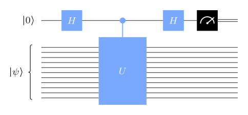
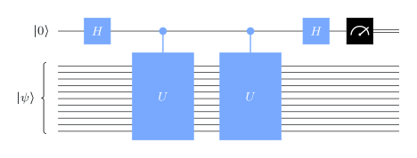
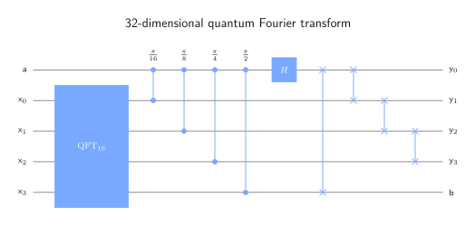
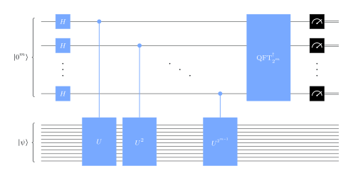

# The phase estimation problem

## Spectral theorem



A matrix $M$ is **normal** if $MM^\dagger=M^\dagger M$. Unitary and Hermitian matrices are normal.

::: {.box}
[Spectral theorem]{.box-title}
For a normal $N\times N$ matrix $M$ there are an orthonormal basis $\{\ket{\psi_1},\dots,\ket{\psi_N}\}$ and complex numbers $\lambda_1,\dots,\lambda_N$ with
$$
M=\sum_{k=1}^N\lambda_k\ket{\psi_k}\bra{\psi_k},\qquad M\ket{\psi_k}=\lambda_k\ket{\psi_k}.
$$
:::

For a **unitary** $U$, every eigenvalue has $\abs{\lambda_k}=1$, so

$$
\lambda_k=e^{2\pi i\theta_k}\quad\text{for a unique } \theta_k\in[0,1).
$$

## The problem

::: {.box}
[Phase estimation]{.box-title}
Input: a quantum circuit for an $n$-qubit unitary $U$, and an $n$-qubit state $\ket\psi$. \
Promise: $\ket\psi$ is an eigenvector of $U$. \
Output: an approximation of $\theta\in[0,1)$, where $U\ket\psi=e^{2\pi i\theta}\ket\psi$.
:::

- The input includes a **quantum state**. Phase estimation is usually a subroutine (as in factoring).
- $\theta$ lives on a **circle**: $0.999$ is within $1/1000$ of $0$.
- More precision costs more: $m$ bits of $\theta$ need $U^{2^{m-1}}$.

# The procedure

## One control qubit

:::: {.columns}
::: {.column width="50%"}
{width="95%"}
:::
::: {.column width="50%"}
A controlled-$U$ on eigenvector $\ket\psi$ **kicks back** the phase onto the control:

$$
\ket\psi\otimes\frac{\ket0+e^{2\pi i\theta}\ket1}{\sqrt2}
$$

After the last Hadamard:

$$
p(0)=\cos^2(\pi\theta),\qquad p(1)=\sin^2(\pi\theta).
$$
:::
::::

Outcome $0$ suggests $\theta\approx0$; outcome $1$ suggests $\theta\approx\tfrac12$. One bit, and noisy unless $\theta\in\{0,\tfrac12\}$.

## Doubling the phase

{width="38%"}

$U^2$ has eigenvalue $e^{2\pi i(2\theta)}$ on the same $\ket\psi$: this measures the **second** bit of $\theta$.

. . .

With $m$ control qubits, apply controlled-$U^{2^k}$ from control $k$. The control register becomes

$$
\frac{1}{\sqrt{2^m}}\sum_{x=0}^{2^m-1}e^{2\pi i x\theta}\ket x .
$$

To read $\theta$ off this state we need the **quantum Fourier transform**.

## The quantum Fourier transform

$$
\QFT_M\ket x=\frac{1}{\sqrt M}\sum_{y=0}^{M-1}\omega_M^{xy}\ket y,\qquad \omega_M=e^{2\pi i/M}.
$$

- Unitary: its columns are orthonormal (geometric series).
- If $\theta=y/2^m$ exactly, the state above **is** $\QFT_{2^m}\ket{y}$. So apply $\QFT^\dagger_{2^m}$ and measure: you get $y$ with certainty.

## Building the QFT efficiently

{width="62%"}

$\QFT_{2^m}$ is built recursively from $\QFT_{2^{m-1}}$ plus Hadamards, controlled-phase gates and swaps (shown: $2^m=32$). Total: **$O(m^2)$ gates**, versus $4^m$ entries in the matrix.

## The full circuit

{width="70%"}

Measure $y\in\{0,\dots,2^m-1\}$; output $\theta\approx y/2^m$.

## How good is the estimate?

For general $\theta$, outcome $y$ has probability

$$
p(y)=\Biggl\lvert\frac1{2^m}\sum_{x=0}^{2^m-1}e^{2\pi i x(\theta-y/2^m)}\Biggr\rvert^2 .
$$

::: {.box}
- A **best $m$-bit approximation** of $\theta$ appears with probability $>4/\pi^2\approx0.405$.
- An estimate **off by more than $2^{-m}$** appears with probability $\le1/4$.
:::

Repeat a few times, or add a few extra control qubits, to boost confidence.

::: {.notes}
The argument: $\abs{\sum_x e^{2\pi i x\delta}}=\abs{e^{2\pi i 2^m\delta}-1}/\abs{e^{2\pi i\delta}-1}$
(geometric series). Bound the numerator chord from below by the arc (via
$\abs{e^{2\pi i\alpha}-1}\ge4\abs\alpha$ for $\abs\alpha\le1/2$) and the denominator chord
from above by the arc length $2\pi\abs\delta$. See the arc-and-chord figure in the
original lesson.
:::

## Try it: the outcome distribution {.scrollable}

```{ojs}
//| echo: false
viewof m = Inputs.range([1, 7], {step: 1, value: 3, label: "control qubits m"})
viewof theta = Inputs.range([0, 0.999], {step: 0.001, value: 0.3, label: "phase θ"})
```

```{ojs}
//| echo: false
pe = {
  const M = 2 ** m;
  return Array.from({length: M}, (_, y) => {
    const d = theta - y / M;
    const s = Math.sin(Math.PI * d);
    const p = Math.abs(s) < 1e-12 ? 1 : Math.sin(Math.PI * M * d) ** 2 / (M * M * s * s);
    return {est: y / M, p};
  });
}
Plot.plot({
  width: 1000, height: 300, marginBottom: 40,
  x: {label: "estimate y / 2^m →", domain: [0, 1]},
  y: {label: "↑ probability", domain: [0, 1], grid: true},
  marks: [
    Plot.ruleY([0]),
    Plot.ruleX(pe, {x: "est", y: "p", stroke: "#3b5bdb", strokeWidth: Math.max(3, 240 / 2 ** m)}),
    Plot.ruleX([theta], {stroke: "#d9480f", strokeDasharray: "5 4", strokeWidth: 2})
  ]
})
```

Dashed line: the true $\theta$. Watch the peak sharpen as $m$ grows, and spread when $\theta$ falls between two grid points.

# Shor's algorithm

## Order finding

$\ZNs=\{a\in\{0,\dots,N-1\}:\gcd(a,N)=1\}$ is closed under multiplication mod $N$.

::: {.box}
[Order finding]{.box-title}
Input: positive integers $N$ and $a$ with $\gcd(a,N)=1$. \
Output: the smallest $r\ge1$ with $a^r\equiv1\pmod N$, the **order** of $a$ mod $N$.
:::

Turn it into phase estimation with the unitary

$$
M_a\ket x=\ket{ax \bmod N}\quad(x\in\ZN),
$$

(identity on the unused basis states). $M_a$ is a permutation: its inverse is $M_a^{r-1}$.

## Eigenvectors of $M_a$

For $j=0,\dots,r-1$:

$$
\ket{\psi_j}=\frac{1}{\sqrt r}\sum_{k=0}^{r-1}\omega_r^{-jk}\ket{a^k},
\qquad M_a\ket{\psi_j}=\omega_r^{\,j}\ket{\psi_j}=e^{2\pi i\, j/r}\ket{\psi_j}.
$$

Phase estimation on $\ket{\psi_1}$ returns $y/2^m\approx1/r$, and with $m=2\lgn N+1$ bits, $r$ is the rounded reciprocal.

. . .

**But we cannot prepare $\ket{\psi_1}$.** The trick:

$$
\ket{1}=\frac{1}{\sqrt r}\sum_{j=0}^{r-1}\ket{\psi_j}.
$$

Running phase estimation on the easy state $\ket1$ behaves like using $\ket{\psi_j}$ for a **uniformly random** $j$: it returns $y/2^m\approx j/r$.

## From $j/r$ to $r$

::: {.box}
[Continued fractions]{.box-title}
For $\alpha\in(0,1)$ there is at most one fraction $u/v$ in lowest terms with $u,v<N$ and $\abs{\alpha-u/v}<\tfrac1{2N^2}$. The continued fraction algorithm finds it with $O((\lgn N)^3)$ operations.
:::

- From $\alpha=y/2^m$ we get $u/v=j/r$ **in lowest terms**: $v$ divides $r$.
- Repeat a few times; guess $r=\operatorname{lcm}$ of the denominators $v$. The failure probability drops exponentially with the number of runs.

**Cost.** Controlled $M_a^{2^k}$ via repeated squaring of $a$ (classically): $O(n^2)$ each, $m=O(n)$ of them, so $O(n^3)$ in total. The QFT adds only $O(n^2)$.

## Factoring by order finding

Split an odd $N$ that is not a prime power (evens and prime powers are easy to split classically):

1. Pick a random $a\in\{2,\dots,N-1\}$. If $d=\gcd(a,N)>1$, output $d$. Done.
2. Find the order $r$ of $a$ mod $N$. **(quantum)**
3. If $r$ is even, compute $d=\gcd\bigl(a^{r/2}-1 \bmod N,\;N\bigr)$. If $d>1$, output $d$.

. . .

**Why it works.** $N$ divides $a^r-1=\bigl(a^{r/2}-1\bigr)\bigl(a^{r/2}+1\bigr)$. Unless all prime factors of $N$ land in the same factor, the GCD exposes some of them.

Each run succeeds with probability $\ge\tfrac12$; $t$ runs fail with probability $\le2^{-t}$. Recurse on $d$ and $N/d$ for the full factorization.

## Example: $N=15$, $a=7$

$$
7^1=7,\quad7^2=49\equiv4,\quad7^3\equiv28\equiv13,\quad7^4\equiv91\equiv1 \pmod{15}\;\Rightarrow\; r=4.
$$

$r$ is even: $a^{r/2}=49\equiv4$, so

$$
\gcd(4-1,15)=3,\qquad 15/3=5 .
$$

Phase estimation would return $y/2^m\approx j/4\in\{0,\tfrac14,\tfrac12,\tfrac34\}$, each with probability $1/4$; denominators $4$ and $2$ have lcm $4$.

## Recap

1. **Spectral theorem:** unitaries have eigenvalues $e^{2\pi i\theta}$; phase estimation finds $\theta$.
2. **Phase kickback** with controlled-$U^{2^k}$ writes $\theta$ into the phases of $m$ control qubits; the **inverse QFT** turns the phases into bits.
3. Best $m$-bit estimate with probability $>40\%$; far-off estimates with probability $\le25\%$.
4. **Order finding** = phase estimation of $M_a$ on the state $\ket1$, plus continued fractions: $O(n^3)$ gates.
5. **Factoring** reduces classically to order finding: polynomial-time quantum factoring.

::: {.aside-note}
Adapted from *Fundamentals of Quantum Algorithms* by John Watrous, © IBM Corp., [CC BY-SA 4.0](https://creativecommons.org/licenses/by-sa/4.0/). [Original lesson](https://quantum.cloud.ibm.com/learning/en/courses/fundamentals-of-quantum-algorithms/phase-estimation-and-factoring/introduction).
:::
