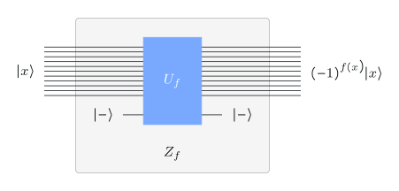
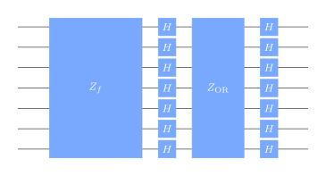
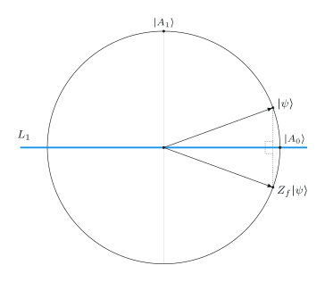
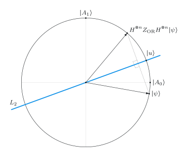
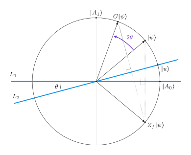
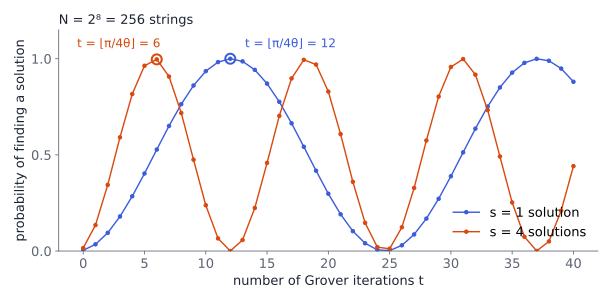

# Unstructured search

## The problem



::: {.box}
[Search]{.box-title}
Input: $f:\Sigma^n\to\Sigma$. \
Output: a string $x$ with $f(x)=1$, or "no solution" if there is none.
:::

::: {.box}
[Unique search]{.box-title}
Same, with the promise that **exactly one** $z$ has $f(z)=1$.
:::

Write $N=2^n$. "Unstructured": nothing about $f$ helps except querying it.

- **Classical:** $\Theta(N)$ queries; even randomized algorithms need about $N/2$ for unique search.
- **Grover:** $O(\sqrt N)$ quantum queries. A **quadratic** speedup, and provably optimal.

::: {.notes}
Search covers a huge range of problems: $f$ can be any efficiently computable
check (a SAT assignment, a key that decrypts, ...). The speedup is only
quadratic, but it applies almost everywhere, which is why it matters.
:::

## Phase query gates

:::: {.columns}
::: {.column width="45%"}
{width="100%"}
:::
::: {.column width="55%"}
Phase kickback with $\ket-$ turns the query gate $U_f$ into

$$
Z_f\ket x=(-1)^{f(x)}\ket x .
$$

A second phase gate, for the OR function:

$$
Z_{\OR}\ket x=\begin{cases}\ \ \ket x & x=0^n\\ -\ket x & x\ne0^n\end{cases}
$$

$Z_{\OR}$ needs no query: it is a fixed, efficiently built circuit.
:::
::::

## The algorithm

::: {.box}
[Grover's algorithm]{.box-title}

1. Prepare $n$ qubits in $\ket u=\Hn\ket{0^n}$, the uniform superposition.
2. Apply the **Grover operation** $G=\Hn Z_{\OR}\Hn Z_f$ $\;t$ times.
3. Measure; output the string $x$.
:::

{width="42%"}

One query per iteration: **$t$ queries in total.** For Search, check the output with one more query and repeat if needed.

# Analysis

## Two subspaces

Split strings into **solutions** $A_1=\{x:f(x)=1\}$ and **non-solutions** $A_0$. Define

$$
\ket{A_0}=\frac{1}{\sqrt{\abs{A_0}}}\sum_{x\in A_0}\ket x,
\qquad
\ket{A_1}=\frac{1}{\sqrt{\abs{A_1}}}\sum_{x\in A_1}\ket x .
$$

The start state lies in their span:

$$
\ket u=\sqrt{\tfrac{\abs{A_0}}{N}}\ket{A_0}+\sqrt{\tfrac{\abs{A_1}}{N}}\ket{A_1}
=\cos\theta\,\ket{A_0}+\sin\theta\,\ket{A_1},
\qquad \sin\theta=\sqrt{\tfrac{\abs{A_1}}{N}} .
$$

## The Grover operation is two reflections

Because $Z_{\OR}=2\ket{0^n}\bra{0^n}-\mathbb I$,

$$
\Hn Z_{\OR}\Hn=2\ket u\bra u-\mathbb I
\qquad\text{(reflection about } \ket u\text{)}.
$$

And $Z_f$ reflects about $\ket{A_0}$: it flips the sign of $\ket{A_1}$ and keeps $\ket{A_0}$.

:::: {.columns}
::: {.column width="50%"}
{width="66%"}
:::
::: {.column width="50%"}
{width="66%"}
:::
::::

## Two reflections make a rotation

:::: {.columns}
::: {.column width="48%"}
{width="100%"}
:::
::: {.column width="52%"}
Reflecting about two lines at angle $\theta$ rotates by $2\theta$. Each $G$ turns the state by $2\theta$ toward $\ket{A_1}$:

$$
\begin{aligned}
G^t\ket u&=\cos\bigl((2t+1)\theta\bigr)\ket{A_0}\\
&\quad+\sin\bigl((2t+1)\theta\bigr)\ket{A_1}.
\end{aligned}
$$

Probability of measuring a solution:

$$
p=\sin^2\bigl((2t+1)\theta\bigr).
$$
:::
::::

# How many iterations?

## Aim for $\pi/2$

We want $(2t+1)\theta\approx\pi/2$, i.e. $t\approx\frac{\pi}{4\theta}-\frac12$. Take

$$
t=\Bigl\lfloor\frac{\pi}{4\theta}\Bigr\rfloor,\qquad \theta=\sin^{-1}\sqrt{\tfrac{s}{N}},\quad s=\abs{A_1}.
$$

- **Unique search** ($s=1$): $\theta\approx1/\sqrt N$, so $t\approx\frac\pi4\sqrt N$ and $p\ge1-\frac1N$.
- **$s$ solutions:** $t\le\frac\pi4\sqrt{N/s}$, so $O\bigl(\sqrt{N/s}\bigr)$ queries.

## Success probability oscillates

{width="80%"}

The probability peaks at the recommended $t$, then falls as the state rotates past $\ket{A_1}$. More solutions: faster rotation, earlier peak.

## Too many iterations overshoots

Using the $s=1$ count when there are really $s=4$ solutions rotates **twice as fast** and sails past $\ket{A_1}$:

| $N$ | 16 | 256 | 4096 | 65536 |
|---|---|---|---|---|
| success with $t$ for $s=1$ | 0.25 | 0.00007 | 0.0002 | 0.00005 |
| success with $t$ for $s=4$ | 1.000 | 0.997 | 0.999 | 1.000 |

Grover's algorithm is not "more iterations = better". **The right $t$ depends on $s$.**

## Try it: success vs. iterations {.scrollable}

```{ojs}
//| echo: false
viewof nq = Inputs.range([2, 16], {step: 1, value: 8, label: "qubits n"})
viewof sols = Inputs.range([1, 64], {step: 1, value: 1, label: "solutions s"})
```

```{ojs}
//| echo: false
grover = {
  const N = 2 ** nq, s = Math.min(sols, N);
  const th = Math.asin(Math.sqrt(s / N));
  const tStar = Math.floor(Math.PI / (4 * th));
  const tMax = Math.max(8, Math.ceil(3 * tStar));
  const pts = Array.from({length: tMax + 1}, (_, t) => ({t, p: Math.sin((2 * t + 1) * th) ** 2}));
  return {N, s, tStar, pts, pStar: Math.sin((2 * tStar + 1) * th) ** 2};
}
Plot.plot({
  width: 1000, height: 300, marginBottom: 40,
  x: {label: "iterations t →"},
  y: {label: "↑ success probability", domain: [0, 1], grid: true},
  marks: [
    Plot.line(grover.pts, {x: "t", y: "p", stroke: "#3b5bdb", strokeWidth: 2}),
    Plot.dot([{t: grover.tStar, p: grover.pStar}], {x: "t", y: "p", r: 7, stroke: "#d9480f", strokeWidth: 3}),
    Plot.text([{t: grover.tStar, p: grover.pStar}], {x: "t", y: "p", dy: -16,
      text: d => `t = ⌊π/4θ⌋ = ${d.t},  p = ${d.p.toFixed(4)}`, fill: "#d9480f", fontSize: 14})
  ]
})
```

$N=2^n$. The ring marks the recommended $t$. A classical search would need about $N/(2s)$ queries on average.

## Unknown $s$, and the edge cases

- **Unknown $s$:** pick $t$ uniformly from $\{1,\dots,\lfloor\pi\sqrt N/4\rfloor\}$. A solution (if one exists) appears with probability above 40%. Repeat and check.
- **Refined method:** choose $t$ at random from $\{1,\dots,T\}$ with $T$ growing like $T\leftarrow\lceil\tfrac54T\rceil$: $O(\sqrt{N/s})$ queries without knowing $s$, and $O(\sqrt N)$ to conclude there is no solution.
- **$s=0$ or $s=N$:** $G\ket u=\pm\ket u$, so the output is a uniformly random string, which is the correct behavior in both cases.
- In general $p\ge s/N$: never worse than guessing. ($t=0$ *is* guessing.)

## Why it matters

- **Optimal:** no quantum query algorithm solves (unique) search with asymptotically fewer than $\sqrt N$ queries. The lower bound was known before Grover found the algorithm.
- **Broadly applicable:** any problem with an efficient checker $f$ gets a square-root speedup, also as a subroutine.
- **Amplitude amplification:** the two-reflection trick boosts the success probability of *any* quantum algorithm quadratically faster than classical repetition.

{width="40%"}

## Recap

1. **Search** over $N=2^n$ strings: $\Theta(N)$ classical queries, $O(\sqrt N)$ quantum.
2. $G=\Hn Z_{\OR}\Hn Z_f$ is a product of two **reflections**, hence a **rotation by $2\theta$** in the plane of $\ket{A_0},\ket{A_1}$, with $\sin\theta=\sqrt{s/N}$.
3. After $t$ iterations the success probability is $\sin^2\bigl((2t+1)\theta\bigr)$; use $t=\lfloor\pi/(4\theta)\rfloor$.
4. Wrong $t$ overshoots. For unknown $s$, randomize $t$.
5. Grover is optimal for search and generalizes to amplitude amplification.

::: {.aside-note}
Adapted from *Fundamentals of Quantum Algorithms* by John Watrous, © IBM Corp., [CC BY-SA 4.0](https://creativecommons.org/licenses/by-sa/4.0/). [Original lesson](https://quantum.cloud.ibm.com/learning/en/courses/fundamentals-of-quantum-algorithms/grover-algorithm/introduction).
:::
