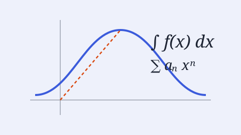

Pick a subject to see its courses. Every lecture is a
[reveal.js](https://revealjs.com) slide deck: press **F** for full screen,
**S** for speaker notes, **O** for an overview of all slides, and **Esc** to
leave either view.

<!--
  One card per subject. To add a subject (e.g. math/), copy the whole
  <a class="subject-card"> ... </a> block below, paste it after the last one,
  and change the folder name, title, description and course count.
-->

```{=html}
<div class="subject-grid">

  <a class="subject-card" href="quantum/index.html">
    
    <div class="subject-body">
      <h3>Quantum</h3>
      <p>Quantum information and computation: IBM's four-course series by John Watrous, from qubits to fault-tolerant quantum computing.</p>
      <span class="subject-count">4 courses</span>
    </div>
  </a>

  <a class="subject-card" href="math/index.html">
    
    <div class="subject-body">
      <h3>Math</h3>
      <p>Mathematics courses: slide decks and notes.</p>
      <span class="subject-count">coming soon</span>
    </div>
  </a>

</div>
```
