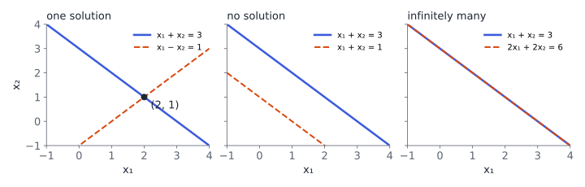

# Systems of linear equations

## Why linear algebra?



Data in machine learning is stored as **vectors** (one example = one row of numbers) and **matrices** (a whole dataset). Models such as linear regression are, at their core, **systems of linear equations**.

. . .

This chapter answers three questions:

1. When does $A\vx=\vb$ have a solution, and how do we find all of them?
2. What structure do the solutions have? (vector spaces, basis, rank)
3. What does a matrix *do* to vectors? (linear maps)

::: {.aside-note}
Book: §2.1–2.8. A **vector** here is any object you can add and scale, with the usual rules; arrays of numbers in $\R^n$ are the main example.
:::

## Three possible outcomes

A system of $m$ linear equations in $n$ unknowns, written compactly as $A\vx=\vb$ with $A\in\R^{m\times n}$:

{width="92%"}

Each equation in two unknowns is a line; solutions are the points on **all** lines. There is always **exactly one**, **none**, or **infinitely many**: never exactly two.

# Matrices

## Matrix operations

- **Addition** entry by entry; **scalar multiplication** of every entry.
- **Product** $AB$ for $A\in\R^{m\times n}$, $B\in\R^{n\times k}$: entry $(i,j)$ is row $i$ of $A$ times column $j$ of $B$:

$$
(AB)_{ij}=\sum_{l=1}^{n}a_{il}\,b_{lj}, \qquad AB\in\R^{m\times k}.
$$

. . .

- Associative and distributive, but **not commutative**: in general $AB\ne BA$ (and one of them may not even be defined).
- **Identity** $I_n$: ones on the diagonal, $AI=IA=A$.
- **Transpose** $(A^\top)_{ij}=a_{ji}$, with $(AB)^\top=B^\top A^\top$. **Symmetric**: $A=A^\top$.

## Inverse

$A\in\R^{n\times n}$ is **invertible** (regular) if some $B$ has $AB=BA=I_n$; write $B=A^{-1}$.

$$
A=\begin{pmatrix}2&1\\5&3\end{pmatrix},\qquad
A^{-1}=\frac{1}{2\cdot3-1\cdot5}\begin{pmatrix}3&-1\\-5&2\end{pmatrix}=\begin{pmatrix}3&-1\\-5&2\end{pmatrix}.
$$

Check: $\begin{pmatrix}2&1\\5&3\end{pmatrix}\begin{pmatrix}3&-1\\-5&2\end{pmatrix}=\begin{pmatrix}1&0\\0&1\end{pmatrix}$ ✓

. . .

- $(AB)^{-1}=B^{-1}A^{-1}$ and $(A^{-1})^\top=(A^\top)^{-1}$.
- For a $2\times2$ matrix, $A^{-1}$ exists exactly when $ad-bc\ne0$ (the determinant, Chapter 4).
- **Not every square matrix has an inverse**: $\begin{pmatrix}1&2\\2&4\end{pmatrix}$ has none.

# Solving linear systems

## Gaussian elimination

Use **elementary row operations**, which never change the solution set:

1. swap two rows, 2. multiply a row by a nonzero number, 3. add a multiple of one row to another.

. . .

$$
\left(\begin{array}{ccc|c}1&2&1&4\\2&5&3&9\\-1&1&4&5\end{array}\right)
\xrightarrow[\;R_3+R_1\;]{R_2-2R_1}
\left(\begin{array}{ccc|c}1&2&1&4\\0&1&1&1\\0&3&5&9\end{array}\right)
\xrightarrow{R_3-3R_2}
\left(\begin{array}{ccc|c}1&2&1&4\\0&1&1&1\\0&0&2&6\end{array}\right)
$$

**Back substitution:** $x_3=3$, then $x_2=1-3=-2$, then $x_1=4-2(-2)-3=5$. So $\vx=(5,-2,3)^\top$.

::: {.notes}
Check in the original equations: 5−4+3=4; 10−10+9=9; −5−2+12=5. Always verify by
substituting back: it catches most arithmetic slips.
:::

## Row echelon form

::: {.box}
[Row echelon form (REF)]{.box-title}
All-zero rows are at the bottom, and the first nonzero entry (**pivot**) of each row is strictly to the right of the pivot above it.
**Reduced** REF additionally has every pivot equal to $1$ and the only nonzero entry in its column.
:::

- Columns with a pivot belong to **basic variables**; the others are **free variables**.
- Free variables can take any value, which is where "infinitely many solutions" comes from.
- No solution exactly when a row becomes $(0\;\cdots\;0\mid c)$ with $c\neq0$.

## All solutions: particular + homogeneous

$$
\left(\begin{array}{cccc|c}1&2&0&1&4\\0&0&1&3&5\end{array}\right)
\qquad\text{(reduced REF; pivots in columns 1 and 3, free: } x_2,x_4)
$$

1. **A particular solution**: set the free variables to $0$: $\;\vx_p=(4,0,5,0)^\top$.
2. **Solutions of $A\vx=\vzero$**: set one free variable to $1$, the other to $0$:
   $\;\vv_1=(-2,1,0,0)^\top,\quad \vv_2=(-1,0,-3,1)^\top$.

. . .

$$
\{\vx: A\vx=\vb\}=\Bigl\{\vx_p+\lambda_1\vv_1+\lambda_2\vv_2\;:\;\lambda_1,\lambda_2\in\R\Bigr\}.
$$

Every solution is **one particular solution plus anything that $A$ sends to $\vzero$**.

## Computing an inverse: the $[A\mid I]$ trick

Row-reduce the augmented matrix $[A\mid I]$; if the left side becomes $I$, the right side is $A^{-1}$:

$$
\left(\begin{array}{cc|cc}2&1&1&0\\5&3&0&1\end{array}\right)\;\longrightarrow\;\cdots\;\longrightarrow\;
\left(\begin{array}{cc|cc}1&0&3&-1\\0&1&-5&2\end{array}\right).
$$

. . .

In practice:

- Don't compute $A^{-1}$ to solve $A\vx=\vb$: elimination (or `np.linalg.solve`) is cheaper and more accurate.
- For overdetermined systems ($m>n$) use the **normal equations** $A^\top A\vx=A^\top\vb$, the basis of least squares (Chapter 9).
- For huge systems, **iterative methods** (Jacobi, Gauss–Seidel, conjugate gradients) approximate the solution step by step.

# Vector spaces

## Groups and vector spaces

A **vector space** $V$ over $\R$ is a set with addition and scalar multiplication such that:

- $(V,+)$ is an **abelian group**: closed, associative, a zero vector $\vzero$, an inverse $-\vx$ for each $\vx$, commutative;
- scalar multiplication distributes over both additions, is associative, and $1\cdot\vx=\vx$.

. . .

Examples: $\R^n$; $m\times n$ matrices $\R^{m\times n}$; polynomials of degree $\le d$; functions $\R\to\R$.

::: {.box}
[Subspace]{.box-title}
$U\subseteq V$ is a **subspace** if it contains $\vzero$ and is closed under addition and scalar multiplication.
:::

The solution set of $A\vx=\vzero$ is always a subspace. That of $A\vx=\vb$ with $\vb\ne\vzero$ is **not**: it misses $\vzero$.

## Linear combinations and independence

A **linear combination** of $\vx_1,\dots,\vx_k$ is $\lambda_1\vx_1+\cdots+\lambda_k\vx_k$.

::: {.box}
[Linear independence]{.box-title}
$\vx_1,\dots,\vx_k$ are **linearly independent** if $\lambda_1\vx_1+\cdots+\lambda_k\vx_k=\vzero$ forces all $\lambda_i=0$. Otherwise they are dependent: one of them is a combination of the others.
:::

. . .

**Test:** put the vectors as columns of a matrix and row-reduce. They are independent **iff every column has a pivot**.

$$
\begin{pmatrix}1\\2\\0\end{pmatrix},\ \begin{pmatrix}0\\1\\1\end{pmatrix},\ \begin{pmatrix}1\\4\\2\end{pmatrix}
\quad\text{are dependent: }\;
\begin{pmatrix}1\\4\\2\end{pmatrix}=\begin{pmatrix}1\\2\\0\end{pmatrix}+2\begin{pmatrix}0\\1\\1\end{pmatrix}.
$$

## Basis, dimension and rank

- A set **spans** $V$ if every vector of $V$ is a linear combination of it.
- A **basis** is a spanning set that is linearly independent: a *minimal* spanning set, or equivalently a *maximal* independent set.
- Every basis of $V$ has the same size: the **dimension** $\dim V$. Example: $\dim\R^n=n$.

. . .

::: {.box}
[Rank]{.box-title}
$\rk(A)$ = number of linearly independent columns = number of independent rows = number of pivots.
:::

- $A\in\R^{n\times n}$ is invertible $\iff\rk(A)=n$.
- $A\vx=\vb$ has a solution $\iff\rk(A)=\rk([A\mid\vb])$.
- The three vectors on the previous slide have rank $2$: they span a plane.

# Linear mappings

## Linear maps and their matrices

$\Phi:V\to W$ is **linear** if $\Phi(\lambda\vx+\psi\boldsymbol{y})=\lambda\Phi(\vx)+\psi\Phi(\boldsymbol{y})$.

Fix bases $(\boldsymbol{b}_1,\dots,\boldsymbol{b}_n)$ of $V$ and $(\boldsymbol{c}_1,\dots,\boldsymbol{c}_m)$ of $W$. The **transformation matrix** $A_\Phi$ has as its $j$-th column the coordinates of $\Phi(\boldsymbol{b}_j)$:

$$
\Phi(\boldsymbol{b}_j)=\sum_{i=1}^m a_{ij}\,\boldsymbol{c}_i .
$$

. . .

**Example:** rotation of the plane by $90^\circ$ sends $\boldsymbol e_1\mapsto\boldsymbol e_2$ and $\boldsymbol e_2\mapsto-\boldsymbol e_1$, so

$$
A=\begin{pmatrix}0&-1\\1&0\end{pmatrix}.
$$

**The columns of a matrix are where the basis vectors go.**

## Change of basis

The same linear map has different matrices in different bases. If $S$ (columns: the new basis of $V$ in old coordinates) and $T$ (the same for $W$) change bases, then

$$
\tilde A_\Phi=T^{-1}A_\Phi\,S .
$$

. . .

Read right to left: convert new coordinates to old ($S$), apply the map ($A_\Phi$), convert back to new coordinates ($T^{-1}$).

::: {.aside-note}
Two matrices related this way (with $S=T$) are **similar**: they describe the same map. Chapter 4 picks a basis that makes the matrix diagonal.
:::

## Kernel and image

::: {.box}
For $\Phi:V\to W$:
**Kernel** $\Ker(\Phi)=\{\vv\in V:\Phi(\vv)=\vzero\}$, a subspace of $V$.
**Image** $\Img(\Phi)=\{\Phi(\vv):\vv\in V\}$, a subspace of $W$.
:::

For $\Phi(\vx)=A\vx$: the image is the **column space** of $A$, and the kernel is the solution space of $A\vx=\vzero$.

. . .

::: {.box}
[Rank–nullity theorem]{.box-title}
$\dim\Ker(\Phi)+\dim\Img(\Phi)=\dim V$, i.e. $\;\dim\Ker(A)+\rk(A)=n$.
:::

In the example two sections back: $n=4$, $\rk(A)=2$, and the kernel was spanned by the two vectors $\vv_1,\vv_2$. ✓

## Try it: a 2×2 matrix as a map {.scrollable}

```{ojs}
//| echo: false
viewof a11 = Inputs.range([-2, 2], {step: 0.1, value: 1.5, label: "a₁₁"})
viewof a12 = Inputs.range([-2, 2], {step: 0.1, value: 0.5, label: "a₁₂"})
viewof a21 = Inputs.range([-2, 2], {step: 0.1, value: 0.3, label: "a₂₁"})
viewof a22 = Inputs.range([-2, 2], {step: 0.1, value: 1.0, label: "a₂₂"})
```

```{ojs}
//| echo: false
lin = {
  const det = a11 * a22 - a12 * a21;
  const zero = Math.abs(a11) + Math.abs(a12) + Math.abs(a21) + Math.abs(a22) < 1e-9;
  const rank = zero ? 0 : (Math.abs(det) < 1e-9 ? 1 : 2);
  const sq = [[0, 0], [1, 0], [1, 1], [0, 1], [0, 0]];
  const img = sq.map(([x, y]) => [a11 * x + a12 * y, a21 * x + a22 * y]);
  return {det, rank, sq, img};
}
Plot.plot({
  width: 440, height: 440, grid: true,
  x: {domain: [-4, 4], label: null}, y: {domain: [-4, 4], label: null},
  marks: [
    Plot.ruleX([0]), Plot.ruleY([0]),
    Plot.line(lin.sq, {x: d => d[0], y: d => d[1], stroke: "#9aa1ae", strokeDasharray: "4 3"}),
    Plot.area(lin.img, {x: d => d[0], y: d => d[1], fill: "#3b5bdb", fillOpacity: 0.15}),
    Plot.line(lin.img, {x: d => d[0], y: d => d[1], stroke: "#3b5bdb", strokeWidth: 2}),
    Plot.arrow([[a11, a21]], {x1: 0, y1: 0, x2: d => d[0], y2: d => d[1], stroke: "#d9480f", strokeWidth: 2.5}),
    Plot.arrow([[a12, a22]], {x1: 0, y1: 0, x2: d => d[0], y2: d => d[1], stroke: "#2b8a3e", strokeWidth: 2.5})
  ]
})
html`<p style="font-size:0.75em">Orange: image of e₁ (column 1). Green: image of e₂ (column 2).<br>
det = ${lin.det.toFixed(2)} (area scale${lin.det < 0 ? ", orientation flipped" : ""}) · rank = ${lin.rank}
${lin.rank < 2 ? " — the square collapses: the map is not invertible" : " — invertible"}</p>`
```

Dashed: the unit square. Make the two columns parallel (e.g. $a_{11}=1,a_{12}=2,a_{21}=1,a_{22}=2$) to see the rank drop to 1.

## Affine spaces

A line or plane that **does not pass through the origin** is not a subspace, but it is a shifted one:

$$
L=\vx_0+U=\{\vx_0+\boldsymbol u:\boldsymbol u\in U\}\qquad(U\text{ a subspace}).
$$

The solution set of $A\vx=\vb$ is exactly such an **affine subspace**: $\vx_p+\Ker(A)$.

. . .

An **affine map** is a linear map followed by a shift:

$$
\phi(\vx)=A\vx+\boldsymbol t .
$$

Affine maps send lines to lines and keep parallel lines parallel. A neural-network layer before its nonlinearity, $W\vx+\boldsymbol b$, is an affine map.

## In Python

```python
import numpy as np

A = np.array([[1, 2, 1], [2, 5, 3], [-1, 1, 4]], dtype=float)
b = np.array([4, 9, 5], dtype=float)
x = np.linalg.solve(A, b)            # array([ 5., -2.,  3.])

np.linalg.matrix_rank(np.array([[1, 0, 1], [2, 1, 4], [0, 1, 2]]))   # 2: dependent columns
np.linalg.inv(np.array([[2, 1], [5, 3]]))                           # [[ 3, -1], [-5,  2]]

from scipy.linalg import null_space
null_space(np.array([[1, 2, 0, 1], [0, 0, 1, 3]]))   # orthonormal basis of the kernel (2 columns)
```

## Recap

1. $A\vx=\vb$ has **zero, one or infinitely many** solutions; Gaussian elimination finds them all.
2. **All solutions = one particular solution + the kernel** of $A$.
3. A **vector space** is closed under addition and scaling; a **basis** is a minimal spanning set, and its size is the **dimension**.
4. **Rank** = number of pivots = independent columns; $\rk(A)+\dim\Ker(A)=n$.
5. A matrix **is** a linear map: its columns are the images of the basis vectors; a change of basis gives $T^{-1}AS$.
6. Shifted subspaces and $A\vx+\boldsymbol t$ give **affine** spaces and maps.

::: {.aside-note}
Study notes following *Mathematics for Machine Learning* (Deisenroth, Faisal, Ong; Cambridge University Press, 2020), Chapter 2. All examples and figures are original. Read the chapter at [mml-book.github.io](https://mml-book.github.io/).
:::
