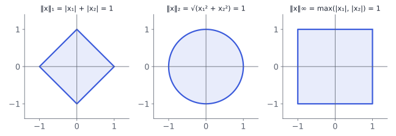

# Lengths and angles

## From algebra to geometry



Chapter 2 treated vectors as things to add and scale. Machine learning also needs to **measure** them:

- How big is a vector? (**norm**)
- How similar are two vectors? (**inner product**, **angle**)
- What is the closest point in a subspace? (**orthogonal projection**)

. . .

These three ideas are behind nearest-neighbour methods, cosine similarity, least squares (Chapter 9) and PCA (Chapter 10).

::: {.aside-note}
Book: §3.1–3.9.
:::

## Norms

::: {.box}
[Norm]{.box-title}
A map $\norm{\cdot}:V\to\R$ with
$\;\norm{\lambda\vx}=\abs\lambda\norm\vx$ (scaling), $\;\norm{\vx+\boldsymbol y}\le\norm\vx+\norm{\boldsymbol y}$ (triangle inequality), $\;\norm\vx\ge0$ with equality only for $\vzero$.
:::

{width="60%"}

For $\vx=(3,-4)$: $\;\norm\vx_1=7,\quad\norm\vx_2=5,\quad\norm\vx_\infty=4$. The pictures show every $\vx$ with norm exactly $1$.

## Inner products

::: {.box}
[Inner product]{.box-title}
A map $\langle\cdot,\cdot\rangle:V\times V\to\R$ that is **bilinear** (linear in each argument), **symmetric** $\langle\vx,\boldsymbol y\rangle=\langle\boldsymbol y,\vx\rangle$, and **positive definite**: $\langle\vx,\vx\rangle>0$ for $\vx\ne\vzero$.
:::

. . .

On $\R^n$, every inner product has the form

$$
\langle\vx,\boldsymbol y\rangle=\vx^\top A\,\boldsymbol y
$$

for a **symmetric, positive definite** matrix $A$. The dot product is $A=I$.

**Example:** $A=\begin{pmatrix}2&1\\1&2\end{pmatrix}$ (eigenvalues $1$ and $3$, so positive definite). Under it, $\langle\boldsymbol e_1,\boldsymbol e_2\rangle=1$: the standard basis vectors are **no longer orthogonal**.

## Lengths, distances and angles

Every inner product gives a norm, a distance and an angle:

$$
\norm\vx=\sqrt{\langle\vx,\vx\rangle},\qquad
d(\vx,\boldsymbol y)=\norm{\vx-\boldsymbol y},\qquad
\cos\omega=\frac{\langle\vx,\boldsymbol y\rangle}{\norm\vx\,\norm{\boldsymbol y}} .
$$

The angle is well defined because of the **Cauchy–Schwarz inequality** $\abs{\langle\vx,\boldsymbol y\rangle}\le\norm\vx\norm{\boldsymbol y}$, which keeps the fraction in $[-1,1]$.

. . .

**Example** (dot product): $\vx=(1,1)$, $\boldsymbol y=(1,2)$.

$$
\cos\omega=\frac{1+2}{\sqrt2\,\sqrt5}=\frac{3}{\sqrt{10}}\approx0.949,\qquad \omega\approx18.4^\circ .
$$

::: {.aside-note}
**Cosine similarity**, used to compare text embeddings, is exactly $\cos\omega$: it ignores length and compares direction only.
:::

# Orthogonality

## Orthogonal vectors and matrices

$\vx\perp\boldsymbol y$ (**orthogonal**) if $\langle\vx,\boldsymbol y\rangle=0$. Unit-length orthogonal vectors are **orthonormal**.

. . .

::: {.box}
[Orthogonal matrix]{.box-title}
A square matrix $A$ whose columns are orthonormal: $A^\top A=AA^\top=I$, so $A^{-1}=A^\top$.
:::

Orthogonal matrices **preserve lengths and angles**:

$$
\norm{A\vx}^2=\vx^\top A^\top A\vx=\vx^\top\vx=\norm\vx^2 .
$$

Rotations and reflections are the examples. Inverting one costs nothing: transpose it.

## Orthonormal bases and Gram–Schmidt

An **orthonormal basis** (ONB) makes coordinates easy: the coordinate of $\vx$ along $\boldsymbol b_i$ is simply $\langle\boldsymbol b_i,\vx\rangle$.

**Gram–Schmidt** turns any basis into an orthogonal one: subtract from each vector its projections onto the earlier ones, then normalize.

. . .

$\boldsymbol b_1=(1,1,0)$, $\boldsymbol b_2=(1,0,1)$:

$$
\boldsymbol u_1=\boldsymbol b_1,\qquad
\boldsymbol u_2=\boldsymbol b_2-\frac{\boldsymbol u_1^\top\boldsymbol b_2}{\boldsymbol u_1^\top\boldsymbol u_1}\boldsymbol u_1
=(1,0,1)-\tfrac12(1,1,0)=\left(\tfrac12,-\tfrac12,1\right).
$$

Check $\boldsymbol u_1^\top\boldsymbol u_2=\tfrac12-\tfrac12+0=0$ ✓. Normalized: $\tfrac1{\sqrt2}(1,1,0)$ and $\tfrac1{\sqrt6}(1,-1,2)$.

## Orthogonal complement

For a subspace $U\subseteq\R^n$, the **orthogonal complement** is

$$
U^\perp=\{\vv:\langle\vv,\boldsymbol u\rangle=0\text{ for all }\boldsymbol u\in U\},\qquad \dim U+\dim U^\perp=n .
$$

Every vector splits uniquely as $\vx=\boldsymbol u+\boldsymbol w$ with $\boldsymbol u\in U$, $\boldsymbol w\in U^\perp$.

. . .

**Example:** for the line $U=\spn\{(1,2,2)\}$ in $\R^3$, the complement $U^\perp$ is the **plane** $x_1+2x_2+2x_3=0$. That's how a plane is described by its **normal vector**.

## Inner products of functions

The same idea works for functions. On the interval $[a,b]$:

$$
\langle f,g\rangle=\int_a^b f(x)\,g(x)\,dx .
$$

. . .

On $[-\pi,\pi]$:

$$
\int_{-\pi}^{\pi}\sin x\cos x\,dx=0,\qquad\int_{-\pi}^{\pi}\sin x\,\sin 2x\,dx=0 .
$$

So $1,\cos x,\sin x,\cos 2x,\sin 2x,\dots$ are **mutually orthogonal**: the basis of **Fourier series**. "Length", "angle" and "projection" now make sense for signals and functions.

# Projections and rotations

## Projecting onto a line

The closest point to $\vx$ on the line $U=\spn\{\boldsymbol b\}$ is the **orthogonal projection**: the error $\vx-\pi_U(\vx)$ must be orthogonal to $\boldsymbol b$.

$$
\pi_U(\vx)=\frac{\boldsymbol b^\top\vx}{\boldsymbol b^\top\boldsymbol b}\,\boldsymbol b,
\qquad
P=\frac{\boldsymbol b\boldsymbol b^\top}{\boldsymbol b^\top\boldsymbol b}\quad\text{(projection matrix)}.
$$

. . .

**Example:** $\boldsymbol b=(1,2,2)$, $\vx=(1,1,1)$. Then $\boldsymbol b^\top\vx=5$, $\boldsymbol b^\top\boldsymbol b=9$:

$$
\pi_U(\vx)=\tfrac59(1,2,2)\approx(0.56,\,1.11,\,1.11).
$$

$P$ is symmetric, has rank $1$, and $P^2=P$: projecting twice changes nothing.

## Projecting onto a subspace

For $U$ spanned by the columns of $B\in\R^{n\times m}$, the same orthogonality condition $B^\top(\vx-B\boldsymbol\lambda)=\vzero$ gives the **normal equations**:

$$
B^\top B\,\boldsymbol\lambda=B^\top\vx,\qquad
\pi_U(\vx)=B\boldsymbol\lambda=B(B^\top B)^{-1}B^\top\vx .
$$

. . .

**Example:** $B=\begin{pmatrix}1&0\\1&1\\1&2\end{pmatrix}$, $\vx=(6,0,0)$.
$\;B^\top B=\begin{pmatrix}3&3\\3&5\end{pmatrix}$, $B^\top\vx=(6,0)$, so $\boldsymbol\lambda=(5,-3)$ and

$$
\pi_U(\vx)=(5,2,-1),\qquad \vx-\pi_U(\vx)=(1,-2,1)\perp\text{both columns}\ \checkmark
$$

This is **least squares**: fitting a line through the points $(0,6),(1,0),(2,0)$. Chapter 9 builds on it.

## Try it: projection onto a line {.scrollable}

```{ojs}
//| echo: false
viewof px = Inputs.range([-3, 3], {step: 0.1, value: 2, label: "x₁"})
viewof py = Inputs.range([-3, 3], {step: 0.1, value: 1.5, label: "x₂"})
viewof ang = Inputs.range([0, 180], {step: 1, value: 20, label: "line angle (degrees)"})
```

```{ojs}
//| echo: false
proj = {
  const r = ang * Math.PI / 180, b = [Math.cos(r), Math.sin(r)];
  const c = px * b[0] + py * b[1];
  const p = [c * b[0], c * b[1]];
  return {b, p, dist: Math.hypot(px - p[0], py - p[1]), c};
}
Plot.plot({
  width: 420, height: 420, grid: true,
  x: {domain: [-3.5, 3.5], label: null}, y: {domain: [-3.5, 3.5], label: null},
  marks: [
    Plot.ruleX([0]), Plot.ruleY([0]),
    Plot.line([[-4 * proj.b[0], -4 * proj.b[1]], [4 * proj.b[0], 4 * proj.b[1]]], {x: d => d[0], y: d => d[1], stroke: "#9aa1ae", strokeWidth: 2}),
    Plot.arrow([[px, py]], {x1: 0, y1: 0, x2: d => d[0], y2: d => d[1], stroke: "#3b5bdb", strokeWidth: 2.5}),
    Plot.arrow([proj.p], {x1: 0, y1: 0, x2: d => d[0], y2: d => d[1], stroke: "#d9480f", strokeWidth: 2.5}),
    Plot.line([[px, py], proj.p], {x: d => d[0], y: d => d[1], stroke: "#2b8a3e", strokeDasharray: "5 4", strokeWidth: 2})
  ]
})
html`<p style="font-size:0.75em">Blue: x. Orange: its projection onto the grey line. Green: the error, always at a right angle to the line.<br>
coordinate along the line = ${proj.c.toFixed(2)} · distance from x to the line = ${proj.dist.toFixed(2)}</p>`
```

Turn the line until the error is zero: then $\vx$ lies on the line.

## Rotations

A **rotation** is a linear map that preserves lengths and angles and keeps orientation ($\det=+1$). In the plane, by angle $\theta$:

$$
R(\theta)=\begin{pmatrix}\cos\theta&-\sin\theta\\\sin\theta&\cos\theta\end{pmatrix},\qquad
R(30^\circ)\begin{pmatrix}1\\0\end{pmatrix}=\begin{pmatrix}0.866\\0.5\end{pmatrix}.
$$

. . .

- $R(\alpha)R(\beta)=R(\alpha+\beta)$: in 2D, rotations **commute**.
- In 3D, rotate about each axis with a $3\times3$ matrix; rotations **do not commute** in 3D.
- In $\R^n$, a **Givens rotation** rotates in one coordinate plane and fixes the rest.
- Every rotation matrix is orthogonal: $R^{-1}=R^\top=R(-\theta)$.

## In Python

```python
import numpy as np

x = np.array([3, -4])
np.linalg.norm(x, 1), np.linalg.norm(x), np.linalg.norm(x, np.inf)   # 7, 5, 4

B = np.array([[1, 0], [1, 1], [1, 2]], dtype=float)
x = np.array([6, 0, 0], dtype=float)
lam = np.linalg.solve(B.T @ B, B.T @ x)       # [ 5., -3.]
p = B @ lam                                    # [ 5.,  2., -1.]
B.T @ (x - p)                                  # [0., 0.]: the error is orthogonal

Q, R = np.linalg.qr(np.array([[1, 1], [1, 0], [0, 1]], dtype=float))   # Gram–Schmidt, done stably
Q.T @ Q                                        # identity: orthonormal columns
```

## Recap

1. A **norm** measures size; different norms have differently shaped unit balls.
2. An **inner product** $\vx^\top A\boldsymbol y$ ($A$ symmetric positive definite) gives lengths, distances and **angles**.
3. **Orthogonal matrices** preserve lengths; an **orthonormal basis** makes coordinates simple inner products. **Gram–Schmidt** builds one.
4. Every subspace has an **orthogonal complement**; functions have inner products too (Fourier).
5. The **orthogonal projection** onto $\spn(B)$ is $B(B^\top B)^{-1}B^\top\vx$: the closest point, and the heart of least squares.
6. **Rotations** are orthogonal with determinant $1$.

::: {.aside-note}
Study notes following *Mathematics for Machine Learning* (Deisenroth, Faisal, Ong; Cambridge University Press, 2020), Chapter 3. All examples and figures are original. Read the chapter at [mml-book.github.io](https://mml-book.github.io/).
:::
