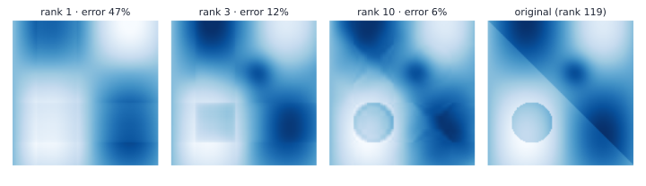

# Summary numbers

## Why decompose a matrix?



A matrix is a linear map. **Decomposing** it means writing it as a product of simpler matrices (triangular, diagonal, orthogonal) that each do one easy thing.

- **Determinant, trace**: single numbers that summarize the map.
- **Eigendecomposition**: directions the map only stretches.
- **Cholesky**: a "square root" of a positive definite matrix.
- **SVD**: rotate, stretch, rotate. Works for *every* matrix, and gives the best low-rank approximation.

::: {.aside-note}
Book: §4.1–4.7.
:::

## Determinant

For a square matrix $A$, $\det(A)$ is the **signed volume scaling factor** of the map $\vx\mapsto A\vx$: the unit square (cube) goes to a parallelogram (parallelepiped) of volume $\abs{\det A}$.

$$
\det\begin{pmatrix}a&b\\c&d\end{pmatrix}=ad-bc .
$$

. . .

- $\det(A)\neq0\iff A$ is invertible (no dimension gets squashed to zero).
- $\det(AB)=\det(A)\det(B)$, $\;\det(A^\top)=\det(A)$, $\;\det(A^{-1})=1/\det(A)$.
- For a **triangular** matrix, $\det$ is the product of the diagonal.
- Larger matrices: **Laplace expansion** along a row, or (in practice) Gaussian elimination to triangular form.

## Trace, and a worked example

The **trace** is the sum of the diagonal: $\operatorname{tr}(A)=\sum_i a_{ii}$. It is linear and satisfies $\operatorname{tr}(AB)=\operatorname{tr}(BA)$.

. . .

$$
M=\begin{pmatrix}2&1&0\\1&3&1\\0&1&2\end{pmatrix}
$$

Laplace expansion along the first row:

$$
\det M=2\,(3\cdot2-1\cdot1)-1\,(1\cdot2-1\cdot0)+0=10-2=8,\qquad \operatorname{tr}M=7 .
$$

We will see shortly that $M$ has eigenvalues $1,2,4$, and indeed $1\cdot2\cdot4=8$, $\;1+2+4=7$.

# Eigenvalues and eigenvectors

## Definition

::: {.box}
[Eigenvalue and eigenvector]{.box-title}
$\lambda\in\R$ is an **eigenvalue** of $A\in\R^{n\times n}$, and $\vx\neq\vzero$ an **eigenvector**, if $\;A\vx=\lambda\vx$.
:::

The map only **stretches** $\vx$ (by $\lambda$); it does not turn it.

. . .

Since $(A-\lambda I)\vx=\vzero$ must have a nonzero solution, $A-\lambda I$ is singular:

$$
p_A(\lambda)=\det(A-\lambda I)=0\qquad\text{(characteristic polynomial)} .
$$

Always: $\det A=\prod_i\lambda_i$ and $\operatorname{tr}A=\sum_i\lambda_i$ (counting repeats, and complex roots if any).

## A worked example

$$
A=\begin{pmatrix}4&1\\2&3\end{pmatrix},\qquad
p_A(\lambda)=(4-\lambda)(3-\lambda)-2=\lambda^2-7\lambda+10=(\lambda-5)(\lambda-2).
$$

. . .

- $\lambda=5$: $\;(A-5I)\vx=\begin{pmatrix}-1&1\\2&-2\end{pmatrix}\vx=\vzero\;\Rightarrow\;\vx=(1,1)$.
- $\lambda=2$: $\;(A-2I)\vx=\begin{pmatrix}2&1\\2&1\end{pmatrix}\vx=\vzero\;\Rightarrow\;\vx=(1,-2)$.

Check: $A(1,-2)^\top=(2,-4)^\top=2\,(1,-2)^\top$ ✓.

. . .

The set of all eigenvectors for $\lambda$ (plus $\vzero$) is the **eigenspace** $E_\lambda=\Ker(A-\lambda I)$. Eigenvectors for **distinct** eigenvalues are linearly independent.

## Symmetric matrices: the spectral theorem

::: {.box}
[Spectral theorem]{.box-title}
If $A=A^\top$, then all eigenvalues are **real**, and there is an **orthonormal basis** of eigenvectors.
:::

. . .

So the eigenvectors of a symmetric matrix are perpendicular. For $M$ from before:

$$
\lambda=1:\ (1,-1,1),\qquad \lambda=2:\ (1,0,-1),\qquad \lambda=4:\ (1,2,1),
$$

pairwise orthogonal (check the dot products). Covariance matrices are symmetric, which is why PCA (Chapter 10) gets orthogonal directions for free.

## Try it: eigenvectors of a symmetric matrix {.scrollable}

```{ojs}
//| echo: false
viewof ea = Inputs.range([-2, 3], {step: 0.1, value: 2, label: "a"})
viewof eb = Inputs.range([-2, 2], {step: 0.1, value: 1, label: "b"})
viewof ed = Inputs.range([-2, 3], {step: 0.1, value: 1, label: "d"})
```

```{ojs}
//| echo: false
eig = {
  const t = 0.5 * Math.atan2(2 * eb, ea - ed);
  const v1 = [Math.cos(t), Math.sin(t)], v2 = [-Math.sin(t), Math.cos(t)];
  const q = v => ea * v[0] * v[0] + 2 * eb * v[0] * v[1] + ed * v[1] * v[1];
  return {v1, v2, l1: q(v1), l2: q(v2)};
}
ellipse = d3.range(0, 2 * Math.PI + 0.01, 0.05).map(s => {
  const x = Math.cos(s), y = Math.sin(s);
  return {x: ea * x + eb * y, y: eb * x + ed * y, cx: x, cy: y};
})
Plot.plot({
  width: 420, height: 420, grid: true,
  x: {domain: [-4, 4], label: null}, y: {domain: [-4, 4], label: null},
  marks: [
    Plot.ruleX([0]), Plot.ruleY([0]),
    Plot.line(ellipse, {x: "cx", y: "cy", stroke: "#9aa1ae", strokeDasharray: "4 3"}),
    Plot.line(ellipse, {x: "x", y: "y", stroke: "#3b5bdb", strokeWidth: 2}),
    Plot.arrow([eig.v1], {x1: 0, y1: 0, x2: d => eig.l1 * d[0], y2: d => eig.l1 * d[1], stroke: "#d9480f", strokeWidth: 2.5}),
    Plot.arrow([eig.v2], {x1: 0, y1: 0, x2: d => eig.l2 * d[0], y2: d => eig.l2 * d[1], stroke: "#2b8a3e", strokeWidth: 2.5})
  ]
})
html`<p style="font-size:0.75em">The matrix [[a, b], [b, d]] maps the dashed unit circle to the blue ellipse. Arrows: λ·v for each unit eigenvector v. They lie on the ellipse's axes.<br>
λ₁ = ${eig.l1.toFixed(2)}, λ₂ = ${eig.l2.toFixed(2)} · det = ${(ea * ed - eb * eb).toFixed(2)} = λ₁λ₂ · trace = ${(ea + ed).toFixed(2)} = λ₁ + λ₂</p>`
```

Make $\det=0$: the ellipse collapses to a line.

# Factorizations

## Cholesky decomposition

::: {.box}
[Cholesky]{.box-title}
Every symmetric positive definite $A$ factors uniquely as $A=LL^\top$, with $L$ lower triangular with positive diagonal.
:::

. . .

$$
\begin{pmatrix}4&2\\2&3\end{pmatrix}=\begin{pmatrix}2&0\\1&\sqrt2\end{pmatrix}\begin{pmatrix}2&1\\0&\sqrt2\end{pmatrix}:
\quad l_{11}=\sqrt4=2,\;\; l_{21}=2/2=1,\;\; l_{22}=\sqrt{3-1^2}=\sqrt2 .
$$

. . .

Uses in ML:

- **Sampling** from $\mathcal N(\boldsymbol\mu,\Sigma)$: draw $\boldsymbol z\sim\mathcal N(\vzero,I)$, return $\boldsymbol\mu+L\boldsymbol z$.
- **Determinants**: $\det A=\prod_i l_{ii}^2$ (needed in Gaussian likelihoods).
- **Solving** $A\vx=\vb$ with two cheap triangular solves.

## Eigendecomposition and diagonalization

If $A\in\R^{n\times n}$ has $n$ linearly independent eigenvectors (columns of $P$), then

$$
A=PDP^{-1},\qquad D=\operatorname{diag}(\lambda_1,\dots,\lambda_n).
$$

For symmetric $A$, $P$ can be orthogonal: $A=PDP^\top$.

. . .

**Powers become cheap:** $A^k=PD^kP^{-1}$. For $A=\begin{pmatrix}2&1\\1&2\end{pmatrix}$ (eigenvalues $3$, $1$; eigenvectors $(1,1)$, $(1,-1)$):

$$
A^5=\frac{3^5}{2}\begin{pmatrix}1&1\\1&1\end{pmatrix}+\frac{1^5}{2}\begin{pmatrix}1&-1\\-1&1\end{pmatrix}=\begin{pmatrix}122&121\\121&122\end{pmatrix}.
$$

::: {.notes}
Not every matrix is diagonalizable: the shear [[1, 1], [0, 1]] has only one independent eigenvector.
:::

## Singular value decomposition

::: {.box}
[SVD]{.box-title}
**Every** $A\in\R^{m\times n}$ of rank $r$ factors as $A=U\Sigma V^\top$: $U\in\R^{m\times m}$ and $V\in\R^{n\times n}$ orthogonal, $\Sigma$ diagonal ($m\times n$) with **singular values** $\sigma_1\ge\sigma_2\ge\dots\ge\sigma_r>0$.
:::

Geometrically: **rotate** ($V^\top$), **stretch** along the axes ($\Sigma$), **rotate** ($U$).

. . .

How to find it: $A^\top A=V\,\Sigma^\top\Sigma\,V^\top$, so the $\sigma_i^2$ are the eigenvalues of $A^\top A$. For $A=\begin{pmatrix}3&0\\4&5\end{pmatrix}$:

$$
A^\top A=\begin{pmatrix}25&20\\20&25\end{pmatrix}\ \Rightarrow\ \sigma^2\in\{45,5\},\quad \sigma_1=3\sqrt5\approx6.71,\ \sigma_2=\sqrt5\approx2.24 .
$$

Check: $\sigma_1\sigma_2=15=\abs{\det A}$ ✓.

## Matrix approximation

Write the SVD as a sum of rank-1 pieces and **keep the first $k$**:

$$
A=\sum_{i=1}^{r}\sigma_i\,\boldsymbol u_i\boldsymbol v_i^\top,\qquad
\hat A_{(k)}=\sum_{i=1}^{k}\sigma_i\,\boldsymbol u_i\boldsymbol v_i^\top .
$$

{width="64%"}

**Eckart–Young:** $\hat A_{(k)}$ is the best rank-$k$ approximation, with spectral-norm error exactly $\sigma_{k+1}$.

## Which decomposition when?

| Matrix | Decomposition | Gives you |
|---|---|---|
| any $m\times n$ | SVD $U\Sigma V^\top$ | rank, best low-rank approximation, pseudo-inverse |
| square, $n$ independent eigenvectors | $PDP^{-1}$ | cheap powers, dynamics $\vx_{k+1}=A\vx_k$ |
| symmetric | $PDP^\top$, $P$ orthogonal | real eigenvalues, orthogonal axes (PCA) |
| symmetric positive definite | Cholesky $LL^\top$ | sampling, determinants, fast solves |

::: {.aside-note}
For a symmetric positive definite matrix, the eigendecomposition **is** an SVD ($U=V=P$, $\Sigma=D$).
:::

## In Python

```python
import numpy as np

M = np.array([[2, 1, 0], [1, 3, 1], [0, 1, 2]], dtype=float)
np.linalg.det(M), np.trace(M)                 # 8.0, 7.0
lam, P = np.linalg.eigh(M)                    # symmetric: [1, 2, 4], orthonormal P
np.allclose(P @ np.diag(lam) @ P.T, M)        # True

L = np.linalg.cholesky(np.array([[4., 2.], [2., 3.]]))   # [[2, 0], [1, 1.414]]

A = np.array([[3., 0.], [4., 5.]])
U, s, Vt = np.linalg.svd(A)                   # s = [6.708, 2.236]
A1 = s[0] * np.outer(U[:, 0], Vt[0])          # best rank-1 approximation
np.linalg.norm(A - A1, 2)                     # 2.236 = s[1]
```

## Recap

1. $\det A$ is the volume scaling factor; $\det A\ne0\iff A$ invertible. $\det=\prod\lambda_i$, $\operatorname{tr}=\sum\lambda_i$.
2. **Eigenvectors** are only stretched: $A\vx=\lambda\vx$; find $\lambda$ from $\det(A-\lambda I)=0$.
3. **Symmetric** matrices have real eigenvalues and orthonormal eigenvectors.
4. **Cholesky** $A=LL^\top$ for positive definite matrices: sampling and determinants.
5. **Diagonalization** $A=PDP^{-1}$ makes powers cheap.
6. **SVD** $A=U\Sigma V^\top$ exists for every matrix; truncating it gives the **best low-rank approximation**.

::: {.aside-note}
Study notes following *Mathematics for Machine Learning* (Deisenroth, Faisal, Ong; Cambridge University Press, 2020), Chapter 4. All examples and figures are original. Read the chapter at [mml-book.github.io](https://mml-book.github.io/).
:::
