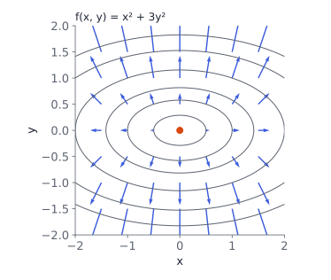

# Derivatives of one variable

## Why calculus?



Training a model means **minimizing a loss** $L(\boldsymbol\theta)$ over parameters $\boldsymbol\theta$. To know which way to move $\boldsymbol\theta$, we need the **gradient**: how $L$ changes when each parameter changes a little.

. . .

This chapter builds the tools:

- derivatives and **Taylor** approximations in one variable,
- **gradients** and **Jacobians** for many inputs and outputs,
- the **chain rule**, which becomes **backpropagation**,
- **Hessians** for curvature.

::: {.aside-note}
Book: §5.1–5.8.
:::

## Derivative and the basic rules

$$
f'(x)=\frac{df}{dx}=\lim_{h\to0}\frac{f(x+h)-f(x)}{h}
$$

is the slope of the tangent line: $f(x+h)\approx f(x)+f'(x)\,h$ for small $h$.

. . .

| Rule | Formula |
|---|---|
| sum | $(f+g)'=f'+g'$ |
| product | $(fg)'=f'g+fg'$ |
| quotient | $(f/g)'=(f'g-fg')/g^2$ |
| **chain** | $\big(g(f(x))\big)'=g'(f(x))\,f'(x)$ |

The chain rule is the one that matters most for machine learning.

## Taylor polynomials

Matching more derivatives at $x_0$ gives better local approximations:

$$
T_n(x)=\sum_{k=0}^{n}\frac{f^{(k)}(x_0)}{k!}\,(x-x_0)^k .
$$

. . .

**Example:** $f(x)=\sqrt x$ around $x_0=4$: $\;f(4)=2,\;f'(4)=\tfrac14,\;f''(4)=-\tfrac1{32}$.

$$
T_2(x)=2+\tfrac14(x-4)-\tfrac1{64}(x-4)^2,\qquad
T_2(4.1)=2.024844,\qquad \sqrt{4.1}=2.024846 .
$$

Three terms give six correct digits near the expansion point.

## Try it: Taylor approximation of sin {.scrollable}

```{ojs}
//| echo: false
viewof tn = Inputs.range([0, 12], {step: 1, value: 3, label: "degree n"})
viewof tx0 = Inputs.range([-3, 3], {step: 0.1, value: 0, label: "expansion point x₀"})
```

```{ojs}
//| echo: false
taylor = {
  const derivs = [Math.sin(tx0), Math.cos(tx0), -Math.sin(tx0), -Math.cos(tx0)];
  const T = x => {
    let s = 0, fact = 1;
    for (let k = 0; k <= tn; k++) {
      if (k > 0) fact *= k;
      s += derivs[k % 4] / fact * Math.pow(x - tx0, k);
    }
    return s;
  };
  return d3.range(-7, 7.01, 0.05).map(x => ({x, f: Math.sin(x), t: T(x)}));
}
Plot.plot({
  width: 620, height: 340, grid: true,
  x: {domain: [-7, 7], label: "x"}, y: {domain: [-2.5, 2.5], label: null},
  marks: [
    Plot.ruleY([0]),
    Plot.line(taylor, {x: "x", y: "f", stroke: "#3b5bdb", strokeWidth: 2.5}),
    Plot.line(taylor.filter(d => Math.abs(d.t) < 3), {x: "x", y: "t", stroke: "#d9480f", strokeWidth: 2, strokeDasharray: "6 4"}),
    Plot.dot([[tx0, Math.sin(tx0)]], {x: d => d[0], y: d => d[1], r: 5, fill: "#212529"})
  ]
})
html`<p style="font-size:0.75em">Blue: sin x. Orange dashed: its Taylor polynomial of degree ${tn} around x₀ = ${tx0}. Higher degree → good over a wider range.</p>`
```

# Many variables

## Partial derivatives and the gradient

For $f:\R^n\to\R$, the **partial derivative** $\partial f/\partial x_i$ varies $x_i$ and holds the others fixed. Collected in a row vector, they form the **gradient**:

$$
\nabla_{\vx}f=\frac{df}{d\vx}=\begin{pmatrix}\dfrac{\partial f}{\partial x_1}&\cdots&\dfrac{\partial f}{\partial x_n}\end{pmatrix}\in\R^{1\times n}.
$$

. . .

**Example:** $f(x,y)=x^2y+\sin(xy)$.

$$
\frac{\partial f}{\partial x}=2xy+y\cos(xy),\qquad
\frac{\partial f}{\partial y}=x^2+x\cos(xy),
$$

so at $(1,2)$: $\;\nabla f=\big(4+2\cos2,\;1+\cos2\big)\approx(3.168,\;0.584)$.

## The gradient points uphill

{width="46%"}

The gradient is **perpendicular to the contour lines** and points in the direction of **steepest increase**. Gradient descent (Chapter 7) steps the other way, $-\nabla f$.

## Jacobians

For a vector-valued $\boldsymbol f:\R^n\to\R^m$, stack the gradients of each output as rows: the **Jacobian** $J\in\R^{m\times n}$, $\;J_{ij}=\partial f_i/\partial x_j$.

. . .

**Example:** polar to Cartesian coordinates, $x=r\cos\theta$, $y=r\sin\theta$:

$$
J=\begin{pmatrix}\cos\theta&-r\sin\theta\\\sin\theta&r\cos\theta\end{pmatrix},\qquad \det J=r .
$$

$\abs{\det J}$ is the **local area scaling**: a small patch $dr\,d\theta$ becomes area $r\,dr\,d\theta$. At $r=2$, areas double. This is the change-of-variables factor used for probability densities (Chapter 6).

## Gradients with vectors and matrices

Some identities used constantly (gradients as row vectors):

| $f(\vx)$ | $df/d\vx$ |
|---|---|
| $\boldsymbol a^\top\vx$ | $\boldsymbol a^\top$ |
| $A\vx$ | $A$ |
| $\vx^\top A\vx$ | $\vx^\top(A+A^\top)$ |
| $\norm{\vx}^2$ | $2\vx^\top$ |

. . .

**Least squares**, $\;L(\boldsymbol\theta)=\norm{\boldsymbol y-X\boldsymbol\theta}^2$. Chain rule with $\boldsymbol e=\boldsymbol y-X\boldsymbol\theta$:

$$
\frac{dL}{d\boldsymbol\theta}=\frac{dL}{d\boldsymbol e}\frac{d\boldsymbol e}{d\boldsymbol\theta}=2\boldsymbol e^\top(-X)=-2(\boldsymbol y-X\boldsymbol\theta)^\top X .
$$

Setting it to zero gives the normal equations $X^\top X\boldsymbol\theta=X^\top\boldsymbol y$ from Chapter 3.

::: {.notes}
Gradients with respect to matrices are tensors in general; often it is easiest to reshape the matrix into a vector, or to compute one entry at a time.
:::

# Backpropagation

## The chain rule on a computation graph

A model is a chain of simple steps. For one neuron with a squared loss:

$$
z=wx+b,\qquad a=\sigma(z)=\frac1{1+e^{-z}},\qquad L=(a-y)^2 .
$$

. . .

The chain rule multiplies **local derivatives** along the path back from $L$:

$$
\frac{\partial L}{\partial w}=\underbrace{2(a-y)}_{\partial L/\partial a}\cdot\underbrace{a(1-a)}_{\partial a/\partial z}\cdot\underbrace{x}_{\partial z/\partial w},
\qquad
\frac{\partial L}{\partial b}=2(a-y)\cdot a(1-a)\cdot1 .
$$

The shared part $\partial L/\partial z$ is computed **once** and reused for every parameter.

## Backpropagation: worked numbers

$w=0.5,\;b=1,\;x=2,\;y=1$.

:::: {.columns}
::: {.column width="48%"}
**Forward pass**

$z=0.5\cdot2+1=2$

$a=\sigma(2)=0.8808$

$L=(0.8808-1)^2=0.01421$
:::
::: {.column width="52%"}
**Backward pass**

$\partial L/\partial a=2(a-y)=-0.2384$

$\partial L/\partial z=-0.2384\cdot0.1050=-0.02503$

$\partial L/\partial w=-0.02503\cdot2=-0.05006$

$\partial L/\partial b=-0.02503$
:::
::::

. . .

Both are negative: increasing $w$ and $b$ lowers the loss, which matches intuition (the output $0.88$ is below the target $1$).

## Automatic differentiation

**Autodiff** does exactly this mechanically for any program made of elementary operations:

- **Forward pass:** evaluate and store intermediate values.
- **Reverse mode** (= backpropagation): one backward sweep gives the gradient with respect to **all** inputs, at a cost of a small multiple of one forward pass.

. . .

Reverse mode is ideal when there are **many inputs and one output** (millions of parameters, one loss). Forward mode suits the opposite case.

It is not symbolic differentiation (no expression swell) and not finite differences (no rounding trade-off): derivatives are exact up to floating point.

# Curvature

## Hessian

The second derivatives of $f:\R^n\to\R$ form the **Hessian**, a symmetric $n\times n$ matrix (for smooth $f$):

$$
H_{ij}=\frac{\partial^2 f}{\partial x_i\,\partial x_j}.
$$

. . .

**Example:** $f(x,y)=x^3+xy^2-2y$. Then $f_x=3x^2+y^2$, $f_y=2xy-2$, and

$$
H(x,y)=\begin{pmatrix}6x&2y\\2y&2x\end{pmatrix},\qquad
H(1,1)=\begin{pmatrix}6&2\\2&2\end{pmatrix},\quad\lambda\approx1.17,\;6.83 .
$$

Both eigenvalues positive: near $(1,1)$ the function curves **upward in every direction**. The eigenvalues of the Hessian are what decide between a minimum, maximum and saddle at a critical point.

## Multivariate Taylor and linearization

Around $\vx_0$, with $\boldsymbol\delta=\vx-\vx_0$:

$$
f(\vx)\approx f(\vx_0)+\nabla f(\vx_0)\,\boldsymbol\delta+\tfrac12\,\boldsymbol\delta^\top H(\vx_0)\,\boldsymbol\delta .
$$

. . .

- The **first-order** part is the **linearization** (tangent plane). Gradient descent uses only this.
- The **second-order** part adds curvature. **Newton's method** minimizes this quadratic model exactly: $\boldsymbol\delta=-H^{-1}\nabla f^\top$.
- The same linearization of a nonlinear map $\boldsymbol f$ uses its Jacobian: $\boldsymbol f(\vx)\approx\boldsymbol f(\vx_0)+J\boldsymbol\delta$.

## In Python

```python
import numpy as np

f = lambda v: v[0]**2 * v[1] + np.sin(v[0] * v[1])
def num_grad(f, x, h=1e-6):                    # central differences, to check by hand
    return np.array([(f(x + h*e) - f(x - h*e)) / (2*h) for e in np.eye(len(x))])
num_grad(f, np.array([1.0, 2.0]))              # [3.1677, 0.5839]

# autodiff with PyTorch: the backprop example
import torch
w = torch.tensor(0.5, requires_grad=True); b = torch.tensor(1.0, requires_grad=True)
L = (torch.sigmoid(w * 2 + b) - 1) ** 2
L.backward()
w.grad, b.grad                                 # (-0.0501, -0.0250)
```

## Recap

1. The **derivative** is the local slope; **Taylor** polynomials add curvature terms.
2. The **gradient** collects partial derivatives; it points uphill, perpendicular to contours.
3. The **Jacobian** does the same for vector outputs; $\abs{\det J}$ is local volume scaling.
4. The **chain rule** composes local derivatives; **backpropagation** applies it from the loss backward, reusing shared factors.
5. **Reverse-mode autodiff** gets all gradients for about the cost of one forward pass.
6. The **Hessian** measures curvature; second-order Taylor underlies Newton's method.

::: {.aside-note}
Study notes following *Mathematics for Machine Learning* (Deisenroth, Faisal, Ong; Cambridge University Press, 2020), Chapter 5. All examples and figures are original. Read the chapter at [mml-book.github.io](https://mml-book.github.io/).
:::
