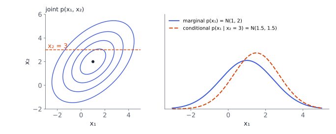

# Foundations

## Why probability?



Data are noisy, models are uncertain, and predictions should say **how sure** they are. Probability is the language for this.

- A **probability space** $(\Omega,\mathcal A,P)$: outcomes $\Omega$, events $\mathcal A$ (subsets we may ask about), and a measure $P$ with $P(\Omega)=1$.
- A **random variable** $X:\Omega\to\mathcal T$ turns outcomes into numbers we care about. We usually work only with its **distribution**.

. . .

Two readings of probability: **frequentist** (long-run frequency of repeatable events) and **Bayesian** (degree of belief, updated by data). The mathematics is the same.

::: {.aside-note}
Book: §6.1–6.7.
:::

## Discrete and continuous

:::: {.columns}
::: {.column width="50%"}
**Discrete** $X$: a **probability mass function**

$$
p(x)=P(X=x),\qquad\sum_x p(x)=1 .
$$

Example: a fair die, $p(x)=\tfrac16$.
:::
::: {.column width="50%"}
**Continuous** $X$: a **probability density**

$$
P(a\le X\le b)=\int_a^b p(x)\,dx,\quad\int p=1 .
$$

A density can exceed $1$; only its integral is a probability.
:::
::::

. . .

The **cumulative distribution function** $F(x)=P(X\le x)$ works for both. For several variables we have a **joint** distribution $p(x,y)$.

# Rules

## Sum rule, product rule, Bayes' theorem

$$
\text{sum rule:}\quad p(x)=\sum_y p(x,y)\ \Big(\text{or }\int p(x,y)\,dy\Big)\qquad\text{(marginalization)}
$$

$$
\text{product rule:}\quad p(x,y)=p(y\mid x)\,p(x)
$$

. . .

Writing the product rule both ways and dividing gives **Bayes' theorem**:

$$
\underbrace{p(\theta\mid\mathcal D)}_{\text{posterior}}=\frac{\overbrace{p(\mathcal D\mid\theta)}^{\text{likelihood}}\;\overbrace{p(\theta)}^{\text{prior}}}{\underbrace{p(\mathcal D)}_{\text{evidence}}},
\qquad p(\mathcal D)=\int p(\mathcal D\mid\theta)\,p(\theta)\,d\theta .
$$

## Bayes in numbers: a screening test

A condition affects $1\%$ of people. A test detects it $95\%$ of the time, and gives a false positive $5\%$ of the time. Someone tests positive.

. . .

$$
P(+)=0.95\cdot0.01+0.05\cdot0.99=0.0095+0.0495=0.059
$$

$$
P(\text{condition}\mid+)=\frac{0.0095}{0.059}\approx0.161 .
$$

. . .

Only about **16%**. The prior (rarity) matters: most positives come from the large healthy group. Forgetting the prior is the **base-rate fallacy**.

## Summary statistics

$$
\mathbb E[X]=\sum_x x\,p(x)\ \text{or}\int x\,p(x)\,dx,\qquad
\operatorname{Cov}[\vx]=\mathbb E\big[(\vx-\boldsymbol\mu)(\vx-\boldsymbol\mu)^\top\big].
$$

The covariance matrix is symmetric positive semidefinite. **Correlation** rescales covariance to $[-1,1]$.

. . .

**Empirical** versions from data points $\vx_1,\dots,\vx_N$: rows $(2,1),(4,3),(6,8)$ give

$$
\bar{\vx}=(4,4),\qquad
\Sigma=\frac1N\sum_n(\vx_n-\bar{\vx})(\vx_n-\bar{\vx})^\top=\begin{pmatrix}2.67&4.67\\4.67&8.67\end{pmatrix}.
$$

Useful rules: $\mathbb E[A\vx+\vb]=A\boldsymbol\mu+\vb$, $\;\operatorname{Cov}[A\vx+\vb]=A\Sigma A^\top$.

## Independence

$X$ and $Y$ are **independent** if $p(x,y)=p(x)\,p(y)$. Then $\operatorname{Cov}[X,Y]=0$ and $\operatorname{Var}[X+Y]=\operatorname{Var}[X]+\operatorname{Var}[Y]$.

. . .

The converse fails: let $X$ be uniform on $\{-1,0,1\}$ and $Y=X^2$. Then

$$
\operatorname{Cov}[X,Y]=\mathbb E[X^3]-\mathbb E[X]\,\mathbb E[X^2]=0-0=0,
$$

yet $Y$ is completely determined by $X$. Zero covariance only rules out **linear** dependence.

. . .

**Conditional independence** $X\perp Y\mid Z$: once $Z$ is known, $Y$ adds nothing about $X$. Much of probabilistic modelling (Chapter 8) is about stating such assumptions.

# The Gaussian

## Gaussian distribution

$$
\mathcal N(\vx\mid\boldsymbol\mu,\Sigma)=\frac{1}{\sqrt{(2\pi)^D\det\Sigma}}\exp\!\Big(-\tfrac12(\vx-\boldsymbol\mu)^\top\Sigma^{-1}(\vx-\boldsymbol\mu)\Big).
$$

Why it is everywhere: the central limit theorem, maximum entropy for a given mean and covariance, and **closed-form** answers for every operation below.

. . .

- **Linear maps:** $A\vx+\vb\sim\mathcal N(A\boldsymbol\mu+\vb,\;A\Sigma A^\top)$.
- **Sums** of independent Gaussians: add the means and the covariances.
- **Product** of two Gaussian densities: an (unnormalized) Gaussian.
- **Sampling:** $\boldsymbol\mu+L\boldsymbol z$ with $\Sigma=LL^\top$ (Cholesky, Chapter 4) and $\boldsymbol z\sim\mathcal N(\vzero,I)$.

## Marginals and conditionals stay Gaussian

Split $\vx=(\vx_a,\vx_b)$. The marginal $p(\vx_a)=\mathcal N(\boldsymbol\mu_a,\Sigma_{aa})$, and the conditional is

$$
p(\vx_a\mid\vx_b)=\mathcal N\big(\boldsymbol\mu_a+\Sigma_{ab}\Sigma_{bb}^{-1}(\vx_b-\boldsymbol\mu_b),\;\Sigma_{aa}-\Sigma_{ab}\Sigma_{bb}^{-1}\Sigma_{ba}\big).
$$

. . .

**Example:** $\boldsymbol\mu=(1,2)$, $\Sigma=\begin{pmatrix}2&1\\1&2\end{pmatrix}$, observe $x_2=3$: mean $1+\tfrac12(3-2)=1.5$, variance $2-\tfrac12=1.5$.

## Conditioning in a picture

{width="80%"}
Observing $x_2$ **shifts** the belief about $x_1$ (they are correlated) and **narrows** it.

# Conjugacy and transformations

## Conjugate priors: Beta–Bernoulli

A prior is **conjugate** to a likelihood if the posterior has the same form as the prior: the update is just arithmetic on parameters.

. . .

Coin with unknown heads-probability $\mu$. Prior $\operatorname{Beta}(\alpha,\beta)\propto\mu^{\alpha-1}(1-\mu)^{\beta-1}$. After $h$ heads and $t$ tails (Bernoulli likelihood $\mu^h(1-\mu)^t$):

$$
p(\mu\mid\mathcal D)=\operatorname{Beta}(\alpha+h,\;\beta+t).
$$

. . .

**Example:** prior $\operatorname{Beta}(2,2)$, then $7$ heads and $3$ tails → $\operatorname{Beta}(9,5)$, posterior mean $9/14\approx0.64$. The plain frequency $7/10$ is pulled slightly toward the prior's $0.5$.

## Try it: updating a Beta prior {.scrollable}

```{ojs}
//| echo: false
viewof pa = Inputs.range([0.5, 10], {step: 0.5, value: 2, label: "prior α"})
viewof pb = Inputs.range([0.5, 10], {step: 0.5, value: 2, label: "prior β"})
viewof nh = Inputs.range([0, 50], {step: 1, value: 7, label: "heads h"})
viewof nt = Inputs.range([0, 50], {step: 1, value: 3, label: "tails t"})
```

```{ojs}
//| echo: false
beta = {
  const grid = d3.range(0.0025, 1, 0.005);
  const dens = (a, b) => {
    const logu = grid.map(m => (a - 1) * Math.log(m) + (b - 1) * Math.log(1 - m));
    const mx = Math.max(...logu), u = logu.map(l => Math.exp(l - mx));
    const z = d3.sum(u) * 0.005;
    return u.map(v => v / z);
  };
  const p = dens(pa, pb), q = dens(pa + nh, pb + nt);
  return grid.flatMap((m, i) => [{m, d: p[i], which: "prior"}, {m, d: q[i], which: "posterior"}]);
}
Plot.plot({
  width: 620, height: 320, grid: true,
  x: {label: "μ (probability of heads)", domain: [0, 1]}, y: {label: "density"},
  color: {domain: ["prior", "posterior"], range: ["#9aa1ae", "#3b5bdb"], legend: true},
  marks: [Plot.line(beta, {x: "m", y: "d", stroke: "which", strokeWidth: 2.5})]
})
html`<p style="font-size:0.75em">Posterior = Beta(${pa + nh}, ${pb + nt}) · mean ${((pa + nh) / (pa + pb + nh + nt)).toFixed(3)} · data frequency ${nh + nt > 0 ? (nh / (nh + nt)).toFixed(3) : "–"}</p>`
```

More data → narrower posterior, and the prior matters less.

## The exponential family

Many common distributions share one form:

$$
p(x\mid\boldsymbol\theta)=h(x)\exp\big(\langle\boldsymbol\theta,\boldsymbol\phi(x)\rangle-A(\boldsymbol\theta)\big),
$$

with **sufficient statistics** $\boldsymbol\phi(x)$ and log-partition function $A$.

. . .

**Bernoulli** in this form: $\;\mu^x(1-\mu)^{1-x}=\exp\!\big(x\log\tfrac{\mu}{1-\mu}+\log(1-\mu)\big)$, so $\phi(x)=x$ and the natural parameter is the **log-odds** $\theta=\log\frac{\mu}{1-\mu}$. Its inverse is the sigmoid, which is where logistic regression comes from.

. . .

Every exponential family has a conjugate prior, and the data enter only through $\sum_n\boldsymbol\phi(x_n)$: a fixed-size summary, however much data there is.

## Change of variables

If $Y=g(X)$ with $g$ invertible and differentiable:

$$
p_Y(y)=p_X\big(g^{-1}(y)\big)\,\left|\frac{d\,g^{-1}(y)}{dy}\right| ,
$$

and in several dimensions the factor is $\abs{\det J}$ of the inverse map (Chapter 5).

. . .

**Inverse transform sampling** uses this backwards: if $U\sim\operatorname{Uniform}(0,1)$, then $F^{-1}(U)$ has CDF $F$.

**Example:** exponential, $F(x)=1-e^{-\lambda x}$ $\Rightarrow$ $x=-\ln(1-u)/\lambda$. With $\lambda=2$, $u=0.5$: $x=\ln2/2\approx0.347$ (the median).

## In Python

```python
import numpy as np
from scipy import stats

0.95 * 0.01 / (0.95 * 0.01 + 0.05 * 0.99)      # 0.161: Bayes, screening test

X = np.array([[2, 1], [4, 3], [6, 8]], dtype=float)
X.mean(axis=0), np.cov(X.T, bias=True)        # (4, 4), [[2.67, 4.67], [4.67, 8.67]]

post = stats.beta(2 + 7, 2 + 3); post.mean()  # 0.643

rng = np.random.default_rng(0)
L = np.linalg.cholesky([[2, 1], [1, 2]])
samples = np.array([1, 2]) + rng.standard_normal((10000, 2)) @ L.T
np.cov(samples.T)                             # close to [[2, 1], [1, 2]]

u = rng.uniform(size=10000); x = -np.log(1 - u) / 2   # exponential(λ = 2)
np.median(x)                                  # ≈ 0.347
```

## Recap

1. Random variables have **pmfs** (discrete) or **densities** (continuous).
2. **Sum rule** marginalizes, **product rule** factorizes; together they give **Bayes' theorem**. Mind the prior.
3. Mean and **covariance** summarize; zero covariance does not mean independence.
4. **Gaussians** stay Gaussian under linear maps, marginalization and conditioning.
5. **Conjugate priors** turn Bayesian updates into parameter arithmetic; the **exponential family** unifies common distributions.
6. **Change of variables** multiplies by $\abs{\det J}$; inverse transform sampling uses $F^{-1}$.

::: {.aside-note}
Study notes following *Mathematics for Machine Learning* (Deisenroth, Faisal, Ong; Cambridge University Press, 2020), Chapter 6. All examples and figures are original. Read the chapter at [mml-book.github.io](https://mml-book.github.io/).
:::
