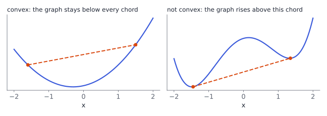

# Gradient descent

## Training is optimization



Fitting a model means finding

$$
\boldsymbol\theta^*=\arg\min_{\boldsymbol\theta}\;L(\boldsymbol\theta),
$$

usually with no closed-form answer. We start somewhere and **improve step by step**, using the gradient from Chapter 5.

. . .

Two big questions:

- **Unconstrained:** how to step (gradient descent, step size, momentum, stochastic gradients).
- **Constrained:** how to respect conditions like $g(\boldsymbol\theta)\le0$ (Lagrange multipliers), and when we can trust the answer is the global optimum (**convexity**).

::: {.aside-note}
Book: §7.1–7.3.
:::

## The gradient descent step

$$
\vx_{k+1}=\vx_k-\gamma\,\big(\nabla f(\vx_k)\big)^\top
$$

with **step size** (learning rate) $\gamma>0$. For small enough $\gamma$, each step lowers $f$ unless $\nabla f(\vx_k)=\vzero$.

. . .

**Example:** $f(\vx)=\tfrac12\vx^\top Q\vx$ with $Q=\operatorname{diag}(1,10)$, so $\nabla f^\top=Q\vx$ and

$$
\vx_{k+1}=(I-\gamma Q)\,\vx_k:\qquad x_{k+1}=(1-\gamma)\,x_k,\quad y_{k+1}=(1-10\gamma)\,y_k .
$$

- Both factors must satisfy $\abs{\cdot}<1$: stable only for $\gamma<2/10=0.2$.
- But then $x$ shrinks by at most $0.8$ per step: slow along the flat direction.

The **condition number** $\kappa=\lambda_{\max}/\lambda_{\min}=10$ measures this tension.

## Try it: step size and conditioning {.scrollable}

```{ojs}
//| echo: false
viewof gamma = Inputs.range([0.01, 0.25], {step: 0.005, value: 0.15, label: "step size γ"})
viewof kappa = Inputs.range([1, 20], {step: 1, value: 10, label: "curvature in y (κ)"})
viewof steps = Inputs.range([1, 60], {step: 1, value: 25, label: "steps"})
```

```{ojs}
//| echo: false
gd = {
  let x = -4, y = 1.5;
  const path = [{k: 0, x, y}];
  for (let k = 1; k <= steps; k++) {
    x = x - gamma * x; y = y - gamma * kappa * y;
    if (Math.abs(y) > 50) break;
    path.push({k, x, y});
  }
  return path;
}
contours = [0.5, 2, 4.5, 8].flatMap((c, i) => d3.range(0, 2 * Math.PI + 0.01, 0.04).map(t => ({
  x: Math.sqrt(2 * c) * Math.cos(t), y: Math.sqrt(2 * c / kappa) * Math.sin(t), c: i})))
Plot.plot({
  width: 620, height: 340, grid: true,
  x: {domain: [-4.5, 4.5], label: "x"}, y: {domain: [-2.5, 2.5], label: "y"},
  marks: [
    Plot.line(contours, {x: "x", y: "y", z: "c", stroke: "#ced4da"}),
    Plot.line(gd, {x: "x", y: "y", stroke: "#d9480f", strokeWidth: 2}),
    Plot.dot(gd, {x: "x", y: "y", r: 3, fill: "#d9480f"}),
    Plot.dot([[0, 0]], {x: d => d[0], y: d => d[1], r: 5, fill: "#212529"})
  ]
})
html`<p style="font-size:0.75em">f(x, y) = ½(x² + κy²). Stable if γ < 2/κ = ${(2 / kappa).toFixed(3)}.
${gd.length <= steps ? "<b>Diverged!</b>" : `After ${steps} steps: f = ${(0.5 * (gd.at(-1).x ** 2 + kappa * gd.at(-1).y ** 2)).toExponential(2)}`}</p>`
```

Push $\gamma$ above $2/\kappa$ and the iterates zig-zag outward.

## Choosing the step size, and momentum

- **Too small:** many tiny steps. **Too large:** overshoot, oscillation, divergence.
- Practical rules: shrink $\gamma$ when $f$ goes up, grow it when steps keep succeeding; **line search**; decaying schedules.

. . .

**Momentum** remembers the previous step:

$$
\vx_{k+1}=\vx_k-\gamma\,\nabla f(\vx_k)^\top+\alpha\,\Delta\vx_k,\qquad \Delta\vx_k=\vx_k-\vx_{k-1},\quad\alpha\in[0,1).
$$

Oscillations across a narrow valley cancel; steady progress along it accumulates. Like a heavy ball rolling downhill.

## Stochastic gradient descent

ML losses are sums over data: $L(\boldsymbol\theta)=\sum_{n=1}^{N}L_n(\boldsymbol\theta)$. The full gradient costs a pass over all $N$ points.

. . .

**SGD:** estimate the gradient from a random **mini-batch** $\mathcal B$:

$$
\boldsymbol\theta_{k+1}=\boldsymbol\theta_k-\gamma_k\,\frac{N}{\abs{\mathcal B}}\sum_{n\in\mathcal B}\nabla L_n(\boldsymbol\theta_k)^\top .
$$

- The estimate is **unbiased**: its expectation is the true gradient.
- Cheap, noisy steps; with a decreasing $\gamma_k$ it still converges (for suitable problems).
- The noise can even help escape poor local minima. Mini-batches also use GPUs well.

# Constraints

## Lagrange multipliers

$$
\min_{\vx}f(\vx)\quad\text{subject to}\quad g_i(\vx)\le0,\ \ i=1,\dots,m .
$$

Build the **Lagrangian** by adding the constraints with multipliers $\lambda_i\ge0$:

$$
\mathfrak L(\vx,\boldsymbol\lambda)=f(\vx)+\sum_i\lambda_i\,g_i(\vx).
$$

. . .

**Equality example:** $\min x^2+y^2$ s.t. $x+2y=5$ (closest point to the origin on a line). For an equality, $\lambda$ may have any sign:

$$
\frac{\partial\mathfrak L}{\partial x}=2x+\lambda=0,\quad \frac{\partial\mathfrak L}{\partial y}=2y+2\lambda=0
\ \Rightarrow\ x=-\tfrac\lambda2,\ y=-\lambda .
$$

The constraint gives $-\tfrac52\lambda=5$, so $\lambda=-2$, $(x,y)=(1,2)$, value $5$. At the optimum $\nabla f$ is parallel to the constraint's normal $(1,2)$.

## Duality

The **dual function** $\mathcal D(\boldsymbol\lambda)=\min_{\vx}\mathfrak L(\vx,\boldsymbol\lambda)$ is always a **lower bound** on the optimum (weak duality). The **dual problem** maximizes it.

. . .

For the example: plugging $x=-\lambda/2$, $y=-\lambda$ into $\mathfrak L$,

$$
\mathcal D(\lambda)=-\tfrac54\lambda^2-5\lambda,\qquad \max_\lambda\mathcal D=\mathcal D(-2)=5 .
$$

The dual optimum equals the primal optimum $5$: **strong duality**. This holds for convex problems under mild conditions.

. . .

Why care: the dual can be easier (fewer variables, simpler constraints). Support vector machines (Chapter 12) are usually solved through their dual.

# Convex optimization

## Convex sets and functions

$f$ is **convex** if every chord lies on or above the graph:

$$
f(\theta\vx+(1-\theta)\boldsymbol y)\le\theta f(\vx)+(1-\theta)f(\boldsymbol y),\qquad\theta\in[0,1].
$$

{width="62%"}

**Key fact:** for a convex problem, every local minimum is a **global** minimum. Tests: $f''\ge0$ in 1D; Hessian positive semidefinite in general.

## Linear programming

Linear objective, linear constraints:

$$
\max_{x,y}\;3x+2y\quad\text{s.t.}\quad x+y\le4,\ \ x\le3,\ \ x,y\ge0 .
$$

. . .

The feasible set is a polygon, and a linear objective is maximized at a **vertex**:

| vertex | $(0,0)$ | $(3,0)$ | $(3,1)$ | $(0,4)$ |
|---|---|---|---|---|
| $3x+2y$ | $0$ | $9$ | $\mathbf{11}$ | $8$ |

Optimum $(3,1)$ with value $11$. Large LPs are solved with the simplex or interior-point methods.

## Quadratic programs and convex conjugates

**Quadratic program:** convex quadratic objective, linear constraints,

$$
\min_{\vx}\ \tfrac12\vx^\top Q\vx+\boldsymbol c^\top\vx\quad\text{s.t.}\quad A\vx\le\vb,\qquad Q\text{ positive semidefinite}.
$$

Least squares with constraints and the SVM are QPs.

. . .

**Convex conjugate** (Legendre–Fenchel transform):

$$
f^*(\boldsymbol s)=\sup_{\vx}\big(\langle\boldsymbol s,\vx\rangle-f(\vx)\big).
$$

Example: $f(x)=\tfrac12x^2$ gives $f^*(s)=\tfrac12s^2$ (the sup is at $x=s$). Conjugates describe a convex function by its supporting lines, and they are the systematic way to derive dual problems.

## In Python

```python
import numpy as np
from scipy.optimize import minimize, linprog

Q = np.diag([1.0, 10.0]); x = np.array([-4.0, 1.5])
for _ in range(100):
    x = x - 0.15 * (Q @ x)                     # gradient descent, γ = 0.15 < 0.2
x                                              # close to [0, 0]

cons = {"type": "eq", "fun": lambda v: v[0] + 2 * v[1] - 5}
minimize(lambda v: v @ v, x0=[0, 0], constraints=[cons]).x   # [1, 2]

res = linprog(c=[-3, -2], A_ub=[[1, 1], [1, 0]], b_ub=[4, 3])  # linprog minimizes
res.x, -res.fun                                # [3, 1], 11
```

## Recap

1. **Gradient descent** steps against the gradient; the step size must respect the curvature ($\gamma<2/\lambda_{\max}$ for quadratics).
2. Ill-conditioning ($\kappa$ large) causes zig-zagging; **momentum** helps.
3. **SGD** uses cheap, unbiased mini-batch gradient estimates.
4. **Lagrange multipliers** handle constraints; the **dual** gives a lower bound, tight under strong duality.
5. **Convex** problems have no bad local minima. **LPs** are solved at vertices; **QPs** cover least squares and SVMs.

::: {.aside-note}
Study notes following *Mathematics for Machine Learning* (Deisenroth, Faisal, Ong; Cambridge University Press, 2020), Chapter 7. All examples and figures are original. Read the chapter at [mml-book.github.io](https://mml-book.github.io/).
:::
