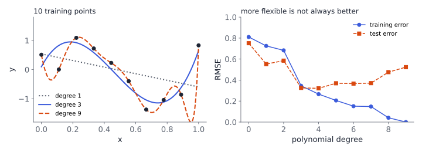

# Data, models and learning

## From mathematics to machine learning



Part I built the tools. Part II uses them on four central problems: **regression** (Ch. 9), **dimensionality reduction** (Ch. 10), **density estimation** (Ch. 11) and **classification** (Ch. 12).

. . .

This chapter sets up the common framework. Every method has three parts:

- **Data:** examples $\vx_n\in\R^D$ (feature vectors), often with labels $y_n$.
- **Model:** a function $f(\vx,\boldsymbol\theta)$, or a distribution $p(\vx\mid\boldsymbol\theta)$.
- **Learning:** choosing $\boldsymbol\theta$ so the model does well on **new** data, not just the data it saw.

::: {.aside-note}
Book: §8.1–8.6.
:::

## Two views of a model

:::: {.columns}
::: {.column width="50%"}
**As a function** (predictor)

$$
f:\R^D\to\R,\qquad \hat y=f(\vx,\boldsymbol\theta)
$$

e.g. linear: $f(\vx,\boldsymbol\theta)=\boldsymbol\theta^\top\vx+\theta_0$.

Learning = **optimization** of a loss (§8.2).
:::
::: {.column width="50%"}
**As a probability model**

$$
p(y\mid\vx,\boldsymbol\theta)
$$

e.g. $y=f(\vx,\boldsymbol\theta)+\varepsilon$, $\;\varepsilon\sim\mathcal N(0,\sigma^2)$.

Learning = **estimation** or **inference** (§8.3–8.4); it also expresses uncertainty.
:::
::::

. . .

The two views often lead to the **same** computation, as we will see: squared loss ↔ Gaussian noise, regularization ↔ prior.

# Empirical risk minimization

## Loss and empirical risk

Choose a **hypothesis class** (say, all linear functions) and a **loss** $\ell(y,\hat y)\ge0$ measuring how wrong a prediction is. Then minimize the average loss on the $N$ training examples:

$$
\mathbf R_{\text{emp}}(\boldsymbol\theta)=\frac1N\sum_{n=1}^{N}\ell\big(y_n,f(\vx_n,\boldsymbol\theta)\big).
$$

. . .

| Loss | $\ell(y,\hat y)$ | used for |
|---|---|---|
| squared | $(y-\hat y)^2$ | regression (least squares, Ch. 9) |
| absolute | $\abs{y-\hat y}$ | regression robust to outliers |
| hinge | $\max(0,\,1-y\hat y)$ | classification, $y\in\{\pm1\}$ (SVM, Ch. 12) |

What we really want is a small **expected** risk on unseen data. The training average is only an estimate of it.

## Overfitting

{width="86%"}

A degree-9 polynomial passes through all 10 training points (training error $0$), but its **test** error is worse than the degree-3 fit. It has learned the noise.

## Regularization and cross-validation

**Regularization** penalizes complex parameters:

$$
\min_{\boldsymbol\theta}\ \frac1N\sum_n\ell\big(y_n,f(\vx_n,\boldsymbol\theta)\big)+\lambda\norm{\boldsymbol\theta}_2^2 .
$$

Larger $\lambda$ → smoother model. $\lambda$ is a **hyperparameter**: it is not learned from the training loss.

. . .

**Cross-validation** chooses hyperparameters using held-out data:

1. Split the data into $K$ parts (folds).
2. For each fold: train on the other $K-1$, measure the error on this one.
3. Average the $K$ errors; pick the hyperparameter with the lowest average.

A final **test set**, never touched during these choices, reports the honest performance.

## Try it: degree, regularization and test error {.scrollable}

```{ojs}
//| echo: false
viewof deg = Inputs.range([0, 9], {step: 1, value: 9, label: "polynomial degree"})
viewof loglam = Inputs.range([-8, 1], {step: 0.25, value: -8, label: "log₁₀ λ"})
```

```{ojs}
//| echo: false
trX = [0, 0.111, 0.222, 0.333, 0.444, 0.556, 0.667, 0.778, 0.889, 1]
trY = [0.51, 0.004, 1.089, 0.724, 0.229, -0.396, -1.371, -1.043, -0.859, 0.831]
teX = [0.391, 0.517, 0.431, 0.587, 0.738, 0.956, 0.284, 0.649, 0.696, 0.293, 0.001, 0.973, 0.298, 0.314, 0.892, 0.585, 0.471, 0.773, 0.03, 0.707, 0.374, 0.091, 0.661, 0.931, 0.207, 0.63, 0.298, 0.742, 0.722, 0.219, 0.83, 0.658, 0.683, 0.82, 0.429, 0.759, 0.878, 0.102, 0.85, 0.394]
teY = [0.192, 0.058, 0.419, -0.237, -1.014, -0.477, 1.066, -0.944, -0.989, 0.975, -0.024, -0.213, 0.746, 0.873, -1.164, -0.549, -0.12, -0.709, 0.507, -1.451, 0.747, 0.509, -1.108, -0.285, 0.849, -1.171, 0.888, -1.036, -0.958, 0.673, -0.723, -0.652, -1.199, -1.069, 0.414, -1.14, -0.256, 0.652, -1.063, 0.421]
fit = {
  const lam = Math.pow(10, loglam), p = deg + 1;
  const feat = x => d3.range(p).map(k => Math.pow(2 * x - 1, k));
  const A = d3.range(p).map(i => d3.range(p).map(j => (i === j ? lam : 0) + d3.sum(trX, x => feat(x)[i] * feat(x)[j])));
  const b = d3.range(p).map(i => d3.sum(trX, (x, n) => feat(x)[i] * trY[n]));
  for (let c = 0; c < p; c++) {                      // Gaussian elimination with partial pivoting
    let piv = c; for (let r = c + 1; r < p; r++) if (Math.abs(A[r][c]) > Math.abs(A[piv][c])) piv = r;
    [A[c], A[piv]] = [A[piv], A[c]]; [b[c], b[piv]] = [b[piv], b[c]];
    for (let r = c + 1; r < p; r++) { const f = A[r][c] / A[c][c]; for (let k = c; k < p; k++) A[r][k] -= f * A[c][k]; b[r] -= f * b[c]; }
  }
  const w = Array(p).fill(0);
  for (let r = p - 1; r >= 0; r--) w[r] = (b[r] - d3.sum(d3.range(r + 1, p), k => A[r][k] * w[k])) / A[r][r];
  const f = x => d3.sum(feat(x), (v, k) => v * w[k]);
  const rmse = (X, Y) => Math.sqrt(d3.mean(X, (x, n) => (f(x) - Y[n]) ** 2));
  return {f, train: rmse(trX, trY), test: rmse(teX, teY)};
}
Plot.plot({
  width: 620, height: 320, grid: true,
  x: {domain: [0, 1], label: "x"}, y: {domain: [-2, 2], label: "y"},
  marks: [
    Plot.dot(teX.map((x, i) => [x, teY[i]]), {x: d => d[0], y: d => d[1], r: 2.5, fill: "#9aa1ae"}),
    Plot.line(d3.range(0, 1.0001, 0.004).map(x => [x, Math.max(-3, Math.min(3, fit.f(x)))]), {x: d => d[0], y: d => d[1], stroke: "#d9480f", strokeWidth: 2.5, clip: true}),
    Plot.dot(trX.map((x, i) => [x, trY[i]]), {x: d => d[0], y: d => d[1], r: 5, fill: "#212529"})
  ]
})
html`<p style="font-size:0.75em">Black: 10 training points. Grey: test points the fit never sees.<br>
training RMSE = <b>${fit.train.toFixed(3)}</b> · test RMSE = <b>${fit.test.toFixed(3)}</b></p>`
```

Start at degree 9 with tiny λ, then raise λ: training error goes up, test error goes down.

# Parameter estimation

## Maximum likelihood

Treat the data as samples from $p(\vx\mid\boldsymbol\theta)$ and choose the $\boldsymbol\theta$ that makes them most probable. With independent examples, minimize the **negative log-likelihood**:

$$
\mathcal L(\boldsymbol\theta)=-\log p(\mathcal X\mid\boldsymbol\theta)=-\sum_{n=1}^{N}\log p(\vx_n\mid\boldsymbol\theta).
$$

. . .

**Coin:** $7$ heads in $10$ tosses. $\;\mathcal L(\mu)=-7\log\mu-3\log(1-\mu)$, and $\mathcal L'(\mu)=0$ gives $\mu_{\text{ML}}=0.7$.

**Gaussian:** for data $2,4,6,8$, the MLE is the sample mean and the **average** squared deviation:

$$
\mu_{\text{ML}}=5,\qquad \sigma^2_{\text{ML}}=\tfrac14(9+1+1+9)=5 .
$$

::: {.notes}
Dividing by N makes the ML variance slightly too small on average; dividing by N - 1 removes that bias.
:::

## Likelihood and loss are the same thing

For regression with Gaussian noise, $y_n=f(\vx_n,\boldsymbol\theta)+\varepsilon$, $\;\varepsilon\sim\mathcal N(0,\sigma^2)$:

$$
-\log p(\boldsymbol y\mid X,\boldsymbol\theta)=\frac1{2\sigma^2}\sum_n\big(y_n-f(\vx_n,\boldsymbol\theta)\big)^2+\text{const}.
$$

**Maximum likelihood = least squares.** Other noise models give other losses (Laplace noise → absolute loss).

. . .

The danger is the same too: with a flexible model, maximum likelihood **overfits**, because it fits the training data as closely as it can.

## MAP estimation

Put a **prior** $p(\boldsymbol\theta)$ on the parameters and maximize the posterior (Bayes' theorem, Ch. 6):

$$
\boldsymbol\theta_{\text{MAP}}=\arg\min_{\boldsymbol\theta}\ \big[-\log p(\mathcal X\mid\boldsymbol\theta)-\log p(\boldsymbol\theta)\big].
$$

. . .

**Coin again**, with prior $\operatorname{Beta}(2,2)$ (mild belief in fairness): the posterior is $\operatorname{Beta}(9,5)$, whose peak is

$$
\mu_{\text{MAP}}=\frac{9-1}{9+5-2}=\frac{8}{12}\approx0.667 ,
$$

between the data's $0.7$ and the prior's $0.5$.

. . .

**Gaussian prior** $\boldsymbol\theta\sim\mathcal N(\vzero,\sigma_p^2I)$ adds $\tfrac1{2\sigma_p^2}\norm{\boldsymbol\theta}^2$ to the loss: **MAP = $L_2$ regularization**, with $\lambda$ set by how wide the prior is.

# Probabilistic modelling

## Inference instead of a single estimate

ML and MAP pick **one** $\boldsymbol\theta$. Bayesian inference keeps the **whole posterior** and averages over it when predicting:

$$
p(\boldsymbol\theta\mid\mathcal X)=\frac{p(\mathcal X\mid\boldsymbol\theta)\,p(\boldsymbol\theta)}{p(\mathcal X)},\qquad
p(\vx^*\mid\mathcal X)=\int p(\vx^*\mid\boldsymbol\theta)\,p(\boldsymbol\theta\mid\mathcal X)\,d\boldsymbol\theta .
$$

. . .

- Predictions come with **uncertainty**, which is larger where data are scarce.
- The integrals are only tractable for special pairs (conjugate priors, Gaussians); otherwise we use approximations (sampling, variational methods).

. . .

**Latent variables** $\boldsymbol z$ are unobserved quantities in the model, such as which cluster a point belongs to. We marginalize them: $p(\vx\mid\boldsymbol\theta)=\int p(\vx\mid\boldsymbol z,\boldsymbol\theta)\,p(\boldsymbol z)\,d\boldsymbol z$. PCA (Ch. 10) and mixture models (Ch. 11) are both of this kind.

## Directed graphical models

A **directed graphical model** (Bayesian network) draws a joint distribution as a graph: one node per variable, arrows from each variable's "parents".

:::: {.columns}
::: {.column width="40%"}
```{=html}
<svg viewBox="0 0 220 170" width="85%" style="display:block;margin:auto">
  <defs><marker id="ar" viewBox="0 0 10 10" refX="9" refY="5" markerWidth="7" markerHeight="7" orient="auto"><path d="M0,0 L10,5 L0,10 z" fill="#1d2433"/></marker></defs>
  <g fill="#eef2ff" stroke="#1d2433" stroke-width="2" font-size="20" text-anchor="middle">
    <circle cx="110" cy="35" r="24"/><circle cx="50" cy="135" r="24"/><circle cx="170" cy="135" r="24"/>
  </g>
  <g font-size="20" text-anchor="middle" fill="#1d2433"><text x="110" y="42">a</text><text x="50" y="142">b</text><text x="170" y="142">c</text></g>
  <g stroke="#1d2433" stroke-width="2" marker-end="url(#ar)"><line x1="98" y1="56" x2="64" y2="112"/><line x1="122" y1="56" x2="156" y2="112"/></g>
</svg>
```
:::
::: {.column width="60%"}
$$
p(a,b,c)=p(a)\,p(b\mid a)\,p(c\mid a)
$$

Reading the graph: $b$ and $c$ are **conditionally independent given $a$**, $\;b\perp c\mid a$.

Example: $a$ = season, $b$ = ice-cream sales, $c$ = sunburns. Correlated, but only through $a$.
:::
::::

. . .

A **plate** (a box with "$N$") stands for $N$ repeated copies, e.g. $N$ coin tosses that all share one parameter $\mu$.

## Model selection

More flexible models fit the training data better, so the training error cannot choose between them.

- **Cross-validation:** estimate the test error directly (above).
- **Bayesian model selection:** compare the **evidence** $p(\mathcal D\mid M)=\int p(\mathcal D\mid\boldsymbol\theta,M)\,p(\boldsymbol\theta\mid M)\,d\boldsymbol\theta$. A model that could explain *anything* spreads its probability thin and gets low evidence: a built-in **Occam's razor**.

. . .

- **Bayes factor** $p(\mathcal D\mid M_1)/p(\mathcal D\mid M_2)$ compares two models.
- Cheap approximations add a penalty for the number of parameters $k$ (lower is better):

$$
\text{AIC}=2k-2\log\hat L,\qquad \text{BIC}=k\log N-2\log\hat L .
$$

## In Python

```python
import numpy as np
from numpy.polynomial import Polynomial

x = np.linspace(0, 1, 10)
y = np.array([0.51, 0.004, 1.089, 0.724, 0.229, -0.396, -1.371, -1.043, -0.859, 0.831])
for deg in (1, 3, 9):
    p = Polynomial.fit(x, y, deg)
    print(deg, np.sqrt(np.mean((p(x) - y) ** 2)))       # training RMSE falls to 0

from sklearn.linear_model import Ridge
from sklearn.model_selection import cross_val_score
from sklearn.pipeline import make_pipeline
from sklearn.preprocessing import PolynomialFeatures
for lam in (1e-6, 1e-3, 1e-1):                         # 5-fold cross-validation
    model = make_pipeline(PolynomialFeatures(9), Ridge(alpha=lam))
    print(lam, -cross_val_score(model, x[:, None], y, cv=5,
                                scoring="neg_mean_squared_error").mean())
```

## Recap

1. A model is a **function** $f(\vx,\boldsymbol\theta)$ or a **distribution** $p(\vx\mid\boldsymbol\theta)$; learning aims at good performance on **new** data.
2. **Empirical risk minimization** minimizes average training loss; flexible models **overfit**.
3. **Regularization** and **cross-validation** control complexity; a separate test set reports honest results.
4. **Maximum likelihood** with Gaussian noise is least squares; **MAP** with a Gaussian prior is $L_2$ regularization.
5. **Bayesian inference** averages over the posterior; **graphical models** describe how a joint distribution factorizes.
6. **Model selection** uses cross-validation, the evidence, or penalties like AIC/BIC.

::: {.aside-note}
Study notes following *Mathematics for Machine Learning* (Deisenroth, Faisal, Ong; Cambridge University Press, 2020), Chapter 8. All examples and figures are original. Read the chapter at [mml-book.github.io](https://mml-book.github.io/).
:::
