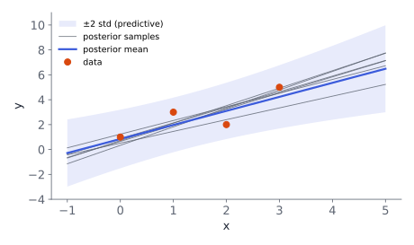

# The problem

## Regression



Given input–output pairs $(\vx_n,y_n)$, find a function that predicts $y$ from $\vx$. We assume noisy observations:

$$
y=f(\vx)+\varepsilon,\qquad \varepsilon\sim\mathcal N(0,\sigma^2).
$$

. . .

**Linear regression** means linear **in the parameters**, not necessarily in $\vx$:

$$
f(\vx)=\boldsymbol\phi(\vx)^\top\boldsymbol\theta=\sum_{k=0}^{K-1}\theta_k\,\phi_k(\vx).
$$

With features $\boldsymbol\phi(x)=(1,x,x^2,\dots)$ this fits polynomials; with other features, other curves. The math in this chapter is the same for all of them.

::: {.aside-note}
Book: §9.1–9.4. This chapter applies Ch. 3 (projections), Ch. 5 (gradients), Ch. 6 (Gaussians) and Ch. 8 (ML, MAP).
:::

## A running example

Four points and a straight-line model $f(x)=\theta_0+\theta_1x$, so $\boldsymbol\phi(x)=(1,x)$:

:::: {.columns}
::: {.column width="40%"}
| $x$ | $0$ | $1$ | $2$ | $3$ |
|---|---|---|---|---|
| $y$ | $1$ | $3$ | $2$ | $5$ |
:::
::: {.column width="60%"}
$$
\Phi=\begin{pmatrix}1&0\\1&1\\1&2\\1&3\end{pmatrix},\qquad
\boldsymbol y=\begin{pmatrix}1\\3\\2\\5\end{pmatrix}.
$$
:::
::::

The **design matrix** $\Phi\in\R^{N\times K}$ has one row $\boldsymbol\phi(\vx_n)^\top$ per example. Everything below is written with $\Phi$ and $\boldsymbol y$.

# Parameter estimation

## Maximum likelihood = least squares

The negative log-likelihood is, up to constants (Ch. 8),

$$
\mathcal L(\boldsymbol\theta)=\frac1{2\sigma^2}\norm{\boldsymbol y-\Phi\boldsymbol\theta}^2 .
$$

Its gradient (Ch. 5) is $-\tfrac1{\sigma^2}(\boldsymbol y-\Phi\boldsymbol\theta)^\top\Phi$. Setting it to zero gives the **normal equations**:

$$
\Phi^\top\Phi\,\boldsymbol\theta_{\text{ML}}=\Phi^\top\boldsymbol y\qquad\Longrightarrow\qquad\boldsymbol\theta_{\text{ML}}=(\Phi^\top\Phi)^{-1}\Phi^\top\boldsymbol y .
$$

. . .

**Example:** $\Phi^\top\Phi=\begin{pmatrix}4&6\\6&14\end{pmatrix}$, $\;\Phi^\top\boldsymbol y=\begin{pmatrix}11\\22\end{pmatrix}$, so

$$
\boldsymbol\theta_{\text{ML}}=\frac1{20}\begin{pmatrix}14&-6\\-6&4\end{pmatrix}\begin{pmatrix}11\\22\end{pmatrix}=\begin{pmatrix}1.1\\1.1\end{pmatrix}:\qquad f(x)=1.1+1.1x .
$$

## The noise level, and overfitting

The noise variance has an ML estimate too: the mean squared residual.

Residuals $\boldsymbol y-\Phi\boldsymbol\theta_{\text{ML}}=(-0.1,\ 0.8,\ -1.3,\ 0.6)$, so

$$
\sigma^2_{\text{ML}}=\tfrac14(0.01+0.64+1.69+0.36)=\tfrac{2.7}{4}=0.675 .
$$

. . .

With $K$ features and $N$ points, maximum likelihood can drive the training error to zero once $K\ge N$ (a degree-3 polynomial through these 4 points, or the degree-9 fit in Ch. 8). Two fixes follow: a **prior** (MAP), or keeping **all** plausible parameters (Bayesian regression).

## MAP estimation = ridge regression

Prior $\boldsymbol\theta\sim\mathcal N(\vzero,b^2I)$. The negative log-posterior adds a penalty:

$$
\frac1{2\sigma^2}\norm{\boldsymbol y-\Phi\boldsymbol\theta}^2+\frac1{2b^2}\norm{\boldsymbol\theta}^2
\quad\Longrightarrow\quad
\boldsymbol\theta_{\text{MAP}}=\Big(\Phi^\top\Phi+\tfrac{\sigma^2}{b^2}I\Big)^{-1}\Phi^\top\boldsymbol y .
$$

. . .

**Example** with $\sigma^2=b^2=1$, so $\lambda=\sigma^2/b^2=1$:

$$
\begin{pmatrix}5&6\\6&15\end{pmatrix}\boldsymbol\theta=\begin{pmatrix}11\\22\end{pmatrix}
\ \Rightarrow\ \boldsymbol\theta_{\text{MAP}}=\tfrac1{39}(33,\,44)\approx(0.846,\ 1.128).
$$

Both parameters are pulled toward $0$ compared with $(1.1,1.1)$. Adding $\lambda I$ also makes the matrix **invertible**, even when $\Phi^\top\Phi$ is not.

# Bayesian linear regression

## Posterior over parameters

Keep the prior $\mathcal N(\vzero,b^2I)$ and compute the full posterior. Everything is Gaussian (Ch. 6), so it is Gaussian too:

$$
p(\boldsymbol\theta\mid\mathcal X,\mathcal Y)=\mathcal N(\boldsymbol m_N,S_N),\qquad
S_N=\Big(\tfrac1{\sigma^2}\Phi^\top\Phi+\tfrac1{b^2}I\Big)^{-1},\quad
\boldsymbol m_N=\tfrac1{\sigma^2}S_N\Phi^\top\boldsymbol y .
$$

. . .

For our example ($\sigma^2=b^2=1$):

$$
\boldsymbol m_N=(0.846,\ 1.128)\ \ (=\boldsymbol\theta_{\text{MAP}}),\qquad
S_N=\frac1{39}\begin{pmatrix}15&-6\\-6&5\end{pmatrix}.
$$

The negative off-diagonal says: if the intercept is larger, the slope is probably smaller.

## Predictions with error bars

At a new input $x_*$, average the predictions of all parameter settings:

$$
p(y_*\mid x_*,\mathcal X,\mathcal Y)=\mathcal N\big(\boldsymbol\phi_*^\top\boldsymbol m_N,\ \ \boldsymbol\phi_*^\top S_N\boldsymbol\phi_*+\sigma^2\big).
$$

Two sources of uncertainty: about the **parameters** ($\boldsymbol\phi_*^\top S_N\boldsymbol\phi_*$) and the **noise** ($\sigma^2$).

. . .

At $x_*=4$, $\boldsymbol\phi_*=(1,4)$:

$$
\text{mean}=0.846+4\cdot1.128=5.36,\qquad
\text{variance}=\tfrac{15-48+80}{39}+1=\tfrac{47}{39}+1\approx2.21 .
$$

## Posterior predictive in a picture

{width="80%"}

Grey lines are lines drawn from the posterior. The band widens away from the data: the model knows where it has not seen anything.

## Try it: Bayesian regression {.scrollable}

```{ojs}
//| echo: false
viewof nuse = Inputs.range([0, 4], {step: 1, value: 4, label: "data points used"})
viewof pvar = Inputs.range([0.1, 10], {step: 0.1, value: 1, label: "prior variance b²"})
viewof nvar = Inputs.range([0.05, 3], {step: 0.05, value: 1, label: "noise variance σ²"})
```

```{ojs}
//| echo: false
blr = {
  const xs = [0, 1, 2, 3].slice(0, nuse), ys = [1, 3, 2, 5].slice(0, nuse);
  const a = nuse / nvar + 1 / pvar, bb = d3.sum(xs) / nvar, d = d3.sum(xs, x => x * x) / nvar + 1 / pvar;
  const det = a * d - bb * bb, S = [[d / det, -bb / det], [-bb / det, a / det]];
  const r = [d3.sum(ys) / nvar, d3.sum(xs, (x, i) => x * ys[i]) / nvar];
  const m = [S[0][0] * r[0] + S[0][1] * r[1], S[1][0] * r[0] + S[1][1] * r[1]];
  const curve = d3.range(-1, 5.01, 0.05).map(x => {
    const mean = m[0] + m[1] * x, v = S[0][0] + 2 * S[0][1] * x + S[1][1] * x * x + nvar;
    return {x, mean, lo: mean - 2 * Math.sqrt(v), hi: mean + 2 * Math.sqrt(v)};
  });
  return {m, curve, pts: xs.map((x, i) => [x, ys[i]])};
}
Plot.plot({
  width: 620, height: 330, grid: true,
  x: {domain: [-1, 5], label: "x"}, y: {domain: [-6, 12], label: "y"},
  marks: [
    Plot.areaY(blr.curve, {x: "x", y1: "lo", y2: "hi", fill: "#3b5bdb", fillOpacity: 0.13, clip: true}),
    Plot.line(blr.curve, {x: "x", y: "mean", stroke: "#3b5bdb", strokeWidth: 2.5}),
    Plot.dot(blr.pts, {x: d => d[0], y: d => d[1], r: 6, fill: "#d9480f"})
  ]
})
html`<p style="font-size:0.75em">posterior mean of (θ₀, θ₁) = (${blr.m[0].toFixed(3)}, ${blr.m[1].toFixed(3)}) · band: ±2 standard deviations of the prediction</p>`
```

With $0$ points you see the prior. Each point narrows the band near it. A tiny $b^2$ pins the line to $0$; a large $b^2$ approaches least squares.

## Marginal likelihood

Integrating out $\boldsymbol\theta$ gives the probability of the data under the **model** (the evidence of Ch. 8):

$$
p(\boldsymbol y\mid X)=\int p(\boldsymbol y\mid X,\boldsymbol\theta)\,p(\boldsymbol\theta)\,d\boldsymbol\theta=\mathcal N\big(\boldsymbol y\mid\vzero,\ b^2\Phi\Phi^\top+\sigma^2I\big).
$$

. . .

- It is available in closed form here, so we can compare feature sets (polynomial degrees) or tune $b^2,\sigma^2$ **without** a validation set.
- Too simple a model cannot explain the data; too flexible a model spreads its probability over many possible data sets. The evidence peaks in between.

# The geometric view

## Maximum likelihood as orthogonal projection

$\Phi\boldsymbol\theta$ ranges over the column space of $\Phi$. Least squares finds the point of that subspace **closest** to $\boldsymbol y$: the orthogonal projection of Ch. 3.

$$
\hat{\boldsymbol y}=\Phi\boldsymbol\theta_{\text{ML}}=\underbrace{\Phi(\Phi^\top\Phi)^{-1}\Phi^\top}_{\text{projection matrix}}\boldsymbol y .
$$

. . .

Check on the example: $\hat{\boldsymbol y}=(1.1,\,2.2,\,3.3,\,4.4)$, residual $\boldsymbol r=(-0.1,\,0.8,\,-1.3,\,0.6)$, and

$$
\Phi^\top\boldsymbol r=\begin{pmatrix}-0.1+0.8-1.3+0.6\\0+0.8-2.6+1.8\end{pmatrix}=\begin{pmatrix}0\\0\end{pmatrix}\ \checkmark
$$

The residual is orthogonal to every feature column: nothing linear in the features is left to explain.

## In Python

```python
import numpy as np

Phi = np.array([[1, 0], [1, 1], [1, 2], [1, 3]], dtype=float)
y = np.array([1, 3, 2, 5], dtype=float)

theta_ml = np.linalg.lstsq(Phi, y, rcond=None)[0]           # [1.1, 1.1]
sigma2_ml = np.mean((y - Phi @ theta_ml) ** 2)              # 0.675

sigma2, b2 = 1.0, 1.0
S_N = np.linalg.inv(Phi.T @ Phi / sigma2 + np.eye(2) / b2)
m_N = S_N @ Phi.T @ y / sigma2                              # [0.846, 1.128]

phi = np.array([1, 4.0])
phi @ m_N, phi @ S_N @ phi + sigma2                         # 5.36, 2.21
```

## Recap

1. **Linear regression** is linear in $\boldsymbol\theta$; features $\boldsymbol\phi(\vx)$ allow curved fits.
2. **Maximum likelihood** = least squares: $\boldsymbol\theta_{\text{ML}}=(\Phi^\top\Phi)^{-1}\Phi^\top\boldsymbol y$. It overfits with many features.
3. **MAP** with a Gaussian prior = **ridge regression**: add $\tfrac{\sigma^2}{b^2}I$.
4. **Bayesian** regression keeps a Gaussian posterior $\mathcal N(\boldsymbol m_N,S_N)$ and gives predictions **with error bars**.
5. The **marginal likelihood** compares models in closed form.
6. Geometrically, least squares **projects** $\boldsymbol y$ onto the column space of $\Phi$.

::: {.aside-note}
Study notes following *Mathematics for Machine Learning* (Deisenroth, Faisal, Ong; Cambridge University Press, 2020), Chapter 9. All examples and figures are original. Read the chapter at [mml-book.github.io](https://mml-book.github.io/).
:::
