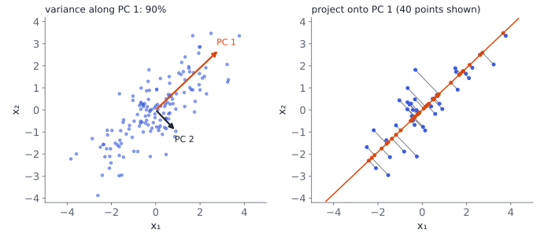

# The idea

## Dimensionality reduction



Real data often has many coordinates (pixels, sensor channels, word counts) but varies along far fewer **directions**. Neighbouring pixels of a photo are strongly correlated, for example.

. . .

**PCA** finds an $M$-dimensional subspace that captures as much of the data as possible, $M\ll D$:

$$
\boldsymbol z_n=B^\top\vx_n\in\R^M\quad\text{(code)},\qquad
\tilde{\vx}_n=B\boldsymbol z_n\in\R^D\quad\text{(reconstruction)},
$$

with $B\in\R^{D\times M}$ having **orthonormal** columns. We assume the data are **centered** (mean $\vzero$) and write $S=\frac1N\sum_n\vx_n\vx_n^\top$ for the data covariance.

::: {.aside-note}
Book: §10.1–10.7. Builds on Ch. 3 (projections), Ch. 4 (eigenvectors, SVD), Ch. 7 (Lagrange multipliers).
:::

## Two views, one answer

:::: {.columns}
::: {.column width="50%"}
**Maximum variance**

Keep the directions along which the data **spread out** the most: they carry the most information.
:::
::: {.column width="50%"}
**Minimum reconstruction error**

Choose the subspace so that projecting onto it **loses** as little as possible.
:::
::::

. . .

Both lead to the **eigenvectors of $S$** with the largest eigenvalues, the **principal components**.

## PCA in a picture

{width="88%"}

Left: the principal axes, with arrow lengths $2\sqrt{\lambda_j}$. Right: each point replaced by its projection onto PC 1; the grey segments are the reconstruction errors.

# Maximum variance

## The first principal component

Project onto a unit vector $\boldsymbol b$: $z_n=\boldsymbol b^\top\vx_n$. The variance of these numbers is

$$
V=\frac1N\sum_n(\boldsymbol b^\top\vx_n)^2=\boldsymbol b^\top S\,\boldsymbol b .
$$

. . .

Maximize $\boldsymbol b^\top S\boldsymbol b$ subject to $\norm{\boldsymbol b}^2=1$ with a Lagrange multiplier (Ch. 7):

$$
\mathfrak L=\boldsymbol b^\top S\boldsymbol b+\lambda(1-\boldsymbol b^\top\boldsymbol b),\qquad
\frac{\partial\mathfrak L}{\partial\boldsymbol b}=0\ \Rightarrow\ S\boldsymbol b=\lambda\boldsymbol b .
$$

So $\boldsymbol b$ is an **eigenvector** of $S$, and the variance it captures is $\boldsymbol b^\top S\boldsymbol b=\lambda$: take the **largest** eigenvalue.

. . .

The $m$-th component, required orthogonal to the first $m-1$, is the eigenvector of the $m$-th largest eigenvalue. Since $S$ is symmetric, these are orthonormal automatically (Ch. 4).

## A worked example

Four centered points $(2,1),\ (1,2),\ (-2,-1),\ (-1,-2)$:

$$
S=\frac14\sum_n\vx_n\vx_n^\top=\begin{pmatrix}2.5&2\\2&2.5\end{pmatrix},\qquad
\lambda_1=4.5,\ \boldsymbol b_1=\tfrac1{\sqrt2}(1,1);\qquad \lambda_2=0.5,\ \boldsymbol b_2=\tfrac1{\sqrt2}(1,-1).
$$

. . .

- Total variance $=\operatorname{tr}S=5=\lambda_1+\lambda_2$.
- PC 1 explains $4.5/5=$ **90%** of it.
- Codes $z_n=\boldsymbol b_1^\top\vx_n=\pm\tfrac{3}{\sqrt2}\approx\pm2.12$: four 2D points become four numbers.

# Minimum reconstruction error

## The projection perspective

Reconstruct each point by projecting it onto the subspace spanned by $B$ (Ch. 3): $\tilde{\vx}_n=BB^\top\vx_n$. Minimize the average squared error

$$
J_M=\frac1N\sum_n\norm{\vx_n-\tilde{\vx}_n}^2 .
$$

. . .

The minimizer is the **same** $B$ (top $M$ eigenvectors), and the error left over is exactly the variance in the directions we dropped:

$$
J_M=\sum_{j=M+1}^{D}\lambda_j .
$$

. . .

**Example** with $M=1$: $\tilde{\vx}=(1.5,1.5)$ for the first two points, $(-1.5,-1.5)$ for the others. Each error vector is $\pm(0.5,-0.5)$, of squared length $0.5$, so $J_1=0.5=\lambda_2$ ✓.

## Try it: turn the projection line {.scrollable}

```{ojs}
//| echo: false
viewof pang = Inputs.range([0, 180], {step: 1, value: 10, label: "direction angle (degrees)"})
```

```{ojs}
//| echo: false
pdata = {
  let s = 12345; const rnd = () => (s = (s * 1103515245 + 12345) % 2147483648) / 2147483648;
  const gauss = () => Math.sqrt(-2 * Math.log(rnd() + 1e-12)) * Math.cos(2 * Math.PI * rnd());
  const pts = d3.range(80).map(() => { const a = gauss(), b = gauss(); return [1.5 * a + 0.4 * b, 1.2 * a + 0.9 * b]; });
  const mx = d3.mean(pts, p => p[0]), my = d3.mean(pts, p => p[1]);
  return pts.map(p => [p[0] - mx, p[1] - my]);
}
pproj = {
  const r = pang * Math.PI / 180, b = [Math.cos(r), Math.sin(r)];
  const z = pdata.map(p => p[0] * b[0] + p[1] * b[1]);
  const rec = z.map(t => [t * b[0], t * b[1]]);
  const v = d3.mean(z, t => t * t);
  const err = d3.mean(pdata, (p, i) => (p[0] - rec[i][0]) ** 2 + (p[1] - rec[i][1]) ** 2);
  return {b, rec, v, err};
}
Plot.plot({
  width: 460, height: 400, grid: true,
  x: {domain: [-4.5, 4.5], label: "x₁"}, y: {domain: [-4, 4], label: "x₂"},
  marks: [
    Plot.line([[-6 * pproj.b[0], -6 * pproj.b[1]], [6 * pproj.b[0], 6 * pproj.b[1]]], {x: d => d[0], y: d => d[1], stroke: "#d9480f", strokeWidth: 2, clip: true}),
    Plot.link(pdata, {x1: d => d[0], y1: d => d[1], x2: (d, i) => pproj.rec[i][0], y2: (d, i) => pproj.rec[i][1], stroke: "#9aa1ae"}),
    Plot.dot(pdata, {x: d => d[0], y: d => d[1], r: 3, fill: "#3b5bdb"}),
    Plot.dot(pproj.rec, {x: d => d[0], y: d => d[1], r: 2.5, fill: "#d9480f"})
  ]
})
html`<p style="font-size:0.75em">variance along the line = <b>${pproj.v.toFixed(3)}</b> · mean squared reconstruction error = <b>${pproj.err.toFixed(3)}</b><br>
sum = ${(pproj.v + pproj.err).toFixed(3)} (the total variance, fixed). Maximizing one minimizes the other.</p>`
```

Find the angle with the largest variance: the grey error lines are then as short as possible.

# Computing PCA

## Eigenvectors, SVD and low-rank approximation

Stack the centered data as rows of $X\in\R^{N\times D}$, so $S=\frac1NX^\top X$. Take the SVD $X=U\Sigma V^\top$ (Ch. 4):

$$
S=\frac1N V\Sigma^\top\Sigma V^\top\quad\Rightarrow\quad
\text{principal directions}=\text{columns of }V,\qquad\lambda_j=\frac{\sigma_j^2}{N}.
$$

. . .

- In practice PCA is computed with the **SVD of $X$**, which is more accurate than forming $S$.
- The reconstruction $\tilde X=XV_MV_M^\top$ is the **best rank-$M$ approximation** of $X$ (Eckart–Young): PCA and low-rank approximation are the same thing.
- If only the top few components are needed, iterative methods (e.g. **power iteration**: repeat $\boldsymbol b\leftarrow S\boldsymbol b/\norm{S\boldsymbol b}$) are much cheaper.

## PCA when $D\gg N$

With $N=100$ images of $D=10^6$ pixels, $S$ is a $10^6\times10^6$ matrix: too big to store.

. . .

Use the small $N\times N$ matrix instead. If $\frac1NXX^\top\boldsymbol c=\lambda\boldsymbol c$, multiply by $X^\top$:

$$
\frac1N X^\top X\,(X^\top\boldsymbol c)=\lambda\,(X^\top\boldsymbol c)\qquad\Rightarrow\qquad S\,\boldsymbol b=\lambda\boldsymbol b\ \text{ with }\ \boldsymbol b=X^\top\boldsymbol c .
$$

Same nonzero eigenvalues; normalize $\boldsymbol b$ to unit length. At most $N-1$ eigenvalues are nonzero for centered data, so at most $N-1$ components are useful.

## The steps in practice

1. **Center:** subtract the mean $\boldsymbol\mu$ of each feature.
2. **Standardize** (if features have different units): divide each feature by its standard deviation. Otherwise the feature with the largest numbers dominates.
3. **Eigendecompose** $S$ (or take the SVD of $X$); sort by eigenvalue.
4. **Choose $M$**, e.g. the smallest $M$ that explains 95% of the variance: $\sum_{j\le M}\lambda_j\big/\sum_j\lambda_j\ge0.95$.
5. **Project:** $\boldsymbol z=B^\top(\vx-\boldsymbol\mu)/\text{std}$.
6. **Reconstruct** (if wanted): undo the steps, $\tilde{\vx}=\text{std}\cdot B\boldsymbol z+\boldsymbol\mu$.

::: {.aside-note}
Uses: compression, visualization ($M=2$), denoising, and preprocessing before regression or classification.
:::

# The latent-variable view

## Probabilistic PCA

Write PCA as a generative model with a latent code $\boldsymbol z$ (Ch. 8):

$$
\boldsymbol z\sim\mathcal N(\vzero,I_M),\qquad
\vx\mid\boldsymbol z\sim\mathcal N(B\boldsymbol z+\boldsymbol\mu,\ \sigma^2I_D)
\qquad\Rightarrow\qquad
\vx\sim\mathcal N(\boldsymbol\mu,\ BB^\top+\sigma^2I).
$$

. . .

Maximum likelihood gives back PCA: the columns of $B$ span the top-$M$ eigenvectors, scaled by $\sqrt{\lambda_j-\sigma^2}$, and $\sigma^2$ is the **average discarded eigenvalue**.

. . .

**Our example**, $M=1$: $\sigma^2=\lambda_2=0.5$, $\;B=\sqrt{4.5-0.5}\,\boldsymbol b_1=\sqrt2\,(1,1)^\top$. Then

$$
BB^\top+\sigma^2I=\begin{pmatrix}2&2\\2&2\end{pmatrix}+\begin{pmatrix}0.5&0\\0&0.5\end{pmatrix}=\begin{pmatrix}2.5&2\\2&2.5\end{pmatrix}=S\ \checkmark
$$

Benefits: a likelihood (for model comparison), handling missing data, sampling new data, and Bayesian extensions.

## In Python

```python
import numpy as np

X = np.array([[2, 1], [1, 2], [-2, -1], [-1, -2]], dtype=float)
X = X - X.mean(axis=0)                         # center (already centered here)
S = X.T @ X / len(X)                           # [[2.5, 2], [2, 2.5]]
lam, V = np.linalg.eigh(S)                     # ascending: [0.5, 4.5]
lam, V = lam[::-1], V[:, ::-1]
lam / lam.sum()                                # [0.9, 0.1]: explained variance

U, s, Vt = np.linalg.svd(X)                    # the SVD route
s**2 / len(X)                                  # [4.5, 0.5], same eigenvalues

Z = X @ V[:, :1]                               # codes: ±2.121
X_rec = Z @ V[:, :1].T                         # (±1.5, ±1.5)
np.mean(np.sum((X - X_rec)**2, axis=1))        # 0.5 = discarded eigenvalue
```

## Recap

1. PCA compresses centered data with an orthonormal $B$: codes $\boldsymbol z=B^\top\vx$, reconstruction $B\boldsymbol z$.
2. **Maximum variance:** the best directions are the top **eigenvectors** of the covariance $S$; each captures variance $\lambda_j$.
3. **Minimum reconstruction error** gives the same answer; the error is the sum of the **discarded** eigenvalues.
4. Compute it with the **SVD**; PCA is the best low-rank approximation of the data.
5. For $D\gg N$, use the $N\times N$ matrix. In practice: center, standardize, choose $M$ by explained variance.
6. **Probabilistic PCA** is a latent-variable model whose maximum likelihood solution is PCA.

::: {.aside-note}
Study notes following *Mathematics for Machine Learning* (Deisenroth, Faisal, Ong; Cambridge University Press, 2020), Chapter 10. All examples and figures are original. Read the chapter at [mml-book.github.io](https://mml-book.github.io/).
:::
