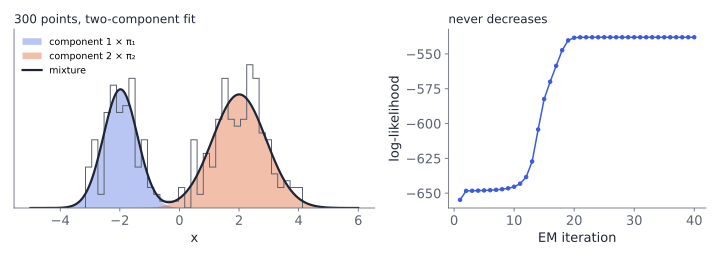

# Mixture models

## Density estimation



**Density estimation:** given data $\vx_1,\dots,\vx_N$, find a distribution $p(\vx)$ that could have produced them. With it we can score new points (anomaly detection), generate samples, and find clusters.

. . .

A single Gaussian is easy to fit (mean and covariance, Ch. 8), but it has **one** bump. Data with two or more groups need something more flexible.

. . .

A **Gaussian mixture model** (GMM) adds $K$ Gaussians with weights:

$$
p(\vx\mid\boldsymbol\theta)=\sum_{k=1}^{K}\pi_k\,\mathcal N(\vx\mid\boldsymbol\mu_k,\Sigma_k),\qquad \pi_k\ge0,\ \ \sum_k\pi_k=1 .
$$

Parameters $\boldsymbol\theta=\{\pi_k,\boldsymbol\mu_k,\Sigma_k\}$. With enough components, a mixture can approximate almost any smooth density.

::: {.aside-note}
Book: §11.1–11.4.
:::

## What a fit looks like

{width="86%"}

Left: data from two groups and a two-component fit. Each shaded bump is one weighted Gaussian; the black curve is their sum. Right: the log-likelihood during the fitting algorithm (EM), which we now derive.

# Maximum likelihood

## Why there is no closed form

The log-likelihood of $N$ independent points is

$$
\log p(\mathcal X\mid\boldsymbol\theta)=\sum_{n=1}^{N}\log\sum_{k=1}^{K}\pi_k\,\mathcal N(\vx_n\mid\boldsymbol\mu_k,\Sigma_k).
$$

The **log of a sum** does not simplify, so setting the gradient to zero does not give an explicit formula as it did for one Gaussian.

. . .

But the gradient conditions do have a clear structure. They all involve the **responsibilities**

$$
r_{nk}=\frac{\pi_k\,\mathcal N(\vx_n\mid\boldsymbol\mu_k,\Sigma_k)}{\sum_j\pi_j\,\mathcal N(\vx_n\mid\boldsymbol\mu_j,\Sigma_j)},
$$

how much component $k$ "explains" point $n$. Each row $(r_{n1},\dots,r_{nK})$ sums to $1$.

## Responsibilities: an example

Two 1D components $\mathcal N(0,1)$ and $\mathcal N(5,1)$ with equal weights $\tfrac12$. Point $x=2$:

$$
\pi_1\mathcal N(2\mid0,1)\propto e^{-2^2/2}=e^{-2}=0.1353,\qquad
\pi_2\mathcal N(2\mid5,1)\propto e^{-3^2/2}=e^{-4.5}=0.0111 .
$$

(The common factor $\tfrac12\cdot\tfrac1{\sqrt{2\pi}}$ cancels.)

$$
r_1=\frac{0.1353}{0.1353+0.0111}=0.924,\qquad r_2=0.076 .
$$

. . .

The point belongs **92% to component 1 and 8% to component 2**: a soft assignment, unlike the hard labels of clustering.

## The update equations

Setting the gradients to zero (with a Lagrange multiplier for $\sum_k\pi_k=1$) gives, with $N_k=\sum_n r_{nk}$:

$$
\boldsymbol\mu_k=\frac1{N_k}\sum_n r_{nk}\,\vx_n,\qquad
\Sigma_k=\frac1{N_k}\sum_n r_{nk}(\vx_n-\boldsymbol\mu_k)(\vx_n-\boldsymbol\mu_k)^\top,\qquad
\pi_k=\frac{N_k}{N}.
$$

. . .

They look like the single-Gaussian MLE, but each point is counted with **weight** $r_{nk}$; $N_k$ is the "effective number of points" in component $k$.

The catch: the $r_{nk}$ depend on the parameters, and the parameters depend on the $r_{nk}$. So we alternate.

# The EM algorithm

## Expectation–maximization

1. **Initialize** $\pi_k,\boldsymbol\mu_k,\Sigma_k$ (e.g. random data points as means).
2. **E-step:** compute all responsibilities $r_{nk}$ with the current parameters.
3. **M-step:** update $\boldsymbol\mu_k$, $\Sigma_k$, $\pi_k$ with the formulas above, holding $r_{nk}$ fixed.
4. **Repeat** 2–3 until the log-likelihood stops changing.

. . .

::: {.box}
[Guarantee]{.box-title}
Each EM iteration **never decreases** the log-likelihood. EM converges to a local maximum (or saddle point), not necessarily the global one.
:::

## One EM iteration by hand

Data $\{-1,0,1,2,4,5,6\}$. Start: $\mu=(0,5)$, $\sigma^2=(1,1)$, $\pi=(\tfrac12,\tfrac12)$.

**E-step:** the points $-1,0,1$ go almost entirely to component 1, and $4,5,6$ to component 2. The point $2$ splits $0.924/0.076$ (previous slide). So $N_1\approx3.92$, $N_2\approx3.08$.

. . .

**M-step:**

| | $\mu_k$ | $\sigma_k^2$ | $\pi_k$ |
|---|---|---|---|
| component 1 | $0.471$ | $1.232$ | $0.561$ |
| component 2 | $4.926$ | $0.869$ | $0.439$ |

. . .

Log-likelihood: $-15.20\to-14.58\to-14.53\to\dots$ It rises at every iteration and levels off.

## Try it: watch EM fit {.scrollable}

```{ojs}
//| echo: false
viewof emIter = Inputs.range([0, 40], {step: 1, value: 0, label: "EM iterations"})
viewof emInit = Inputs.range([-4, 4], {step: 0.5, value: -0.5, label: "initial mean of component 1"})
```

```{ojs}
//| echo: false
emData = {
  let s = 2024; const rnd = () => (s = (s * 1103515245 + 12345) % 2147483648) / 2147483648;
  const gauss = () => Math.sqrt(-2 * Math.log(rnd() + 1e-12)) * Math.cos(2 * Math.PI * rnd());
  return [...d3.range(120).map(() => -2 + 0.6 * gauss()), ...d3.range(180).map(() => 2 + gauss())];
}
emRun = {
  const N = (x, m, v) => Math.exp(-((x - m) ** 2) / (2 * v)) / Math.sqrt(2 * Math.PI * v);
  let mu = [emInit, 0.5], va = [4, 4], pi = [0.5, 0.5], ll = 0;
  for (let it = 0; it <= emIter; it++) {
    const R = emData.map(x => { const a = pi[0] * N(x, mu[0], va[0]), b = pi[1] * N(x, mu[1], va[1]); return [a / (a + b), b / (a + b), Math.log(a + b)]; });
    ll = d3.sum(R, r => r[2]);
    if (it === emIter) break;
    for (const k of [0, 1]) {
      const Nk = d3.sum(R, r => r[k]);
      mu[k] = d3.sum(emData, (x, n) => R[n][k] * x) / Nk;
      va[k] = Math.max(1e-3, d3.sum(emData, (x, n) => R[n][k] * (x - mu[k]) ** 2) / Nk);
      pi[k] = Nk / emData.length;
    }
  }
  const curve = d3.range(-5, 6.01, 0.05).map(x => ({x, c1: pi[0] * N(x, mu[0], va[0]), c2: pi[1] * N(x, mu[1], va[1])}));
  return {mu, va, pi, ll, curve};
}
Plot.plot({
  width: 620, height: 300, grid: true,
  x: {domain: [-5, 6], label: "x"}, y: {domain: [0, 0.45], label: "density"},
  marks: [
    Plot.ruleX(emData, {x: d => d, y1: 0, y2: 0.025, stroke: "#495057", strokeOpacity: 0.5}),
    Plot.areaY(emRun.curve, {x: "x", y: "c1", fill: "#3b5bdb", fillOpacity: 0.3}),
    Plot.areaY(emRun.curve, {x: "x", y: "c2", fill: "#d9480f", fillOpacity: 0.3}),
    Plot.line(emRun.curve, {x: "x", y: d => d.c1 + d.c2, stroke: "#212529", strokeWidth: 2})
  ]
})
html`<p style="font-size:0.75em">μ = (${emRun.mu.map(v => v.toFixed(2)).join(", ")}) · σ² = (${emRun.va.map(v => v.toFixed(2)).join(", ")}) · π = (${emRun.pi.map(v => v.toFixed(2)).join(", ")})<br>log-likelihood = <b>${emRun.ll.toFixed(2)}</b></p>`
```

Step through the iterations: the log-likelihood only goes up. Ticks at the bottom are the 300 data points.

## Practical issues

- **Local optima:** different starting points can give different fits. Run EM several times and keep the best log-likelihood, or start from **k-means** clusters.
- **Collapsing components:** if a component sits on a single point and its variance shrinks to $0$, the likelihood goes to $\infty$. That fit is useless. Fix: a lower bound on the variance, or a prior (MAP-EM).
- **Choosing $K$:** more components always raise the training likelihood. Use held-out likelihood or BIC (Ch. 8).

. . .

**k-means** is the limit of EM when all components share a variance $\sigma^2I$ with $\sigma^2\to0$: responsibilities become hard 0/1 assignments to the nearest mean, and the M-step averages each cluster.

# The latent-variable view

## A generative story

Introduce a hidden one-hot variable $\boldsymbol z$ saying which component generated $\vx$:

$$
p(z_k=1)=\pi_k,\qquad p(\vx\mid z_k=1)=\mathcal N(\vx\mid\boldsymbol\mu_k,\Sigma_k).
$$

. . .

- **Marginalizing** $\boldsymbol z$ (sum rule, Ch. 6) gives back the mixture: $p(\vx)=\sum_k\pi_k\mathcal N(\vx\mid\boldsymbol\mu_k,\Sigma_k)$.
- **Bayes' theorem** gives the posterior of the hidden label: $p(z_k=1\mid\vx_n)=r_{nk}$. The responsibilities **are** posterior probabilities.
- **Sampling** (ancestral): draw $k$ with probabilities $\pi$, then draw $\vx\sim\mathcal N(\boldsymbol\mu_k,\Sigma_k)$.

. . .

In general, EM maximizes the likelihood of any latent-variable model: the E-step computes the posterior over $\boldsymbol z$, the M-step maximizes the **expected** complete-data log-likelihood $\mathbb E_{\boldsymbol z}\big[\log p(\vx,\boldsymbol z\mid\boldsymbol\theta)\big]$.

## In Python

```python
import numpy as np
from scipy.stats import norm

x = np.array([-1, 0, 1, 2, 4, 5, 6], dtype=float)
mu, var, pi = np.array([0., 5.]), np.array([1., 1.]), np.array([.5, .5])
for it in range(20):
    dens = pi * norm.pdf(x[:, None], mu, np.sqrt(var))       # N x K
    print(it, np.log(dens.sum(1)).sum())                     # -15.20, -14.58, -14.53, ...
    r = dens / dens.sum(1, keepdims=True)                    # E-step
    Nk = r.sum(0)                                            # M-step
    mu = (r * x[:, None]).sum(0) / Nk
    var = (r * (x[:, None] - mu) ** 2).sum(0) / Nk
    pi = Nk / len(x)

from sklearn.mixture import GaussianMixture                 # the same, ready-made
GaussianMixture(n_components=2, n_init=5).fit(x[:, None]).means_
```

## Recap

1. A **GMM** $\sum_k\pi_k\mathcal N(\boldsymbol\mu_k,\Sigma_k)$ models multi-modal data.
2. Its log-likelihood has a **log of a sum**: no closed-form maximum.
3. **Responsibilities** $r_{nk}$ softly assign points to components.
4. **EM** alternates computing $r_{nk}$ (E) and weighted mean/covariance/weight updates (M); the likelihood never decreases.
5. Watch for local optima and collapsing components; choose $K$ with held-out data or BIC. k-means is the hard-assignment limit.
6. With a hidden label $\boldsymbol z$, responsibilities are **posteriors**, and the GMM is a generative model.

::: {.aside-note}
Study notes following *Mathematics for Machine Learning* (Deisenroth, Faisal, Ong; Cambridge University Press, 2020), Chapter 11. All examples and figures are original. Read the chapter at [mml-book.github.io](https://mml-book.github.io/).
:::
