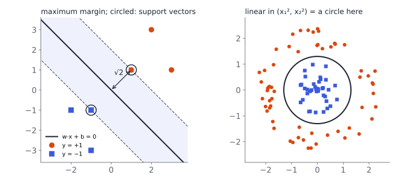

# Separating hyperplanes

## Binary classification



Each example $\vx_n\in\R^D$ has a label $y_n\in\{+1,-1\}$. We look for a linear score

$$
f(\vx)=\langle\boldsymbol w,\vx\rangle+b
$$

and predict the class $\operatorname{sign} f(\vx)$. The **decision boundary** $f(\vx)=0$ is a hyperplane with normal vector $\boldsymbol w$ (Ch. 3).

. . .

Two facts from geometry:

- Correct classification of $(\vx_n,y_n)$ means $y_nf(\vx_n)>0$.
- The distance from $\vx$ to the hyperplane is $\dfrac{\abs{f(\vx)}}{\norm{\boldsymbol w}}$.

::: {.aside-note}
Book: §12.1–12.5. Uses Ch. 3 (geometry), Ch. 7 (constrained optimization, duality), Ch. 8 (losses and regularization).
:::

## Which separating line?

If the classes can be separated, there are infinitely many separating hyperplanes. The **support vector machine** picks the one with the largest **margin**: the distance to the closest training point.

. . .

A wide margin leaves room for new points that land near, but not exactly on, the training points. It is less sensitive to small changes in the data.

. . .

$f$ and $c\cdot f$ ($c>0$) give the same boundary, so we fix the scale: require

$$
y_n\big(\langle\boldsymbol w,\vx_n\rangle+b\big)\ge1\quad\text{for all }n,
$$

with equality for the closest points. Their distance to the boundary is then $1/\norm{\boldsymbol w}$.

# The primal SVM

## Hard-margin SVM

Maximizing the margin $1/\norm{\boldsymbol w}$ is the same as minimizing $\norm{\boldsymbol w}^2$:

::: {.box}
[Hard-margin SVM]{.box-title}
$$
\min_{\boldsymbol w,b}\ \tfrac12\norm{\boldsymbol w}^2\qquad\text{subject to}\qquad y_n\big(\langle\boldsymbol w,\vx_n\rangle+b\big)\ge1,\quad n=1,\dots,N .
$$
:::

A convex quadratic program (Ch. 7): one global optimum.

. . .

The points with $y_nf(\vx_n)=1$ lie exactly on the margin. They are the **support vectors**: the solution depends **only** on them. Moving any other point (without crossing the margin) changes nothing.

## A worked example

{width="62%"}

Positive: $(1,1),(2,3),(3,1)$. Negative: $(-1,-1),(-2,-1),(-1,-3)$. Solution $\boldsymbol w=(\tfrac12,\tfrac12)$, $b=0$:

$y_nf(\vx_n)=1,\ 2.5,\ 2,\ 1,\ 1.5,\ 2$, all $\ge1$; the two support vectors give exactly $1$. Margin $1/\norm{\boldsymbol w}=\sqrt2$, half the distance between $(1,1)$ and $(-1,-1)$.

## Soft margin and the hinge loss

Real data are rarely separable. Allow violations with **slack** variables $\xi_n\ge0$:

$$
\min_{\boldsymbol w,b,\boldsymbol\xi}\ \tfrac12\norm{\boldsymbol w}^2+C\sum_n\xi_n\quad\text{s.t.}\quad y_nf(\vx_n)\ge1-\xi_n,\ \ \xi_n\ge0 .
$$

$C$ trades margin width against violations: large $C$ ≈ hard margin, small $C$ = wider margin with more violations.

. . .

At the optimum $\xi_n=\max\big(0,\,1-y_nf(\vx_n)\big)$, the **hinge loss**. So the soft-margin SVM is **empirical risk minimization** (Ch. 8): hinge loss plus $L_2$ regularization.

| $y_nf(\vx_n)$ | $2$ | $1$ | $0.3$ | $-0.5$ |
|---|---|---|---|---|
| hinge loss | $0$ | $0$ | $0.7$ | $1.5$ |

Correct and outside the margin: no loss. Inside the margin, or wrong: a linear penalty.

## Try it: find the maximum margin by hand {.scrollable}

```{ojs}
//| echo: false
viewof sAng = Inputs.range([0, 180], {step: 1, value: 20, label: "direction of w (degrees)"})
viewof sNorm = Inputs.range([0.1, 2], {step: 0.01, value: 1, label: "‖w‖"})
viewof sB = Inputs.range([-2, 2], {step: 0.05, value: 0.5, label: "b"})
```

```{ojs}
//| echo: false
svmPts = [[1, 1, 1], [2, 3, 1], [3, 1, 1], [-1, -1, -1], [-2, -1, -1], [-1, -3, -1]]
svm = {
  const r = sAng * Math.PI / 180, w = [sNorm * Math.cos(r), sNorm * Math.sin(r)];
  const f = p => w[0] * p[0] + w[1] * p[1] + sB;
  const hinge = svmPts.map(p => Math.max(0, 1 - p[2] * f(p)));
  const line = c => {
    const n2 = sNorm * sNorm, p0 = [(c - sB) * w[0] / n2, (c - sB) * w[1] / n2], d = [-w[1] / sNorm, w[0] / sNorm];
    return [[p0[0] - 12 * d[0], p0[1] - 12 * d[1]], [p0[0] + 12 * d[0], p0[1] + 12 * d[1]]].map(q => ({x: q[0], y: q[1], c}));
  };
  return {hinge, l0: line(0), lm: [...line(1), ...line(-1)], obj: 0.5 * sNorm * sNorm + d3.sum(hinge)};
}
Plot.plot({
  width: 440, height: 420, grid: true,
  x: {domain: [-4, 4], label: "x₁"}, y: {domain: [-4, 4], label: "x₂"},
  marks: [
    Plot.line(svm.lm, {x: "x", y: "y", z: "c", stroke: "#9aa1ae", strokeWidth: 1.5, strokeDasharray: "6 4", clip: true}),
    Plot.line(svm.l0, {x: "x", y: "y", stroke: "#212529", strokeWidth: 2.5, clip: true}),
    Plot.dot(svmPts, {x: d => d[0], y: d => d[1], r: 7, fill: d => d[2] > 0 ? "#d9480f" : "#3b5bdb", symbol: d => d[2] > 0 ? "circle" : "square",
                      stroke: (d, i) => svm.hinge[i] > 0 ? "#212529" : null, strokeWidth: 2})
  ]
})
html`<p style="font-size:0.75em">Black line: f(x) = 0; dashed: f(x) = ±1. Points with a black outline have positive hinge loss.<br>
½‖w‖² = ${(0.5 * sNorm * sNorm).toFixed(3)} · total hinge loss = ${d3.sum(svm.hinge).toFixed(3)} · <b>objective (C = 1) = ${svm.obj.toFixed(3)}</b></p>`
```

The best you can do is $0.25$: direction $45^\circ$, $\norm{\boldsymbol w}\approx0.71$, $b=0$. A smaller $\norm{\boldsymbol w}$ widens the margin until points start paying hinge loss.

# The dual SVM

## Lagrangian and dual

Add multipliers $\alpha_n\ge0$ for the constraints (Ch. 7). Setting the derivatives with respect to $\boldsymbol w$ and $b$ to zero gives

$$
\boldsymbol w=\sum_n\alpha_ny_n\vx_n,\qquad\sum_n\alpha_ny_n=0 .
$$

. . .

Substituting back leaves a problem in $\boldsymbol\alpha$ only:

::: {.box}
[Dual SVM]{.box-title}
$$
\max_{\boldsymbol\alpha}\ \sum_n\alpha_n-\tfrac12\sum_{i,j}y_iy_j\alpha_i\alpha_j\langle\vx_i,\vx_j\rangle\quad\text{s.t.}\quad\sum_n\alpha_ny_n=0,\quad0\le\alpha_n\le C .
$$
:::

$\alpha_n>0$ only for support vectors; all other points have $\alpha_n=0$.

## The dual for our example

Only the support vectors $(1,1)$ ($y=+1$) and $(-1,-1)$ ($y=-1$) have nonzero $\alpha$; by symmetry $\alpha=\tfrac14$ each:

$$
\boldsymbol w=\tfrac14\cdot(+1)\begin{pmatrix}1\\1\end{pmatrix}+\tfrac14\cdot(-1)\begin{pmatrix}-1\\-1\end{pmatrix}=\begin{pmatrix}\tfrac12\\\tfrac12\end{pmatrix}\ \checkmark,
\qquad\sum_n\alpha_ny_n=\tfrac14-\tfrac14=0\ \checkmark
$$

. . .

Objective values: primal $\tfrac12\norm{\boldsymbol w}^2=\tfrac14$; dual $\sum\alpha_n-\tfrac12\norm{\boldsymbol w}^2=\tfrac12-\tfrac14=\tfrac14$. Equal: **strong duality** holds.

. . .

Why the dual matters: its size is $N$ (not $D$), and the data appear **only through inner products** $\langle\vx_i,\vx_j\rangle$.

# Kernels

## The kernel trick

Map inputs to features $\boldsymbol\phi(\vx)$ and run the SVM there. The dual only needs $\langle\boldsymbol\phi(\vx_i),\boldsymbol\phi(\vx_j)\rangle$, so define a **kernel**

$$
k(\vx,\vx')=\langle\boldsymbol\phi(\vx),\boldsymbol\phi(\vx')\rangle
$$

and never compute $\boldsymbol\phi$ itself. Predictions: $f(\vx)=\sum_n\alpha_ny_n\,k(\vx_n,\vx)+b$.

. . .

**Example:** $k(\vx,\vx')=\langle\vx,\vx'\rangle^2$ in 2D is the inner product of $\boldsymbol\phi(\vx)=(x_1^2,\ \sqrt2x_1x_2,\ x_2^2)$. With $\vx=(1,2)$, $\vx'=(3,1)$:

$$
\langle\vx,\vx'\rangle^2=5^2=25,\qquad \boldsymbol\phi(\vx)^\top\boldsymbol\phi(\vx')=1\cdot9+2\sqrt2\cdot3\sqrt2+4\cdot1=9+12+4=25\ \checkmark
$$

A boundary linear in these features is a **conic** in the plane, like the circle in the figure.

## Common kernels

| Kernel | $k(\vx,\vx')$ | feature space |
|---|---|---|
| linear | $\langle\vx,\vx'\rangle$ | the inputs themselves |
| polynomial | $(\langle\vx,\vx'\rangle+c)^p$ | all monomials up to degree $p$ |
| Gaussian (RBF) | $\exp\!\big(-\norm{\vx-\vx'}^2/(2\ell^2)\big)$ | infinite-dimensional |

For $\vx=(1,2)$, $\vx'=(3,1)$, $\ell=1$: $\;\norm{\vx-\vx'}^2=5$, so the RBF kernel is $e^{-2.5}\approx0.082$: similarity decays with distance.

. . .

A function is a valid kernel if every **Gram matrix** $K_{ij}=k(\vx_i,\vx_j)$ is symmetric positive semidefinite. Kernels also work on non-vector data (strings, graphs) as long as this holds.

## Solving SVMs in practice

- Both primal and dual are **quadratic programs** (Ch. 7); general QP solvers work for small problems.
- **Dual, kernel SVMs:** specialized methods such as SMO (sequential minimal optimization) update two $\alpha$'s at a time, in closed form.
- **Primal, linear SVMs:** minimize hinge loss $+\;\lambda\norm{\boldsymbol w}^2$ with (stochastic) **subgradient descent**; this scales to millions of examples.
- The kernel matrix is $N\times N$, so kernel SVMs get expensive for very large $N$.

## In Python

```python
import numpy as np
from sklearn.svm import SVC

X = np.array([[1, 1], [2, 3], [3, 1], [-1, -1], [-2, -1], [-1, -3]])
y = np.array([1, 1, 1, -1, -1, -1])

clf = SVC(kernel="linear", C=1e6).fit(X, y)      # very large C ≈ hard margin
clf.coef_, clf.intercept_                        # [[0.5, 0.5]], [0.]
clf.support_vectors_                             # (-1, -1) and (1, 1)
clf.dual_coef_                                   # alpha_n * y_n: [[-0.25, 0.25]]

rbf = SVC(kernel="rbf", gamma=0.5, C=1.0).fit(X, y)   # gamma = 1 / (2 l^2)
rbf.predict([[0.5, 0.2], [-2, 0]])               # [ 1, -1]
```

## Recap

1. A linear classifier predicts $\operatorname{sign}(\langle\boldsymbol w,\vx\rangle+b)$; distance to the boundary is $\abs{f(\vx)}/\norm{\boldsymbol w}$.
2. The **SVM** maximizes the margin: $\min\tfrac12\norm{\boldsymbol w}^2$ s.t. $y_nf(\vx_n)\ge1$. Only **support vectors** matter.
3. The **soft margin** allows violations; it equals hinge loss $+$ $L_2$ regularization.
4. The **dual** gives $\boldsymbol w=\sum\alpha_ny_n\vx_n$ and uses data only through inner products.
5. **Kernels** replace inner products, giving nonlinear boundaries without computing features.
6. SVMs are solved as QPs, by SMO (dual) or subgradient descent (primal, linear).

::: {.aside-note}
Study notes following *Mathematics for Machine Learning* (Deisenroth, Faisal, Ong; Cambridge University Press, 2020), Chapter 12. All examples and figures are original. Read the chapter at [mml-book.github.io](https://mml-book.github.io/).
:::
