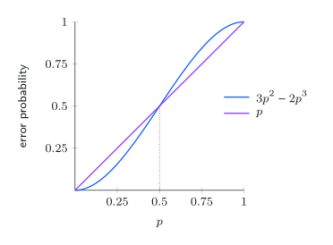
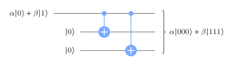
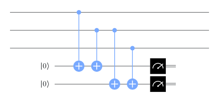
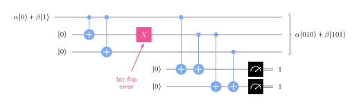
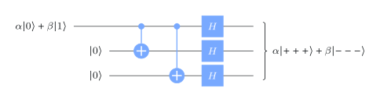
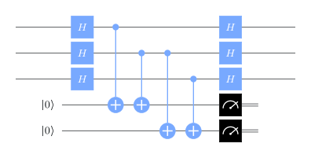
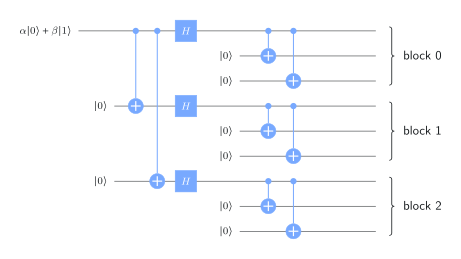
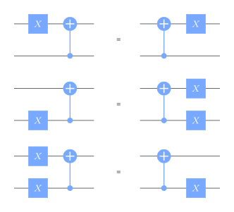
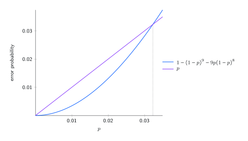

# Repetition codes

## Classical warm-up



Send a bit through a **binary symmetric channel**: each bit flips independently with probability $p$.

**3-bit repetition code:** encode $0\mapsto000$, $1\mapsto111$; decode by **majority vote**.

:::: {.columns}
::: {.column width="55%"}
Decoding fails only if 2 or 3 bits flip:

$$
3p^2(1-p)+p^3=3p^2-2p^3,
$$

which is **smaller than $p$ for every $p<\tfrac12$**. For $p=0.01$: about $0.0003$.

Redundancy turns a noisy bit into a much more reliable one.
:::
::: {.column width="45%"}
{width="88%"}
:::
::::

## Why quantum is harder

Copying is the obvious idea, and it fails three ways:

1. **No-cloning:** we cannot copy an unknown $\alpha\ket0+\beta\ket1$ into $(\alpha\ket0+\beta\ket1)^{\otimes3}$.
2. **Measuring destroys:** reading the qubits to take a majority vote would collapse the state.
3. **Errors are continuous:** a qubit can be rotated by any small angle, not just flipped.

. . .

Each has an answer:

1. Encode **into entanglement**: $\alpha\ket0+\beta\ket1\mapsto\alpha\ket{000}+\beta\ket{111}$.
2. Measure **parities**, which reveal the error but not $\alpha,\beta$.
3. **Discretization**: correcting $X$ and $Z$ errors corrects every error (end of this lecture).

## The bit-flip code

:::: {.columns}
::: {.column width="40%"}
{width="100%"}
:::
::: {.column width="60%"}
Two CNOTs encode $\alpha\ket0+\beta\ket1\mapsto\alpha\ket{000}+\beta\ket{111}$. This is not three copies: it's an entangled state.
:::
::::

## Detecting bit flips

{width="44%"}

Detect bit flips by computing the parities of qubit pairs onto two ancillas. The two outcomes, the **syndrome**, say which qubit flipped, if any:

| syndrome | 00 | 01 | 11 | 10 |
|---|---|---|---|---|
| correction | none | qubit 0 | qubit 1 | qubit 2 |

## Parities reveal the error, not the data

{width="62%"}

With a bit flip on the middle qubit, the state is $\alpha\ket{010}+\beta\ket{101}$. **Both terms** give the same parities, so the syndrome measurement does not collapse the superposition. Apply $X$ to the flagged qubit: back to $\alpha\ket{000}+\beta\ket{111}$.

. . .

**But phase flips pass straight through:** $Z$ on any qubit maps $\alpha\ket{000}+\beta\ket{111}$ to $\alpha\ket{000}-\beta\ket{111}$, a valid encoding of the wrong state.

## The phase-flip code

:::: {.columns}
::: {.column width="42%"}
{width="100%"}
:::
::: {.column width="58%"}
Add Hadamards: $\alpha\ket0+\beta\ket1\mapsto\alpha\ket{+++}+\beta\ket{---}$.

Since $Z\ket\pm=\ket\mp$, a phase flip acts like a bit flip **in the Hadamard basis**. Detect it the same way, with Hadamards around the parity check.
:::
::::

{width="34%"}

Now bit flips go undetected. We need both protections at once.

# The 9-qubit Shor code

## Concatenate the two codes

:::: {.columns}
::: {.column width="45%"}
{width="100%"}
:::
::: {.column width="55%"}
Encode with the phase-flip code, then encode **each** of its three qubits with the bit-flip code:

$$
\begin{aligned}
\ket0&\mapsto\Bigl(\tfrac{\ket{000}+\ket{111}}{\sqrt2}\Bigr)^{\otimes3},\\
\ket1&\mapsto\Bigl(\tfrac{\ket{000}-\ket{111}}{\sqrt2}\Bigr)^{\otimes3}.
\end{aligned}
$$

Nine physical qubits, three blocks of three.
:::
::::

## Correcting both kinds of error

- **Bit flip** in a block: fixed **inside** that block by the bit-flip code (parities of qubit pairs).
- **Phase flip** in a block: changes the sign of that block's $\ket{000}\pm\ket{111}$. Compare the signs of neighbouring blocks (an $X^{\otimes6}$ parity) and fix one qubit with $Z$.
- **Both** ($Y\propto XZ$ on one qubit): the two corrections are independent, so each fixes its part.

:::: {.columns}
::: {.column width="50%"}
{width="42%"}
:::
::: {.column width="50%"}
The analysis uses how errors move through CNOTs: an $X$ on the control spreads to the target, and a $Z$ on the target spreads to the control.
:::
::::

## Random errors and break-even

If each of the 9 qubits independently suffers an error with probability $p$, the code fails only with 2 or more errors:

:::: {.columns}
::: {.column width="48%"}
{width="100%"}
:::
::: {.column width="52%"}
$$
\Pr(\text{logical error})\le1-(1-p)^9-9p(1-p)^8 .
$$

The code helps when this is below $p$: the **break-even point** is about $p\approx0.0323$.

Above it, the extra qubits add more opportunities for error than the code removes.
:::
::::

## Try it: when does encoding help? {.scrollable}

```{ojs}
//| echo: false
viewof perr = Inputs.range([0, 0.1], {step: 0.0005, value: 0.01, label: "physical error rate p"})
```

```{ojs}
//| echo: false
codes = {
  const rep = q => 3 * q * q - 2 * q ** 3;
  const shor = q => 1 - (1 - q) ** 9 - 9 * q * (1 - q) ** 8;
  const pts = d3.range(0, 0.1001, 0.001).flatMap(q => [
    {p: q, err: q, curve: "no code"}, {p: q, err: rep(q), curve: "3-bit repetition (bit flips only)"},
    {p: q, err: shor(q), curve: "Shor code (bound)"}]);
  return {pts, rep: rep(perr), shor: shor(perr)};
}
Plot.plot({
  width: 900, height: 280, marginLeft: 60, color: {legend: true, range: ["#9aa1ae", "#3b5bdb", "#d9480f"]},
  x: {label: "physical error rate p →"}, y: {label: "↑ error after decoding", grid: true},
  marks: [Plot.line(codes.pts, {x: "p", y: "err", stroke: "curve", strokeWidth: 2}),
          Plot.ruleX([perr], {strokeDasharray: "4 3"})]
})
html`<p style="font-size:0.8em">p = ${perr}: repetition ${codes.rep.toExponential(2)}, Shor ${codes.shor.toExponential(2)}
— Shor code ${codes.shor < perr ? "<strong>helps</strong>" : "<strong>hurts</strong>"}</p>`
```

# Discretization of errors

## Correcting $X$ and $Z$ is enough

Any single-qubit unitary error is a combination of Paulis:

$$
E=\alpha\,\mathbb I+\beta X+\gamma Y+\delta Z .
$$

Applied to an encoded state $\ket\psi$, it gives a **superposition** of four cases: no error, $X$, $Y$, $Z$ on that qubit.

. . .

The syndrome measurement **collapses** this superposition to one case, and its outcome says which. Correcting it leaves exactly $\ket\psi$.

. . .

The same holds for **arbitrary** errors, non-unitary ones included: any channel on one qubit has Kraus matrices that are combinations of $\mathbb I,X,Y,Z$. For several qubits, the Paulis on those qubits play the same role.

::: {.box}
A code that corrects $X$, $Z$ and $Y$ errors on any single qubit corrects **every** single-qubit error.
:::

## Recap

1. **Repetition code:** majority vote turns error rate $p$ into $3p^2-2p^3$.
2. Quantum version: encode into **entanglement**, measure **parities** (the syndrome) so the data is never read.
3. The bit-flip code misses phase flips, and the phase-flip code misses bit flips.
4. The **9-qubit Shor code** concatenates them and corrects any single-qubit error. Break-even at $p\approx3.2\%$.
5. **Discretization:** syndrome measurement collapses continuous errors to Pauli errors, so correcting $X$, $Y$, $Z$ suffices.

::: {.aside-note}
Adapted from *Foundations of Quantum Error Correction* by John Watrous, © IBM Corp., [CC BY-SA 4.0](https://creativecommons.org/licenses/by-sa/4.0/). [Original lesson](https://quantum.cloud.ibm.com/learning/en/courses/foundations-of-quantum-error-correction/correcting-quantum-errors/introduction).
:::
