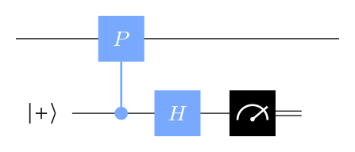
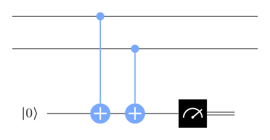
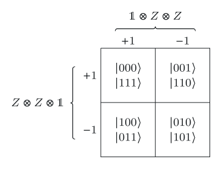
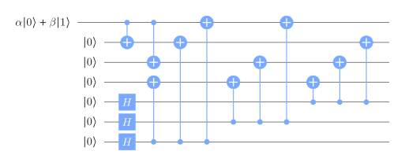
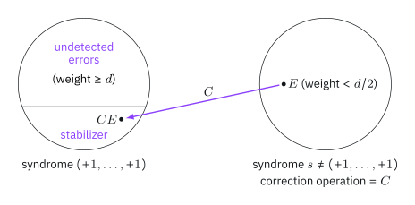

# Pauli operations and observables

## Pauli operations



$$
\mathbb I=\begin{pmatrix}1&0\\0&1\end{pmatrix},\quad
X=\begin{pmatrix}0&1\\1&0\end{pmatrix},\quad
Y=\begin{pmatrix}0&-i\\i&0\end{pmatrix},\quad
Z=\begin{pmatrix}1&0\\0&-1\end{pmatrix}.
$$

- Unitary, Hermitian, square to $\mathbb I$; eigenvalues $\pm1$.
- Distinct non-identity Paulis **anticommute**: $XZ=-ZX$, and $XY=iZ$ (cyclically).

. . .

An $n$-qubit **Pauli operation** is a tensor product such as $Z\otimes Z\otimes\mathbb I$, written $ZZI$. Its **weight** is the number of non-identity factors.

Two Pauli operations either **commute or anticommute**: anticommute exactly when they anticommute at an odd number of positions. $ZZI$ and $XXX$ anticommute at two positions, so they commute.

## Pauli operations as observables

A Pauli operation $P\ne\pm\mathbb I$ has eigenvalues $\pm1$ with eigenspaces of equal dimension. "Measuring $P$" means a projective measurement onto these two eigenspaces.

:::: {.columns}
::: {.column width="45%"}
{width="75%"}
:::
::: {.column width="55%"}
**Non-destructively**, with one ancilla: phase estimation with a controlled-$P$ (phase kickback). The ancilla outcome $0$ means eigenvalue $+1$, outcome $1$ means $-1$. The data qubits are projected onto that eigenspace but not otherwise disturbed.
:::
::::

{width="22%"}

For $Z\otimes Z$ this is just two CNOTs onto a $\ket0$ ancilla: a **parity check**.

# Codes from stabilizers

## The repetition code, revisited

The 3-bit repetition code is the space fixed by two observables:

$$
ZZI\,\ket\psi=\ket\psi,\qquad IZZ\,\ket\psi=\ket\psi
\quad\Longleftrightarrow\quad
\ket\psi\in\operatorname{span}\{\ket{000},\ket{111}\}.
$$

:::: {.columns}
::: {.column width="48%"}
{width="85%"}
:::
::: {.column width="52%"}
The **syndrome** is the pair of outcomes. It splits the 8-dimensional space into four 2-dimensional subspaces; $(+1,+1)$ is the code space.

$XXX$ commutes with both but is not in the group they generate: it acts as a **logical $X$**.
:::
::::

## Stabilizer codes

::: {.box}
[Stabilizer code]{.box-title}
$n$-qubit Pauli operations $P_1,\dots,P_r$ (**stabilizer generators**) that

1. all **commute**,
2. form a **minimal** generating set, and
3. don't generate $-\mathbb I$ (so some state is fixed by all).

**Code space:** $\mathcal C=\{\ket\psi: P_k\ket\psi=\ket\psi\text{ for all }k\}$, of dimension $2^{\,n-r}$.
:::

So $r$ independent generators on $n$ qubits encode $n-r$ logical qubits. The group $\langle P_1,\dots,P_r\rangle$ is the **stabilizer**.

## Examples

| Code | $n$ | Generators | encodes |
|---|---|---|---|
| bit-flip repetition | 3 | $ZZI,\ IZZ$ | 1 |
| phase-flip repetition | 3 | $XXI,\ IXX$ | 1 |
| Shor | 9 | 6 $ZZ$ checks in blocks, 2 $X^{\otimes6}$ checks between blocks | 1 |
| Steane | 7 | 3 $Z$-type, 3 $X$-type (from the Hamming code) | 1 |
| 5-qubit | 5 | $XZZXI,\ IXZZX,\ XIXZZ,\ ZXIXZ$ | 1 |

:::: {.columns}
::: {.column width="40%"}
{width="90%"}
:::
::: {.column width="60%"}
Encoders for stabilizer codes are built from **Clifford** gates ($H$, $S$, CNOT), which map Pauli operations to Pauli operations under conjugation. Shown: the Steane code encoder.
:::
::::

# Detecting and correcting errors

## Three kinds of Pauli error

For a Pauli error $E$ on an encoded state:

1. $E$ **anticommutes** with some generator: the syndrome changes, so the error is **detected**.
2. $E$ commutes with every generator but is **not in the stabilizer** (up to phase): undetected, and it changes the logical state. This is a **logical error**.
3. $E$ is **in the stabilizer** (up to phase): it does nothing to encoded states.

. . .

::: {.box}
[Distance]{.box-title}
The **distance** $d$ is the minimum weight of an error of type 2. An $[[n,k,d]]$ code uses $n$ qubits to encode $k$, with distance $d$.
:::

It detects every error of weight $<d$ and corrects every error of weight $\le\lfloor(d-1)/2\rfloor$. Shor $[[9,1,3]]$, Steane $[[7,1,3]]$ and the 5-qubit code $[[5,1,3]]$ each correct any single-qubit error.

## Correcting errors

1. Measure all stabilizer generators: a syndrome $s\in\{\pm1\}^r$.
2. Choose a correction $C_s$ in advance for each syndrome: typically a **lowest-weight** Pauli producing $s$.
3. Apply $C_s$.

{width="42%"}

If the actual error $E$ has weight $<d/2$, then $C_sE$ has weight $<d$ and syndrome $(+1,\dots,+1)$, so it lies in the stabilizer: **the correction succeeded**, even if $C_s\ne E$.

::: {.notes}
Two errors with the same syndrome differ by an element that commutes with all
generators. If both have weight below $d/2$, their product has weight below
$d$, so it cannot be a logical error, and must be in the stabilizer.
:::

## Recap

1. $n$-qubit **Pauli operations** commute or anticommute; as observables they are measured non-destructively by phase estimation.
2. A **stabilizer code** is the joint $+1$ eigenspace of commuting Pauli generators. $r$ generators on $n$ qubits encode $n-r$ qubits.
3. The **syndrome** (generator outcomes) detects errors that anticommute with some generator.
4. **Distance** = smallest undetectable logical error. $[[n,k,d]]$ corrects $\lfloor(d-1)/2\rfloor$ errors.
5. Shor, Steane and the 5-qubit code are all stabilizer codes with $d=3$.

::: {.aside-note}
Adapted from *Foundations of Quantum Error Correction* by John Watrous, © IBM Corp., [CC BY-SA 4.0](https://creativecommons.org/licenses/by-sa/4.0/). [Original lesson](https://quantum.cloud.ibm.com/learning/en/courses/foundations-of-quantum-error-correction/stabilizer-formalism/introduction).
:::
