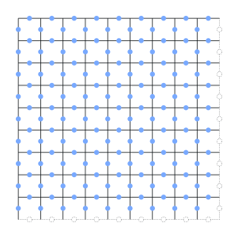
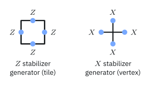
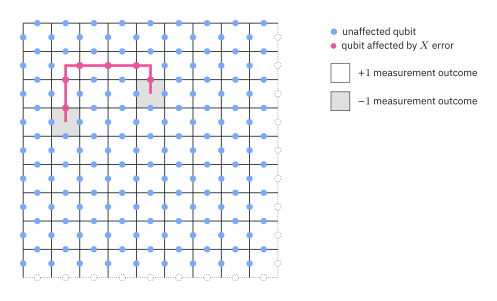
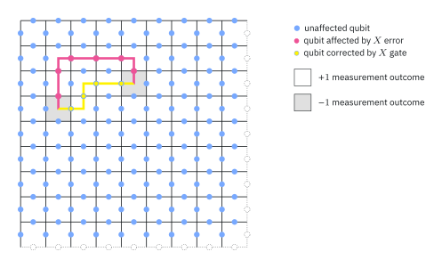
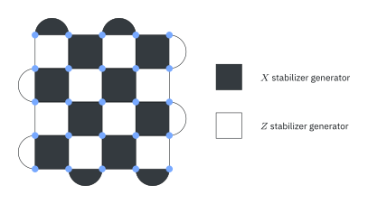
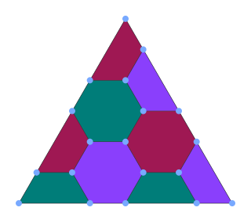

# CSS codes

## Classical linear codes



A **linear code** is a set of binary strings closed under XOR. It can be described by **parity checks**: strings $v$ with $v\cdot x=0$ (mod 2) for every codeword $x$.

- **3-bit repetition code** $\{000,111\}$: parity checks $110$ and $011$.
- **$[7,4,3]$ Hamming code**: 16 codewords of length 7, encoding 4 bits, minimum distance 3. Parity checks:

$$
1111000,\qquad 1100110,\qquad 1010101 .
$$

Each single-bit error gives a **different** nonzero pattern of check violations, so it can be located and fixed.

## Definition of CSS codes

::: {.box}
[CSS code]{.box-title}
A stabilizer code whose generators can be chosen to be **$Z$-type** (only $Z$ and $\mathbb I$) and **$X$-type** (only $X$ and $\mathbb I$).
:::

- Each classical parity check $v$ gives a generator: $Z^{v}$ (a $Z$ on each position where $v$ has a 1), or $X^{v}$.
- $Z$-type and $X$-type generators commute $\iff$ their supports overlap in an **even** number of positions.

. . .

**Steane code:** the Hamming checks used twice:

$$
\begin{array}{ccccccc}
Z&Z&Z&Z&\mathbb I&\mathbb I&\mathbb I\\
Z&Z&\mathbb I&\mathbb I&Z&Z&\mathbb I\\
Z&\mathbb I&Z&\mathbb I&Z&\mathbb I&Z
\end{array}
\qquad
\begin{array}{ccccccc}
X&X&X&X&\mathbb I&\mathbb I&\mathbb I\\
X&X&\mathbb I&\mathbb I&X&X&\mathbb I\\
X&\mathbb I&X&\mathbb I&X&\mathbb I&X
\end{array}
$$

## Correcting errors in CSS codes

**$X$ and $Z$ errors are handled separately:**

- $Z$-type generators detect **bit flips** ($X$ errors), acting exactly as the classical parity checks.
- $X$-type generators detect **phase flips** ($Z$ errors), the same checks in the Hadamard basis.
- A $Y$ error shows up in both.

. . .

So a classical decoder for each set of checks is a quantum decoder. The Steane code uses the Hamming decoder twice and corrects any single-qubit error.

**Code space:** uniform superpositions over cosets of a classical code. The $Z$ checks fix which strings may appear, and the $X$ checks force equal amplitudes and phases within each coset.

# The toric code

## Qubits on a torus

:::: {.columns}
::: {.column width="45%"}
{width="66%"}
:::
::: {.column width="55%"}
An $L\times L$ grid with **periodic** boundaries (a torus), one qubit on every edge: $2L^2$ qubits.

{width="58%"}

- **$Z$ generator** per tile: $Z$ on its 4 edges.
- **$X$ generator** per vertex: $X$ on its 4 edges.
:::
::::

::: {.notes}
Generators always overlap on 0 or 2 qubits, so all commute. The product of
all tile generators is the identity (and likewise for vertices), so one of
each type is redundant: $2L^2-2$ independent generators on $2L^2$ qubits.
:::

They commute; $2L^2-2$ are independent, so it **encodes 2 qubits**.

## Detecting errors

:::: {.columns}
::: {.column width="50%"}
{width="100%"}
:::
::: {.column width="50%"}
A chain of $X$ errors flips the two **tiles at its ends**, and nothing in between: each tile along the way sees two errors.

A **closed loop** of errors is invisible.

- A loop that encloses a region is a product of vertex ($X$) generators: harmless.
- A loop **around the torus** is a logical operation.
:::
::::

## Correcting errors, and distance

:::: {.columns}
::: {.column width="50%"}
{width="100%"}
:::
::: {.column width="50%"}
Correct by joining flagged tiles in pairs with short chains (e.g. **minimum-weight matching**).

Error + correction forms closed loops. If none wraps around the torus, the correction succeeds even if it differs from the actual error.
:::
::::

The shortest logical error wraps the torus: length $L$. The toric code is a $[[2L^2,2,L]]$ code: **distance grows** with $L$, while each check still acts on only 4 nearby qubits.

## Other code families

:::: {.columns}
::: {.column width="50%"}
{width="62%"}

**Surface codes:** the toric code cut flat with suitable boundaries; encodes 1 qubit. **Rotated** surface codes (shown, distance 5) use fewer qubits for the same distance.
:::
::: {.column width="50%"}
{width="48%"}

**Color codes:** generalize the Steane code to 2D lattices of 3-colorable tiles.
:::
::::

**Gross code:** a recent $[[144,12,12]]$ code; like the toric code, but each check reaches 2 extra qubits.

## Recap

1. **Classical linear codes** are described by parity checks; the $[7,4,3]$ Hamming code locates any single bit error.
2. **CSS codes** use $Z$-type and $X$-type generators from classical checks; they correct $X$ and $Z$ errors separately. The Steane code is Hamming used twice.
3. The **toric code**: qubits on edges of an $L\times L$ torus, tile $Z$ and vertex $X$ checks; $[[2L^2,2,L]]$.
4. Errors show up as **endpoints of chains**; decoding pairs them up; logical errors are loops around the torus.
5. **Surface**, **color** and newer codes such as the gross code build on the same ideas.

::: {.aside-note}
Adapted from *Foundations of Quantum Error Correction* by John Watrous, © IBM Corp., [CC BY-SA 4.0](https://creativecommons.org/licenses/by-sa/4.0/). [Original lesson](https://quantum.cloud.ibm.com/learning/en/courses/foundations-of-quantum-error-correction/quantum-code-constructions/introduction).
:::
