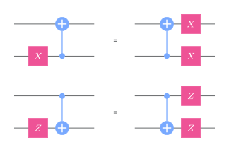
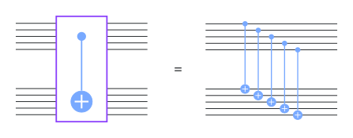
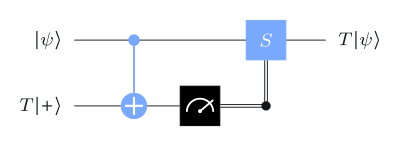
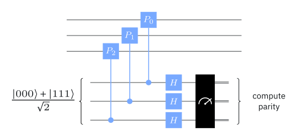

# An approach to fault tolerance

## The problem



Error correction protects **stored** qubits. But in a real computer, **everything** is noisy: the gates of the computation, the encoding, and the syndrome-measurement circuits themselves.

. . .

**Noise model** (the simplest standard one): errors strike each **location** of a circuit (gate, idle qubit, preparation, measurement) **independently** with probability $p$.

::: {.aside-note}
Real devices have correlated errors too; the independent model is a baseline ("nature is unpredictable, not malicious"). Results extend to more adversarial models.
:::

## Fault-tolerant implementations

Replace each qubit by an encoded block, and each gate by a **gadget** acting on encoded blocks, with error correction between gadgets.

::: {.box}
**Design goal:** a single fault anywhere in a gadget causes **at most one error per code block**, which the next round of error correction removes.
:::

:::: {.columns}
::: {.column width="55%"}
The danger is **error propagation**: a two-qubit gate can turn one error into two. An $X$ on a CNOT's control copies to the target; a $Z$ on the target copies to the control.
:::
::: {.column width="45%"}
{width="70%"}
:::
::::

# Controlling error propagation

## Transversal gates

:::: {.columns}
::: {.column width="45%"}
{width="88%"}
:::
::: {.column width="55%"}
A gate is **transversal** if it acts qubit by qubit across code blocks: the $k$-th qubit of one block interacts only with the $k$-th qubit of another.

A fault then affects **at most one qubit per block**. Fault-tolerant automatically.

Examples: qubit-by-qubit CNOT works for **every CSS code**, and logical Pauli gates are transversal for **every stabilizer code**.
:::
::::

. . .

::: {.box}
[Eastin–Knill theorem]{.box-title}
For any code with distance at least 2, the transversal logical gates form a discrete set, so they are **never universal**.
:::

## Magic states

The missing gate is $T$. Prepare a **magic state** $T\ket+$ separately, and use it to apply $T$ with Clifford gates and a measurement:

{width="44%"}

CNOT, measure, and apply $S$ if the outcome is $1$: the output is $T\ket\psi$.

. . .

- Run the same circuit on **encoded** blocks: every part except the magic state is transversal.
- Noisy encoded magic states are cleaned up by **magic state distillation**: many noisy copies in, fewer better copies out.

## Fault-tolerant error correction

Syndrome measurement must not spread errors either. A naive check, one ancilla touched by several data qubits, can feed one ancilla error back into many of them.

:::: {.columns}
::: {.column width="50%"}
{width="90%"}
:::
::: {.column width="50%"}
- **Shor's method:** measure each generator using a **cat state** $\tfrac{1}{\sqrt2}(\ket{0\cdots0}+\ket{1\cdots1})$ so that each ancilla qubit touches only one data qubit. Repeat to guard against measurement errors.
- **Steane's method:** prepare an encoded ancilla and interact with it **transversally**.
- **Knill's method:** fault-tolerant **teleportation** through encoded Bell pairs.
:::
::::

# The threshold theorem

## Statement

::: {.box}
[Threshold theorem]{.box-title}
A quantum circuit of size $N$ can be implemented with high accuracy by a noisy circuit, provided the error probability at each location is below a fixed threshold $p_{\text{th}}>0$. The noisy circuit has size $O(N\log^c N)$ for a constant $c$.
:::

Arbitrarily long quantum computations are possible **with only polylogarithmic overhead**, as long as the hardware is good enough.

Estimated thresholds with surface codes and modern gadgets: about **0.1% to 1%**.

## Why: concatenation

With the Steane code, a logical error needs two faults in one block: probability at most $Cp^2$. Below $p_{\text{th}}=1/C$ this is an improvement.

. . .

Now treat the fault-tolerant circuit as an ordinary circuit and make **it** fault-tolerant. After $k$ levels:

$$
p\;\to\;(Cp)\,p\;\to\;(Cp)^3p\;\to\;(Cp)^7p\;\to\;\cdots\;\to\;(Cp)^{2^k-1}p .
$$

- Error rate falls **doubly exponentially** in $k$.
- Circuit size grows only **singly exponentially** in $k$.

So $k\approx\log\log N$ levels suffice, and the size grows by only a polylog factor.

## Try it: concatenation levels {.scrollable}

```{ojs}
//| echo: false
viewof pphys = Inputs.range([0.0001, 0.02], {step: 0.0001, value: 0.002, label: "physical error rate p"})
viewof Cc = Inputs.range([50, 1000], {step: 10, value: 200, label: "constant C (threshold 1/C)"})
```

```{ojs}
//| echo: false
levels = d3.range(0, 6).map(k => {
  const x = Cc * pphys;
  return {k, err: Math.min(1, Math.pow(x, 2 ** k - 1) * pphys)};
})
Plot.plot({
  width: 900, height: 280, marginLeft: 70,
  x: {label: "concatenation level k →", ticks: 6, tickFormat: "d"},
  y: {type: "log", label: "↑ logical error bound", grid: true, domain: [1e-30, 1]},
  marks: [Plot.line(levels.filter(d => d.err > 0), {x: "k", y: d => Math.max(d.err, 1e-30), stroke: "#3b5bdb", strokeWidth: 2, marker: "circle"})]
})
html`<p style="font-size:0.8em">threshold 1/C = ${(1 / Cc).toFixed(4)}; p is ${pphys < 1 / Cc ? "<strong>below</strong> threshold: errors vanish fast" : "<strong>above</strong> threshold: concatenation makes it worse"}</p>`
```

The bound $(Cp)^{2^k-1}p$ from the slide before. Move $p$ across $1/C$ and watch the curve flip from plunging to rising.

## Recap

1. **Fault tolerance:** every part of the computation is noisy, error correction included. Gadgets must keep one fault to one error per block.
2. **Transversal gates** are fault-tolerant automatically, but by **Eastin–Knill** never universal.
3. **Magic states** ($T\ket+$, made reliable by distillation) supply the missing non-Clifford gate.
4. Syndrome extraction must be fault-tolerant too: Shor, Steane and Knill methods.
5. **Threshold theorem:** below a constant error rate (≈0.1–1% for surface codes), any computation runs reliably with polylog overhead, via **concatenation**.

::: {.aside-note}
Adapted from *Foundations of Quantum Error Correction* by John Watrous, © IBM Corp., [CC BY-SA 4.0](https://creativecommons.org/licenses/by-sa/4.0/). [Original lesson](https://quantum.cloud.ibm.com/learning/en/courses/foundations-of-quantum-error-correction/fault-tolerant-quantum-computing/introduction).
:::
