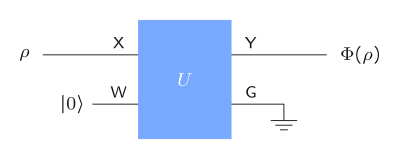
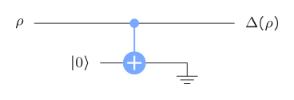
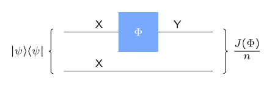

# Quantum channel basics

## What is a channel?



A **channel** $\Phi$ from $\mathsf X$ to $\mathsf Y$ is any physically possible operation: it takes a density matrix of $\mathsf X$ to a density matrix of $\mathsf Y$. Unitaries, measurements whose results are thrown away, noise, discarding a system: all channels.

. . .

::: {.box}
[Channel]{.box-title}
A linear map $\Phi$ that is

- **trace-preserving**: $\operatorname{Tr}(\Phi(\rho))=\operatorname{Tr}(\rho)$, and
- **completely positive**: $(\mathrm{Id}_{\mathsf Z}\otimes\Phi)(P)\ge0$ for every positive semidefinite $P$ on $(\mathsf Z,\mathsf X)$, for every system $\mathsf Z$.
:::

**Linear** because mixing inputs must mix outputs. **Completely** positive because $\Phi$ may act on half of an entangled pair. Positivity alone is not enough: the **transpose** is positive and trace-preserving but **not** a channel.

## First examples

- **Unitary channel**: $\Phi(\rho)=U\rho U^\dagger$.
- **Convex combinations** of channels are channels: $\rho\mapsto\sum_k p_k\Phi_k(\rho)$.

. . .

Three noisy qubit channels:

$$
\begin{aligned}
\text{reset:}\quad &\Lambda(\rho)=\operatorname{Tr}(\rho)\ket0\bra0\\[1mm]
\text{completely dephasing:}\quad &\Delta(\rho)=\bra0\rho\ket0\,\ket0\bra0+\bra1\rho\ket1\,\ket1\bra1\\[1mm]
\text{completely depolarizing:}\quad &\Omega(\rho)=\operatorname{Tr}(\rho)\,\frac{\mathbb I}{2}
\end{aligned}
$$

$\Delta$ erases the off-diagonal entries: a standard basis measurement whose outcome nobody looks at. $\Omega$ outputs the completely mixed state, and $\Omega_\varepsilon=(1-\varepsilon)\,\mathrm{Id}+\varepsilon\,\Omega$ is the standard model of depolarizing **noise**.

# Three representations

## Stinespring: a unitary on a bigger system

:::: {.columns}
::: {.column width="45%"}
{width="100%"}
:::
::: {.column width="55%"}
Attach a fresh system $\mathsf W$ in $\ket0$, apply a unitary $U$ to $(\mathsf X,\mathsf W)$, and discard part of the result (the ground symbol = partial trace):

$$
\Phi(\rho)=\operatorname{Tr}_{\mathsf G}\Bigl(U\bigl(\rho\otimes\ket0\bra0\bigr)U^\dagger\Bigr).
$$
:::
::::

:::: {.columns}
::: {.column width="50%"}
{width="75%"}
:::
::: {.column width="50%"}
Completely dephasing: a CNOT copies the standard basis onto $\ket0$, and the copy is discarded. Information leaking to an environment **is** decoherence.
:::
::::

## Kraus: a sum of sandwiches

$$
\Phi(\rho)=\sum_{k=0}^{N-1}A_k\,\rho\,A_k^\dagger,
\qquad
\sum_{k}A_k^\dagger A_k=\mathbb I .
$$

| Channel | Kraus matrices |
|---|---|
| Unitary | $U$ |
| Reset $\Lambda$ | $\ket0\bra0,\ \ket0\bra1$ |
| Completely dephasing $\Delta$ | $\ket0\bra0,\ \ket1\bra1$ |
| Completely depolarizing $\Omega$ | $\tfrac12\mathbb I,\ \tfrac12X,\ \tfrac12Y,\ \tfrac12Z$ |

The condition $\sum_kA_k^\dagger A_k=\mathbb I$ is exactly trace preservation. Kraus matrices are not unique.

## Choi: one matrix that is the channel

$$
J(\Phi)=\sum_{a,b\in\Sigma}\ket a\bra b\otimes\Phi\bigl(\ket a\bra b\bigr).
$$

:::: {.columns}
::: {.column width="45%"}
{width="100%"}
:::
::: {.column width="55%"}
Apply $\Phi$ to half of the maximally entangled $\ket\psi=\tfrac1{\sqrt n}\sum_a\ket a\ket a$: the output is the **Choi state** $J(\Phi)/n$.

$\Phi$ is a channel $\iff$ $J(\Phi)\ge0$ and $\operatorname{Tr}_{\mathsf Y}J(\Phi)=\mathbb I_{\mathsf X}$.
:::
::::

Examples: $J(\mathrm{Id})=n\ket\psi\bra\psi$ (unnormalized e-bit for $n=2$); $J(\Omega)=\tfrac12\mathbb I\otimes\mathbb I$.

## All three are equivalent

Every channel has all three representations, and each one gives a channel:

$$
\text{channel}\;\Longrightarrow\;\text{Choi}\;\Longrightarrow\;\text{Kraus}\;\Longrightarrow\;\text{Stinespring}\;\Longrightarrow\;\text{channel}.
$$

. . .

- **Channel → Choi:** apply $\Phi$ to half of a maximally entangled state; complete positivity makes $J(\Phi)\ge0$.
- **Choi → Kraus:** write $J(\Phi)=\sum_k\ket{\psi_k}\bra{\psi_k}$ (spectral decomposition); each $\ket{\psi_k}$, reshaped, is a Kraus matrix.
- **Kraus → Stinespring:** $U\ket\phi\ket0=\sum_kA_k\ket\phi\ket k$ defines an isometry; extend it to a unitary.
- **Stinespring → channel:** unitaries, adding $\ket0$ and partial traces are all completely positive and trace-preserving.

::: {.notes}
At most $nm$ Kraus matrices are ever needed for a channel from an
$n$-dimensional to an $m$-dimensional system: the rank of $J(\Phi)$.
:::

## In Qiskit

```python
from qiskit.quantum_info import Kraus, Choi, DensityMatrix
import numpy as np

K0 = np.array([[1, 0], [0, 0]])       # completely dephasing channel
K1 = np.array([[0, 0], [0, 1]])
dephase = Kraus([K0, K1])

dephase.is_cptp()                     # True: a valid channel
Choi(dephase).data                    # its 4x4 Choi matrix
DensityMatrix.from_label("+").evolve(dephase)   # -> I/2: the coherence is gone
```

## Recap

1. A **channel** is a linear, trace-preserving, **completely** positive map. It describes any physical operation, noise included.
2. Key qubit examples: **reset**, **completely dephasing** (kills off-diagonals), **completely depolarizing** (outputs $\mathbb I/2$).
3. **Stinespring:** a unitary on system + environment, then discard.
4. **Kraus:** $\Phi(\rho)=\sum A_k\rho A_k^\dagger$ with $\sum A_k^\dagger A_k=\mathbb I$.
5. **Choi:** $J(\Phi)\ge0$ and $\operatorname{Tr}_{\mathsf Y}J(\Phi)=\mathbb I$ characterize channels exactly.

::: {.aside-note}
Adapted from *General Formulation of Quantum Information* by John Watrous, © IBM Corp., [CC BY-SA 4.0](https://creativecommons.org/licenses/by-sa/4.0/). [Original lesson](https://quantum.cloud.ibm.com/learning/en/courses/general-formulation-of-quantum-information/quantum-channels/introduction).
:::
