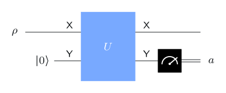

# Formulations of measurements

## Measurements as collections of matrices



::: {.box}
[General measurement]{.box-title}
Positive semidefinite matrices $\{P_0,\dots,P_{m-1}\}$ with $P_0+\cdots+P_{m-1}=\mathbb I$. On state $\rho$, outcome $a$ appears with probability
$$
\Pr(a)=\operatorname{Tr}(P_a\rho)=\bra\psi P_a\ket\psi\ \text{ for }\rho=\ket\psi\bra\psi .
$$
:::

- **Projective** measurements are the special case where every $P_a$ is a projection.
- The number of outcomes $m$ can **exceed** the dimension $n$.
- Also called a **POVM** (positive operator-valued measure).

## Two non-projective examples

**Two outcomes, one qubit:**

$$
P_0=\begin{pmatrix}\tfrac23&\tfrac13\\[1mm]\tfrac13&\tfrac13\end{pmatrix},
\qquad
P_1=\begin{pmatrix}\tfrac13&-\tfrac13\\[1mm]-\tfrac13&\tfrac23\end{pmatrix}.
$$

Both are positive semidefinite and sum to $\mathbb I$, but $P_0^2\ne P_0$.

Unlike a projective measurement, a general measurement can have more outcomes than the dimension, as the next example shows.

## The tetrahedral measurement

:::: {.columns}
::: {.column width="40%"}
{width="100%"}
:::
::: {.column width="60%"}
Four outcomes on one qubit: $P_a=\tfrac12\ket{\phi_a}\bra{\phi_a}$, where the $\ket{\phi_a}$ are the corners of a regular tetrahedron in the Bloch sphere:

$$
\begin{aligned}
\ket{\phi_0}&=\ket0,\\
\ket{\phi_{k+1}}&=\tfrac1{\sqrt3}\ket0+\sqrt{\tfrac23}\,e^{2\pi ik/3}\ket1,\quad k=0,1,2 .
\end{aligned}
$$

The four $P_a$ sum to $\mathbb I$: the corners average to the center of the sphere.
:::
::::

## Measurements as channels

A measurement is also a **channel** from $\mathsf X$ to a classical register $\mathsf Y$ holding the outcome:

$$
\Phi(\rho)=\sum_{a=0}^{m-1}\operatorname{Tr}(P_a\rho)\,\ket a\bra a .
$$

. . .

Conversely, any channel whose output is always **diagonal** is a measurement: $P_a$ is read off from $\Phi$ as the matrix with $\operatorname{Tr}(P_a\rho)=\bra a\Phi(\rho)\ket a$.

**Partial measurements** follow the same rules on a subsystem: measure $\mathsf X$ of $(\mathsf X,\mathsf Z)$ with $\{P_a\}$; outcome $a$ appears with probability $\operatorname{Tr}\bigl((P_a\otimes\mathbb I)\rho\bigr)$, and leaves $\mathsf Z$ in $\operatorname{Tr}_{\mathsf X}\bigl((P_a\otimes\mathbb I)\rho\bigr)$ divided by that probability.

# Naimark's theorem

## Every measurement is projective, in a bigger space

{width="40%"}

Given $\{P_0,\dots,P_{m-1}\}$, add a system $\mathsf Y$ with $m$ states in $\ket0$, apply a unitary $U$ satisfying

$$
U\bigl(\ket\psi\otimes\ket0\bigr)=\sum_{a=0}^{m-1}\sqrt{P_a}\ket\psi\otimes\ket a,
$$

and measure $\mathsf Y$ in the standard basis. Outcome $a$ appears with probability $\norm{\sqrt{P_a}\ket\psi}^2=\bra\psi P_a\ket\psi$. ✓

::: {.notes}
$\sqrt{P}$ is the unique positive semidefinite square root: take a spectral
decomposition $P=\sum_k\lambda_k\ket{\psi_k}\bra{\psi_k}$ and replace each
$\lambda_k$ by $\sqrt{\lambda_k}$. The map $\ket\psi\ket0\mapsto\sum_a\sqrt{P_a}\ket\psi\ket a$
preserves inner products because $\sum_aP_a=\mathbb I$, so it extends to a unitary.
:::

## Non-destructive measurements

Naimark's construction also says what happens to $\mathsf X$: after outcome $a$, it is left in

$$
\frac{\sqrt{P_a}\,\rho\,\sqrt{P_a}}{\operatorname{Tr}(P_a\rho)} .
$$

. . .

More generally, from any Kraus-type description $\{M_{a,k}\}$ with $\sum_kM_{a,k}^\dagger M_{a,k}=P_a$, the post-measurement state is

$$
\frac{\sum_kM_{a,k}\,\rho\,M_{a,k}^\dagger}{\operatorname{Tr}(P_a\rho)} .
$$

The outcome statistics fix $P_a$; how the system is disturbed is an extra choice.

# Discrimination and tomography

## Telling two states apart

$\rho_0$ is prepared with probability $p$, $\rho_1$ with probability $1-p$; guess which.

::: {.box}
[Helstrom–Holevo theorem]{.box-title}
The best possible probability of a correct guess is
$$
\frac12+\frac12\bigl\|\,p\rho_0-(1-p)\rho_1\bigr\|_1 ,
$$
where $\norm{A}_1$ (the **trace norm**) is the sum of the absolute values of the eigenvalues of $A$.
:::

Optimal: project onto the nonnegative eigenspace of $p\rho_0-(1-p)\rho_1$. For pure states, equal priors: $\tfrac12+\tfrac12\sqrt{1-\abs{\braket{\psi_0}{\psi_1}}^2}$.

## Try it: discriminate two qubit states {.scrollable}

```{ojs}
//| echo: false
viewof a0 = Inputs.range([0, 360], {step: 1, value: 0, label: "ρ₀ direction (degrees)"})
viewof l0 = Inputs.range([0, 1], {step: 0.01, value: 1, label: "ρ₀ purity ‖r₀‖"})
viewof a1 = Inputs.range([0, 360], {step: 1, value: 90, label: "ρ₁ direction (degrees)"})
viewof l1 = Inputs.range([0, 1], {step: 0.01, value: 1, label: "ρ₁ purity ‖r₁‖"})
viewof prior = Inputs.range([0, 1], {step: 0.01, value: 0.5, label: "p = Pr(ρ₀)"})
```

```{ojs}
//| echo: false
helstrom = {
  const r = Math.PI / 180;
  const v0 = [l0 * Math.sin(a0 * r), l0 * Math.cos(a0 * r)], v1 = [l1 * Math.sin(a1 * r), l1 * Math.cos(a1 * r)];
  const w = [prior * v0[0] - (1 - prior) * v1[0], prior * v0[1] - (1 - prior) * v1[1]];
  const tn = Math.max(Math.abs(2 * prior - 1), Math.hypot(w[0], w[1]));
  return {v0, v1, p: 0.5 + 0.5 * tn};
}
Plot.plot({
  width: 340, height: 340, inset: 10, x: {domain: [-1.1, 1.1], axis: null}, y: {domain: [-1.1, 1.1], axis: null},
  marks: [
    Plot.line(d3.range(0, 361, 3).map(t => [Math.sin(t * Math.PI / 180), Math.cos(t * Math.PI / 180)]), {x: d => d[0], y: d => d[1], stroke: "#9aa1ae"}),
    Plot.text([[0, 1.07], [0, -1.07], [1.07, 0]], {x: d => d[0], y: d => d[1], text: ["|0⟩", "|1⟩", "|+⟩"], fontSize: 13}),
    Plot.arrow([helstrom.v0], {x1: 0, y1: 0, x2: d => d[0], y2: d => d[1], stroke: "#3b5bdb", strokeWidth: 3}),
    Plot.arrow([helstrom.v1], {x1: 0, y1: 0, x2: d => d[0], y2: d => d[1], stroke: "#d9480f", strokeWidth: 3})
  ]
})
html`<p style="font-size:0.8em">Best success probability: <strong>${helstrom.p.toFixed(4)}</strong>
(blue ρ₀, orange ρ₁, in the x–z plane of the Bloch ball)</p>`
```

For qubits, $\norm{p\rho_0-(1-p)\rho_1}_1=\max\bigl(\abs{2p-1},\ \norm{p\,r_0-(1-p)\,r_1}\bigr)$. Defaults: $\ket0$ vs. $\ket+$, success $\approx0.854$.

## More than two states, and tomography

- **Three or more states:** no closed formula in general. The optimum is a semidefinite program, computable numerically.

. . .

**Quantum state tomography:** estimate an unknown $\rho$ from many copies.

- **Pauli measurements:** measure a third of the copies each in the $X$, $Y$, $Z$ bases. The averages estimate $r_x,r_y,r_z$, hence $\rho=\tfrac12(\mathbb I+r\cdot\sigma)$.
- **Tetrahedral measurement:** one fixed four-outcome measurement on every copy. Its outcome frequencies determine $\rho$, because $\{P_a\}$ spans all $2\times2$ Hermitian matrices.

The estimate improves like $1/\sqrt N$ with $N$ copies: a single copy reveals almost nothing.

## Recap

1. A **general measurement** is $\{P_a\}$, positive semidefinite, summing to $\mathbb I$; $\Pr(a)=\operatorname{Tr}(P_a\rho)$.
2. Equivalently, a **channel** with classical (diagonal) output.
3. **Naimark:** every general measurement is a projective measurement on a larger system; it can be made **non-destructive**, leaving $\sqrt{P_a}\rho\sqrt{P_a}/\Pr(a)$.
4. **Helstrom–Holevo:** the best guess between two states succeeds with probability $\tfrac12+\tfrac12\norm{p\rho_0-(1-p)\rho_1}_1$.
5. **Tomography** reconstructs $\rho$ from statistics on many copies.

::: {.aside-note}
Adapted from *General Formulation of Quantum Information* by John Watrous, © IBM Corp., [CC BY-SA 4.0](https://creativecommons.org/licenses/by-sa/4.0/). [Original lesson](https://quantum.cloud.ibm.com/learning/en/courses/general-formulation-of-quantum-information/general-measurements/introduction).
:::
