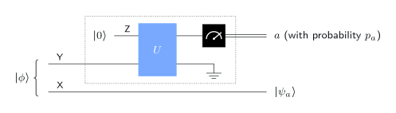
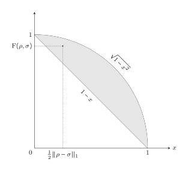

# Purifications

## Every mixed state is part of a pure one



::: {.box}
[Purification]{.box-title}
A state vector $\ket\psi$ of a pair $(\mathsf X,\mathsf Y)$ **purifies** $\rho$ if
$\;\operatorname{Tr}_{\mathsf Y}\bigl(\ket\psi\bra\psi\bigr)=\rho .$
:::

**Existence.** Take a spectral decomposition $\rho=\sum_{k=0}^{r-1}p_k\ket{\psi_k}\bra{\psi_k}$ and set

$$
\ket\psi=\sum_{k=0}^{r-1}\sqrt{p_k}\,\ket{\psi_k}\otimes\ket k .
$$

$\mathsf Y$ needs at least $r=\operatorname{rank}(\rho)$ classical states. Example: the e-bit purifies $\mathbb I/2$.

. . .

Mixedness can always be viewed as **entanglement with something we don't hold**.

## Schmidt decompositions

::: {.box}
[Schmidt decomposition]{.box-title}
Every state vector of $(\mathsf X,\mathsf Y)$ can be written
$$
\ket\psi=\sum_{a=0}^{r-1}\sqrt{p_a}\,\ket{x_a}\otimes\ket{y_a},
$$
with $p_a>0$ summing to $1$, and **both** $\{\ket{x_a}\}$ and $\{\ket{y_a}\}$ orthonormal.
:::

- Follows from the singular value decomposition of the coefficient matrix of $\ket\psi$.
- Both reduced states share the **same nonzero eigenvalues** $p_a$:
  $\operatorname{Tr}_{\mathsf Y}=\sum_ap_a\ket{x_a}\bra{x_a}$, $\;\operatorname{Tr}_{\mathsf X}=\sum_ap_a\ket{y_a}\bra{y_a}$.
- $\ket\psi$ is a product state $\iff r=1$ (the **Schmidt rank**).

## Unitary equivalence of purifications

::: {.box}
[Theorem]{.box-title}
If $\ket\psi$ and $\ket\phi$ of $(\mathsf X,\mathsf Y)$ both purify the same $\rho$, there is a unitary $U$ **on $\mathsf Y$ alone** with
$\;(\mathbb I_{\mathsf X}\otimes U)\ket\psi=\ket\phi .$
:::

Proof: write both in Schmidt form. The $\ket{x_a}$ and $p_a$ are fixed by $\rho$, so the two differ only in the orthonormal sets $\{\ket{y_a}\}$, and a unitary maps one set to the other.

. . .

**Consequences:**

- **Superdense coding** works for this reason: Alice's local unitary can turn $\ket{\phi^+}$ into any of the four Bell states.
- **Ideal quantum bit commitment is impossible:** if the receiver's state is the same whether the bit is 0 or 1, the committer can switch between the two purifications with a local unitary.

## Hughston–Jozsa–Wootters

{width="46%"}

If $\operatorname{Tr}_{\mathsf Y}\ket\phi\bra\phi=\sum_ap_a\ket{\psi_a}\bra{\psi_a}$ for **any** decomposition, there is a measurement on $\mathsf Y$ alone giving outcome $a$ with probability $p_a$ and leaving $\mathsf X$ in $\ket{\psi_a}$.

By measuring their half, the holder of $\mathsf Y$ can **steer** $\mathsf X$ into any ensemble that averages to $\rho$. They still can't choose which outcome occurs, so no signal is sent.

# Fidelity

## Definition

::: {.box}
[Fidelity]{.box-title}
$$
\operatorname F(\rho,\sigma)=\operatorname{Tr}\sqrt{\sqrt\rho\,\sigma\,\sqrt\rho}=\bigl\|\sqrt\rho\sqrt\sigma\bigr\|_1 .
$$
:::

- **Pure and anything:** $\operatorname F\bigl(\ket\psi\bra\psi,\sigma\bigr)=\sqrt{\bra\psi\sigma\ket\psi}$.
- **Two pure states:** $\operatorname F=\abs{\braket\psi\phi}$.

::: {.aside-note}
Some authors define fidelity as the **square** of this quantity. Always check which convention a source uses.
:::

## Properties

1. $0\le\operatorname F(\rho,\sigma)\le1$: equal to $1$ iff $\rho=\sigma$, equal to $0$ iff their supports are orthogonal. Symmetric in $\rho,\sigma$.
2. **Multiplicative:** $\operatorname F(\rho_1\otimes\rho_2,\sigma_1\otimes\sigma_2)=\operatorname F(\rho_1,\sigma_1)\operatorname F(\rho_2,\sigma_2)$.
3. **Monotone:** $\operatorname F(\rho,\sigma)\le\operatorname F\bigl(\Phi(\rho),\Phi(\sigma)\bigr)$ for every channel $\Phi$. Processing never makes states easier to tell apart.

## Fidelity vs. trace distance

**Fuchs–van de Graaf inequalities:**

$$
1-\tfrac12\norm{\rho-\sigma}_1\;\le\;\operatorname F(\rho,\sigma)\;\le\;\sqrt{1-\tfrac14\norm{\rho-\sigma}_1^2}.
$$

:::: {.columns}
::: {.column width="45%"}
{width="72%"}
:::
::: {.column width="55%"}
With $x=\tfrac12\norm{\rho-\sigma}_1$ on the horizontal axis, $(x,\operatorname F)$ always lies in the shaded region between the line $1-x$ and the curve $\sqrt{1-x^2}$.

So **high fidelity $\iff$ small trace distance**, and by Helstrom–Holevo, $\iff$ the states are hard to tell apart.
:::
::::

## Gentle measurement lemma

If a measurement outcome is **very likely**, observing it barely disturbs the state.

::: {.box}
If $\operatorname{Tr}(P_0\rho)>1-\varepsilon$, the non-destructive measurement from Naimark's theorem, on outcome $0$, leaves
$$
\rho_0=\frac{\sqrt{P_0}\,\rho\,\sqrt{P_0}}{\operatorname{Tr}(P_0\rho)}
\qquad\text{with}\qquad
\operatorname F(\rho,\rho_0)^2>1-\varepsilon .
$$
:::

This is why checking a property that is almost certainly true is almost free in quantum algorithms and protocols.

::: {.notes}
The proof uses $\sqrt{P_0}\ge P_0$ (eigenvalues in $[0,1]$), so
$\operatorname F(\rho,\rho_0)=\operatorname{Tr}(\sqrt{P_0}\rho)/\sqrt{\operatorname{Tr}(P_0\rho)}\ge\sqrt{\operatorname{Tr}(P_0\rho)}$.
:::

## Uhlmann's theorem

::: {.box}
[Uhlmann's theorem]{.box-title}
$$
\operatorname F(\rho,\sigma)=\max\Bigl\{\abs{\braket\phi\psi}\ :\ \ket\phi\text{ purifies }\rho,\ \ket\psi\text{ purifies }\sigma\Bigr\},
$$
over purifications in $(\mathsf X,\mathsf Y)$, with $\mathsf Y$ at least as large as $\mathsf X$.
:::

The fidelity of two mixed states is the **best overlap of their purifications**, reducing a statement about mixed states to one about pure ones.

. . .

Monotonicity under channels follows: apply the channel's Stinespring unitary to the optimal purifications. The overlap is unchanged, and they are purifications of the outputs.

## Recap

1. Every $\rho$ has a **purification**; mixedness is entanglement with an unseen system.
2. **Schmidt decomposition:** $\ket\psi=\sum\sqrt{p_a}\ket{x_a}\ket{y_a}$; both halves have the same spectrum.
3. Purifications of the same $\rho$ differ by a **unitary on the purifying system**: superdense coding works, ideal bit commitment does not.
4. **Fidelity** $\operatorname F=\operatorname{Tr}\sqrt{\sqrt\rho\sigma\sqrt\rho}$: multiplicative, monotone under channels, tied to trace distance by **Fuchs–van de Graaf**.
5. **Gentle measurement** and **Uhlmann's theorem** connect fidelity to measurement and to purifications.

::: {.aside-note}
Adapted from *General Formulation of Quantum Information* by John Watrous, © IBM Corp., [CC BY-SA 4.0](https://creativecommons.org/licenses/by-sa/4.0/). [Original lesson](https://quantum.cloud.ibm.com/learning/en/courses/general-formulation-of-quantum-information/purifications-and-fidelity/introduction).
:::
