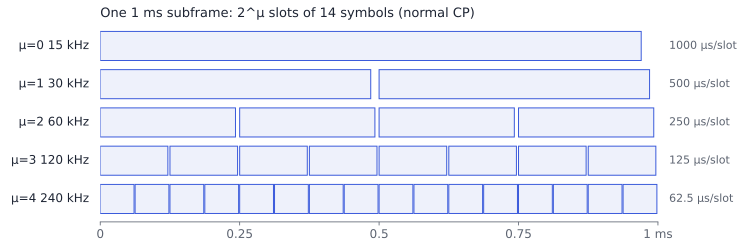

# Timing units and the OFDM symbol {#timing}

## Why $T_c = 1/(480\,\text{kHz}\cdot 4096)$ {#why-tc}



Every time quantity in TS 38.211 is an integer multiple of one basic unit:

$$
T_c=\frac{1}{\Delta f_{\max}\,N_f},\quad \Delta f_{\max}=480\ \text{kHz},\ N_f=4096 \;\Rightarrow\; T_c\approx 0.509\ \text{ns}
$$

$$
\kappa=\frac{T_s}{T_c}=64,\qquad T_s=\frac{1}{15\ \text{kHz}\cdot 2048}\approx 32.55\ \text{ns}\ (\text{the LTE unit})
$$

::: {.box}

[Design intent]{.box-title} $T_c$ is the sample time of a 4096-point FFT at the largest subcarrier spacing. Every coarser numerology is an exact power-of-two multiple, so CP lengths, guard periods and timing-advance steps are integers, never rounded.

:::

::: {.spec}

TS 38.211 §4.1

:::

::: {.notes}
Point out that κ = 64 makes LTE and NR timing commensurate: one LTE Ts is exactly 64 Tc. This is what lets DSS and EN-DC share timing references without fractional offsets. Rel-17 extends Δf to 960 kHz for FR2-2, but Tc is unchanged; the 480/960 kHz numerologies use the same integer formulas with larger μ.
:::

## Symbol and CP lengths, exactly {#cp-formula}

For numerology $\mu$ ($\Delta f = 15\cdot 2^{\mu}$ kHz), normal CP:

$$
N_u^{\mu}=2048\,\kappa\,2^{-\mu},\qquad N_{CP,l}^{\mu}=\begin{cases}144\,\kappa\,2^{-\mu}+16\,\kappa & l=0\ \text{or}\ l=7\cdot 2^{\mu}\\[1mm] 144\,\kappa\,2^{-\mu} & \text{otherwise}\end{cases}
$$

Extended CP (60 kHz only): $N_{CP}=512\,\kappa\,2^{-\mu}$, 12 symbols per slot.

::: {.compact}
| μ | Δf | Tu (µs) | CP (µs) | long CP (µs) | CP overhead |
|---|---|---|---|---|---|
| 0 | 15 kHz | 66.667 | 4.688 | 5.208 | 6.6 % |
| 1 | 30 kHz | 33.333 | 2.344 | 2.865 | 6.6 % |
| 2 | 60 kHz | 16.667 | 1.172 | 1.693 | 6.6 % |
| 3 | 120 kHz | 8.333 | 0.586 | 1.107 | 6.6 % |
| 4 | 240 kHz | 4.167 | 0.293 | 0.814 | 6.6 % |
:::

::: {.spec}

TS 38.211 §5.3.1

:::

::: {.notes}
The +16κ (0.521 µs) extra on one symbol every 0.5 ms is what makes 14 symbols fit exactly into a slot. Check for μ=1: 14 × (33.333 + 2.344) + 0.521 = 500.0 µs. The extra is a constant 16κ for every μ, so at high μ it is a large fraction of the CP: at 120 kHz the "long" symbol has almost twice the normal CP. Receivers must handle the irregular symbol lengths when computing FFT window positions.
:::

## The baseband OFDM signal in TS 38.211 {#ofdm-signal}

For antenna port $p$, numerology $\mu$, symbol $l$ starting at $t^{\mu}_{\text{start},l}$:

$$
s_l^{(p,\mu)}(t)=\sum_{k=0}^{N^{\mu}_{\text{grid}}N^{RB}_{sc}-1} a_{k,l}^{(p,\mu)}\, e^{\,j2\pi\left(k+k_0^{\mu}-N^{\mu}_{\text{grid}}N^{RB}_{sc}/2\right)\Delta f\,\left(t-N^{\mu}_{CP,l}T_c-t^{\mu}_{\text{start},l}\right)}
$$

- $k_0^{\mu}$ aligns grids of different numerologies on the same carrier (mixed numerology).
- No DC subcarrier is reserved, unlike LTE. The UE reports where its LO sits, and the gNB can avoid or tolerate it.
- Upconversion adds a per-symbol phase term $e^{-j2\pi f_0 (t_{\text{start},l}+N_{CP,l}T_c)}$ (§5.4), so phase stays deterministic across symbols.

::: {.spec}

TS 38.211 §5.3.1, §5.4

:::

::: {.notes}
The phase-compensation term in §5.4 matters for RF engineers doing IQ captures: if your analyzer does not apply it, constellations rotate symbol to symbol by a deterministic amount. Commercial NR demodulators (VSA, Keysight/R&S) apply it automatically when the carrier frequency f0 is entered correctly. A wrong f0 shows up as a symbol-dependent phase error that looks like phase noise but is perfectly periodic.
:::

# Frames, slots and timing relations {#frame}

## Frame, subframe, slot {#frame-structure}

{width="82%"}

::: {.columns}

::: {.column}

- Frame 10 ms, subframe 1 ms: fixed for every μ.
- $N^{\text{subframe},\mu}_{\text{slot}} = 2^{\mu}$; $N^{\text{frame},\mu}_{\text{slot}} = 10\cdot 2^{\mu}$.

:::

::: {.column}

- Data: μ = 0–3 (Rel-15/16), μ = 5, 6 in FR2-2 (Rel-17).
- SSB: μ = 0, 1 (FR1), 3, 4 (FR2), 5, 6 (FR2-2). Never 60 kHz.

:::

:::

::: {.spec}

TS 38.211 §4.2–4.3 · TS 38.213 §4.1

:::

::: {.notes}
Why no 60 kHz SSB? 60 kHz is an FR1/FR2 data option but was never given an SSB pattern, to limit the number of blind hypotheses during cell search. A 60 kHz data carrier in FR2 still uses a 120 or 240 kHz SSB. This is the first example of mixed numerology a field engineer meets: the SSB and the BWP can have different SCS on the same carrier.
:::

## Uplink–downlink timing relation {#ul-dl-timing}

The UE starts its uplink frame early by

$$
T_{TA}=\left(N_{TA}+N_{TA,\text{offset}}\right)T_c
$$

::: {.compact}
| Band type (TS 38.133) | $N_{TA,\text{offset}}$ (Tc) | Time |
|---|---|---|
| FR1, no LTE–NR coexistence | 25600 | 13.0 µs |
| FR1 FDD with LTE–NR coexistence | 0 | 0 |
| FR1 TDD with LTE–NR coexistence | 39936 | 20.3 µs |
| FR2 | 13792 | 7.0 µs |
:::

::: {.box}

[Where 13 µs comes from]{.box-title} In FR1 TDD the offset gives the gNB time to switch from receive to transmit (≈ 10 µs) plus ≈ 3 µs of inter-site synchronization error budget.

:::

One TA step is $16\cdot 64\,T_c/2^{\mu}$: 520.8 ns at 15 kHz, 260.4 ns at 30 kHz (≈ 39 m of one-way distance).

::: {.spec}

TS 38.211 §4.3.1 · TS 38.133 §7.1 · TS 38.213 §4.2

:::

::: {.notes}
The 13 µs = 10 µs + 3 µs split is how ShareTechnote explains the FR1 offset on its tdd-UL-DL-ConfigurationCommon page. The coexistence value 39936 Tc matches the LTE TDD offset (624 Ts), so NR and LTE TDD uplinks on the same site stay aligned. A wrong N_TA,offset assumption in a test setup causes a constant ~13 µs UL timing error; the gNB then sends large TA corrections in the first few hundred ms after access.
:::

# Frequency domain: rasters, Point A and the grid {#freq}

## Global frequency raster and NR-ARFCN {#arfcn}

$$
F_{REF}=F_{REF\text{-}Offs}+\Delta F_{Global}\left(N_{REF}-N_{REF\text{-}Offs}\right)
$$

::: {.compact}
| Range | ΔFGlobal | FREF-Offs | NREF-Offs | NREF range |
|---|---|---|---|---|
| 0–3000 MHz | 5 kHz | 0 MHz | 0 | 0–599999 |
| 3000–24250 MHz | 15 kHz | 3000 MHz | 600000 | 600000–2016666 |
| 24250–100000 MHz | 60 kHz | 24250.08 MHz | 2016667 | 2016667–3279165 |
:::

::: {.box}

[Example (n78)]{.box-title} absoluteFrequencyPointA = 632016 → $3000+0.015\,(632016-600000)=3480.24$ MHz.\
 absoluteFrequencySSB = 632256 → 3483.84 MHz: 240 raster steps × 15 kHz = 3.6 MHz above Point A.

:::

The **channel raster** (where a carrier may sit) is a band-specific subset: 100 kHz, 15 kHz or 30 kHz steps.

::: {.spec}

TS 38.104 §5.4.2 · TS 38.101-1 §5.4.2

:::

::: {.notes}
The example values are from ShareTechnote's BWP page (n78, 20 MHz Amarisoft configuration). Note that absoluteFrequencySSB is not the SSB centre: it is subcarrier 0 of RB 10 of the SSB, i.e. the SSB centre for an even subcarrier count. Many planning tools get this half-subcarrier convention wrong when converting between GSCN and ARFCN.
:::

## Synchronization raster (GSCN) {#gscn}

::: {.compact}
| Range | SSB frequency SSREF | GSCN |
|---|---|---|
| 0–3000 MHz | $N\cdot 1200\ \text{kHz}+M\cdot 50\ \text{kHz}$, $N=1{:}2499,\ M\in\{1,3,5\}$ | $3N+(M-3)/2$ |
| 3000–24250 MHz | $3000\ \text{MHz}+N\cdot 1.44\ \text{MHz}$, $N=0{:}14756$ | $7499+N$ |
| 24250–100000 MHz | $24250.08\ \text{MHz}+N\cdot 17.28\ \text{MHz}$, $N=0{:}4383$ | $22256+N$ |
:::

- The cell-defining SSB must sit on the sync raster. Secondary SSBs (for example for measurement) may sit off-raster.
- Step sizes trade search time against placement freedom: 1.2 MHz below 3 GHz, 1.44 MHz in mid-band, 17.28 MHz in FR2.
- Bands restrict GSCN further (Table 5.4.3.3-1), for example n78: 7711–8051 in steps of 1.

::: {.spec}

TS 38.104 §5.4.3

:::

::: {.notes}
Search-time arithmetic: n78 spans 3300–3800 MHz = 341 GSCN candidates. With a 20 ms SSB period assumed during initial search and at least one period per candidate, a brute-force scan is about 7 s per band before any parallelism, which is why UEs use stored frequency lists and why operators should keep the cell-defining SSB on a predictable GSCN across sites.
:::

## Point A, CRB, PRB and kSSB {#pointa}

::: {.columns}

::: {.column}

- **Point A**: subcarrier 0 of common RB 0, the same for every numerology on the carrier.
- **CRB** $n_{CRB}$: counted from Point A, per numerology.
- **offsetToCarrier**: first usable CRB of the carrier, per SCS.
- **PRB**: $n_{CRB}=n_{PRB}+N^{\text{start}}_{BWP}$.
- **kSSB** (MIB + PBCH bit): SSB subcarrier offset from the CRB grid, 0–23 (FR1) or 0–11 (FR2).
- **offsetToPointA** (SIB1): CRB offset of the SSB, in 15 kHz RBs (FR1) or 60 kHz RBs (FR2).

:::

::: {.column}

::: {.box}

[Point A from SIB1 (FR1)]{.box-title} 

$$
F_{A}=F_{SSB,RB0}-k_{SSB}\cdot 15\,\text{kHz}-\text{offsetToPointA}\cdot 12\cdot 15\,\text{kHz}
$$

 where $F_{SSB,RB0}$ is subcarrier 0 of SSB RB 0.

:::

::: {.small}

The SSB need not be aligned to the carrier's PRB grid. kSSB absorbs the misalignment between sync raster and channel raster.

:::

:::

:::

::: {.spec}

TS 38.211 §4.4.3–4.4.4 · TS 38.213 §4.1 · TS 38.331 FrequencyInfoDL

:::

::: {.notes}
This is the three-step procedure ShareTechnote gives for SA: convert the SSB ARFCN to MHz, move down 10 SSB RBs to get subcarrier 0 of SSB RB 0, then subtract k_SSB subcarriers and offsetToPointA RBs. Common field error: using the SSB SCS instead of 15 kHz for k_SSB in FR1. In FR1, k_SSB and offsetToPointA are always in 15 kHz units regardless of subCarrierSpacingCommon.
:::

## Transmission bandwidth and guard bands {#max-rb}

::: {.compact}
| SCS | 20 MHz | 50 MHz | 100 MHz | Min. guard @100 MHz |
|---|---|---|---|---|
| 15 kHz | 106 | 270 | n/a | n/a |
| 30 kHz | 51 | 133 | 273 | 845 kHz |
| 60 kHz | 24 | 65 | 135 | 1210 kHz |
:::

Minimum guard band, per side (TS 38.101-1 §5.3.3):

$$
G_{\min}=\frac{BW_{\text{Channel}}\cdot 1000\ \text{kHz}-N_{RB}\cdot 12\cdot \text{SCS}}{2}-\frac{\text{SCS}}{2}
$$

Check: $(100\,000-273\cdot 360)/2-15=845$ kHz. Spectrum utilization is $273\cdot 360/100\,000 = 98.3\%$, against 90 % for LTE at 20 MHz.

::: {.box .warn}

[RF consequence]{.box-title}A 845 kHz guard band at the edge of a 100 MHz carrier means the transmit filter and DPD must hold ACLR and the operating-band unwanted emission mask with almost no transition band. Wideband AAUs often back off edge PRBs in practice.

:::

::: {.spec}

TS 38.101-1 Table 5.3.2-1, §5.3.3

:::

::: {.notes}
The −SCS/2 term accounts for the half-subcarrier asymmetry: NR has no reserved DC subcarrier, so the RB grid is shifted by half a subcarrier relative to the channel centre. Ask students to compute 60 kHz at 100 MHz: (100000 − 135·720)/2 − 30 = 1210 kHz. Larger SCS uses the band less efficiently at a given bandwidth.
:::

# Worked example and exercises {#practice1}

## Worked example: symbol timing in one 30 kHz slot {#worked1}

Slot 0 of a subframe at μ = 1. In units of $T_c$: $N_u=65536$, $N_{CP}=4608$, long CP $=5632$.

::: {.compact}
| Symbol l | CP (Tc) | Start (µs) | FFT window starts (µs) |
|---|---|---|---|
| 0 | 5632 | 0.000 | 2.865 |
| 1 | 4608 | 36.198 | 38.542 |
| 2 | 4608 | 71.875 | 74.219 |
| 13 | 4608 | 464.323 | 466.667 |
:::

End of symbol 13: $464.323+35.677=500.000$ µs. The next long CP falls on symbol 0 of slot 1, because $l=7\cdot 2^{\mu}=14$ counts from the start of the subframe.

::: {.box .field}

[Field use]{.box-title}A receiver that places the FFT window in the middle of the CP gains margin against both early and late echoes. Placing it at the CP end gives the most protection against delay spread but none against timing error.

:::

::: {.notes}
Derivation: symbol 0 length = 65536 + 5632 = 71168 Tc = 36.198 µs. Each later symbol = 65536 + 4608 = 70144 Tc = 35.677 µs. Start of l = 36.198 + (l−1)·35.677 µs for l ≥ 1. l = 13: 36.198 + 12·35.677 = 464.32 µs. Tc = 0.50863 ns.
:::

## Exercises {#ex1}

1. A carrier in n77 has absoluteFrequencyPointA = 650000 and offsetToCarrier = 0 at 30 kHz with 273 RBs. Find the carrier centre frequency.
2. Compute the minimum guard band for 40 MHz at 30 kHz (NRB = 106).
3. How many TA steps of the RAR timing advance ($T_A$ = 0…3846) correspond to a UE 10 km away at 30 kHz? Ignore $N_{TA,\text{offset}}$.
4. Why can a 120 kHz SSB be used with a 60 kHz data BWP, but a 60 kHz SSB never exists? Give one receiver-side and one network-side reason.

::: {.aside-note}

Answers are in the speaker notes (press <kbd>S</kbd>).

:::

::: {.notes}
1. Point A = 3000 + 0.015·(650000 − 600000) = 3750.00 MHz. Carrier spans 273·12·30 kHz = 98.28 MHz from Point A (offset 0) → centre = 3750.00 + 49.14 = 3799.14 MHz (plus the half-subcarrier convention, 15 kHz below if you take the k = N/2 subcarrier: 3799.125 MHz).
2. (40000 − 106·360)/2 − 15 = (40000 − 38160)/2 − 15 = 920 − 15 = 905 kHz.
3. Round trip 2·10 km / c = 66.7 µs. Step at 30 kHz = 16·64·Tc/2 = 260.4 ns. 66.7 µs / 0.2604 µs = 256 steps.
4. Receiver: fewer SCS hypotheses per band during blind search, and 120/240 kHz cover FR2 phase-noise needs while 15/30 cover FR1. Network: SSB patterns (cases A–E) were only designed for 15, 30, 120 and 240 kHz; a 60 kHz pattern would add a sixth case with no coverage or capacity benefit over 30 kHz in FR1 or 120 kHz in FR2.
:::

## References and further reading {#refs1}

::: {.refs}

- **3GPP** TS 38.211 §4.1–4.4 (frame structure, resource grid), §5.3–5.4 (OFDM signal, upconversion)
- **3GPP** TS 38.101-1 §5.3.2–5.3.3 (transmission bandwidth, guard band), §5.4 (channel raster)
- **3GPP** TS 38.104 §5.4.2–5.4.3 (NR-ARFCN, GSCN)
- **3GPP** TS 38.133 §7.1 (NTA,offset) · TS 38.213 §4.1–4.2 (kSSB, TA application)
- [ShareTechnote · Frame structure](https://www.sharetechnote.com/html/5G/5G_FrameStructure.html){target="_blank"}
- [ShareTechnote · Numerology](https://sharetechnote.com/html/5G/5G_Phy_Numerology.html){target="_blank"}
- [ShareTechnote · Physical-layer timing unit](https://sharetechnote.com/html/5G/5G_Phy_TimingUnit.html){target="_blank"}
- [ShareTechnote · FR / bandwidth, ARFCN and GSCN](https://www.sharetechnote.com/html/5G/5G_FR_Bandwidth.html){target="_blank"}
- [ShareTechnote · Resource block indexing / Point A](https://www.sharetechnote.com/html/5G/5G_ResourceBlockIndexing.html){target="_blank"}
- [ShareTechnote · UL timing](https://www.sharetechnote.com/html/5G/5G_UL_Timing.html){target="_blank"}
- C. Johnson, *5G New Radio in Bullets*, independently published, 2019 (ISBN 978-1077484351): chapters on numerology, frame structure, resource grid and channel rasters.
- E. Dahlman, S. Parkvall, J. Sköld, *5G NR: The Next Generation Wireless Access Technology*, 2nd ed., Academic Press, 2020.

:::

::: {.aside-note}

Specs are quoted by clause so they can be checked against any Release; numbers on these slides follow Rel-15 to Rel-17 unless marked.

:::
