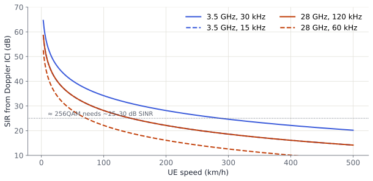

# Multipath and the cyclic prefix {#cp}

## Why the CP turns the channel into one tap per subcarrier {#circular}



Channel $h(\tau)=\sum_i \alpha_i\,\delta(\tau-\tau_i)$. If $\tau_{\max}\le T_{CP}$ and timing is right, the FFT sees a **circular** convolution:

$$
Y_{k,l}=H_{k}\,X_{k,l}+N_{k,l},\qquad H_k=\sum_i \alpha_i\,e^{-j2\pi k\Delta f\,\tau_i}
$$

- Each subcarrier sees a single complex gain: a one-tap equalizer $\hat X=Y/\hat H$ is enough.
- Delay only rotates phase across subcarriers: $\angle H_k$ slopes by $-2\pi\Delta f\,\tau$ per subcarrier. That slope is how the receiver measures timing error.

::: {.box}

[Condition]{.box-title}$\tau_{\max}+\varepsilon_{\text{timing}}\le T_{CP}$. Timing error eats into the same budget as the channel.

:::

::: {.notes}
Make the link to DMRS-based timing estimation: a residual timing offset δ produces a linear phase ramp 2πkΔfδ across subcarriers. With Type-1 DMRS on every second subcarrier, the unambiguous range is ±1/(2·2Δf) = ±8.3 µs at 15 kHz, ±4.2 µs at 30 kHz. Beyond that the estimator wraps.
:::

## When an echo exceeds the CP {#beyond-cp}

An echo with relative power $\rho$ and excess delay $\tau>T_{CP}$ spills $\Delta=\tau-T_{CP}$ into the FFT window of the next symbol (ISI) and truncates its own symbol (ICI). To first order:

$$
\text{SIR}\approx\frac{T_u}{2\,\rho\,\Delta}
$$

::: {.box}

[Worked example (30 kHz)]{.box-title} Echo from a lake or hillside: $\rho=-6$ dB (0.25), $\tau=4\ \mu s$. $\Delta=4-2.34=1.66\ \mu s$.\
 $\text{SIR}\approx 33.3/(2\cdot 0.25\cdot 1.66)=40\Rightarrow 16$ dB, a ceiling that no extra power removes.

:::

- At 15 kHz, $\Delta<0$: no penalty at all for the same echo.
- Symptom in drive tests: good RSRP, SINR capped around 15–20 dB, high BLER at high MCS in specific areas (coastlines, valleys).

::: {.notes}
This is an approximation that treats the leaked portion as Gaussian interference. The exact expression depends on the receiver's window placement and on whether the echo is resolved by the channel estimator. Still, it is accurate enough to decide whether a measured SINR ceiling is self-interference. Test: if SINR does not change when neighbour cells are blanked but changes with SCS or with downtilt (which removes far reflectors), it is delay spread.
:::

# Delay spread and coherence bandwidth {#ds}

## How long are real channels? {#ds-values}

::: {.columns}

::: {.column}

**TR 38.901 CDL scaling values** (RMS delay spread)

::: {.compact}
|  |  |
|---|---|
| Very short | 10 ns |
| Short | 30 ns |
| Nominal | 100 ns |
| Long | 300 ns |
| Very long | 1000 ns |
:::

::: {.spec}

TR 38.901 Table 7.7.3-1

:::

:::

::: {.column}

**UMa statistical model**, median $10^{\mu_{\lg DS}}$, $f_c\le 6$ GHz

::: {.compact}
|  |  |  |
|---|---|---|
| LOS | $\mu_{\lg DS}=-6.955-0.0963\lg f_c$ | ≈ 93 ns |
| NLOS | $\mu_{\lg DS}=-6.28-0.204\lg f_c$ | ≈ 364 ns |
:::

::: {.spec}

TR 38.901 Table 7.5-6 (fc in GHz, fc = 6 used below 6 GHz for UMa)

:::

:::

:::

::: {.box .warn}

[RMS is not maximum]{.box-title}The CP must cover the *maximum* excess delay with meaningful power. For exponential power-delay profiles, the −15 dB point is ≈ 3.5 × RMS: 364 ns NLOS → ≈ 1.3 µs, already over half of the 2.34 µs CP at 30 kHz.

:::

::: {.notes}
−15 dB point for an exponential PDP: P(τ) ∝ exp(−τ/σ), so τ_−15dB = 15/(10·log10 e)·σ = 3.45σ. Students should compute this themselves. The log-normal spread around the median (σ_lgDS ≈ 0.39 for UMa NLOS) means the 90th percentile is about 10^(1.28·0.39) ≈ 3.2 × the median: ≈ 1.2 µs RMS, ≈ 4 µs at −15 dB. That tail is where 30 kHz starts to hurt in large macro cells.
:::

## Coherence bandwidth and what it controls {#bc}

$$
B_c\approx\frac{1}{5\,\sigma_\tau}\quad(\text{frequency correlation}\ge 0.5)
$$

::: {.compact}
| στ | Bc | RBs @30 kHz | Consequence |
|---|---|---|---|
| 100 ns | 2 MHz | ≈ 5.6 | Wideband CQI/PMI is fine |
| 364 ns | 550 kHz | ≈ 1.5 | Sub-band CSI and frequency-selective scheduling pay off |
| 1 µs | 200 kHz | ≈ 0.6 | Channel varies within an RB: denser DMRS in frequency |
:::

- DMRS Type 1 samples every 2nd subcarrier (Δ = 60 kHz at 30 kHz SCS): still well inside $B_c$ for most channels.
- PRB bundling size (2, 4 or wideband) should not exceed $B_c$, or the UE's joint channel estimate across the bundle averages over a varying channel.

::: {.spec}

TS 38.211 §7.4.1.1 · TS 38.214 §5.1.2.3

:::

::: {.notes}
The 1/(5σ) rule (Rappaport) is a rule of thumb, not an equality: the exact coherence bandwidth depends on the PDP shape. Use it for order-of-magnitude decisions: sub-band size for CSI reporting (configured in CSI-ReportConfig) and whether wideband PRB bundling is safe.
:::

# Doppler and time variation {#doppler}

## Doppler-induced ICI {#doppler-ici}

$f_d=v f_c/c$. For a Jakes spectrum the ICI power relative to the signal is approximately

$$
\frac{P_{ICI}}{P_S}\approx\frac{(\pi f_d T_u)^2}{3}\quad\Rightarrow\quad \text{SIR}_{ICI}\approx\frac{3}{(\pi f_d T_u)^2}
$$

{width="56%"}

::: {.small}

350 km/h at 3.5 GHz: $f_d=1134$ Hz → 23.3 dB at 30 kHz, 17.3 dB at 15 kHz. Wider SCS helps.

:::

::: {.notes}
Compute with students: fd = 97.2 m/s · 3.5e9 / 3e8 = 1134 Hz. π·1134·33.33e-6 = 0.1188; squared = 0.01411; /3 = 4.70e-3 → SIR = 23.3 dB. At 15 kHz T_u doubles → 4× ICI → 17.3 dB. This is one reason high-speed railway deployments in FR1 prefer 30 kHz despite the shorter CP.
:::

## Coherence time, DMRS and TRS {#tcoh}

$$
T_{coh}\approx\frac{0.423}{f_d}
$$

::: {.compact}
| Scenario | fd | Tcoh | vs 0.5 ms slot |
|---|---|---|---|
| Pedestrian 3 km/h, 3.5 GHz | 9.7 Hz | 44 ms | Static over many slots |
| Car 120 km/h, 3.5 GHz | 389 Hz | 1.09 ms | ≈ 2 slots |
| Train 350 km/h, 3.5 GHz | 1134 Hz | 373 µs | Shorter than a slot |
| Car 120 km/h, 28 GHz | 3111 Hz | 136 µs | ≈ 1 slot at 120 kHz |
:::

::: {.box .field}

[What to configure]{.box-title} When $T_{coh}$ approaches the slot length, one front-loaded DMRS symbol is not enough: use `dmrs-AdditionalPosition` pos2 or pos3 so the channel is re-estimated within the slot. TRS (CSI-RS for tracking) gives the UE fine time/frequency tracking and Doppler estimates.

:::

::: {.spec}

TS 38.211 §7.4.1.1.2 · TS 38.214 §5.1.6.1.1 (TRS)

:::

::: {.notes}
T_coh ≈ 0.423/fd is the 50%-correlation definition. Some texts use 9/(16π fd) = 0.179/fd; be consistent within one analysis. Additional DMRS costs 1 symbol each (≈ 7 % of a slot), so enabling pos3 on a stationary cluster wastes capacity. Many networks leave pos1 as default and switch to pos2/3 only on HST or motorway cells.
:::

# Phase noise {#pn}

## Phase noise: CPE and ICI {#pn-model}

Received subcarrier $k$ of symbol $l$ with oscillator phase $\phi(t)$:

$$
Y_{k}=X_k H_k\,\underbrace{J_0}_{\text{CPE}}+\underbrace{\sum_{m\ne k}X_m H_m J_{m-k}}_{\text{ICI}},\qquad J_n=\frac{1}{T_u}\int_0^{T_u}e^{j\phi(t)}e^{-j2\pi n t/T_u}\,dt
$$

- **CPE**: the same rotation on every subcarrier of a symbol. Estimate it from pilots and remove it.
- **ICI**: phase-noise power at offsets ≳ Δf leaks between subcarriers and acts as noise. Only a wider Δf (or a cleaner oscillator) reduces it.
- Multiplying a reference by N raises phase noise by $20\lg N$: 3.5 → 28 GHz from the same reference is +18 dB.

::: {.box}

[EVM rule of thumb]{.box-title}Residual RMS phase error $\sigma_\phi$ (rad) gives $\text{EVM}\approx\sigma_\phi$. 256QAM's 3.5 % limit allows about 2° RMS after CPE removal.

:::

::: {.notes}
Derive J0 as the average of e^{jφ} over the symbol: low-frequency phase noise (inside the subcarrier spacing) is common to all subcarriers, hence CPE. High-frequency phase noise produces J_n ≠ 0 for n ≠ 0, i.e. ICI. Doubling SCS halves T_u, which moves more of the phase-noise spectrum into the 'common' part. This is the physics behind 120 kHz in FR2, not latency.
:::

## PT-RS: tracking CPE in NR {#ptrs}

::: {.columns}

::: {.column}

- Present on PDSCH and PUSCH only, when configured.
- Time density $L_{PT\text{-}RS}\in\{1,2,4\}$ symbols, frequency density $K_{PT\text{-}RS}\in\{2,4\}$ RBs.
- Density follows scheduled MCS and bandwidth through RRC thresholds (`timeDensity`, `frequencyDensity`).
- Mapped on one subcarrier of a DMRS port: overhead is under 1 % at the densest setting with wide allocations.

:::

::: {.column}

::: {.compact}
| Scheduled MCS | Time density |
|---|---|
| < ptrs-MCS1 | no PT-RS |
| ptrs-MCS1 … ptrs-MCS2 | every 4th symbol |
| ptrs-MCS2 … ptrs-MCS3 | every 2nd symbol |
| ≥ ptrs-MCS3 | every symbol |
:::

::: {.spec}

TS 38.214 Table 5.1.6.3-1 · TS 38.211 §7.4.1.2

:::

:::

:::

::: {.box .field}

[Field symptom]{.box-title}High-MCS BLER in FR2 that improves when PT-RS density is increased, with no change in SINR, points to phase noise in the UE or gNB LO chain.

:::

::: {.notes}
ShareTechnote's DL resource grid simulator lets you toggle PT-RS densities and see the RE pattern. In FR1 PT-RS is usually disabled: phase noise at 3.5 GHz with 30 kHz SCS rarely limits 256QAM. In FR2 it is effectively mandatory for 64QAM and above.
:::

# Choosing SCS, exercises {#practice2}

## Putting it together: choosing the numerology {#choose}

::: {.compact}
| Constraint | Pushes toward | Quantity to compute |
|---|---|---|
| Delay spread, large cells | smaller SCS (longer CP) | max excess delay vs TCP |
| Doppler, high speed | larger SCS | $\text{SIR}_{ICI}=3/(\pi f_d T_u)^2$ |
| Phase noise (FR2) | larger SCS + PT-RS | residual σφ vs target EVM |
| Latency | larger SCS or mini-slots | slot duration, HARQ RTT |
| Channel bandwidth | larger SCS above 50 MHz (FFT size ≤ 4096) | NRB × 12 ≤ 3300 subcarriers |
:::

In practice: 30 kHz for FR1 TDD mid-band (100 MHz needs ≥ 30 kHz), 15 kHz for FR1 FDD low-band and DSS with LTE, 120 kHz for FR2.

::: {.notes}
The FFT constraint: NR caps the number of RBs at 275 per carrier (3300 subcarriers), so 100 MHz cannot be done at 15 kHz (it would need 6600 subcarriers). That is why n78 100 MHz carriers are always 30 kHz, independent of the delay-spread argument.
:::

## Exercises {#ex2}

1. A macro cell at 3.5 GHz has an echo 10 dB below the main path at 3.2 µs excess delay. Estimate the SIR ceiling at 30 kHz and at 15 kHz.
2. For UMa NLOS at 3.5 GHz, compute the 90th-percentile RMS delay spread (σlgDS = 0.39) and its −15 dB excess delay. Is 30 kHz safe?
3. A 28 GHz UE moves at 60 km/h. With 120 kHz SCS, compute fd, SIRICI and Tcoh. Which DMRS configuration would you start from?
4. An LO has −90 dBc/Hz at 100 kHz offset at 3.5 GHz. Estimate the same LO's level at 28 GHz and explain why PT-RS becomes necessary.

::: {.aside-note}

Answers in the speaker notes.

:::

::: {.notes}
1. ρ = 0.1, Δ = 3.2 − 2.34 = 0.86 µs → SIR ≈ 33.3/(2·0.1·0.86) = 194 → 22.9 dB at 30 kHz. At 15 kHz Δ < 0 → no penalty.
2. Median 364 ns; 90th percentile ×10^(1.28·0.39) = ×3.16 → 1.15 µs RMS. −15 dB point ≈ 3.45 × 1.15 = 4.0 µs > 2.34 µs: 30 kHz suffers in the worst 10 % of locations; 15 kHz (4.69 µs) is safe.
3. fd = 16.67·28e9/3e8 = 1556 Hz; T_u = 8.33 µs; SIR = 3/(π·1556·8.33e-6)^2 = 3/(0.0407)^2 = 1810 → 32.6 dB; T_coh = 0.423/1556 = 272 µs ≈ 2.2 slots at 125 µs. Start with pos1 (one additional DMRS); pos2 only for higher speeds.
4. +20 log10(8) = +18 dB → about −72 dBc/Hz at the same offset. The integrated phase noise rises by 18 dB, so the residual phase error that was negligible at 3.5 GHz now reaches several degrees and must be tracked per symbol with PT-RS.
:::

## References and further reading {#refs2}

::: {.refs}

- **3GPP** TR 38.901 §7.5 (Table 7.5-6, LSPs), §7.7.3 (delay scaling)
- **3GPP** TS 38.211 §7.4.1.1 (DMRS), §7.4.1.2 (PT-RS), §7.4.1.5 (CSI-RS/TRS)
- **3GPP** TS 38.214 §5.1.2.3 (PRB bundling), §5.1.6.1.1 (TRS), §5.1.6.3 (PT-RS density)
- [ShareTechnote · Frame structure](https://www.sharetechnote.com/html/5G/5G_FrameStructure.html){target="_blank"}
- [ShareTechnote · Reference signals (incl. PT-RS)](https://www.sharetechnote.com/html/5G/5G_Phy_ReferenceSignal.html){target="_blank"}
- [ShareTechnote · CSI-RS](https://www.sharetechnote.com/html/5G/5G_CSI_RS.html){target="_blank"}
- [ShareTechnote · DL resource grid simulator](http://sharetechnote.com/html/WebProgramming/Websim_ResourceGridDl5G.html){target="_blank"}
- C. Johnson, *5G New Radio in Bullets*, independently published, 2019 (ISBN 978-1077484351): chapters on OFDM, physical-layer reference signals and PT-RS.
- E. Dahlman, S. Parkvall, J. Sköld, *5G NR: The Next Generation Wireless Access Technology*, 2nd ed., Academic Press, 2020.
- T. S. Rappaport, *Wireless Communications: Principles and Practice*, 2nd ed., Prentice Hall, 2002, ch. 5 (coherence bandwidth and time).

:::

::: {.aside-note}

Specs are quoted by clause so they can be checked against any Release; numbers on these slides follow Rel-15 to Rel-17 unless marked.

:::
