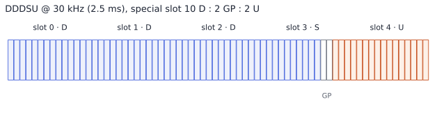

# Configuring a TDD carrier {#tdd}

## tdd-UL-DL-ConfigurationCommon {#tdd-common}



::: {.columns}

::: {.column}

```
tdd-UL-DL-ConfigurationCommon
  referenceSubcarrierSpacing  kHz30
  pattern1
    dl-UL-TransmissionPeriodicity ms2p5
    nrofDownlinkSlots     3
    nrofDownlinkSymbols   10
    nrofUplinkSlots       1
    nrofUplinkSymbols     2
  pattern2   (optional, second period)
```

:::

::: {.column}

::: {.small}

- Periods: 0.5, 0.625, 1, 1.25, 2, 2.5, 5, 10 ms (3 and 4 ms added in Rel-16).
- DL slots first, then DL symbols, flexible remainder, then UL symbols, then UL slots.
- Two patterns concatenate (for example 2.5 ms + 2.5 ms) into a 5 ms super-period.
- Flexible symbols can be overridden by `tdd-UL-DL-ConfigurationDedicated` and by DCI 2_0 (SFI).

:::

:::

:::

{width="88%"}

::: {.spec}

TS 38.213 §11.1 · TS 38.331 TDD-UL-DL-ConfigCommon

:::

::: {.notes}
The resulting pattern for this example is DDDSU with 10 DL, 2 flexible (guard), 2 UL symbols in the special slot. Counting symbols over the 2.5 ms period (70 symbols): 52 DL (74 %), 16 UL (23 %), 2 GP (3 %). The second pattern is how operators build DDDSUDDSUU-type structures or align with LTE TDD configuration 2 for coexistence.
:::

## Slot formats and dynamic SFI {#sfi}

- TS 38.213 Table 11.1.1-1 defines formats 0–55: each of 14 symbols is D, U or F. Formats 56–254 are reserved.
- Format 255: the UE follows `tdd-UL-DL-ConfigurationCommon`/`Dedicated` and the scheduling DCIs.
- DCI 2_0 (SFI-RNTI) carries an index into a **slot format combination** table configured by RRC: one entry can describe several slots.
- Priority: semi-static D/U cannot be overridden; semi-static F can be resolved by SFI, then by scheduling DCI.

::: {.box}

[Why it matters for RF]{.box-title}A dynamic TDD cell can change its DL/UL split per slot. Its neighbours then see DL energy in their UL symbols: cross-link interference. Dynamic SFI is safe only where cells are isolated (indoor, private networks) or co-ordinated.

:::

::: {.spec}

TS 38.213 §11.1.1 · TS 38.212 §7.3.1.3.1

:::

::: {.notes}
ShareTechnote's Slot Format Combination page walks through an RRC configuration example with SlotFormatCombinationsPerCell and the positionInDCI field. In public macro networks, SFI is almost never used: national regulators and operator agreements fix a common frame structure per band.
:::

# Guard period engineering {#gp}

## The guard period sets the maximum cell range {#gp-range}

At the DL→UL switch, the cell-edge UE must receive the last DL symbol and transmit its first UL symbol early by its timing advance:

$$
T_{GP}\ \ge\ \frac{2d}{c}+T_{UE,\text{Rx}\to\text{Tx}}\qquad\Rightarrow\qquad d_{\max}\approx\frac{c\,(T_{GP}-T_{UE,\text{Rx}\to\text{Tx}})}{2}
$$

::: {.compact}
| GP @ 30 kHz | T<sub>GP</sub> | d<sub>max</sub> (switching ignored) |
|---|---|---|
| 2 symbols | 71.4 µs | 10.7 km |
| 4 symbols | 142.7 µs | 21.4 km |
| 6 symbols | 214.1 µs | 32.1 km |
:::

The UL→DL switch needs no GP at the UE: timing advance already aligns the uplink. The gNB's own Rx→Tx switch is covered by $N_{TA,\text{offset}}$ (Lecture 1).

::: {.spec}

TS 38.211 §4.3.1 · TS 38.133 §7.1

:::

::: {.notes}
ShareTechnote's tdd-UL-DL-ConfigurationCommon page quotes the 6-symbol / 32.1 km figure. Practical note: the UE's own Rx→Tx transition time (a few µs, specified in the UE RF and RRM requirements) comes off the same budget, so the real range is slightly below the table. Rural TDD cells beyond ~10 km need a longer special-slot GP, which costs DL capacity; that is a real planning trade-off.
:::

## Remote interference: when the far gNB lands in your uplink {#remote}

A distant gNB's DL arrives delayed by $D/c$. It overlaps the victim's UL symbols when

$$
\frac{D}{c}\ >\ T_{GP}\quad\Rightarrow\quad D\ >\ c\,T_{GP}\approx 21\ \text{km for 2 GP symbols at 30 kHz}
$$

- Normally, path loss over 21+ km kills that signal. Under **tropospheric ducting** it can travel hundreds of km with little loss.
- Signature: UL interference rising over the first UL symbols of a slot, worst at night or in calm weather, affecting many sites in a region at once.
- Rel-16 adds remote interference management (RIM): victim gNBs transmit a RIM reference signal so aggressors can detect and back off.

::: {.box .field}

[Diagnosis]{.box-title}Plot per-symbol UL interference (IoT) across the slot. A slope that decreases symbol by symbol, identical across a cluster, is ducting. A flat raised floor is local external interference.

:::

::: {.notes}
This is the classic TD-LTE problem seen in China and the Netherlands, carried over to NR. The slope comes from distance: farther aggressors arrive later and are weaker, so the first UL symbols collect the most energy. Mitigation before RIM: extend the GP (more F symbols), or blank the first UL symbols at affected sites.
:::

# Network synchronization {#sync}

## How tightly must TDD cells be aligned? {#sync-req}

::: {.kpis}

::: {.kpi}

[≤ 3 µs]{.kpi-val}[cell phase sync accuracy between overlapping TDD cells (TS 38.133 §7.4)]{.kpi-label}

:::

::: {.kpi}

[±1.5 µs]{.kpi-val}[each cell vs a common reference (ITU-T G.8271 level for TDD)]{.kpi-label}

:::

::: {.kpi}

[13 µs]{.kpi-val}[FR1 N<sub>TA,offset</sub> = 10 µs switch + 3 µs sync budget]{.kpi-label}

:::

:::

- Sources: GNSS at each site, or IEEE 1588 PTP with a full-on-path-support telecom profile (ITU-T G.8275.1) from a grandmaster.
- Holdover: when GNSS is lost, the local oscillator must keep the error within budget. An OCXO drifts µs within hours; rubidium holds for a day or more.
- Operators sharing a band must also share the frame start and a compatible pattern. Unsynchronized neighbours need a guard band or restricted blocks.

::: {.spec}

TS 38.133 §7.4 · ITU-T G.8271 / G.8271.1 / G.8275.1

:::

::: {.notes}
Make the arithmetic concrete: a 1e-9 frequency error accumulates 1 µs of time error in 1000 s (17 minutes). A good OCXO might be 1e-10 after aging compensation → 1.5 µs in 4 hours. This is why loss-of-GNSS alarms must trigger action within hours, not days.
:::

## Worked example: gNB-to-gNB interference if sync fails {#cli-budget}

::: {.compact}
| Item | Value | Note |
|---|---|---|
| Aggressor power per RB | 28.6 dBm | 53 dBm over 273 RBs |
| Aggressor gain toward victim | +4 dBi | 24 dBi array, −20 dB off-boresight/tilt |
| Path loss, 1 km LOS mast to mast | −103.3 dB | free space, 3.5 GHz |
| Victim gain toward aggressor | +4 dBi | same discrimination |
| **Interference per RB** | **−66.7 dBm** |  |
| Victim noise per RB | −115.4 dBm | −174 + 10 lg(360 kHz) + 3 dB NF |
:::

::: {.box .warn}

[Result]{.box-title}Interference over thermal ≈ **49 dB**. One unsynchronized site 1 km away can take out the uplink of its neighbour completely. That is why sync alarms are radio alarms.

:::

::: {.aside-note}

Illustrative values. Real antenna discrimination depends on tilt, azimuth and pattern.

:::

::: {.notes}
Ask students to recompute with 10 km separation (FSPL +20 dB → 29 dB IoT, still fatal) and with 40 dB of total discrimination instead of 40 → 48 (each side −24 dB). The conclusion does not change: the only robust fix is synchronization and a common frame structure.
:::

# Bandwidth parts {#bwp}

## Bandwidth part: definition and limits {#bwp-def}

- A BWP is a contiguous set of CRBs with one numerology and CP, inside the carrier (TS 38.211 §4.4.5).
- Up to 4 DL and 4 UL dedicated BWPs per serving cell, plus the initial BWP (id 0). One DL and one UL active at a time (Rel-15/16).
- `locationAndBandwidth` is a RIV with $N=275$:

$$
\text{RIV}=\begin{cases}275(L-1)+RB_{\text{start}} & L-1\le\lfloor 275/2\rfloor\\ 275(275-L+1)+(274-RB_{\text{start}}) & \text{otherwise}\end{cases}
$$

::: {.small}

Example: 51 RBs starting at CRB 0 → RIV = 275·50 + 0 = 13750. 273 RBs from CRB 0 → L − 1 = 272 > 137 → RIV = 275·3 + 274 = 1099.

:::

The initial BWP for idle UEs follows CORESET#0 until SIB1 gives `initialDownlinkBWP`.

::: {.spec}

TS 38.211 §4.4.5 · TS 38.213 §12 · TS 38.214 §5.1.2.2.2 (RIV)

:::

::: {.notes}
Verify the second RIV: L = 273, 275 − 273 + 1 = 3, 275·3 = 825, + (274 − 0) = 1099. A common configuration error is a locationAndBandwidth that does not match offsetToCarrier/carrierBandwidth: the UE then rejects the RRC reconfiguration. ShareTechnote's BWP page has a worked n78 20 MHz example with the CRB-to-PRB mapping per BWP.
:::

## Switching BWPs: triggers and delays {#bwp-switch}

::: {.columns}

::: {.column}

::: {.small}

- **DCI** 1_1 / 0_1 BWP indicator (0, 1 or 2 bits): switch and schedule in one DCI.
- **Timer**: `bwp-InactivityTimer` (2 ms … 2560 ms) returns the UE to `defaultDownlinkBWP-Id`.
- **RRC** reconfiguration, or **random access** on a BWP without RACH resources (falls back to initial BWP).

:::

:::

::: {.column}

::: {.compact}
| μ | Type 1 (slots) | Type 2 (slots) |
|---|---|---|
| 0 | 1 | 3 |
| 1 | 2 | 5 |
| 2 | 3 | 9 |
| 3 | 6 | 18 |
:::

::: {.spec}

DCI-based switch delay, TS 38.133 Table 8.6.2-1 (UE capability type)

:::

:::

:::

::: {.box .field}

[Tuning]{.box-title}A short inactivity timer saves UE power but causes repeated switches: each costs up to 5 slots of no scheduling at 30 kHz (2.5 ms). For bursty traffic (web, chat), a timer of 50–100 ms is a common starting point; for constant streams, keep the wide BWP.

:::

::: {.notes}
Type 1 vs type 2 is a UE capability (bwp-SwitchingDelay). During the switching delay the UE is not required to receive or transmit. Power saving numbers vary by chipset; a rough industry figure is that RF and baseband power scale sub-linearly with bandwidth, so a 100→20 MHz switch saves a meaningful but not 5× fraction of modem power.
:::

# Exercises {#practice3}

## Exercises {#ex3}

1. Write `pattern1` for DDDDDDDSUU at 30 kHz with a 6:4:4 special slot. Compute the DL/UL/GP symbol shares.
2. A rural TDD cell must reach 18 km. How many GP symbols at 30 kHz are needed (UE switching 5 µs)? What is the DL capacity cost compared with 2 GP symbols in DDDSU?
3. Compute the RIV of a 106-RB BWP starting at CRB 50.
4. Repeat the gNB-to-gNB example for two sites 5 km apart with 25 dB discrimination on each side.

::: {.aside-note}

Answers in the speaker notes.

:::

::: {.notes}
1. period ms5, nrofDownlinkSlots 7, nrofDownlinkSymbols 6, nrofUplinkSlots 2, nrofUplinkSymbols 4. Symbols per 5 ms: 140. DL = 7·14 + 6 = 104 (74.3 %), UL = 2·14 + 4 = 32 (22.9 %), GP = 4 (2.9 %).
2. Need T_GP ≥ 2·18 km/c + 5 µs = 120 + 5 = 125 µs → 125/35.68 = 3.5 → 4 symbols. Taking the 2 extra GP symbols from DL in DDDSU: DL 50 of 70 instead of 52 → −3.8 % DL capacity.
3. L = 106, L − 1 = 105 ≤ 137 → RIV = 275·105 + 50 = 28925.
4. FSPL at 5 km, 3.5 GHz = 103.3 + 14.0 = 117.3 dB. Gains: 24 − 25 = −1 dBi each side. I = 28.6 − 1 − 117.3 − 1 = −90.7 dBm per RB; IoT = −90.7 + 115.4 = 24.7 dB. Still fatal for the victim uplink.
:::

## References and further reading {#refs3}

::: {.refs}

- **3GPP** TS 38.213 §11.1 (slot configuration, SFI), §12 (BWP operation)
- **3GPP** TS 38.211 §4.3.1, §4.4.5 · TS 38.214 §5.1.2.2.2
- **3GPP** TS 38.331 TDD-UL-DL-ConfigCommon, BWP-Downlink, ServingCellConfig
- **3GPP** TS 38.133 §7.4 (cell phase sync), Table 8.6.2-1 (BWP switch delay) · TS 38.321 §5.15
- **3GPP** ITU-T G.8271, G.8271.1, G.8275.1 (time synchronization)
- [ShareTechnote · tdd-UL-DL-ConfigurationCommon](https://www.sharetechnote.com/html/5G/5G_tdd_UL_DL_configurationCommon.html){target="_blank"}
- [ShareTechnote · Slot format combination](https://sharetechnote.com/html/5G/5G_SlotFormatCombination.html){target="_blank"}
- [ShareTechnote · Carrier bandwidth part](https://www.sharetechnote.com/html/5G/5G_CarrrierBandwidthPart.html){target="_blank"}
- C. Johnson, *5G New Radio in Bullets*, independently published, 2019 (ISBN 978-1077484351): chapters on TDD frame structure, slot formats and bandwidth parts.
- E. Dahlman, S. Parkvall, J. Sköld, *5G NR: The Next Generation Wireless Access Technology*, 2nd ed., Academic Press, 2020.

:::

::: {.aside-note}

Specs are quoted by clause so they can be checked against any Release; numbers on these slides follow Rel-15 to Rel-17 unless marked.

:::
