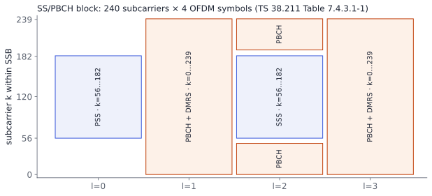

# Inside the SS/PBCH block {#ssb}

## Resource map {#ssb-map}



{width="72%"}

::: {.small}

- 240 subcarriers (20 RBs) × 4 symbols. PSS/SSS on the centre 127 subcarriers, with 8/9 null guard subcarriers either side.
- PBCH DMRS on every 4th subcarrier, shifted by $v=N_{ID}^{cell}\bmod 4$. 432 PBCH QPSK symbols per SSB.

:::

::: {.spec}

TS 38.211 §7.4.3.1, Table 7.4.3.1-1

:::

::: {.notes}
Useful numbers: 3.6 MHz at 15 kHz SCS, 7.2 MHz at 30 kHz, 28.8 MHz at 120 kHz, 57.6 MHz at 240 kHz. The minimum channel bandwidth of a band is set so that the SSB fits: this is why n78 has a 10 MHz minimum at 30 kHz SSB and why some FR2 bands start at 50 MHz.
:::

## PSS and SSS sequences {#pss-sss}

::: {.columns}

::: {.column}

**PSS**: one m-sequence, three cyclic shifts

$$
d_{PSS}(n)=1-2x(m),\ \ m=(n+43N_{ID}^{(2)})\bmod 127
$$

$x(i+7)=(x(i+4)+x(i))\bmod 2$, initial state $[x(6)\dots x(0)]=[1\,1\,1\,0\,1\,1\,0]$.

:::

::: {.column}

**SSS**: product of two m-sequences

$$
d_{SSS}(n)=[1-2x_0((n+m_0)\bmod 127)]\,[1-2x_1((n+m_1)\bmod 127)]
$$

$m_0=15\lfloor N_{ID}^{(1)}/112\rfloor+5N_{ID}^{(2)}$, $m_1=N_{ID}^{(1)}\bmod 112$.

:::

:::

$$
N_{ID}^{cell}=3N_{ID}^{(1)}+N_{ID}^{(2)},\quad N_{ID}^{(1)}\in\{0,\dots,335\},\ N_{ID}^{(2)}\in\{0,1,2\}\ \Rightarrow\ 1008\ \text{PCIs}
$$

::: {.box}

[Why m-sequences, not Zadoff-Chu (LTE)?]{.box-title}BPSK ±1 values allow real-valued correlation, and m-sequences avoid the timing–frequency-offset ambiguity of ZC sequences, which matters with the large initial CFO of mmWave oscillators.

:::

::: {.spec}

TS 38.211 §7.4.2.2–7.4.2.3

:::

::: {.notes}
A ZC sequence with frequency offset produces a correlation peak shifted in time (the ambiguity between timing and CFO), which can mislead initial timing. m-sequences have a sharp autocorrelation that degrades gracefully with CFO. ShareTechnote's PSS page compares the NR m-sequence with the LTE ZC PSS and includes a PCI ↔ PSS/SSS converter.
:::

## PBCH payload and DMRS {#pbch}

::: {.columns}

::: {.column}

::: {.small}

- MIB: 23 bits + 1 choice bit, plus 8 bits added by the physical layer: 4 SFN LSBs, half-frame bit, and either the 3 MSBs of the SSB index ($L_{\max}=64$) or the MSB of $k_{SSB}$ plus reserved bits.
- 32-bit payload + 24-bit CRC → polar code → 864 bits → 432 QPSK symbols.
- The MIB repeats every 80 ms. SSBs within it differ only in the PHY-added bits.

:::

:::

::: {.column}

PBCH DMRS scrambling init:

$$
c_{\text{init}}=2^{11}(\bar i_{SSB}+1)(\lfloor N_{ID}^{cell}/4\rfloor+1)+2^{6}(\bar i_{SSB}+1)+(N_{ID}^{cell}\bmod 4)
$$

::: {.small}

$\bar i_{SSB}$: the 3 LSBs of the SSB index ($L_{\max}\ge 8$), or 2 LSBs + half-frame bit ($L_{\max}=4$). The UE learns the beam index by testing 8 DMRS hypotheses, before decoding any bit.

:::

:::

:::

::: {.spec}

TS 38.211 §7.4.1.4 · TS 38.212 §7.1 · TS 38.331 MIB

:::

::: {.notes}
This is a subtle and elegant design: the SSB index (beam ID) is carried in the reference signal, not in the data, so a UE can know which beam it is on from DMRS detection alone. For Lmax = 64, only the 3 LSBs fit into DMRS; the 3 MSBs go into the PBCH payload, which is why FR2 UEs need to decode PBCH to know the full beam index.
:::

# Burst sets and beam sweeping {#burst}

## Candidate SSB positions in a 5 ms half-frame {#cases}

::: {.compact}
| Case | SCS | First symbols | n | Lmax |
|---|---|---|---|---|
| A | 15 kHz | {2, 8} + 14n | 0,1 (≤ 3 GHz) · 0–3 (> 3 GHz) | 4 / 8 |
| B | 30 kHz | {4, 8, 16, 20} + 28n | 0 (≤ 3 GHz) · 0,1 (> 3 GHz) | 4 / 8 |
| C | 30 kHz | {2, 8} + 14n | 0,1 · 0–3 (split 3 GHz paired, 1.88 GHz unpaired) | 4 / 8 |
| D | 120 kHz | {4, 8, 16, 20} + 28n | 0–3, 5–8, 10–13, 15–18 | 64 |
| E | 240 kHz | {8, 12, 16, 20, 32, 36, 40, 44} + 56n | 0–3, 5–8 | 64 |
:::

::: {.small}

- Cases F, G (480/960 kHz) added for FR2-2 in Rel-17.
- Symbols 0–1 and 12–13 of each slot are avoided so PDCCH and UL/guard can coexist with SSBs.
- `ssb-PositionsInBurst` (4-, 8- or 64-bit bitmap) says which candidates are actually transmitted.

:::

::: {.spec}

TS 38.213 §4.1

:::

::: {.notes}
Worked example for n78 Case C, unpaired, Lmax 8: first symbols 2, 8, 16, 22, 30, 36, 44, 50 → slots 0–3 of the half-frame at 30 kHz, two SSBs per slot at symbols 2–5 and 8–11. All 8 SSBs are sent within 2 ms, leaving 3 ms of the half-frame free. With a 20 ms period, SSB overhead on those slots is high but on the carrier as a whole it is about (8·4 symbols · 20 RBs)/(40 slots·14 symbols·273 RBs) ≈ 0.4 %.
:::

## Periodicity, SMTC and measurement windows {#smtc}

- `ssb-periodicityServingCell`: 5, 10, 20, 40, 80, 160 ms. Idle UEs assume 20 ms during initial search.
- **SMTC** (SSB-based measurement timing configuration): period 5–160 ms, offset, duration 1–5 ms. The UE only looks for neighbour SSBs inside this window.
- Inter-frequency measurements may need **measurement gaps** (for example 6 ms every 40 ms) unless the UE can measure without gaps.

::: {.box .warn}

[Classic misconfiguration]{.box-title}Neighbour cells with different SSB timing (or different SMTC offset) than the serving cell's SMTC: the UE never detects them, so no handover is triggered and calls drop at the cell edge. Always check SMTC alignment after changing the SSB period or frame timing of a cluster.

:::

::: {.spec}

TS 38.331 SSB-MTC, MeasObjectNR · TS 38.133 §9

:::

::: {.notes}
ShareTechnote's measurement examples show smtc1 { periodicityAndOffset sf20: 0, duration sf1 }. With a 1 ms duration and 30 kHz Case C (8 SSBs over 2 ms), the UE sees only the first 4 candidates. Fine if all neighbours use the same pattern, wrong if a neighbour sends its strongest beam in candidate 6.
:::

# From MIB to SIB1 {#sib1}

## What the MIB tells the UE {#mib-fields}

::: {.compact}
| Field | Bits | Use |
|---|---|---|
| systemFrameNumber | 6 (+4 PHY) | 10-bit SFN |
| subCarrierSpacingCommon | 1 | SCS of CORESET#0, SIB1, Msg2/4 |
| ssb-SubcarrierOffset | 4 (+1 PHY in FR1) | kSSB: SSB vs CRB grid |
| dmrs-TypeA-Position | 1 | first PDSCH DMRS in symbol 2 or 3 |
| pdcch-ConfigSIB1 | 8 | controlResourceSetZero (4) + searchSpaceZero (4) |
| cellBarred, intraFreqReselection | 1 + 1 | access control |
:::

::: {.box}

[No SIB1 here]{.box-title}In FR1, $k_{SSB}>23$ (FR2: $k_{SSB}>11$) tells the UE there is no CORESET#0 for this SSB: for example an NSA-only cell, or a secondary SSB. `pdcch-ConfigSIB1` then points the UE to where (in GSCN) to search next.

:::

::: {.spec}

TS 38.331 MIB · TS 38.213 §4.1, §13

:::

::: {.notes}
An NSA (EN-DC) NR cell does not need SIB1, because the UE gets all configuration through LTE RRC. Such cells broadcast k_SSB = 30/31 (FR1) so that SA UEs skip them quickly. Seeing SA-capable UEs camp on LTE next to a strong NR cell is often explained by this.
:::

## CORESET#0 and Type0-PDCCH {#coreset0}

- `controlResourceSetZero` indexes TS 38.213 Tables 13-1 … 13-10 (by SSB/PDCCH SCS and band): the SSB/CORESET multiplexing pattern, 24/48/96 RBs, 1–3 symbols, and the RB offset from the SSB.
- Pattern 1: SSB and CORESET#0 in different symbols (TDM), the FR1 case. Patterns 2/3: frequency-multiplexed, FR2 options.
- `searchSpaceZero` (Table 13-11 for pattern 1) gives $O$ and $M$: the monitoring slot for SSB index $i$ is

$$
n_0=\left(O\cdot 2^{\mu}+\lfloor i\cdot M\rfloor\right)\bmod N^{\text{frame},\mu}_{\text{slot}}
$$

::: {.small}

Each beam (SSB index) has its own Type0-PDCCH occasion, so SIB1 is beam-swept too.

:::

::: {.spec}

TS 38.213 §13, Tables 13-1 to 13-11

:::

::: {.notes}
CORESET#0 also defines the initial DL BWP until SIB1 provides initialDownlinkBWP: its RB span is the initial BWP. The 24-RB CORESET#0 at 30 kHz is 8.64 MHz wide, so an n78 cell's idle-mode traffic (SIB1, paging, Msg2/4) is confined to under 9 MHz of the 100 MHz carrier. This matters for idle-mode interference and for the RF test of receiver blocking during access.
:::

# Planning the SSB layer {#plan}

## SSB power, pathloss and the beam-gain trap {#ssb-power}

`ss-PBCH-BlockPower` (SIB1) is the SSS EPRE in dBm. The UE derives downlink pathloss from it:

$$
PL=\texttt{referenceSignalPower}-\text{higher-layer filtered SS-RSRP}
$$

::: {.box}

[Example]{.box-title}200 W over 3276 subcarriers → $53-10\lg 3276 = 17.8$ dBm per RE. Configure ss-PBCH-BlockPower = 18 dBm if SSB EPRE equals data EPRE.

:::

::: {.box .warn}

[Beam-gain trap]{.box-title}With beamformed SSBs, the received SSB includes array gain that the configured EPRE does not. If the SSB beams have $G_{SSB}$ dB more gain than the reference assumed, every UE underestimates PL by $G_{SSB}$ and transmits PRACH and PUSCH too weakly. Symptom: high RACH attempt counts with plenty of DL margin.

:::

::: {.spec}

TS 38.213 §7.1.1, §7.4 · TS 38.331 ServingCellConfigCommonSIB

:::

::: {.notes}
Vendors handle this differently: some include the SSB beam gain in ss-PBCH-BlockPower (it is then an EIRP-like value per RE), some do not. Check your vendor's definition before tuning preambleReceivedTargetPower. ShareTechnote's power-control example shows ss-PBCH-BlockPower = 8 with preambleReceivedTargetPower −110 and powerRampingStep dB4 in a lab RACH trace.
:::

## PCI planning rules for NR {#pci-plan}

::: {.compact}
| Rule | Reason |
|---|---|
| No collision: neighbours never share a PCI | UE cannot separate the two cells |
| No confusion: no cell has two neighbours with the same PCI | handover target ambiguous |
| Avoid equal PCI mod 3 between strong overlapping cells | same PSS sequence: slower, less reliable detection |
| Avoid equal PCI mod 4 between strong overlapping cells | PBCH DMRS on the same subcarriers: PBCH SINR drops |
| Check PCI mod 30 for UL DMRS (transform precoding, default IDs) | same base-sequence group in neighbouring cells |
:::

::: {.small}

With 1008 PCIs, reuse distance is rarely the limit. Mod-3/mod-4 clashes are, especially at sector boundaries of the same site.

:::

::: {.spec}

TS 38.211 §7.4.1.4, §7.4.2, §6.4.1.1.1.2

:::

::: {.notes}
A simple same-site scheme: give the three sectors of a site PCIs 3k, 3k+1, 3k+2 (different mod 3), and check mod 4 is also different between adjacent sectors of neighbouring sites. Note that NR has no always-on CRS, so the LTE-era mod-6 CRS shift rule does not exist in NR.
:::

# Exercises {#practice4}

## Exercises {#ex4}

1. A UE detects $N_{ID}^{(2)}=2$ and $N_{ID}^{(1)}=170$. Compute the PCI, the PSS cyclic shift and $m_0, m_1$ of the SSS.
2. List the first symbols of all SSB candidates for Case B above 3 GHz and the slots they occupy at 30 kHz.
3. A cell has 200 W, 100 MHz at 30 kHz, and SSBs with 6 dB more beam gain than the PDSCH reference. The vendor excludes beam gain from ss-PBCH-BlockPower. What value would you configure, and what is the pathloss error otherwise?
4. Explain how a UE learns the SSB index for $L_{\max}=8$ without decoding PBCH data.

::: {.aside-note}

Answers in the speaker notes.

:::

::: {.notes}
1. PCI = 3·170 + 2 = 512. PSS shift = 43·2 = 86. m0 = 15·floor(170/112) + 5·2 = 15 + 10 = 25; m1 = 170 mod 112 = 58.
2. {4, 8, 16, 20} + 28n, n = 0, 1 → 4, 8, 16, 20, 32, 36, 44, 48. Slot 0: symbols 4 and 8; slot 1: 16 → 2, 20 → 6; slot 2: 32 → 4, 36 → 8; slot 3: 44 → 2, 48 → 6.
3. EPRE 17.8 dBm, so 18 dBm if beam gain is excluded. Without correction the UE's PL estimate is 6 dB too low, so open-loop PRACH power is 6 dB too low; with 4 dB ramping steps the UE needs 2 extra preamble attempts (6/4 rounded up) before it reaches the power it should have started with.
4. The 3 LSBs of the SSB index set the PBCH DMRS scrambling init. The UE correlates against the 8 possible DMRS sequences and picks the strongest: the index comes from the reference signal.
:::

## References and further reading {#refs4}

::: {.refs}

- **3GPP** TS 38.211 §7.4.2 (PSS, SSS), §7.4.1.4 (PBCH DMRS), §7.4.3 (SSB mapping)
- **3GPP** TS 38.212 §7.1 (PBCH coding) · TS 38.213 §4.1 (cell search, SSB cases), §13 (CORESET#0, Type0-PDCCH)
- **3GPP** TS 38.331 MIB, SIB1, SSB-MTC · TS 38.133 §9 (measurements)
- [ShareTechnote · SS block](https://www.sharetechnote.com/html/5G/5G_SS_Block.html){target="_blank"}
- [ShareTechnote · PSS](https://sharetechnote.com/html/5G/5G_PSS.html){target="_blank"}
- [ShareTechnote · SSS](https://sharetechnote.com/html/5G/5G_SSS.html){target="_blank"}
- [ShareTechnote · PBCH](https://sharetechnote.com/html/5G/5G_PBCH.html){target="_blank"}
- [ShareTechnote · MIB / SIB](https://sharetechnote.com/html/5G/5G_Mib_Sib.html){target="_blank"}
- [ShareTechnote · Cell search](https://www.sharetechnote.com/html/5G/5G_CellSearch.html){target="_blank"}
- [ShareTechnote · Synchronization (SSB cases)](https://www.sharetechnote.com/html/5G/5G_Phy_Synchronization.html){target="_blank"}
- C. Johnson, *5G New Radio in Bullets*, independently published, 2019 (ISBN 978-1077484351): chapters on synchronization signals, PBCH, MIB/SIB1 and cell search.
- E. Dahlman, S. Parkvall, J. Sköld, *5G NR: The Next Generation Wireless Access Technology*, 2nd ed., Academic Press, 2020.

:::

::: {.aside-note}

Specs are quoted by clause so they can be checked against any Release; numbers on these slides follow Rel-15 to Rel-17 unless marked.

:::
