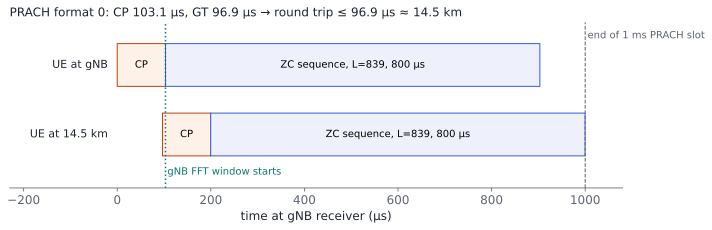

# The PRACH waveform {#prach}

## Long preamble formats (L = 839) {#long-formats}



::: {.compact}
| Format | ΔfRA | Sequence | CP | Duration | GT | Max radius |
|---|---|---|---|---|---|---|
| 0 | 1.25 kHz | 800 µs | 103.1 µs | 1 ms | 96.9 µs | ≈ 14.5 km |
| 1 | 1.25 kHz | 2 × 800 µs | 684.4 µs | 3 ms | 715.6 µs | ≈ 100 km |
| 2 | 1.25 kHz | 4 × 800 µs | 152.6 µs | 3.5 ms | 147.4 µs | ≈ 22 km |
| 3 | 5 kHz | 4 × 200 µs | 103.1 µs | 1 ms | 96.9 µs | ≈ 14.5 km |
:::

$$
R_{\max}\approx\frac{c}{2}\,\min\left(T_{CP},T_{GT}\right)
$$

{width="64%"}

::: {.spec}

TS 38.211 Table 6.3.3.1-1 (Nu, NCP in κ units)

:::

::: {.notes}
Derivations: format 0 N_u = 24576κ = 800 µs, N_CP = 3168κ = 103.1 µs, GT = 1000 − 903.1 = 96.9 µs → 14.5 km. Format 2 repeats the sequence 4 times for +6 dB energy (coverage), not range. Format 3's 5 kHz spacing makes it robust to Doppler (high-speed trains). Short formats (A1–A3, B1–B4, C0, C2) use L = 139 at 15–120 kHz, scaling all durations by 2^−μ: they target small and medium cells and are the only option in FR2.
:::

## Zadoff-Chu roots and cyclic shifts {#zc}

$$
x_u(n)=e^{-j\pi u n(n+1)/L_{RA}},\qquad x_{u,v}(n)=x_u\big((n+C_v)\bmod L_{RA}\big),\quad C_v=vN_{CS}
$$

- Cyclic shifts of one root are orthogonal (ideal periodic autocorrelation). Different roots have cross-correlation $1/\sqrt{L}$.
- A delayed preamble appears as a shifted correlation peak. The shift must stay inside its own zone:

$$
N_{CS}\,\frac{T_{seq}}{L_{RA}}\ \ge\ \frac{2R}{c}+\tau_{ds}
$$

::: {.box}

[Worked example: 10 km, format 0]{.box-title} $T_{seq}/L=800/839=0.954\ \mu s$. RTD = 66.7 µs, delay spread 5 µs → $N_{CS}\ge 75.2$.\
 Pick $N_{CS}=76$ (zeroCorrelationZoneConfig = 10). Preambles per root $\lfloor 839/76\rfloor=11$ → $\lceil 64/11\rceil=6$ roots per cell.

:::

::: {.spec}

TS 38.211 §6.3.3.1, Table 6.3.3.1-5

:::

::: {.notes}
The unrestricted N_CS values for L = 839 are 0, 13, 15, 18, 22, 26, 32, 38, 46, 59, 76, 93, 119, 167, 279, 419. With 838 usable logical roots and 6 per cell, there are ~139 distinct root groups: root planning is a reuse problem like PCI planning. Neighbours sharing a root and N_CS produce 'ghost' preambles: the gNB detects a neighbour cell's UE.
:::

## High speed: restricted sets {#restricted}

- A Doppler shift of $f_d$ moves the ZC correlation peak to a *different cyclic shift*: $d_u$ samples per $\Delta f_{RA}$ of frequency offset.
- With 1.25 kHz spacing, $f_d\approx 600$ Hz (≈ 190 km/h at 3.5 GHz) already creates strong aliased peaks and false detections.
- **Restricted set type A/B** (`restrictedSetConfig`) skip cyclic shifts that would alias, at the cost of fewer preambles per root.
- **Format 3** (5 kHz) quadruples the tolerance. It is the usual choice for railway cells with long preambles.

::: {.box .field}

[Field symptom]{.box-title}Many Msg1 detections with no Msg3 following, concentrated on cells along a railway or motorway: aliased or ghost preambles. Check restrictedSetConfig and root planning before touching power.

:::

::: {.spec}

TS 38.211 §6.3.3.1 (restricted sets)

:::

::: {.notes}
fd for 190 km/h at 3.5 GHz: 52.8 m/s · 3.5e9/3e8 = 616 Hz, about half of Δf_RA. Once the frequency offset approaches Δf_RA/2, the correlation peak at the shifted position becomes comparable to the true one. Restricted sets are defined only for L = 839.
:::

# RACH occasions and beam association {#ro}

## From prach-ConfigurationIndex to occasions {#ro-config}

- `prach-ConfigurationIndex` selects a row of TS 38.211 Tables 6.3.3.2-2/3/4 (FR1 paired, FR1 unpaired, FR2): format, period (x), subframe/slot, starting symbol, number of occasions per slot.
- `msg1-FDM` ∈ {1, 2, 4, 8} occasions side by side in frequency, starting at `msg1-FrequencyStart`.
- `ssb-perRACH-OccasionAndCB-PreamblesPerSSB`: $N$ SSBs per occasion (1/8 … 16) and $R$ contention-based preambles per SSB.

::: {.box}

[Mapping order (TS 38.213 §8.1)]{.box-title}SSB indices are mapped to preambles: first by preamble index inside one occasion, then by frequency (FDM), then by time within a PRACH slot, then across PRACH slots.

:::

::: {.small}

Example: 8 SSBs, msg1-FDM = 2, one SSB per occasion → 8 occasions are needed → 4 time instances. The association period must cover all SSBs at least once.

:::

::: {.spec}

TS 38.211 §6.3.3.2 · TS 38.213 §8.1 · TS 38.331 RACH-ConfigCommon

:::

::: {.notes}
This mapping is what lets the gNB learn the UE's best downlink beam from where the preamble arrives (ShareTechnote stresses this as the key NR difference from LTE RACH). It also means: if the gNB receive beam for each occasion matches the SSB beam, the PRACH gets beamforming gain on reception. Misaligned SSB-to-RO receive beams look like a pure uplink coverage loss.
:::

## Msg2 addressing and windows {#ra-rnti}

$$
\text{RA-RNTI}=1+s_{id}+14\,t_{id}+14\cdot 80\,f_{id}+14\cdot 80\cdot 8\,ul_{carrier\_id}
$$

::: {.small}

$s_{id}$: first symbol of the occasion (0–13), $t_{id}$: first slot in the frame (0–79), $f_{id}$: FDM index (0–7), $ul_{carrier\_id}$: 0 normal UL, 1 SUL.

:::

- `ra-ResponseWindow`: sl1 … sl80 slots after the occasion, at most 10 ms in Rel-15.
- `preambleTransMax`, `powerRampingStep` (0, 2, 4, 6 dB), `ra-ContentionResolutionTimer` (8–64 subframes).
- Rel-16 2-step RACH: MsgA = preamble + PUSCH, MsgB = response. Selected when RSRP ≥ `msgA-RSRP-Threshold`, falls back to 4-step otherwise.

::: {.spec}

TS 38.321 §5.1.1–5.1.5 · TS 38.331 RACH-ConfigGeneric

:::

::: {.notes}
A UE that sent its preamble in occasion (s=0, t=19, f=1) on the normal UL looks for RA-RNTI = 1 + 0 + 14·19 + 1120·1 = 1387. Two UEs that chose different preambles in the same occasion share the RA-RNTI and read the same RAR PDU; each finds its own RAPID inside.
:::

# Power and timing {#power-ta}

## PRACH power control {#prach-power}

$$
P_{PRACH}=\min\left\{P_{CMAX},\ P_{PRACH,\text{target}}+PL\right\}
$$

$$
P_{PRACH,\text{target}}=\texttt{preambleReceivedTargetPower}+\Delta_{\text{preamble}}+(\text{COUNTER}-1)\cdot\texttt{powerRampingStep}
$$

::: {.box}

[Example]{.box-title}Target −110 dBm, PL = 125 dB, format 0 ($\Delta=0$), first attempt: $P=15$ dBm. After 3 failures with 4 dB steps: 27 dBm → capped at $P_{CMAX}=23$ dBm.

:::

::: {.small}

- PL comes from ss-PBCH-BlockPower − filtered SS-RSRP (Lecture 4: watch the beam-gain trap).
- Msg3 power uses the RAR's TPC command and `msg3-DeltaPreamble` on top of the PRACH-derived open loop.

:::

::: {.spec}

TS 38.213 §7.4 · TS 38.321 §5.1.3

:::

::: {.notes}
A UE reaching P_CMAX on attempt n stops gaining from further ramping. If preambleTransMax is large, it keeps transmitting at max power, adding uplink interference for nothing. In UL-limited cells, the better levers are the target power (raise it only if UL noise rise allows) and reducing the pathloss error, not a bigger ramping step.
:::

## Timing advance: initial and closed loop {#ta}

::: {.columns}

::: {.column}

**RAR**: 12-bit $T_A\in\{0,\dots,3846\}$

$$
N_{TA}=T_A\cdot 16\cdot 64/2^{\mu}
$$

::: {.small}

Max: 3846 steps × 520.8 ns = 2.0 ms of round trip at 15 kHz (≈ 300 km): never the limit, PRACH format is.

:::

:::

::: {.column}

**MAC CE**: 6-bit $T_A\in\{0,\dots,63\}$, relative

$$
N_{TA,\text{new}}=N_{TA,\text{old}}+(T_A-31)\cdot 16\cdot 64/2^{\mu}
$$

::: {.small}

±31 steps per command: ±8.1 µs at 30 kHz. Applied from slot $n+k+1$ after reception (TS 38.213 §4.2).

:::

:::

:::

::: {.kpis}

::: {.kpi}

[6.67 µs]{.kpi-val}[round trip per km]{.kpi-label}

:::

::: {.kpi}

[39 m]{.kpi-val}[one TA step at 30 kHz (one-way)]{.kpi-label}

:::

::: {.kpi}

[timeAlignmentTimer]{.kpi-val}[expiry → UE must redo RACH]{.kpi-label}

:::

:::

::: {.spec}

TS 38.213 §4.2 · TS 38.321 §5.2, §6.1.3.4

:::

::: {.notes}
TA as a geolocation tool: the RAR TA gives distance with ~39 m granularity at 30 kHz, but multipath (the first detected path is not always the direct path) biases it long in NLOS. Many vendors export TA distributions per cell: a long tail beyond the planned radius is the classic overshooting indicator.
:::

# Troubleshooting access {#ra-kpi}

## Decomposing random access failures {#ra-tree}

::: {.compact}
| Failing step | Typical cause | Check first |
|---|---|---|
| Msg1 not detected | UL coverage, PL error, NCS too small for real distance | TA distribution, ss-PBCH-BlockPower, zeroCorrelationZoneConfig |
| Msg1 detected, no Msg3 | ghost/aliased preambles, RAR not received | root plan, restrictedSetConfig, RAR window, DL beam |
| Msg3 decode failure | Msg3 power too low, UL interference | msg3-DeltaPreamble, TPC in RAR, UL IoT per symbol |
| Msg4 / contention failure | DL quality at the edge, timer too short | ra-ContentionResolutionTimer, CORESET#0 robustness |
:::

::: {.box .field}

[Method]{.box-title}Compute per-step ratios: Msg3/Msg1, Msg4/Msg3 per cell. A low Msg3/Msg1 with normal UL IoT points to preamble-detection artefacts. A low Msg3/Msg1 with high UL IoT points to interference (remember remote interference, Lecture 3).

:::

::: {.notes}
ShareTechnote's RACH page lists the RRC parameters with their spec references (prach-ConfigurationIndex 38.321 §5.1, prach-RootSequenceIndex and zeroCorrelationZoneConfig 38.211 §6.3.3). A good practice exercise is to take one cell's RACH-ConfigCommon and re-derive its maximum supported radius and the number of roots it consumes.
:::

## Exercises {#ex5}

1. Design PRACH for a 25 km coastal cell (format, NCS, roots per cell). Assume 5 µs delay spread.
2. Compute the RA-RNTI for an occasion at symbol 0, slot 9, fid = 0, normal UL.
3. A UE has PL = 132 dB, target −104 dBm, step 2 dB, PCMAX = 23 dBm. On which attempt does it reach PCMAX?
4. Why is the gNB's PRACH receive beam per occasion as important as the SSB beam itself in FR2?

::: {.aside-note}

Answers in the speaker notes.

:::

::: {.notes}
1. Format 0/3 reach only 14.5 km, format 2 ≈ 22 km: use format 1 (≈ 100 km) or format 2 with a reduced target if 22 km suffices. 25 km → format 1. N_CS: RTD = 166.7 µs + 5 µs = 171.7 µs / 0.954 = 180 → next value 279 (config 14). Preambles per root = floor(839/279) = 3 → ceil(64/3) = 22 roots per cell. Large roots-per-cell is the price of range.
2. 1 + 0 + 14·9 + 0 = 127.
3. Attempt 1: −104 + 132 = 28 dBm > 23 → already capped at attempt 1. Ramping cannot help: this UE is UL-limited.
4. In FR2 the PRACH is received with an analog beam chosen per occasion, based on the SSB mapping. If the gNB listens with the wrong beam, the preamble loses the full array gain (often 15–20 dB), which looks like a large uplink coverage hole although the DL beam is fine.
:::

## References and further reading {#refs5}

::: {.refs}

- **3GPP** TS 38.211 §6.3.3 (PRACH sequences, formats, configuration tables)
- **3GPP** TS 38.213 §4.2 (TA application), §7.4 (PRACH power), §8 (random access procedure)
- **3GPP** TS 38.321 §5.1 (random access), §5.2 (TA maintenance), §6.1.3.4 (TA command MAC CE), §6.2.3 (RAR)
- **3GPP** TS 38.331 RACH-ConfigCommon, RACH-ConfigGeneric
- [ShareTechnote · RACH](https://www.sharetechnote.com/html/5G/5G_RACH.html){target="_blank"}
- [ShareTechnote · Timing advance](https://www.sharetechnote.com/html/5G/5G_TimingAdvance.html){target="_blank"}
- [ShareTechnote · UL timing](https://www.sharetechnote.com/html/5G/5G_UL_Timing.html){target="_blank"}
- [ShareTechnote · SA initial attach](https://www.sharetechnote.com/html/5G/5G_CallProcess_InitialAttach.html){target="_blank"}
- [ShareTechnote · Power control](https://www.sharetechnote.com/html/5G/5G_PowerControl.html){target="_blank"}
- C. Johnson, *5G New Radio in Bullets*, independently published, 2019 (ISBN 978-1077484351): chapters on random access, timing advance and initial access signalling.
- E. Dahlman, S. Parkvall, J. Sköld, *5G NR: The Next Generation Wireless Access Technology*, 2nd ed., Academic Press, 2020.

:::

::: {.aside-note}

Specs are quoted by clause so they can be checked against any Release; numbers on these slides follow Rel-15 to Rel-17 unless marked.

:::
