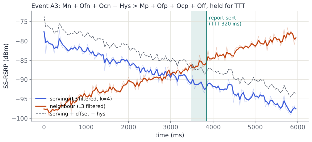

# What the UE measures {#defs}

## SS-RSRP, SS-RSRQ, SS-SINR {#definitions}



::: {.compact}
| Quantity | Definition (TS 38.215 §5.1) | Reported range |
|---|---|---|
| SS-RSRP | linear average power (W) per RE of the SSS (optionally + PBCH DMRS), in the SMTC window | −156 … −31 dBm, 1 dB |
| SS-RSRQ | $N\times$SS-RSRP / NR carrier RSSI, $N$ = RBs in the RSSI bandwidth | −43 … 20 dB, 0.5 dB |
| SS-SINR | SSS power per RE / (noise + interference) per RE, same REs | −23 … 40 dB, 0.5 dB |
| L1-RSRP | RSRP per SSB or CSI-RS resource, for beam reports | −140 … −44 dBm, 1 dB (differential 2 dB) |
:::

::: {.small}

- FR1 reference point: the antenna connector. FR2: the combined signal of the antenna elements of one receiver branch, so the UE's own array gain is *inside* FR2 RSRP.
- Reported value $n$ for RSRP maps to roughly $[-157+n,\,-156+n)$ dBm: a threshold `rsrp 106` in RRC means ≈ −51 dBm.

:::

::: {.spec}

TS 38.215 §5.1.1–5.1.6 · TS 38.133 §10.1

:::

::: {.notes}
ShareTechnote's power-definition page lists the full family: SS-, CSI- and SRS-RSRP, SS- and CSI-RSRQ, SS- and CSI-SINR. Its CA example decodes a2-Threshold rsrp 16 as about −141 dBm, consistent with −157 + 16. Teams that compare UE logs with gNB counters must agree on whether they use the reported index or the dBm value.
:::

## What RSRQ can and cannot be {#rsrq-ceiling}

If the RSSI symbol is fully loaded by the serving cell only, with no noise, every RB carries 12 REs at RSRP:

$$
\text{RSRQ}=\frac{N\cdot\text{RSRP}}{N\cdot 12\cdot\text{RSRP}}=\frac{1}{12}\ \Rightarrow\ -10.8\ \text{dB}
$$

- One equally strong, fully loaded neighbour: −13.8 dB. RSRQ above −10.8 dB means the RSSI symbols were partly empty (low load).
- So RSRQ mixes interference *and* load: the same location reads differently at 3 a.m. and at busy hour.

::: {.box .warn}

[SS-SINR in synchronized networks]{.box-title}If all cells send SSBs in the same symbols, SSBs always collide with neighbours' SSBs, whatever the traffic. SS-SINR then reflects **full-load** interference and underestimates PDSCH SINR at low load. Staggering SSB positions between neighbours changes this, and also changes what the KPI means.

:::

::: {.notes}
This is the most common misreading in NR benchmarking. Ask students: two networks show the same SS-SINR distribution, one with aligned SSBs and one with offset SSBs. Which delivers better throughput at 30 % load? The offset one's SS-SINR already looks like low-load SINR; the aligned one's SS-SINR looks like full load, so at 30 % load its PDSCH SINR is better than its SS-SINR suggests.
:::

## Worked example: predicting SINR from RSRPs {#sinr-calc}

Noise per RE at the UE: $-174+10\lg(30\,\text{kHz})+7\ \text{dB NF}=-122.2$ dBm.

::: {.compact}
|  | Serving | Neighbour 1 | Neighbour 2 |
|---|---|---|---|
| SS-RSRP | −85 dBm | −88 dBm | −90 dBm |
:::

$$
\text{SINR}=\frac{P_s}{\eta\,(P_1+P_2)+N}
$$

::: {.kpis}

::: {.kpi}

[0.9 dB]{.kpi-val}[η = 100 % (SSB-on-SSB, or full load)]{.kpi-label}

:::

::: {.kpi}

[6.1 dB]{.kpi-val}[η = 30 % PDSCH load]{.kpi-label}

:::

::: {.kpi}

[37.2 dB]{.kpi-val}[η = 0, noise only]{.kpi-label}

:::

:::

::: {.small}

Three cells within 5 dB is the textbook definition of pilot pollution: no dominant server, low SINR at any load.

:::

::: {.notes}
Calculation: P1 + P2 = 10^(−8.8) + 10^(−9.0) = 1.585e-9 + 1.0e-9 = 2.585e-9 mW → −85.9 dBm. At η = 1: SINR = −85 − (−85.9) = 0.9 dB (noise is negligible). At η = 0.3: I = −91.1 dBm → 6.1 dB. Noise only: −85 + 122.2 = 37.2 dB. The same location spans 1 dB to 37 dB of SINR depending only on neighbour activity, which is why SINR maps must state the load (or SSB alignment) they were measured under.
:::

# Filtering, events and handover {#events}

## Layer-3 filtering {#l3}

$$
F_n=(1-a)\,F_{n-1}+a\,M_n,\qquad a=\frac{1}{2^{k/4}},\ \ k=\texttt{filterCoefficient}
$$

::: {.compact}
| k | a | Effective memory (samples) | Effect |
|---|---|---|---|
| 0 | 1 | 1 | no filtering |
| 4 | 0.5 | ≈ 2 | default: light smoothing |
| 8 | 0.25 | ≈ 4 | smoother, slower |
| 11 | 0.15 | ≈ 7 | for fast fading suppression, delays HO |
:::

::: {.small}

The filter runs per measurement period of the UE's L1 (which depends on SMTC and DRX), so the same k means different time constants on different cells.

:::

::: {.spec}

TS 38.331 §5.5.3.2 · QuantityConfig

:::

::: {.notes}
Effective memory ≈ 1/a samples. With an L1 measurement period around 200 ms (DRX or relaxed measurement), k = 8 gives ~800 ms of smoothing: plus a 320 ms TTT, the handover decision lags the radio by more than a second. At 120 km/h that is 33 m: fine in a macro cell, too slow at a street corner in FR2.
:::

## Measurement events {#events-table}

::: {.compact}
| Event | Entering condition (Mn: neighbour, Mp: serving, Ms: SpCell) | Typical use |
|---|---|---|
| A1 | Ms − Hys > Thresh | stop inter-freq measurements |
| A2 | Ms + Hys < Thresh | start gaps / inter-RAT search |
| A3 | Mn + Ofn + Ocn − Hys > Mp + Ofp + Ocp + Off | intra-freq handover |
| A4 | Mn + Ofn + Ocn − Hys > Thresh | load balancing, SCell add |
| A5 | Mp + Hys < Thresh1 and Mn + Ofn + Ocn − Hys > Thresh2 | inter-freq handover |
| A6 | Mn + Ocn − Hys > Ms + Ocs + Off | SCell replacement |
| B1 / B2 | inter-RAT neighbour (and serving) vs thresholds | EN-DC SgNB add, NR→LTE |
:::

{width="48%"}

::: {.spec}

TS 38.331 §5.5.4

:::

::: {.notes}
Ocn is the cell individual offset (CIO), the main tool to move a handover border for one neighbour pair without touching the rest. Ofn/Ofp are frequency-specific offsets. The figure is generated from synthetic RSRP traces with L3 filtering (k = 4), Off = 3 dB, Hys = 1 dB, TTT = 320 ms.
:::

## Handover failures and how to read them {#mro}

::: {.compact}
| Failure | What happened | Typical fix |
|---|---|---|
| Too late | RLF in source before HO completes; UE re-establishes in target | lower Off/TTT, raise CIO toward target |
| Too early | HO succeeds, RLF soon after in target; UE returns to source | raise Off/TTT, lower CIO |
| Wrong cell | RLF in target, re-establishment in a third cell | neighbour relations, CIO, antenna tilt |
| Ping-pong | A→B→A within a short time (for example < 1 s) | Hys, TTT, L3 filter |
:::

::: {.box .field}

[FR2 specifics]{.box-title}Beam-level mobility inside a cell (Lecture 8) absorbs most fast changes. Cell-level parameters in FR2 often need shorter TTT and lighter filtering than FR1, otherwise blockage events turn into RLFs before the A3 report is sent.

:::

::: {.spec}

TS 38.300 §15.5 (MRO) · TS 38.331 RLF-Report

:::

::: {.notes}
The RLF report (and from Rel-16 the successful HO report) lets the network classify these cases automatically: it contains the last measurement results and the cell where the UE re-established. SON MRO algorithms use exactly these counters to adjust CIO pairwise.
:::

# Idle mode: selection and reselection {#idle}

## Cell selection: the S-criterion {#s-criterion}

$$
S_{rxlev}=Q_{rxlevmeas}-(Q_{rxlevmin}+Q_{rxlevminoffset})-P_{compensation}-Q_{offsettemp}>0
$$

$$
S_{qual}=Q_{qualmeas}-(Q_{qualmin}+Q_{qualminoffset})-Q_{offsettemp}>0
$$

::: {.small}

- `q-RxLevMin` is signalled in 2 dB units (−70 … −22 → −140 … −44 dBm).
- FR1: $P_{compensation}=\max(P_{EMAX1}-P_{PowerClass},0)$ (simplified): a cell that limits UE power must require more DL margin.
- Reselection ranks $R_s=Q_{meas,s}+Q_{hyst}$ against $R_n=Q_{meas,n}-Q_{offset}$, held for `t-Reselection`. Inter-frequency uses absolute priorities and thresholds.

:::

::: {.box}

[Example]{.box-title}q-RxLevMin = −64 (−128 dBm), measured −120 dBm, no offsets, PEMAX = 23, power class 3 → Srxlev = +8 dB: suitable.

:::

::: {.spec}

TS 38.304 §5.2.3.2, §5.2.4 · TS 38.331 SIB1, SIB2–SIB4

:::

::: {.notes}
ShareTechnote's cell selection criterion page goes through every term and where the UE gets it: only Qrxlevmeas (RSRP) and Qqualmeas (RSRQ) come from the air. Setting q-RxLevMin too low makes UEs camp where they cannot complete RACH (UL-limited, Lecture 7); setting it too high creates artificial coverage holes in idle mode.
:::

## Exercises {#ex6}

1. RRC sets `a3-Offset` = 6 (in 0.5 dB units), `hysteresis` = 2 (0.5 dB units), CIO 0. Serving filtered RSRP −95 dBm. Above what neighbour RSRP does A3 enter?
2. A cell shows SS-RSRQ of −8 dB at night and −14 dB at busy hour at the same spots. Explain both values.
3. With k = 8 and an L1 period of 40 ms, estimate the filter's time constant. What TTT would you combine it with for a 120 km/h motorway?
4. Compute Srxlev for measured −126 dBm, q-RxLevMin −62, Qrxlevminoffset 0, Pcompensation 3 dB.

::: {.aside-note}

Answers in the speaker notes.

:::

::: {.notes}
1. Off = 3 dB, Hys = 1 dB: Mn − 1 > −95 + 3 → Mn > −91 dBm.
2. Night: RSSI symbols mostly empty → RSRQ above the −10.8 dB full-load ceiling. Busy hour: own and neighbour cells loaded → RSSI includes all data REs plus interference → −14 dB.
3. a = 0.25, memory ≈ 4 samples ≈ 160 ms. At 120 km/h (33 m/s), use a short TTT (e.g. 80–160 ms) so the total lag stays ≈ 300 ms ≈ 10 m.
4. −126 − (−124 + 0) − 3 = −5 dB: not suitable.
:::

## References and further reading {#refs6}

::: {.refs}

- **3GPP** TS 38.215 §5.1 (measurement definitions) · TS 38.133 §10.1 (reporting ranges and mapping)
- **3GPP** TS 38.331 §5.5.3 (L3 filtering), §5.5.4 (events A1–A6, B1, B2), QuantityConfig, ReportConfigNR
- **3GPP** TS 38.304 §5.2 (cell selection and reselection) · TS 38.300 §15.5 (SON / MRO)
- [ShareTechnote · RSRP / RSRQ / SINR definitions](https://www.sharetechnote.com/html/5G/5G_PowerDefinition.html){target="_blank"}
- [ShareTechnote · Measurement report](https://www.sharetechnote.com/html/5G/5G_MeasurementReport.html){target="_blank"}
- [ShareTechnote · Cell selection criterion](https://www.sharetechnote.com/html/5G/5G_CellSelectionCriterion.html){target="_blank"}
- C. Johnson, *5G New Radio in Bullets*, independently published, 2019 (ISBN 978-1077484351): chapters on measurements, RRC measurement configuration and mobility.
- E. Dahlman, S. Parkvall, J. Sköld, *5G NR: The Next Generation Wireless Access Technology*, 2nd ed., Academic Press, 2020.

:::

::: {.aside-note}

Specs are quoted by clause so they can be checked against any Release; numbers on these slides follow Rel-15 to Rel-17 unless marked.

:::
