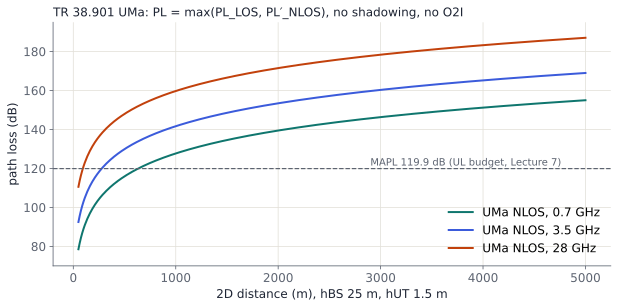

# Propagation models {#prop}

## TR 38.901 path loss, UMa {#uma}



$f_c$ in GHz, distances in m, $h_{BS}=25$ m:

$$
PL_{LOS}=28.0+22\lg d_{3D}+20\lg f_c\quad(10\ \text{m}\le d_{2D}\le d'_{BP})
$$

$$
PL_{NLOS}=\max\left(PL_{LOS},\ 13.54+39.08\lg d_{3D}+20\lg f_c-0.6\,(h_{UT}-1.5)\right)
$$

::: {.small}

$d'_{BP}=4h'_{BS}h'_{UT}f_c/c$ with effective heights $h'=h-1$ m: 560 m at 3.5 GHz for a 1.5 m UE. Shadow fading σ: 4 dB LOS, 6 dB NLOS.

:::

{width="46%"}

::: {.spec}

TR 38.901 §7.4.1, Table 7.4.1-1

:::

::: {.notes}
The NLOS slope (39.08 dB/decade) is the number to remember: doubling distance costs 11.8 dB in NLOS UMa, versus 6 dB in free space. For UMi street canyon NLOS: PL' = 35.3 lg d3D + 22.4 + 21.3 lg fc − 0.3 (hUT − 1.5), σ = 7.82 dB. Note the different frequency coefficient (21.3 vs 20).
:::

## Outdoor-to-indoor penetration {#o2i}

$$
PL=PL_b+PL_{tw}+PL_{in}+N(0,\sigma_P^2),\qquad PL_{in}=0.5\,d_{2D\text{-}in}
$$

::: {.columns}

::: {.column}

::: {.small}

**Low-loss** (standard glass, concrete):\
$PL_{tw}=5-10\lg\left(0.3\cdot 10^{-L_{glass}/10}+0.7\cdot 10^{-L_{concrete}/10}\right)$

:::

::: {.small}

**High-loss** (IRR glass, concrete):\
$PL_{tw}=5-10\lg\left(0.7\cdot 10^{-L_{IRR}/10}+0.3\cdot 10^{-L_{concrete}/10}\right)$

:::

::: {.small}

$L_{glass}=2+0.2f$, $L_{IRR}=23+0.3f$, $L_{concrete}=5+4f$ (dB, f in GHz)

:::

:::

::: {.column}

::: {.compact}
| f | Low-loss PLtw | High-loss PLtw |
|---|---|---|
| 0.7 GHz | 10.2 dB | 17.7 dB |
| 3.5 GHz | 12.7 dB | 26.8 dB |
| 28 GHz | 17.8 dB | 37.9 dB |
:::

:::

:::

::: {.box .warn}

[Energy-efficient buildings]{.box-title}Metal-coated (IRR) glass adds ≈ 14 dB at 3.5 GHz and ≈ 20 dB at 28 GHz over standard glass. A single building type assumption can swing the plan by a factor of 3–5 in site count.

:::

::: {.spec}

TR 38.901 §7.4.3, Tables 7.4.3-1/2

:::

::: {.notes}
The low-loss model is a parallel combination: 30 % of the wall is glass (weak loss) and dominates the result, which is why 'low-loss' is only 12.7 dB at 3.5 GHz despite 19 dB of concrete loss. In high-loss, the 70 % IRR glass and 30 % concrete are both lossy, so there is no weak path. σ_P = 4.4 dB (low-loss) and 6.5 dB (high-loss).
:::

# Link budgets {#lb}

## Uplink budget, 3.5 GHz, indoor UE {#ul-budget}

::: {.compact}
| Item | Value | Note |
|---|---|---|
| UE power − body loss | 23 − 3 = 20 dBm | power class 3 |
| gNB RX gain | +18 dBi | conservative, before MIMO combining |
| Sensitivity, 10 PRB (3.6 MHz) | −108.4 dBm | −174 + 65.6 + 3 dB NF − 3 dB SINR |
| Path loss before margins | 146.4 dB |  |
| Shadowing (90 % edge, σ = 6) | −7.7 dB | 1.28 σ |
| O2I low-loss + indoor | −16.8 dB | 12.7 + 0.5 × 8.3 m |
| Interference margin | −2 dB |  |
| **MAPL** | **119.9 dB** |  |
:::

Invert UMa NLOS at 3.5 GHz: $119.9=13.54+39.08\lg d+10.88\Rightarrow d\approx 278$ m. With 2 PRB instead of 10: +7 dB → ≈ 419 m.

::: {.notes}
8.3 m is the mean of min(U(0,25), U(0,25)), the indoor-distance model in TR 38.901. 1.28σ gives 90 % location probability at the edge; area reliability is higher (around 95–97 % depending on σ/n). Each assumption here is a lever and must be stated when comparing vendors' budgets.
:::

## The asymmetry: where the uplink ends, RSRP still looks fine {#dl-vs-ul}

Same location (PL + margins = 119.9 dB), 200 W carrier, 17.8 dBm per RE:

::: {.kpis}

::: {.kpi}

[−87 dBm]{.kpi-val}[SS-RSRP with a 15 dBi broadcast beam]{.kpi-label}

:::

::: {.kpi}

[−78 dBm]{.kpi-val}[PDSCH RSRP with a 24 dBi traffic beam]{.kpi-label}

:::

::: {.kpi}

[44 dB]{.kpi-val}[DL SNR per RE (UE NF 7 dB)]{.kpi-label}

:::

:::

::: {.box .warn}

[Consequence]{.box-title}The uplink of a 10-PRB PUSCH ends at an SS-RSRP of about −87 dBm in this scenario, a value most drive-test colour scales show as "good". Coverage thresholds must be derived from the UL budget, then translated into an RSRP threshold, not the other way round.

:::

::: {.small}

- Fixes: lower-band UL (CA, SUL, EN-DC anchor), UL MIMO, PC2 UEs (26 dBm), PUSCH repetition (Rel-17), fewer PRBs per edge UE.

:::

::: {.notes}
The 9 dB difference between SSB and traffic beam gain is typical for 64T64R with a wide broadcast beam; vendors differ. This slide is the quantitative version of the LinkedIn Episode 15 message. A good exercise: find the SS-RSRP at which your own network's UL BLER exceeds 10 % from drive-test data, and compare it with the planning threshold.
:::

# Uplink power control {#pc}

## PUSCH power control {#pusch-pc}

$$
P_{PUSCH}=\min\left\{P_{CMAX},\ P_{O\_PUSCH}+10\lg\!\left(2^{\mu}M_{RB}\right)+\alpha\,PL+\Delta_{TF}+f\right\}
$$

::: {.small}

- $P_{O\_PUSCH}$: nominal (cell, `p0-NominalWithGrant`) + UE-specific part.
- $\alpha\in\{0,0.4,0.5,\dots,1\}$: fractional compensation. α < 1 lets edge UEs arrive weaker, protecting neighbours.
- $f$: closed-loop TPC accumulation, {−1, 0, +1, +3} dB per command (accumulated mode).
- PHR reports $P_{CMAX}-P_{PUSCH}$: the scheduler's signal to shrink $M_{RB}$ when the UE runs out of power.

:::

::: {.box}

[Example]{.box-title}$P_0=-90$ dBm, α = 0.8, 10 PRB at 30 kHz ($10\lg 20=13$ dB): PL = 120 dB → 19 dBm. The UE hits 23 dBm at PL = (23 + 90 − 13)/0.8 = 125 dB. Beyond that, every dB of extra path loss is lost SINR unless $M_{RB}$ shrinks.

:::

::: {.spec}

TS 38.213 §7.1.1 · TS 38.321 §5.4.6 (PHR)

:::

::: {.notes}
ShareTechnote's power-control page shows a lab trace with p0-NominalWithGrant −90, preambleReceivedTargetPower −110 and powerRampingStep dB4, and the RAR TPC command feeding the first PUSCH. Emphasize the link to Lecture 4: PL in this formula comes from ss-PBCH-BlockPower minus filtered RSRP, so a wrong ss-PBCH-BlockPower shifts every UE's PUSCH power by the same error.
:::

## Choosing α and P0 {#alpha}

::: {.compact}
| Setting | Edge UE SINR | Inter-cell interference | Use |
|---|---|---|---|
| α = 1, P0 high | high | high | isolated cells, coverage-limited rural |
| α = 0.8, P0 ≈ −90 dBm | medium | medium | typical urban starting point |
| α = 0.6, P0 higher | lower at edge | low | dense, interference-limited clusters |
:::

Received power at the gNB for a non-capped UE:

$$
P_{rx}=P_{PUSCH}-PL=P_0+10\lg(2^{\mu}M_{RB})-(1-\alpha)\,PL
$$

::: {.small}

With α = 0.8, a UE 20 dB farther away arrives 4 dB weaker per PRB. Uplink noise rise (IoT) from the whole cell is what P0 must balance.

:::

::: {.notes}
Practical tuning loop: measure UL IoT per cell (busy hour) and UL BLER/MCS distributions. If IoT is low and edge MCS is poor, raise P0 or α. If IoT is high everywhere in a cluster, lower P0 first, then α. Always change one cluster at a time and compare neighbouring clusters as control.
:::

# Exercises {#practice7}

## Exercises {#ex7}

1. Redo the UL budget for high-loss buildings at 3.5 GHz. What is the new indoor range?
2. Repeat it at 700 MHz with a 15 dBi gNB antenna and low-loss buildings. Compare with 3.5 GHz.
3. For P0 = −95 dBm, α = 0.7, 20 PRB at 30 kHz, at which PL does the UE reach 23 dBm?
4. Your drive test shows UL BLER rising above 10 % at SS-RSRP ≈ −95 dBm, but the plan assumed −105 dBm. List three possible causes.

::: {.aside-note}

Answers in the speaker notes.

:::

::: {.notes}
1. High-loss PL_tw 26.8 dB instead of 12.7 → MAPL 105.8 dB → lg d = (105.8 − 24.42)/39.08 = 2.083 → ≈ 121 m. More than half the range lost.
2. MAPL = 146.4 − 3 (15 vs 18 dBi) − 7.7 − (10.2 + 4.2) − 2 = 119.4 dB; lg d = (119.4 − 13.54 + 3.10)/39.08 = 2.787 → ≈ 613 m, about 2.2× the 3.5 GHz range at the same UE power and bandwidth.
3. 10 lg(2·20) = 16.0 dB. 23 = −95 + 16 + 0.7 PL → PL = 102/0.7 = 145.7 dB.
4. SSB beam gain lower than assumed (RSRP-to-UL mapping shifted), higher UL IoT than the 2 dB margin (interference, remote interference), worse O2I than planned, wrong ss-PBCH-BlockPower biasing power control, or UL scheduled with more PRBs than the budget assumed.
:::

## References and further reading {#refs7}

::: {.refs}

- **3GPP** TR 38.901 §7.4.1 (path loss), §7.4.3 (O2I penetration), Table 7.4.1-1
- **3GPP** TS 38.213 §7.1 (PUSCH power control), §7.2 (PUCCH), §7.7 (PHR)
- **3GPP** TS 38.321 §5.4.6 (power headroom reporting) · TS 38.101-1 §6.2 (UE output power)
- [ShareTechnote · Power control](https://www.sharetechnote.com/html/5G/5G_PowerControl.html){target="_blank"}
- [ShareTechnote · RSRP / RSRQ / SINR definitions](https://www.sharetechnote.com/html/5G/5G_PowerDefinition.html){target="_blank"}
- C. Johnson, *5G New Radio in Bullets*, independently published, 2019 (ISBN 978-1077484351): chapters on uplink power control, link budget and coverage.
- E. Dahlman, S. Parkvall, J. Sköld, *5G NR: The Next Generation Wireless Access Technology*, 2nd ed., Academic Press, 2020.
- T. S. Rappaport, *Wireless Communications: Principles and Practice*, 2nd ed., Prentice Hall, 2002, ch. 4 (shadowing and edge reliability).

:::

::: {.aside-note}

Specs are quoted by clause so they can be checked against any Release; numbers on these slides follow Rel-15 to Rel-17 unless marked.

:::
