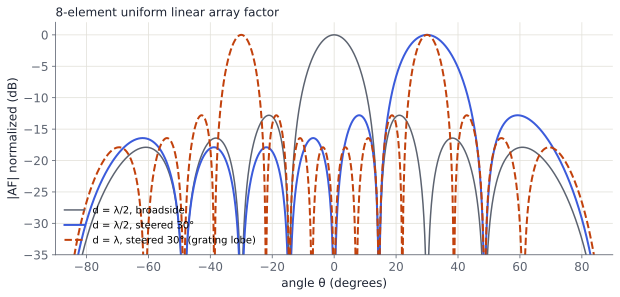

# Antenna arrays {#arrays}

## Array factor, beamwidth and grating lobes {#af}



Uniform linear array, $N$ elements, spacing $d$, steered to $\theta_0$:

$$
AF(\theta)=\frac{1}{N}\left|\sum_{n=0}^{N-1}e^{\,j2\pi n\frac{d}{\lambda}(\sin\theta-\sin\theta_0)}\right|
$$

::: {.columns}

::: {.column}

::: {.small}

- HPBW ≈ $0.886\,\lambda/(Nd\cos\theta_0)$ rad → ≈ $101.5^\circ/N$ at broadside for $d=\lambda/2$ (12.7° for N = 8).
- Beam broadens by $1/\cos\theta_0$ when steered.
- No grating lobe for scan angles up to $\theta_{\max}$ if $d/\lambda<1/(1+|\sin\theta_{\max}|)$.

:::

:::

::: {.column}

{width="100%"}

:::

:::

::: {.notes}
With d = λ and θ0 = 30°, a grating lobe appears at sin θ = sin 30° − 1 = −0.5 → θ = −30°, as in the figure. Vertical element spacing in many AAUs is larger than λ/2 because each 'element' is a sub-array of 2–3 radiators: vertical steering range is then deliberately limited to a few degrees to avoid grating lobes.
:::

## What 64T64R buys: gain and EIRP {#eirp}

With $N$ PAs of power $P_{PA}$ combining coherently, and element/sub-array gain $G_e$:

$$
\text{EIRP}=P_{PA}+20\lg N+G_e
$$

::: {.box}

[Illustrative 64T64R AAU at 200 W]{.box-title} $P_{PA}=200/64=3.1$ W = 34.9 dBm; $20\lg 64=36.1$ dB; 3-element vertical sub-array + element ≈ 9.8 dBi → EIRP ≈ 80.8 dBm in the beam peak.

:::

::: {.small}

- Total conducted power grows as $10\lg N$, EIRP as $20\lg N$: half of the array gain comes from more PAs, half from directivity.
- Uplink: maximum-ratio combining over 64 receivers gives up to $10\lg 64=18$ dB of SNR gain, more than any DL change can return to an UL-limited cell.
- MU-MIMO: users separated in angle share the same RBs. Capacity gain depends on user angular spread and CSI accuracy, not on N alone.

:::

::: {.spec}

TS 38.104 §6.2 (BS output power), §9 (radiated requirements, OTA)

:::

::: {.notes}
EIRP limits for AAS base stations are specified as OTA requirements (TS 38.104 radiated part, TS 38.141-2 for conformance). In the field, EMF compliance often caps the actual EIRP below the hardware maximum, using statistical power-limiting features. That affects both coverage (Lecture 7) and the SSB/traffic-beam gain gap.
:::

# CSI and codebooks {#csi}

## CSI-RS and what the UE reports {#csi-rs}

- CSI-RS ports: 1, 2, 4, 8, 12, 16, 24, 32. One port is used for TRS (tracking). Multi-port for CSI acquisition and beam management.
- Configured, not always on (unlike LTE CRS), and designed for beamforming: each resource can carry its own beam.
- Report quantities: CRI (which resource/beam), RI, PMI, CQI, LI, L1-RSRP, L1-SINR (Rel-16).
- Periodic (PUCCH), semi-persistent (PUCCH/PUSCH), aperiodic (PUSCH, triggered by DCI).

::: {.box}

[Hierarchy]{.box-title}CSI-ResourceConfig → resource sets → NZP-CSI-RS resources (ports, density, period, QCL source); CSI-ReportConfig → what to report, from which resources, on which channel.

:::

::: {.spec}

TS 38.211 §7.4.1.5 · TS 38.214 §5.2 · TS 38.331 CSI-MeasConfig

:::

::: {.notes}
ShareTechnote's CSI framework page explains how these RRC objects point at each other, and why one framework covers beam management, tracking loops and closed-loop MIMO. Start any CSI troubleshooting from the report configuration: a UE reporting CQI on the wrong resource set is a configuration problem, not a radio one.
:::

## Type I single-panel codebook {#type1}

$P_{CSI\text{-}RS}=2N_1N_2$ ports (dual polarization). Precoder $W=W_1W_2$:

$$
v_{l,m}=u_m\otimes\left[1,\ e^{j2\pi l/(O_1N_1)},\ \dots,\ e^{j2\pi l(N_1-1)/(O_1N_1)}\right]^T,\qquad \varphi_n=e^{j\pi n/2}
$$

::: {.small}

- $i_1=(i_{1,1},i_{1,2})$: beam from an oversampled 2D DFT grid of $N_1O_1\times N_2O_2$ directions.
- $i_2$: co-phasing $\varphi_n$ between polarizations (and beam selection for some modes).
- Example: 32 ports, $(N_1,N_2)=(8,2)$, $(O_1,O_2)=(4,4)$ → 32 × 8 = 256 grid beams.
- Type II: linear combination of 2–4 beams with amplitude and phase per sub-band: finer CSI for MU-MIMO, much larger report.

:::

::: {.spec}

TS 38.214 §5.2.2.2.1 (Type I), §5.2.2.2.3 (Type II)

:::

::: {.notes}
The oversampling factors O1, O2 set the angular step of the beam grid (ShareTechnote's codebook page notes they determine the beam sweeping step). With N1 = 8, O1 = 4 the horizontal grid has 32 directions across the visible region; adjacent beams overlap at about −1 dB, so the UE's PMI choice is robust to small movements.
:::

# Beam management {#bm}

## P1, P2, P3 and how they are really configured {#p123}

::: {.compact}
| Procedure | Who sweeps | Reference signal | Configuration |
|---|---|---|---|
| P1 · initial selection | gNB wide beams | SSB (or CSI-RS) | SSB burst + RACH occasion mapping, L1-RSRP report |
| P2 · gNB TX refinement | gNB narrow beams | CSI-RS | resource set with `repetition off`, report CRI + L1-RSRP |
| P3 · UE RX refinement | UE RX beams | CSI-RS | resource set with `repetition on`, no report needed |
:::

::: {.small}

The specifications never use the names P1–P3: what is configured is a CSI-RS resource set and its `repetition` flag. With repetition off, the UE cannot assume the resources share a TX beam (the gNB is sweeping). With repetition on, they do (the UE sweeps).

:::

::: {.spec}

TS 38.214 §5.1.6.1.2, §5.2.1.4 · TS 38.331 NZP-CSI-RS-ResourceSet

:::

::: {.notes}
This point is made directly on ShareTechnote's beam management page: P1/P2/P3 are industry names kept from the study item. Up to 4 beams per L1-RSRP report in Rel-15 (nrofReportedRS), with the best in 7 bits absolute and others as 4-bit differentials in 2 dB steps.
:::

## TCI states, QCL and beam failure recovery {#tci}

::: {.columns}

::: {.column}

**QCL types**

::: {.compact}
|  |  |
|---|---|
| A | Doppler shift, Doppler spread, average delay, delay spread |
| B | Doppler shift, Doppler spread |
| C | Doppler shift, average delay |
| D | spatial RX parameter (the beam) |
:::

::: {.small}

Up to 128 TCI states configured for PDSCH, up to 8 activated by MAC CE, selected by a 3-bit DCI field.

:::

:::

::: {.column}

**Beam failure recovery**

::: {.small}

1. UE monitors BFD-RS: hypothetical PDCCH BLER above Qout (10 %) counts one instance.
2. `beamFailureInstanceMaxCount` reached before the timer expires → beam failure.
3. UE picks a candidate beam with RSRP above `rsrp-ThresholdSSB`.
4. Contention-free PRACH on that beam's preamble; gNB answers in the recovery search space.

:::

:::

:::

::: {.spec}

TS 38.214 §5.1.5 · TS 38.213 §6 · TS 38.321 §5.17 · TS 38.133 §8.5

:::

::: {.notes}
A TCI state says: 'receive this PDSCH as you would receive reference signal X'. Type D tells an FR2 UE which RX beam to use. If a TCI activation MAC CE is lost or late, the UE listens with the wrong beam: throughput collapses while RSRP on the old beam still looks fine. ShareTechnote's QCL page shows RRC examples where PDCCH TCI states point at NZP-CSI-RS resources.
:::

# Transmitter impairments {#tx}

## PAPR, back-off and DPD {#papr}

OFDM with $N$ active subcarriers (Nyquist sampling, Gaussian approximation):

$$
\Pr(\text{PAPR}>\gamma)\approx 1-\left(1-e^{-\gamma}\right)^{N}
$$

::: {.small}

For $N=3276$ (100 MHz at 30 kHz): PAPR ≈ 12.4 dB at $10^{-4}$. Oversampled real signals are slightly higher.

:::

::: {.compact}
| Technique | What it does | Cost |
|---|---|---|
| Back-off | operate the PA below compression | efficiency drops several points per dB |
| CFR | clip and filter peaks to 7–8 dB PAPR | adds EVM, must respect ACLR |
| DPD | pre-invert PA non-linearity and memory | feedback receiver, compute, adaptation |
:::

::: {.box .field}

[Uplink]{.box-title}DFT-s-OFDM (transform precoding) gives the UE a lower PAPR for single-layer PUSCH: about 2–3 dB more usable power at the cell edge. Enabling it for edge UEs is a coverage tool.

:::

::: {.notes}
Derivation of the 12.4 dB: set 1 − (1 − e^{−γ})^N = 1e-4 → e^{−γ} ≈ 1e-4/3276 = 3.05e-8 → γ = 17.3 (linear) → 12.4 dB. This is why a radio rated for 200 W average needs PA headroom far beyond 200 W without CFR and DPD.
:::

## EVM and ACLR limits {#evm-aclr}

::: {.columns}

::: {.column}

**BS EVM limits** (TS 38.104 §6.5.2)

::: {.compact}
|  |  |
|---|---|
| QPSK | 17.5 % |
| 16QAM | 12.5 % |
| 64QAM | 8 % |
| 256QAM | 3.5 % |
| 1024QAM (Rel-17) | 2.5 % |
:::

:::

::: {.column}

**ACLR**

::: {.small}

- BS (FR1): ≥ 45 dB (TS 38.104 §6.6.3)
- UE NR ACLR: ≥ 30 dB (TS 38.101-1 §6.5.2.4)
- Third-order products rise ≈ 3 dB per 1 dB of output increase near compression, so ACLR worsens ≈ 2 dB per dB of reduced back-off.

:::

:::

:::

::: {.box}

[EVM budget (RSS)]{.box-title}$\text{EVM}_{tot}=\sqrt{\sum_i \text{EVM}_i^2}$: PA after DPD 2 %, phase noise 1 %, filters/IQ 1 % → 2.45 %. Passes 256QAM with margin, but only just meets 1024QAM's 2.5 %: every block of the chain must improve to support it.

:::

::: {.notes}
EVM adds in RMS because the contributions are independent. This explains why 1024QAM in FR1 is mainly a small-cell / high-SINR feature: the radio's own EVM floor, not the channel, becomes the limit. The 2 dB/dB ACLR slope follows from IM3 rising at 3 dB/dB while the carrier rises at 1 dB/dB.
:::

# Outlook, exercises and course summary {#wrap}

## What 5G-Advanced changes for RF engineers {#outlook}

::: {.compact}
| Topic | Release | RF impact |
|---|---|---|
| Network energy saving | Rel-18 | cell/antenna muting, PA efficiency at low load |
| Sub-band full duplex (SBFD) | Rel-18 study, Rel-19 | DL and UL in one TDD carrier: self- and cross-link interference |
| AI/ML for beam management and CSI | Rel-18 study, Rel-19 | beam prediction from partial measurements (set A/B) |
| NTN (satellite) | Rel-17 onward | Doppler, long delay, new link budgets |
| Upper mid-band (7–24 GHz) | 6G studies, Rel-20 | new arrays, propagation, coexistence |
:::

::: {.small}

The fundamentals of this course (CP and Doppler, sync, link budget, beam gain, linearity) carry over unchanged.

:::

::: {.notes}
ShareTechnote has pages on AI/ML beam management that describe the Set A (observed) and Set B (predicted) framework from the Rel-18 study and Rel-19 RRC parameters. Release timing changes; check 3GPP's release planning page for the current freeze dates.
:::

## Exercises {#ex8}

1. An 8 × 1 horizontal array with $d=0.6\lambda$ must scan ±45°. Is there a grating lobe? What spacing would be safe?
2. Compute the EIRP change when a 64T AAU is replaced by a 32T AAU of the same total power and element gain.
3. A radio has PA EVM 2.8 % after DPD. With 1 % phase noise and 1 % IQ/filter EVM, can it meet 256QAM? 1024QAM?
4. A UE on FR2 reports good L1-RSRP on beam 5 but PDSCH BLER is high. Name two beam-management causes and the logs that would confirm them.

::: {.aside-note}

Answers in the speaker notes.

:::

::: {.notes}
1. Limit d/λ < 1/(1 + sin 45°) = 0.586 → 0.6λ is just above: a grating lobe starts to enter at the scan edge. Use ≤ 0.58λ (0.5λ is the safe standard).
2. Same total power: per-PA power doubles (+3 dB) but 20 lg N drops by 6 dB → EIRP −3 dB (and beams twice as wide).
3. sqrt(2.8² + 1 + 1) = 3.13 % → passes 256QAM (3.5 %), fails 1024QAM (2.5 %).
4. Wrong or stale TCI state (MAC CE activation lost/late) → check TCI activation MAC CE and DCI TCI field in UE logs; UE RX beam not refined (no P3 resource set) → check NZP-CSI-RS-ResourceSet repetition config; frequent beam failure instances → BFR counters, beamFailureInstanceMaxCount.
:::

## Course summary {#summary}

::: {.compact}
| Lecture | Number to remember |
|---|---|
| 1 Numerology | $T_c$ = 0.509 ns; CP 4.69 µs × 2−μ; 845 kHz guard at 100 MHz/30 kHz |
| 2 Channel physics | SIRICI = 3/(π fd Tu)²; Bc ≈ 1/(5στ) |
| 3 TDD & sync | 2 GP symbols @30 kHz ≈ 10.7 km; ≤ 3 µs between cells |
| 4 SSB | 240 × 4 REs; PCI = 3NID(1) + NID(2); beam index in PBCH DMRS |
| 5 RACH | R ≈ c·min(CP, GT)/2; NCS·Tseq/L ≥ RTD + τ |
| 6 Measurements | RSRQ ≤ −10.8 dB at full load; A3 with Off, Hys, CIO, TTT |
| 7 Link budget | UMa NLOS 39 dB/decade; UL ends where RSRP still looks good |
| 8 Arrays & TX | EIRP = PPA + 20 lg N + Ge; PAPR ≈ 12 dB; EVM adds in RSS |
:::

## References and further reading {#refs8}

::: {.refs}

- **3GPP** TS 38.214 §5.1.5 (TCI/QCL), §5.2 (CSI, codebooks) · TS 38.213 §6 (link recovery)
- **3GPP** TS 38.321 §5.17 (beam failure detection and recovery) · TS 38.211 §7.4.1.5 (CSI-RS)
- **3GPP** TS 38.104 §6.2, §6.5.2 (EVM), §6.6.3 (ACLR), §9 (OTA) · TS 38.101-1 §6.4, §6.5
- [ShareTechnote · CSI-RS](https://www.sharetechnote.com/html/5G/5G_CSI_RS.html){target="_blank"}
- [ShareTechnote · CSI framework](https://www.sharetechnote.com/html/5G/5G_CSI_Framework.html){target="_blank"}
- [ShareTechnote · CSI-RS codebook](https://mail.sharetechnote.com/html/5G/5G_CSI_RS_Codebook.html){target="_blank"}
- [ShareTechnote · Beam management](https://www.sharetechnote.com/html/5G/5G_Phy_BeamManagement.html){target="_blank"}
- [ShareTechnote · QCL / TCI](https://www.sharetechnote.com/html/5G/5G_QCL.html){target="_blank"}
- C. Johnson, *5G New Radio in Bullets*, independently published, 2019 (ISBN 978-1077484351): chapters on MIMO, CSI, beam management and RF requirements.
- E. Dahlman, S. Parkvall, J. Sköld, *5G NR: The Next Generation Wireless Access Technology*, 2nd ed., Academic Press, 2020.
- C. A. Balanis, *Antenna Theory: Analysis and Design*, 4th ed., Wiley, 2016, ch. 6 (arrays).

:::

::: {.aside-note}

Specs are quoted by clause so they can be checked against any Release; numbers on these slides follow Rel-15 to Rel-17 unless marked.

:::
