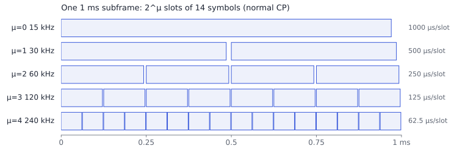

# Beginner · the idea

## Radio time works like a calendar {#calendar}



5G cuts time into fixed blocks, the way a calendar cuts a year into months and days.

- **Frame** = 10 ms. Always.
- **Subframe** = 1 ms. Always: 10 per frame.
- **Slot** = 14 OFDM symbols. This is the part that changes.

::: {.box}
[The one idea of this section]{.box-title}
The frame and subframe never change. What changes is how many slots fit into one subframe. That choice is called the **numerology**.
:::

::: {.notes}
Analogy for a non-specialist audience: the subframe is a one-hour meeting room booking; numerology decides whether you hold one long meeting, two half-hour meetings or eight short ones in that hour. Each meeting always has 14 agenda items (symbols); shorter meetings just go faster.
:::

## Numerology in one table {#numerology-simple}

Subcarrier spacing (SCS) doubles at each step, and the slot gets half as long:

::: {.compact}
| μ | SCS | Slots in 1 ms | Slot length | Typical use |
|---|---|---|---|---|
| 0 | 15 kHz | 1 | 1 ms | FR1 FDD low band, LTE sharing |
| 1 | 30 kHz | 2 | 0.5 ms | FR1 TDD mid band (3.5 GHz) |
| 2 | 60 kHz | 4 | 0.25 ms | FR1 / FR2 data option |
| 3 | 120 kHz | 8 | 0.125 ms | FR2 mmWave |
:::

::: {.kpis}
::: {.kpi}
[15 × 2^μ^ kHz]{.kpi-val}[subcarrier spacing]{.kpi-label}
:::
::: {.kpi}
[2^μ^]{.kpi-val}[slots per subframe]{.kpi-label}
:::
::: {.kpi}
[14]{.kpi-val}[symbols per slot (normal CP)]{.kpi-label}
:::
:::

Shorter slots let the scheduler react faster: that is where 5G's lower latency comes from.

# Intermediate · how it works

## Frame, subframe, slot {#frame-structure}

{width="82%"}

::: {.columns}

::: {.column}

- Frame 10 ms, subframe 1 ms: fixed for every μ.
- $N^{\text{subframe},\mu}_{\text{slot}} = 2^{\mu}$; $N^{\text{frame},\mu}_{\text{slot}} = 10\cdot 2^{\mu}$.

:::

::: {.column}

- Data: μ = 0–3 (Rel-15/16), μ = 5, 6 in FR2-2 (Rel-17).
- SSB: μ = 0, 1 (FR1), 3, 4 (FR2), 5, 6 (FR2-2). Never 60 kHz.

:::

:::

::: {.spec}

TS 38.211 §4.2–4.3 · TS 38.213 §4.1

:::

::: {.notes}
Why no 60 kHz SSB? 60 kHz is an FR1/FR2 data option but was never given an SSB pattern, to limit the number of blind hypotheses during cell search. A 60 kHz data carrier in FR2 still uses a 120 or 240 kHz SSB. This is the first example of mixed numerology a field engineer meets: the SSB and the BWP can have different SCS on the same carrier.
:::

## Why $T_c = 1/(480\,\text{kHz}\cdot 4096)$ {#why-tc}

Every time quantity in TS 38.211 is an integer multiple of one basic unit:

$$
T_c=\frac{1}{\Delta f_{\max}\,N_f},\quad \Delta f_{\max}=480\ \text{kHz},\ N_f=4096 \;\Rightarrow\; T_c\approx 0.509\ \text{ns}
$$

$$
\kappa=\frac{T_s}{T_c}=64,\qquad T_s=\frac{1}{15\ \text{kHz}\cdot 2048}\approx 32.55\ \text{ns}\ (\text{the LTE unit})
$$

::: {.box}

[Design intent]{.box-title} $T_c$ is the sample time of a 4096-point FFT at the largest subcarrier spacing. Every coarser numerology is an exact power-of-two multiple, so CP lengths, guard periods and timing-advance steps are integers, never rounded.

:::

::: {.spec}

TS 38.211 §4.1

:::

::: {.notes}
Point out that κ = 64 makes LTE and NR timing commensurate: one LTE Ts is exactly 64 Tc. This is what lets DSS and EN-DC share timing references without fractional offsets. Rel-17 extends Δf to 960 kHz for FR2-2, but Tc is unchanged; the 480/960 kHz numerologies use the same integer formulas with larger μ.
:::

# Advanced · expert depth

## Symbol and CP lengths, exactly {#cp-formula}

For numerology $\mu$ ($\Delta f = 15\cdot 2^{\mu}$ kHz), normal CP:

$$
N_u^{\mu}=2048\,\kappa\,2^{-\mu},\qquad N_{CP,l}^{\mu}=\begin{cases}144\,\kappa\,2^{-\mu}+16\,\kappa & l=0\ \text{or}\ l=7\cdot 2^{\mu}\\[1mm] 144\,\kappa\,2^{-\mu} & \text{otherwise}\end{cases}
$$

Extended CP (60 kHz only): $N_{CP}=512\,\kappa\,2^{-\mu}$, 12 symbols per slot.

::: {.compact}
| μ | Δf | Tu (µs) | CP (µs) | long CP (µs) | CP overhead |
|---|---|---|---|---|---|
| 0 | 15 kHz | 66.667 | 4.688 | 5.208 | 6.6 % |
| 1 | 30 kHz | 33.333 | 2.344 | 2.865 | 6.6 % |
| 2 | 60 kHz | 16.667 | 1.172 | 1.693 | 6.6 % |
| 3 | 120 kHz | 8.333 | 0.586 | 1.107 | 6.6 % |
| 4 | 240 kHz | 4.167 | 0.293 | 0.814 | 6.6 % |
:::

::: {.spec}

TS 38.211 §5.3.1

:::

::: {.notes}
The +16κ (0.521 µs) extra on one symbol every 0.5 ms is what makes 14 symbols fit exactly into a slot. Check for μ=1: 14 × (33.333 + 2.344) + 0.521 = 500.0 µs. The extra is a constant 16κ for every μ, so at high μ it is a large fraction of the CP: at 120 kHz the "long" symbol has almost twice the normal CP. Receivers must handle the irregular symbol lengths when computing FFT window positions.
:::

## Worked example: symbol timing in one 30 kHz slot {#worked1}

Slot 0 of a subframe at μ = 1. In units of $T_c$: $N_u=65536$, $N_{CP}=4608$, long CP $=5632$.

::: {.compact}
| Symbol l | CP (Tc) | Start (µs) | FFT window starts (µs) |
|---|---|---|---|
| 0 | 5632 | 0.000 | 2.865 |
| 1 | 4608 | 36.198 | 38.542 |
| 2 | 4608 | 71.875 | 74.219 |
| 13 | 4608 | 464.323 | 466.667 |
:::

End of symbol 13: $464.323+35.677=500.000$ µs. The next long CP falls on symbol 0 of slot 1, because $l=7\cdot 2^{\mu}=14$ counts from the start of the subframe.

::: {.box .field}

[Field use]{.box-title}A receiver that places the FFT window in the middle of the CP gains margin against both early and late echoes. Placing it at the CP end gives the most protection against delay spread but none against timing error.

:::

::: {.notes}
Derivation: symbol 0 length = 65536 + 5632 = 71168 Tc = 36.198 µs. Each later symbol = 65536 + 4608 = 70144 Tc = 35.677 µs. Start of l = 36.198 + (l−1)·35.677 µs for l ≥ 1. l = 13: 36.198 + 12·35.677 = 464.32 µs. Tc = 0.50863 ns.
:::

## Uplink–downlink timing relation {#ul-dl-timing}

The UE starts its uplink frame early by

$$
T_{TA}=\left(N_{TA}+N_{TA,\text{offset}}\right)T_c
$$

::: {.compact}
| Band type (TS 38.133) | $N_{TA,\text{offset}}$ (Tc) | Time |
|---|---|---|
| FR1, no LTE–NR coexistence | 25600 | 13.0 µs |
| FR1 FDD with LTE–NR coexistence | 0 | 0 |
| FR1 TDD with LTE–NR coexistence | 39936 | 20.3 µs |
| FR2 | 13792 | 7.0 µs |
:::

::: {.box}

[Where 13 µs comes from]{.box-title} In FR1 TDD the offset gives the gNB time to switch from receive to transmit (≈ 10 µs) plus ≈ 3 µs of inter-site synchronization error budget.

:::

One TA step is $16\cdot 64\,T_c/2^{\mu}$: 520.8 ns at 15 kHz, 260.4 ns at 30 kHz (≈ 39 m of one-way distance).

::: {.spec}

TS 38.211 §4.3.1 · TS 38.133 §7.1 · TS 38.213 §4.2

:::

::: {.notes}
The 13 µs = 10 µs + 3 µs split is how ShareTechnote explains the FR1 offset on its tdd-UL-DL-ConfigurationCommon page. The coexistence value 39936 Tc matches the LTE TDD offset (624 Ts), so NR and LTE TDD uplinks on the same site stay aligned. A wrong N_TA,offset assumption in a test setup causes a constant ~13 µs UL timing error; the gNB then sends large TA corrections in the first few hundred ms after access.
:::

## Putting it together: choosing the numerology {#choose}

::: {.compact}
| Constraint | Pushes toward | Quantity to compute |
|---|---|---|
| Delay spread, large cells | smaller SCS (longer CP) | max excess delay vs TCP |
| Doppler, high speed | larger SCS | $\text{SIR}_{ICI}=3/(\pi f_d T_u)^2$ |
| Phase noise (FR2) | larger SCS + PT-RS | residual σφ vs target EVM |
| Latency | larger SCS or mini-slots | slot duration, HARQ RTT |
| Channel bandwidth | larger SCS above 50 MHz (FFT size ≤ 4096) | NRB × 12 ≤ 3300 subcarriers |
:::

In practice: 30 kHz for FR1 TDD mid-band (100 MHz needs ≥ 30 kHz), 15 kHz for FR1 FDD low-band and DSS with LTE, 120 kHz for FR2.

::: {.notes}
The FFT constraint: NR caps the number of RBs at 275 per carrier (3300 subcarriers), so 100 MHz cannot be done at 15 kHz (it would need 6600 subcarriers). That is why n78 100 MHz carriers are always 30 kHz, independent of the delay-spread argument.
:::

# Practice

## Exercises {#ex}

1. How many slots does one 10 ms frame hold at 60 kHz? At 120 kHz?
2. Why does symbol 0 of every 0.5 ms have a slightly longer CP than the others?
3. A 100 MHz carrier at 3.5 GHz: why can it not use 15 kHz, whatever the delay spread?
4. One TA step at 30 kHz is 260.4 ns. How far is that in one-way distance?

::: {.aside-note}
Answers in the speaker notes (press **S**).
:::

::: {.notes}
1. 10 × 2^2 = 40 slots at 60 kHz; 10 × 2^3 = 80 at 120 kHz.
2. 16κ Tc (0.521 µs) is added once per 0.5 ms so that exactly 14·2^μ symbols fill each half-subframe; the remainder of the integer arithmetic is placed on that symbol.
3. NR allows at most 275 RBs (3300 subcarriers) per carrier; 100 MHz at 15 kHz would need about 6600 subcarriers.
4. Round trip 260.4 ns → one-way 260.4e-9 × 3e8 / 2 = 39 m.
:::

## References {#refs}

::: {.refs}
- **3GPP** TS 38.211 §4.1–4.3 (timing units, frames, slots), §5.3.1 (CP lengths)
- **3GPP** TS 38.133 §7.1 (NTA,offset)
- [ShareTechnote · Frame structure](https://www.sharetechnote.com/html/5G/5G_FrameStructure.html){target="_blank"}
- [ShareTechnote · Numerology](https://sharetechnote.com/html/5G/5G_Phy_Numerology.html){target="_blank"}
- [ShareTechnote · Physical-layer timing unit](https://sharetechnote.com/html/5G/5G_Phy_TimingUnit.html){target="_blank"}
- [ShareTechnote · UL timing](https://www.sharetechnote.com/html/5G/5G_UL_Timing.html){target="_blank"}
- C. Johnson, *5G New Radio in Bullets*, independently published, 2019 (ISBN 978-1077484351)
- E. Dahlman, S. Parkvall, J. Sköld, *5G NR: The Next Generation Wireless Access Technology*, 2nd ed., Academic Press, 2020
:::
