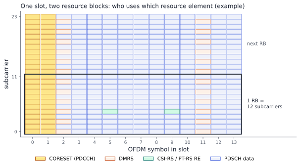
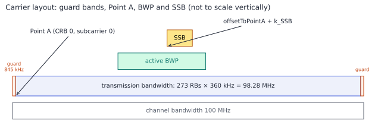
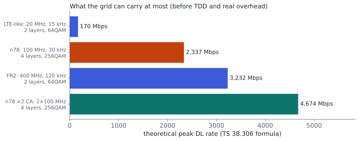

# Beginner · the idea

## The grid is a spreadsheet {#spreadsheet}



Think of the radio channel as a big spreadsheet:

- **Columns** are time: one column per OFDM symbol (14 per slot).
- **Rows** are frequency: one row per subcarrier.
- One cell = one **resource element (RE)**: the smallest piece the network can fill.
- 12 rows together = one **resource block (RB)**: the unit the scheduler hands out.

::: {.kpis}
::: {.kpi}
[1 RE]{.kpi-val}[1 subcarrier × 1 symbol]{.kpi-label}
:::
::: {.kpi}
[1 RB]{.kpi-val}[12 subcarriers]{.kpi-label}
:::
::: {.kpi}
[168]{.kpi-val}[REs in one RB over one slot]{.kpi-label}
:::
:::

::: {.notes}
Every bit a user receives sits in some of these cells. Reference signals, control channels and data all share the same grid. ShareTechnote's resource grid simulator is a good way to see this live.
:::

## How wide is one resource block? {#rb-width}

An RB is always 12 subcarriers, so its width grows with the subcarrier spacing:

::: {.compact}
| SCS | RB width | Example channel | RBs |
|---|---|---|---|
| 15 kHz | 180 kHz | 20 MHz | 106 |
| 30 kHz | 360 kHz | 100 MHz | 273 |
| 120 kHz | 1.44 MHz | 400 MHz (FR2) | 264 |
:::

A 100 MHz carrier at 30 kHz uses 273 × 360 kHz = 98.3 MHz: **98 % of the channel**, against 90 % for LTE. The rest is guard band at the edges.

## What fills the grid {#grid-fill}

{width="76%"}

- **CORESET** (yellow): the first 1–3 symbols carry control (PDCCH): who gets which resources.
- **DMRS** (orange): reference symbols so the phone can estimate the channel for demodulation.
- **CSI-RS / PT-RS**: occasional REs for channel measurement and phase tracking.
- **PDSCH** (blue): everything else carries user data.

# Intermediate · how it works

## Transmission bandwidth and guard bands {#max-rb}

::: {.compact}
| SCS | 20 MHz | 50 MHz | 100 MHz | Min. guard @100 MHz |
|---|---|---|---|---|
| 15 kHz | 106 | 270 | n/a | n/a |
| 30 kHz | 51 | 133 | 273 | 845 kHz |
| 60 kHz | 24 | 65 | 135 | 1210 kHz |
:::

Minimum guard band, per side (TS 38.101-1 §5.3.3):

$$
G_{\min}=\frac{BW_{\text{Channel}}\cdot 1000\ \text{kHz}-N_{RB}\cdot 12\cdot \text{SCS}}{2}-\frac{\text{SCS}}{2}
$$

Check: $(100\,000-273\cdot 360)/2-15=845$ kHz. Spectrum utilization is $273\cdot 360/100\,000 = 98.3\%$, against 90 % for LTE at 20 MHz.

::: {.box .warn}

[RF consequence]{.box-title}A 845 kHz guard band at the edge of a 100 MHz carrier means the transmit filter and DPD must hold ACLR and the operating-band unwanted emission mask with almost no transition band. Wideband AAUs often back off edge PRBs in practice.

:::

::: {.spec}

TS 38.101-1 Table 5.3.2-1, §5.3.3

:::

::: {.notes}
The −SCS/2 term accounts for the half-subcarrier asymmetry: NR has no reserved DC subcarrier, so the RB grid is shifted by half a subcarrier relative to the channel centre. Ask students to compute 60 kHz at 100 MHz: (100000 − 135·720)/2 − 30 = 1210 kHz. Larger SCS uses the band less efficiently at a given bandwidth.
:::

## Control channel units: REG, CCE, CORESET {#cce}

::: {.compact}
| Unit | Size | Note |
|---|---|---|
| RE | 1 subcarrier × 1 symbol | smallest unit |
| REG | 12 REs (1 RB × 1 symbol) | 3 of them carry PDCCH DMRS |
| REG bundle | 2, 3 or 6 REGs | mapping / precoding unit |
| CCE | 6 REGs = 72 REs | building block of a PDCCH |
| Aggregation level | 1, 2, 4, 8, 16 CCEs | higher = more robust |
| CORESET | 1–3 symbols, 6-RB groups | up to 12 per cell (Rel-15) |
:::

- With QPSK and DMRS removed, one CCE carries about 108 bits: AL 16 carries about 1728.
- Cell-edge UEs need high aggregation levels: a small CORESET runs out of room before the data channel does.

::: {.notes}
Numbers from ShareTechnote's resource allocation unit page: 54 usable REs per CCE (72 minus DMRS) × 2 bits = 108 bits. To fit one AL16 DCI in a 1-symbol CORESET you need 16 CCEs = 96 RBs; with 2 symbols, 48 RBs.
:::

## Where everything sits on the carrier {#layout}

{width="92%"}

- Point A anchors every numerology's RB grid. The carrier starts at offsetToCarrier, the BWP at its own start RB.
- The SSB sits on the sync raster, so it is generally **not** aligned with the RB grid: $k_{SSB}$ fixes the leftover offset.

# Advanced · expert depth

## Global frequency raster and NR-ARFCN {#arfcn}

$$
F_{REF}=F_{REF\text{-}Offs}+\Delta F_{Global}\left(N_{REF}-N_{REF\text{-}Offs}\right)
$$

::: {.compact}
| Range | ΔFGlobal | FREF-Offs | NREF-Offs | NREF range |
|---|---|---|---|---|
| 0–3000 MHz | 5 kHz | 0 MHz | 0 | 0–599999 |
| 3000–24250 MHz | 15 kHz | 3000 MHz | 600000 | 600000–2016666 |
| 24250–100000 MHz | 60 kHz | 24250.08 MHz | 2016667 | 2016667–3279165 |
:::

::: {.box}

[Example (n78)]{.box-title} absoluteFrequencyPointA = 632016 → $3000+0.015\,(632016-600000)=3480.24$ MHz.\
 absoluteFrequencySSB = 632256 → 3483.84 MHz: 240 raster steps × 15 kHz = 3.6 MHz above Point A.

:::

The **channel raster** (where a carrier may sit) is a band-specific subset: 100 kHz, 15 kHz or 30 kHz steps.

::: {.spec}

TS 38.104 §5.4.2 · TS 38.101-1 §5.4.2

:::

::: {.notes}
The example values are from ShareTechnote's BWP page (n78, 20 MHz Amarisoft configuration). Note that absoluteFrequencySSB is not the SSB centre: it is subcarrier 0 of RB 10 of the SSB, i.e. the SSB centre for an even subcarrier count. Many planning tools get this half-subcarrier convention wrong when converting between GSCN and ARFCN.
:::

## Synchronization raster (GSCN) {#gscn}

::: {.compact}
| Range | SSB frequency SSREF | GSCN |
|---|---|---|
| 0–3000 MHz | $N\cdot 1200\ \text{kHz}+M\cdot 50\ \text{kHz}$, $N=1{:}2499,\ M\in\{1,3,5\}$ | $3N+(M-3)/2$ |
| 3000–24250 MHz | $3000\ \text{MHz}+N\cdot 1.44\ \text{MHz}$, $N=0{:}14756$ | $7499+N$ |
| 24250–100000 MHz | $24250.08\ \text{MHz}+N\cdot 17.28\ \text{MHz}$, $N=0{:}4383$ | $22256+N$ |
:::

- The cell-defining SSB must sit on the sync raster. Secondary SSBs (for example for measurement) may sit off-raster.
- Step sizes trade search time against placement freedom: 1.2 MHz below 3 GHz, 1.44 MHz in mid-band, 17.28 MHz in FR2.
- Bands restrict GSCN further (Table 5.4.3.3-1), for example n78: 7711–8051 in steps of 1.

::: {.spec}

TS 38.104 §5.4.3

:::

::: {.notes}
Search-time arithmetic: n78 spans 3300–3800 MHz = 341 GSCN candidates. With a 20 ms SSB period assumed during initial search and at least one period per candidate, a brute-force scan is about 7 s per band before any parallelism, which is why UEs use stored frequency lists and why operators should keep the cell-defining SSB on a predictable GSCN across sites.
:::

## Point A, CRB, PRB and kSSB {#pointa}

::: {.columns}

::: {.column}

- **Point A**: subcarrier 0 of common RB 0, the same for every numerology on the carrier.
- **CRB** $n_{CRB}$: counted from Point A, per numerology.
- **offsetToCarrier**: first usable CRB of the carrier, per SCS.
- **PRB**: $n_{CRB}=n_{PRB}+N^{\text{start}}_{BWP}$.
- **kSSB** (MIB + PBCH bit): SSB subcarrier offset from the CRB grid, 0–23 (FR1) or 0–11 (FR2).
- **offsetToPointA** (SIB1): CRB offset of the SSB, in 15 kHz RBs (FR1) or 60 kHz RBs (FR2).

:::

::: {.column}

::: {.box}

[Point A from SIB1 (FR1)]{.box-title} 

$$
F_{A}=F_{SSB,RB0}-k_{SSB}\cdot 15\,\text{kHz}-\text{offsetToPointA}\cdot 12\cdot 15\,\text{kHz}
$$

 where $F_{SSB,RB0}$ is subcarrier 0 of SSB RB 0.

:::

::: {.small}

The SSB need not be aligned to the carrier's PRB grid. kSSB absorbs the misalignment between sync raster and channel raster.

:::

:::

:::

::: {.spec}

TS 38.211 §4.4.3–4.4.4 · TS 38.213 §4.1 · TS 38.331 FrequencyInfoDL

:::

::: {.notes}
This is the three-step procedure ShareTechnote gives for SA: convert the SSB ARFCN to MHz, move down 10 SSB RBs to get subcarrier 0 of SSB RB 0, then subtract k_SSB subcarriers and offsetToPointA RBs. Common field error: using the SSB SCS instead of 15 kHz for k_SSB in FR1. In FR1, k_SSB and offsetToPointA are always in 15 kHz units regardless of subCarrierSpacingCommon.
:::

## The baseband OFDM signal in TS 38.211 {#ofdm-signal}

For antenna port $p$, numerology $\mu$, symbol $l$ starting at $t^{\mu}_{\text{start},l}$:

$$
s_l^{(p,\mu)}(t)=\sum_{k=0}^{N^{\mu}_{\text{grid}}N^{RB}_{sc}-1} a_{k,l}^{(p,\mu)}\, e^{\,j2\pi\left(k+k_0^{\mu}-N^{\mu}_{\text{grid}}N^{RB}_{sc}/2\right)\Delta f\,\left(t-N^{\mu}_{CP,l}T_c-t^{\mu}_{\text{start},l}\right)}
$$

- $k_0^{\mu}$ aligns grids of different numerologies on the same carrier (mixed numerology).
- No DC subcarrier is reserved, unlike LTE. The UE reports where its LO sits, and the gNB can avoid or tolerate it.
- Upconversion adds a per-symbol phase term $e^{-j2\pi f_0 (t_{\text{start},l}+N_{CP,l}T_c)}$ (§5.4), so phase stays deterministic across symbols.

::: {.spec}

TS 38.211 §5.3.1, §5.4

:::

::: {.notes}
The phase-compensation term in §5.4 matters for RF engineers doing IQ captures: if your analyzer does not apply it, constellations rotate symbol to symbol by a deterministic amount. Commercial NR demodulators (VSA, Keysight/R&S) apply it automatically when the carrier frequency f0 is entered correctly. A wrong f0 shows up as a symbol-dependent phase error that looks like phase noise but is perfectly periodic.
:::

## Peak throughput straight from the grid {#peak}

TS 38.306 gives the maximum data rate a UE must support:

$$
R_{\max}=10^{-6}\sum_{j}\;v_j\,Q_{m,j}\,f_j\,R_{\max}^{code}\,\frac{12\,N_{PRB,j}}{T_s^{\mu}}\,(1-OH_j),\qquad T_s^{\mu}=\frac{10^{-3}}{14\cdot 2^{\mu}}
$$

::: {.columns}
::: {.column}
::: {.small}
- $v$: MIMO layers, $Q_m$: bits per symbol (8 for 256QAM), $f$: scaling factor (1 if not reported)
- $R^{code}_{\max}=948/1024\approx 0.926$
- $OH$: 0.14 FR1 DL, 0.18 FR2 DL, 0.08 FR1 UL, 0.10 FR2 UL
- n78, 100 MHz, 4 layers, 256QAM → **≈ 2337 Mbps**
:::
:::
::: {.column}
{width="100%"}
:::
:::

::: {.notes}
Steps for the n78 case (ShareTechnote's worked example): 273 × 12 = 3276 subcarriers × 28,000 symbols/s = 91.7 M REs/s; × 4 layers × 8 bits = 2.935 Gbit/s; × 0.926 × 0.86 = 2.337 Gbit/s. In TDD multiply by the DL share (about 0.74 for DDDSU): ≈ 1.7 Gbit/s is the realistic ceiling of a single n78 carrier.
:::

## Handing out RBs: allocation types 0 and 1 {#ra-types}

::: {.columns}
::: {.column}
**Type 0: bitmap of RB groups**

- The BWP is cut into resource block groups (RBGs) of 2, 4, 8 or 16 RBs, depending on BWP size and configuration.
- One bit per RBG: allocations can be scattered (frequency-selective scheduling).
- Field size = number of RBGs in the BWP.
:::
::: {.column}
**Type 1: one contiguous block**

- Start RB and length packed into one value, the RIV.
- Field size $\lceil \log_2(N(N+1)/2)\rceil$ bits: 16 bits for a 273-RB BWP.
- Always used for DCI fallback formats (0_0, 1_0) and for uplink with DFT-s-OFDM.
:::
:::

::: {.notes}
ShareTechnote's resource allocation type page shows the field-size formulas and RIV decoding examples. 273·274/2 = 37,401 → log2 = 15.2 → 16 bits.
:::

# Practice

## Exercises {#ex}

1. How many REs are in a 273-RB carrier during one slot?
2. Compute the minimum guard band for 40 MHz at 30 kHz (N~RB~ = 106).
3. absoluteFrequencyPointA = 650000 with 273 RBs at 30 kHz and offsetToCarrier 0. Where is the carrier centre?

::: {.aside-note}
Answers in the speaker notes.
:::

::: {.notes}
1. 273 × 12 × 14 = 45,864 REs per slot.
2. (40000 − 106·360)/2 − 15 = 920 − 15 = 905 kHz.
3. Point A = 3000 + 0.015 × 50000 = 3750.00 MHz; carrier width 98.28 MHz → centre ≈ 3799.14 MHz.
:::

## References {#refs}

::: {.refs}
- **3GPP** TS 38.211 §4.4 (resource grid, Point A, CRB/PRB), §5.3.1
- **3GPP** TS 38.101-1 §5.3.2–5.3.3 (transmission bandwidth, guard band)
- **3GPP** TS 38.104 §5.4.2–5.4.3 (NR-ARFCN, GSCN)
- [ShareTechnote · Resource block indexing / Point A](https://www.sharetechnote.com/html/5G/5G_ResourceBlockIndexing.html){target="_blank"}
- [ShareTechnote · FR / bandwidth, ARFCN and GSCN](https://www.sharetechnote.com/html/5G/5G_FR_Bandwidth.html){target="_blank"}
- [ShareTechnote · DL resource grid simulator](http://sharetechnote.com/html/WebProgramming/Websim_ResourceGridDl5G.html){target="_blank"}
- [ShareTechnote · Resource grid](https://www.sharetechnote.com/html/5G/5G_ResourceGrid.html){target="_blank"}
- [ShareTechnote · Resource allocation units (REG, CCE, CORESET)](https://www.sharetechnote.com/html/5G/5G_ResourceAllocationUnit.html){target="_blank"}
- [ShareTechnote · Resource allocation type 0 / 1](https://www.sharetechnote.com/html/5G/5G_ResourceAllocationType.html){target="_blank"}
- [ShareTechnote · Max throughput estimation](https://www.sharetechnote.com/html/5G/5G_MaxThroughputEstimation.html){target="_blank"}
- [ShareTechnote · MCS / TBS / code rate](https://www.sharetechnote.com/html/5G/5G_MCS_TBS_CodeRate.html){target="_blank"}
- C. Johnson, *5G New Radio in Bullets*, independently published, 2019 (ISBN 978-1077484351)
- E. Dahlman, S. Parkvall, J. Sköld, *5G NR: The Next Generation Wireless Access Technology*, 2nd ed., Academic Press, 2020
:::
