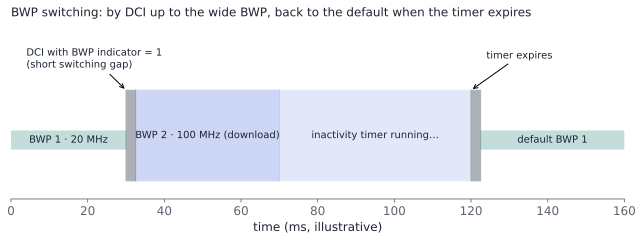

# Beginner · the idea

## A wide motorway, a few lanes in use {#motorway}



A 100 MHz carrier is like a 20-lane motorway. A phone checking messages does not need all 20 lanes, and listening to all of them costs battery.

- A **bandwidth part (BWP)** is the set of lanes a phone uses right now.
- The network can give a phone a narrow BWP when it is idle-ish and a wide one when it downloads.
- Outside its active BWP, the phone does not listen at all.

::: {.box}
[The one idea of this section]{.box-title}
BWPs let the phone's receiver match its bandwidth to its traffic: less bandwidth, less power.
:::

## The rules in plain words {#bwp-rules}

- Up to **4** downlink and **4** uplink BWPs can be configured per cell (Rel-15).
- Only **1** downlink and **1** uplink BWP is **active** at a time.
- Every phone starts on the **initial BWP**, the small part where system information and access happen.
- Each BWP can even use its own subcarrier spacing.
- Switching between BWPs takes a short break: the phone cannot receive for a few slots.

::: {.notes}
The initial BWP is tied to CORESET#0 until SIB1 defines it; at 30 kHz with a 24-RB CORESET#0 it is under 9 MHz wide. This is where idle-mode traffic (SIB1, paging, Msg2/Msg4) lives, which you will meet again in Chapter 2.
:::

# Intermediate · how it works

## Bandwidth part: definition and limits {#bwp-def}

- A BWP is a contiguous set of CRBs with one numerology and CP, inside the carrier (TS 38.211 §4.4.5).
- Up to 4 DL and 4 UL dedicated BWPs per serving cell, plus the initial BWP (id 0). One DL and one UL active at a time (Rel-15/16).
- `locationAndBandwidth` is a RIV with $N=275$:

$$
\text{RIV}=\begin{cases}275(L-1)+RB_{\text{start}} & L-1\le\lfloor 275/2\rfloor\\ 275(275-L+1)+(274-RB_{\text{start}}) & \text{otherwise}\end{cases}
$$

::: {.small}

Example: 51 RBs starting at CRB 0 → RIV = 275·50 + 0 = 13750. 273 RBs from CRB 0 → L − 1 = 272 > 137 → RIV = 275·3 + 274 = 1099.

:::

The initial BWP for idle UEs follows CORESET#0 until SIB1 gives `initialDownlinkBWP`.

::: {.spec}

TS 38.211 §4.4.5 · TS 38.213 §12 · TS 38.214 §5.1.2.2.2 (RIV)

:::

::: {.notes}
Verify the second RIV: L = 273, 275 − 273 + 1 = 3, 275·3 = 825, + (274 − 0) = 1099. A common configuration error is a locationAndBandwidth that does not match offsetToCarrier/carrierBandwidth: the UE then rejects the RRC reconfiguration. ShareTechnote's BWP page has a worked n78 20 MHz example with the CRB-to-PRB mapping per BWP.
:::

## A day in the life of BWP switching {#bwp-day}

{width="92%"}

- The UE idles on a narrow BWP. A download starts: one DCI both **switches** to the wide BWP and **schedules** data in it.
- When traffic stops, the inactivity timer runs. On expiry the UE falls back to the **default** BWP by itself, with no signalling.

## CRB → PRB: the same RB number means different places {#crb-prb}

Inside a BWP, RBs are numbered from 0 (PRBs). On the carrier, they are counted from Point A (CRBs):

$$
n_{CRB}=n_{PRB}+N^{\text{start}}_{BWP}
$$

::: {.compact}
| Active BWP | Start (CRB) | DCI says "PRB 3" | Real position |
|---|---|---|---|
| BWP 0 | 0 | PRB 3 | CRB 3 |
| BWP 1 | 40 | PRB 3 | CRB 43 |
| BWP 2 | 80 | PRB 3 | CRB 83 |
:::

The same DCI bits point to different frequencies depending on the active BWP. A UE and a gNB that disagree on the active BWP (for example after a lost DCI) disagree on every allocation.

::: {.notes}
Example taken from ShareTechnote's BWP page. Also note that the frequency-domain assignment field size follows the active BWP's size, so DCI sizes change when switching BWP.
:::

# Advanced · expert depth

## Switching BWPs: triggers and delays {#bwp-switch}

::: {.columns}

::: {.column}

::: {.small}

- **DCI** 1_1 / 0_1 BWP indicator (0, 1 or 2 bits): switch and schedule in one DCI.
- **Timer**: `bwp-InactivityTimer` (2 ms … 2560 ms) returns the UE to `defaultDownlinkBWP-Id`.
- **RRC** reconfiguration, or **random access** on a BWP without RACH resources (falls back to initial BWP).

:::

:::

::: {.column}

::: {.compact}
| μ | Type 1 (slots) | Type 2 (slots) |
|---|---|---|
| 0 | 1 | 3 |
| 1 | 2 | 5 |
| 2 | 3 | 9 |
| 3 | 6 | 18 |
:::

::: {.spec}

DCI-based switch delay, TS 38.133 Table 8.6.2-1 (UE capability type)

:::

:::

:::

::: {.box .field}

[Tuning]{.box-title}A short inactivity timer saves UE power but causes repeated switches: each costs up to 5 slots of no scheduling at 30 kHz (2.5 ms). For bursty traffic (web, chat), a timer of 50–100 ms is a common starting point; for constant streams, keep the wide BWP.

:::

::: {.notes}
Type 1 vs type 2 is a UE capability (bwp-SwitchingDelay). During the switching delay the UE is not required to receive or transmit. Power saving numbers vary by chipset; a rough industry figure is that RF and baseband power scale sub-linearly with bandwidth, so a 100→20 MHz switch saves a meaningful but not 5× fraction of modem power.
:::

## What is configured per BWP {#bwp-config}

::: {.columns}
::: {.column}
**Common part** (`bwp-Common`)

- `genericParameters`: `locationAndBandwidth`, `subcarrierSpacing`, `cyclicPrefix`
- `pdcch-ConfigCommon`: common CORESET and search spaces
- `pdsch-ConfigCommon`: time-domain allocation tables
- UL: `rach-ConfigCommon`, `pusch-ConfigCommon`, `pucch-ConfigCommon`
:::
::: {.column}
**Dedicated part** (`bwp-Dedicated`)

- `pdcch-Config`: UE-specific CORESETs and search spaces
- `pdsch-Config` / `pusch-Config`: DMRS, PT-RS, MCS tables, TCI states
- `radioLinkMonitoringConfig`, beam failure recovery (UL)
:::
:::

- BWP ID 0 is reserved for the initial BWP. Dedicated BWPs use IDs 1–4.
- The BWP indicator in DCI 1_1 / 0_1 has 0, 1 or 2 bits, depending on how many BWPs are configured.

## Practical rules {#bwp-practical}

- A BWP the UE must measure SSB in should **contain the SSB**. Not every BWP has to.
- If the active UL BWP has **no RACH resources**, random access falls back to the initial BWP.
- Switching delay (2–5 slots at 30 kHz) means no scheduling: avoid timers that cause switching every few hundred ms.
- Power saving is the main reason to use multiple BWPs; capacity is the reason to keep one wide BWP for active users.
- Rel-16 added more power-saving tools on top of BWPs (wake-up signal DCI 2_6, SCell dormancy using a dormant BWP).

::: {.notes}
The dormant BWP (Rel-16) lets an SCell stay activated but behave like a dormant cell: the UE stops PDCCH monitoring there but keeps CSI measurements, so it can be woken quickly. See ShareTechnote's power saving and WUS/DCP pages.
:::

# Practice

## Exercises {#ex}

1. Compute the RIV of a 106-RB BWP starting at CRB 50.
2. A UE on a 30 kHz carrier with type-2 switching delay changes BWP 10 times per second. How much scheduling time does it lose?
3. Why must a BWP be at least as wide as the SSB if the UE should measure the SSB in it?

::: {.aside-note}
Answers in the speaker notes.
:::

::: {.notes}
1. L − 1 = 105 ≤ 137 → RIV = 275·105 + 50 = 28925.
2. 5 slots × 0.5 ms = 2.5 ms per switch → 25 ms per second = 2.5 % of the time.
3. The UE only receives inside its active BWP; an SSB outside it (or wider than it) cannot be measured without leaving the BWP, which needs measurement gaps.
:::

## References {#refs}

::: {.refs}
- **3GPP** TS 38.211 §4.4.5 (BWP)
- **3GPP** TS 38.213 §12 (BWP operation)
- **3GPP** TS 38.321 §5.15 · TS 38.133 Table 8.6.2-1 (switch delay)
- [ShareTechnote · Carrier bandwidth part](https://www.sharetechnote.com/html/5G/5G_CarrrierBandwidthPart.html){target="_blank"}
- [ShareTechnote · BWP switching](https://www.sharetechnote.com/html/5G/5G_CarrrierBandwidthPart.html#How_a_specific_BWP_is_selected){target="_blank"}
- [ShareTechnote · DCI formats](https://www.sharetechnote.com/html/5G/5G_DCI.html){target="_blank"}
- [ShareTechnote · Power saving](https://www.sharetechnote.com/html/5G/5G_PowerSaving.html){target="_blank"}
- [ShareTechnote · Wake-up signal / DCP](https://www.sharetechnote.com/html/5G/5G_WUS_DCP.html){target="_blank"}
- C. Johnson, *5G New Radio in Bullets*, independently published, 2019 (ISBN 978-1077484351)
- E. Dahlman, S. Parkvall, J. Sköld, *5G NR: The Next Generation Wireless Access Technology*, 2nd ed., Academic Press, 2020
:::
