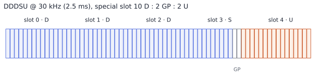

# Beginner · the idea

## One road, traffic lights {#one-road}



In **TDD**, downlink and uplink use the same frequency and take turns, like cars on a one-lane bridge controlled by traffic lights.

- **D** symbols: the network talks (downlink).
- **U** symbols: the phones talk (uplink).
- **F** (flexible) symbols: either, or a short pause to switch direction.

{width="88%"}

The most common pattern at 3.5 GHz is **DDDSU**: three downlink slots, one special slot that switches over, one uplink slot.

## Why more D than U? {#why-dl}

Count the symbols in DDDSU with a 10 : 2 : 2 special slot:

::: {.kpis}
::: {.kpi}
[74 %]{.kpi-val}[downlink (52 of 70 symbols)]{.kpi-label}
:::
::: {.kpi}
[23 %]{.kpi-val}[uplink (16 symbols)]{.kpi-label}
:::
::: {.kpi}
[3 %]{.kpi-val}[guard (2 symbols)]{.kpi-label}
:::
:::

- Most traffic is downlink (video, web), so operators give it most of the time.
- The guard symbols give the signal time to travel before the phones start transmitting.
- Neighbouring networks must use the same pattern. Section 6 explains why.

# Intermediate · how it works

## tdd-UL-DL-ConfigurationCommon {#tdd-common}

::: {.columns}

::: {.column}

```
tdd-UL-DL-ConfigurationCommon
  referenceSubcarrierSpacing  kHz30
  pattern1
    dl-UL-TransmissionPeriodicity ms2p5
    nrofDownlinkSlots     3
    nrofDownlinkSymbols   10
    nrofUplinkSlots       1
    nrofUplinkSymbols     2
  pattern2   (optional, second period)
```

:::

::: {.column}

::: {.small}

- Periods: 0.5, 0.625, 1, 1.25, 2, 2.5, 5, 10 ms (3 and 4 ms added in Rel-16).
- DL slots first, then DL symbols, flexible remainder, then UL symbols, then UL slots.
- Two patterns concatenate (for example 2.5 ms + 2.5 ms) into a 5 ms super-period.
- Flexible symbols can be overridden by `tdd-UL-DL-ConfigurationDedicated` and by DCI 2_0 (SFI).

:::

:::

:::

{width="88%"}

::: {.spec}

TS 38.213 §11.1 · TS 38.331 TDD-UL-DL-ConfigCommon

:::

::: {.notes}
The resulting pattern for this example is DDDSU with 10 DL, 2 flexible (guard), 2 UL symbols in the special slot. Counting symbols over the 2.5 ms period (70 symbols): 52 DL (74 %), 16 UL (23 %), 2 GP (3 %). The second pattern is how operators build DDDSUDDSUU-type structures or align with LTE TDD configuration 2 for coexistence.
:::

## Slot formats and dynamic SFI {#sfi}

- TS 38.213 Table 11.1.1-1 defines formats 0–55: each of 14 symbols is D, U or F. Formats 56–254 are reserved.
- Format 255: the UE follows `tdd-UL-DL-ConfigurationCommon`/`Dedicated` and the scheduling DCIs.
- DCI 2_0 (SFI-RNTI) carries an index into a **slot format combination** table configured by RRC: one entry can describe several slots.
- Priority: semi-static D/U cannot be overridden; semi-static F can be resolved by SFI, then by scheduling DCI.

::: {.box}

[Why it matters for RF]{.box-title}A dynamic TDD cell can change its DL/UL split per slot. Its neighbours then see DL energy in their UL symbols: cross-link interference. Dynamic SFI is safe only where cells are isolated (indoor, private networks) or co-ordinated.

:::

::: {.spec}

TS 38.213 §11.1.1 · TS 38.212 §7.3.1.3.1

:::

::: {.notes}
ShareTechnote's Slot Format Combination page walks through an RRC configuration example with SlotFormatCombinationsPerCell and the positionInDCI field. In public macro networks, SFI is almost never used: national regulators and operator agreements fix a common frame structure per band.
:::

# Advanced · expert depth

## The guard period sets the maximum cell range {#gp-range}

At the DL→UL switch, the cell-edge UE must receive the last DL symbol and transmit its first UL symbol early by its timing advance:

$$
T_{GP}\ \ge\ \frac{2d}{c}+T_{UE,\text{Rx}\to\text{Tx}}\qquad\Rightarrow\qquad d_{\max}\approx\frac{c\,(T_{GP}-T_{UE,\text{Rx}\to\text{Tx}})}{2}
$$

::: {.compact}
| GP @ 30 kHz | T<sub>GP</sub> | d<sub>max</sub> (switching ignored) |
|---|---|---|
| 2 symbols | 71.4 µs | 10.7 km |
| 4 symbols | 142.7 µs | 21.4 km |
| 6 symbols | 214.1 µs | 32.1 km |
:::

The UL→DL switch needs no GP at the UE: timing advance already aligns the uplink. The gNB's own Rx→Tx switch is covered by $N_{TA,\text{offset}}$ (Section 1).

::: {.spec}

TS 38.211 §4.3.1 · TS 38.133 §7.1

:::

::: {.notes}
ShareTechnote's tdd-UL-DL-ConfigurationCommon page quotes the 6-symbol / 32.1 km figure. Practical note: the UE's own Rx→Tx transition time (a few µs, specified in the UE RF and RRM requirements) comes off the same budget, so the real range is slightly below the table. Rural TDD cells beyond ~10 km need a longer special-slot GP, which costs DL capacity; that is a real planning trade-off.
:::

# Practice

## Exercises {#ex}

1. Write `pattern1` for DDDDDDDSUU at 30 kHz with a 6:4:4 special slot and compute the DL/UL/GP shares.
2. A rural TDD cell must reach 18 km (UE switching 5 µs). How many GP symbols at 30 kHz are needed?
3. Why does the UL→DL switch need no guard period at the UE?

::: {.aside-note}
Answers in the speaker notes.
:::

::: {.notes}
1. ms5, nrofDownlinkSlots 7, nrofDownlinkSymbols 6, nrofUplinkSlots 2, nrofUplinkSymbols 4. Of 140 symbols: DL 104 (74.3 %), UL 32 (22.9 %), GP 4 (2.9 %).
2. 2·18 km/c + 5 µs = 125 µs → 125/35.68 = 3.5 → 4 symbols.
3. Timing advance already makes the UE transmit early so that its uplink ends at the gNB exactly when the downlink restarts.
:::

## References {#refs}

::: {.refs}
- **3GPP** TS 38.213 §11.1 (slot configuration, SFI)
- **3GPP** TS 38.331 TDD-UL-DL-ConfigCommon
- **3GPP** TS 38.211 §4.3.1
- [ShareTechnote · tdd-UL-DL-ConfigurationCommon](https://www.sharetechnote.com/html/5G/5G_tdd_UL_DL_configurationCommon.html){target="_blank"}
- [ShareTechnote · Slot format combination](https://sharetechnote.com/html/5G/5G_SlotFormatCombination.html){target="_blank"}
- C. Johnson, *5G New Radio in Bullets*, independently published, 2019 (ISBN 978-1077484351)
- E. Dahlman, S. Parkvall, J. Sköld, *5G NR: The Next Generation Wireless Access Technology*, 2nd ed., Academic Press, 2020
:::
