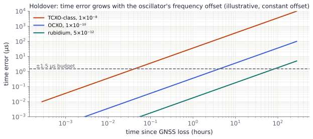
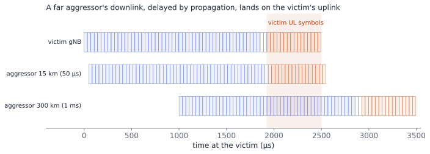

# Beginner · the idea

## Neighbours who share a wall {#wall}



Two neighbours share a thin wall. One wants to sleep (listen), the other plays loud music (transmit). If they keep different hours, nobody sleeps.

- A gNB **transmitting** downlink is loud: up to 200 W on a high mast.
- A gNB **receiving** uplink is listening for phones at 0.2 W.
- If a neighbouring cell transmits while yours listens, its downlink drowns your uplink.

::: {.box}
[The one idea of this section]{.box-title}
All TDD cells in an area, even of different operators, must switch at the same moments: one clock, one pattern.
:::

# Intermediate · how it works

## How tightly must TDD cells be aligned? {#sync-req}

::: {.kpis}

::: {.kpi}

[≤ 3 µs]{.kpi-val}[cell phase sync accuracy between overlapping TDD cells (TS 38.133 §7.4)]{.kpi-label}

:::

::: {.kpi}

[±1.5 µs]{.kpi-val}[each cell vs a common reference (ITU-T G.8271 level for TDD)]{.kpi-label}

:::

::: {.kpi}

[13 µs]{.kpi-val}[FR1 NTA,offset = 10 µs switch + 3 µs sync budget]{.kpi-label}

:::

:::

- Sources: GNSS at each site, or IEEE 1588 PTP with a full-on-path-support telecom profile (ITU-T G.8275.1) from a grandmaster.
- Holdover: when GNSS is lost, the local oscillator must keep the error within budget. An OCXO drifts µs within hours; rubidium holds for a day or more.
- Operators sharing a band must also share the frame start and a compatible pattern. Unsynchronized neighbours need a guard band or restricted blocks.

::: {.spec}

TS 38.133 §7.4 · ITU-T G.8271 / G.8271.1 / G.8275.1

:::

::: {.notes}
Make the arithmetic concrete: a 1e-9 frequency error accumulates 1 µs of time error in 1000 s (17 minutes). A good OCXO might be 1e-10 after aging compensation → 1.5 µs in 4 hours. This is why loss-of-GNSS alarms must trigger action within hours, not days.
:::

## How fast a site drifts without GNSS {#drift}

{width="78%"}

- Time error grows linearly with the oscillator's frequency offset: $\Delta t = (\Delta f/f)\cdot t$.
- A cheap oscillator leaves the ±1.5 µs budget within minutes, a good OCXO within hours, rubidium within days.
- This is why GNSS-loss alarms on TDD sites need action the same day.

## The timing chain {#timing-chain}

::: {.columns}
::: {.column}
**GNSS at every site**

- A GNSS receiver disciplines the local oscillator.
- Simple, accurate, but exposed to jamming, antenna faults and indoor sites without sky view.
:::
::: {.column}
**PTP over the transport network**

- A grandmaster (with GNSS) distributes time with IEEE 1588 PTP.
- Full timing support (ITU-T G.8275.1): every switch in the path is a boundary clock, keeping the error within budget.
- Partial support (G.8275.2) is possible with tighter limits on network asymmetry.
:::
:::

- Most networks combine both: GNSS where possible, PTP as backup or for indoor/small cells, holdover oscillators for the gaps.

# Advanced · expert depth

## Worked example: gNB-to-gNB interference if sync fails {#cli-budget}

::: {.compact}
| Item | Value | Note |
|---|---|---|
| Aggressor power per RB | 28.6 dBm | 53 dBm over 273 RBs |
| Aggressor gain toward victim | +4 dBi | 24 dBi array, −20 dB off-boresight/tilt |
| Path loss, 1 km LOS mast to mast | −103.3 dB | free space, 3.5 GHz |
| Victim gain toward aggressor | +4 dBi | same discrimination |
| **Interference per RB** | **−66.7 dBm** |  |
| Victim noise per RB | −115.4 dBm | −174 + 10 lg(360 kHz) + 3 dB NF |
:::

::: {.box .warn}

[Result]{.box-title}Interference over thermal ≈ **49 dB**. One unsynchronized site 1 km away can take out the uplink of its neighbour completely. That is why sync alarms are radio alarms.

:::

::: {.aside-note}

Illustrative values. Real antenna discrimination depends on tilt, azimuth and pattern.

:::

::: {.notes}
Ask students to recompute with 10 km separation (FSPL +20 dB → 29 dB IoT, still fatal) and with 40 dB of total discrimination instead of 40 → 48 (each side −24 dB). The conclusion does not change: the only robust fix is synchronization and a common frame structure.
:::

## Remote interference: when the far gNB lands in your uplink {#remote}

A distant gNB's DL arrives delayed by $D/c$. It overlaps the victim's UL symbols when

$$
\frac{D}{c}\ >\ T_{GP}\quad\Rightarrow\quad D\ >\ c\,T_{GP}\approx 21\ \text{km for 2 GP symbols at 30 kHz}
$$

- Normally, path loss over 21+ km kills that signal. Under **tropospheric ducting** it can travel hundreds of km with little loss.
- Signature: UL interference rising over the first UL symbols of a slot, worst at night or in calm weather, affecting many sites in a region at once.
- Rel-16 adds remote interference management (RIM): victim gNBs transmit a RIM reference signal so aggressors can detect and back off.

::: {.box .field}

[Diagnosis]{.box-title}Plot per-symbol UL interference (IoT) across the slot. A slope that decreases symbol by symbol, identical across a cluster, is ducting. A flat raised floor is local external interference.

:::

::: {.notes}
This is the classic TD-LTE problem seen in China and the Netherlands, carried over to NR. The slope comes from distance: farther aggressors arrive later and are weaker, so the first UL symbols collect the most energy. Mitigation before RIM: extend the GP (more F symbols), or blank the first UL symbols at affected sites.
:::

## Ducting: delay against the guard period {#ducting-chart}

{width="92%"}

- 15 km of delay (50 µs) stays inside a 71 µs guard period. 300 km (about 1 ms) lands squarely on the victim's uplink.
- Under ducting, signals from hundreds of km away can arrive with little loss, so the slope of interference across the UL symbols points to distant aggressors.

## Remote interference management (Rel-16) {#rim}

- Handled **between gNBs only**: the UE is not involved.
- gNBs are grouped into **victim** and **aggressor** sets (set IDs).
- **RIM-RS**: a new gNB-transmitted reference signal, periodic, at most 32 resources per 10 ms, with time/frequency/sequence derived from the set ID.
- **Wireless framework**: an aggressor that hears a victim's RIM-RS mitigates (fewer DL symbols, lower power) and answers with its own RIM-RS. The victim stops when it no longer hears aggressors.
- **Backhaul framework**: the aggressor reports "RS detected" / "RS disappeared" to the victim through the core network (AMF, TS 38.413).

::: {.notes}
Summary based on ShareTechnote's CLI/RIM page. Typical mitigation is muting the last DL symbols before the guard period (effectively lengthening the GP) during ducting events, which are often seasonal and at night.
:::

## CLI in dynamic TDD (Rel-16) and what comes next {#cli}

- Neighbouring cells with **different** DL/UL patterns create cross-link interference. gNBs can exchange intended TDD configurations over Xn/F1.
- UEs can measure UE-to-UE CLI:
  - **SRS-RSRP** (reported 0–98): power of a specific aggressor UE's SRS.
  - **CLI-RSSI** (reported 0–76): total power in a configured time/frequency window.
- A CLI measurement object holds up to 32 SRS resources and 64 RSSI windows; event **I1** triggers when interference exceeds a threshold.
- gNB-to-gNB CLI is not measured over the air in Rel-16: coordination only.
- **Rel-19 sub-band full duplex** builds on this: L1 CLI reporting, intra-cell CLI and gNB-to-gNB CLI information exchange.

::: {.notes}
From ShareTechnote's CLI/RIM page. CLI measurement is an optional UE capability, and supported resource counts are usually below the ASN.1 maxima.
:::

# Practice

## Exercises {#ex}

1. Repeat the gNB-to-gNB interference budget for sites 5 km apart with 25 dB discrimination on each side.
2. A site's oscillator drifts by 1×10⁻¹⁰ after losing GNSS. How long until it is 1.5 µs off?
3. Why does remote interference hit the first uplink symbols of a slot hardest?

::: {.aside-note}
Answers in the speaker notes.
:::

::: {.notes}
1. FSPL at 5 km, 3.5 GHz = 117.3 dB; gains −1 dBi each side; I = 28.6 − 1 − 117.3 − 1 = −90.7 dBm per RB; IoT ≈ 24.7 dB: still fatal.
2. 1.5e-6 / 1e-10 = 15,000 s ≈ 4.2 hours.
3. Distant aggressors arrive late, so their downlink spills into the start of the victim's uplink period; closer (stronger) aggressors spill less, giving a slope that decreases symbol by symbol.
:::

## References {#refs}

::: {.refs}
- **3GPP** TS 38.133 §7.4 (cell phase synchronization)
- **3GPP** TS 38.211 §4.3.1
- **3GPP** ITU-T G.8271, G.8271.1, G.8275.1
- [ShareTechnote · tdd-UL-DL-ConfigurationCommon](https://www.sharetechnote.com/html/5G/5G_tdd_UL_DL_configurationCommon.html){target="_blank"}
- [ShareTechnote · UL timing](https://www.sharetechnote.com/html/5G/5G_UL_Timing.html){target="_blank"}
- [ShareTechnote · CLI / RIM](https://www.sharetechnote.com/html/5G/5G_RIM.html){target="_blank"}
- [ShareTechnote · Synchronization](https://www.sharetechnote.com/html/5G/5G_Phy_Synchronization.html){target="_blank"}
- [ShareTechnote · SBFD (sub-band full duplex)](https://www.sharetechnote.com/html/5G/5G_SBFD.html){target="_blank"}
- [ShareTechnote · Xn interface](https://www.sharetechnote.com/html/5G/5G_RAN_Xn.html){target="_blank"}
- C. Johnson, *5G New Radio in Bullets*, independently published, 2019 (ISBN 978-1077484351)
- E. Dahlman, S. Parkvall, J. Sköld, *5G NR: The Next Generation Wireless Access Technology*, 2nd ed., Academic Press, 2020
:::
