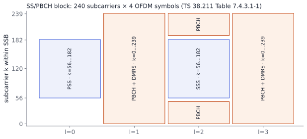
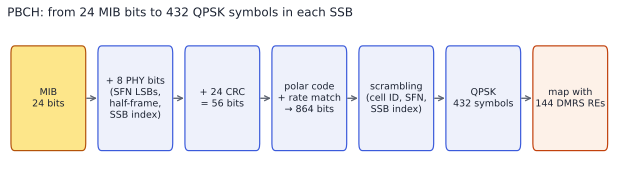

# Beginner · the idea

## A lighthouse for phones {#beacon}



A ship at night first looks for a lighthouse. A phone first looks for the **SSB** (synchronization signal / PBCH block).

- It is sent by every cell, again and again (typically every 20 ms).
- It tells the phone **when** slots start, **which** cell this is, and **where** to find more information.
- It is small: 4 OFDM symbols × 240 subcarriers.

::: {.box}
[The one idea of this section]{.box-title}
If a phone cannot hear the SSB, the cell does not exist for it. SSB coverage is cell coverage.
:::

## What is inside {#ssb-inside}

::: {.compact}
| Part | Symbol | What it gives the phone |
|---|---|---|
| PSS (primary sync) | 0 | timing, and 1 of 3 cell-ID groups |
| SSS (secondary sync) | 2 | the rest of the cell ID (1 of 336) |
| PBCH (broadcast channel) | 1, 2, 3 | frame number, beam index, where SIB1 is |
:::

::: {.kpis}
::: {.kpi}
[20 RBs]{.kpi-val}[3.6 MHz at 15 kHz, 7.2 MHz at 30 kHz]{.kpi-label}
:::
::: {.kpi}
[4 symbols]{.kpi-val}[one SSB]{.kpi-label}
:::
::: {.kpi}
[20 ms]{.kpi-val}[period assumed during initial search]{.kpi-label}
:::
:::

Unlike LTE, NR has no reference signal running across the whole carrier all the time. The SSB is lean by design, which saves energy and interference.

# Intermediate · how it works

## Resource map {#ssb-map}

{width="72%"}

::: {.small}

- 240 subcarriers (20 RBs) × 4 symbols. PSS/SSS on the centre 127 subcarriers, with 8/9 null guard subcarriers either side.
- PBCH DMRS on every 4th subcarrier, shifted by $v=N_{ID}^{cell}\bmod 4$. 432 PBCH QPSK symbols per SSB.

:::

::: {.spec}

TS 38.211 §7.4.3.1, Table 7.4.3.1-1

:::

::: {.notes}
Useful numbers: 3.6 MHz at 15 kHz SCS, 7.2 MHz at 30 kHz, 28.8 MHz at 120 kHz, 57.6 MHz at 240 kHz. The minimum channel bandwidth of a band is set so that the SSB fits: this is why n78 has a 10 MHz minimum at 30 kHz SSB and why some FR2 bands start at 50 MHz.
:::

## PBCH payload and DMRS {#pbch}

::: {.columns}

::: {.column}

::: {.small}

- MIB: 23 bits + 1 choice bit, plus 8 bits added by the physical layer: 4 SFN LSBs, half-frame bit, and either the 3 MSBs of the SSB index ($L_{\max}=64$) or the MSB of $k_{SSB}$ plus reserved bits.
- 32-bit payload + 24-bit CRC → polar code → 864 bits → 432 QPSK symbols.
- The MIB repeats every 80 ms. SSBs within it differ only in the PHY-added bits.

:::

:::

::: {.column}

PBCH DMRS scrambling init:

$$
c_{\text{init}}=2^{11}(\bar i_{SSB}+1)(\lfloor N_{ID}^{cell}/4\rfloor+1)+2^{6}(\bar i_{SSB}+1)+(N_{ID}^{cell}\bmod 4)
$$

::: {.small}

$\bar i_{SSB}$: the 3 LSBs of the SSB index ($L_{\max}\ge 8$), or 2 LSBs + half-frame bit ($L_{\max}=4$). The UE learns the beam index by testing 8 DMRS hypotheses, before decoding any bit.

:::

:::

:::

::: {.spec}

TS 38.211 §7.4.1.4 · TS 38.212 §7.1 · TS 38.331 MIB

:::

::: {.notes}
This is a subtle and elegant design: the SSB index (beam ID) is carried in the reference signal, not in the data, so a UE can know which beam it is on from DMRS detection alone. For Lmax = 64, only the 3 LSBs fit into DMRS; the 3 MSBs go into the PBCH payload, which is why FR2 UEs need to decode PBCH to know the full beam index.
:::

## PBCH: how 24 bits become 432 symbols {#pbch-chain}

{width="96%"}

- The SSB has **576** REs that can carry PBCH (240 in symbol 1, 96 in symbol 2, 240 in symbol 3). DMRS takes one in four: **144** REs, leaving **432** for data.
- QPSK only, heavily coded (about 56 information bits in 864 coded bits): a cell-edge UE must decode it without any prior knowledge.
- Two scramblings: one tied to the cell ID and SFN, one per SSB index, so neighbouring cells and beams look different.
- The 24-bit CRC also tells the UE which hypothesis (timing, SSB index) was the right one.

::: {.notes}
Numbers from ShareTechnote's PBCH page (576 PBCH-capable REs, 144 DMRS, 432 data REs, E = 864 bits after rate matching). The MIB content repeats over 80 ms, so a UE can soft-combine several SSBs of the same beam before decoding.
:::

# Advanced · expert depth

## SSB power, pathloss and the beam-gain trap {#ssb-power}

`ss-PBCH-BlockPower` (SIB1) is the SSS EPRE in dBm. The UE derives downlink pathloss from it:

$$
PL=\texttt{referenceSignalPower}-\text{higher-layer filtered SS-RSRP}
$$

::: {.box}

[Example]{.box-title}200 W over 3276 subcarriers → $53-10\lg 3276 = 17.8$ dBm per RE. Configure ss-PBCH-BlockPower = 18 dBm if SSB EPRE equals data EPRE.

:::

::: {.box .warn}

[Beam-gain trap]{.box-title}With beamformed SSBs, the received SSB includes array gain that the configured EPRE does not. If the SSB beams have $G_{SSB}$ dB more gain than the reference assumed, every UE underestimates PL by $G_{SSB}$ and transmits PRACH and PUSCH too weakly. Symptom: high RACH attempt counts with plenty of DL margin.

:::

::: {.spec}

TS 38.213 §7.1.1, §7.4 · TS 38.331 ServingCellConfigCommonSIB

:::

::: {.notes}
Vendors handle this differently: some include the SSB beam gain in ss-PBCH-BlockPower (it is then an EIRP-like value per RE), some do not. Check your vendor's definition before tuning preambleReceivedTargetPower. ShareTechnote's power-control example shows ss-PBCH-BlockPower = 8 with preambleReceivedTargetPower −110 and powerRampingStep dB4 in a lab RACH trace.
:::

## Finding the SSB in a receiver: the DSP view {#ssb-dsp}

1. **PSS search**: correlate the incoming samples with the 3 PSS references over at least one SSB period (20 ms). The best peak gives symbol timing, N~ID~^(2)^ and a coarse frequency offset.
2. **Refine timing**, cut out the 4 SSB symbols and take their FFT.
3. **SSS**: correlate symbol 2 against the 336 SSS candidates → N~ID~^(1)^ → PCI.
4. **PBCH DMRS**: its positions follow PCI mod 4. Test the 8 DMRS sequences → SSB index (and half-frame bit).
5. **PBCH**: equalize with the DMRS, descramble, polar-decode, check the CRC → MIB.

::: {.box .field}
[Why it matters for RF]{.box-title}
Steps 1–4 work at negative SNR: correlation over 127 subcarriers gives about 21 dB of processing gain. A UE can therefore detect a cell and report its RSRP well below the SINR needed to decode data.
:::

::: {.notes}
ShareTechnote's "DSP - SSB detection" page walks through this pipeline on a recorded signal (30.72 MS/s, 106 PRB, 15 kHz). 10·lg(127) ≈ 21 dB is the coherent correlation gain of a 127-length sequence.
:::

## SSB configuration in RRC {#ssb-rrc}

::: {.compact}
| Parameter | Where | Meaning |
|---|---|---|
| `absoluteFrequencySSB` | ServingCellConfigCommon / MeasObjectNR | ARFCN of SSB subcarrier 0 of RB 10 |
| `ssbSubcarrierSpacing` | idem | 15, 30, 120 or 240 kHz |
| `ssb-PositionsInBurst` | SIB1 / ServingCellConfigCommon | which candidate SSBs are sent |
| `ssb-periodicityServingCell` | idem | 5 … 160 ms |
| `ss-PBCH-BlockPower` | SIB1 | SSS EPRE, used for pathloss |
| `smtc` | MeasObjectNR | when to look for SSBs of a frequency |
:::

- The **cell-defining SSB** must be on the sync raster (a GSCN). Rel-17 adds **NCD-SSBs** (non-cell-defining) so that, for example, RedCap UEs can measure in a BWP that does not contain the cell-defining SSB.

# Practice

## Exercises {#ex}

1. How wide is an SSB at 120 kHz and at 240 kHz SCS?
2. A cell has 200 W over 100 MHz at 30 kHz. What ss-PBCH-BlockPower matches a flat EPRE?
3. SSB beams have 6 dB more gain than the reference assumed in ss-PBCH-BlockPower. What happens to the UE's pathloss estimate and to its PRACH power?

::: {.aside-note}
Answers in the speaker notes.
:::

::: {.notes}
1. 240 × 120 kHz = 28.8 MHz; 240 × 240 kHz = 57.6 MHz.
2. 53 dBm − 10·lg(3276) = 17.8 dBm → configure 18 dBm.
3. The UE measures 6 dB more RSRP than the configured power implies, so it underestimates pathloss by 6 dB and starts PRACH 6 dB too low; with 4 dB ramping it needs 2 extra attempts.
:::

## References {#refs}

::: {.refs}
- **3GPP** TS 38.211 §7.4.3 (SSB mapping), §7.4.1.4 (PBCH DMRS)
- **3GPP** TS 38.212 §7.1 (PBCH coding)
- **3GPP** TS 38.213 §4.1, §7.4
- [ShareTechnote · SS block](https://www.sharetechnote.com/html/5G/5G_SS_Block.html){target="_blank"}
- [ShareTechnote · PBCH](https://sharetechnote.com/html/5G/5G_PBCH.html){target="_blank"}
- [ShareTechnote · Cell search](https://www.sharetechnote.com/html/5G/5G_CellSearch.html){target="_blank"}
- [ShareTechnote · SSB detection (DSP)](https://www.sharetechnote.com/html/5G/5G_PHY_DSP_SSB.html){target="_blank"}
- [ShareTechnote · PBCH DMRS](https://www.sharetechnote.com/html/5G/5G_PBCH_DMRS.html){target="_blank"}
- [ShareTechnote · PBCH decoding process](https://www.sharetechnote.com/html/5G/5G_PBCH_Decoding.html){target="_blank"}
- [ShareTechnote · NCD-SSB](https://www.sharetechnote.com/html/5G/5G_NCD_SSB.html){target="_blank"}
- [ShareTechnote · Matlab 5G: SS/PBCH block](https://www.sharetechnote.com/html/lte_toolbox/Matlab_LteToolbox_5G_SS_PBCH.html){target="_blank"}
- C. Johnson, *5G New Radio in Bullets*, independently published, 2019 (ISBN 978-1077484351)
- E. Dahlman, S. Parkvall, J. Sköld, *5G NR: The Next Generation Wireless Access Technology*, 2nd ed., Academic Press, 2020
:::
