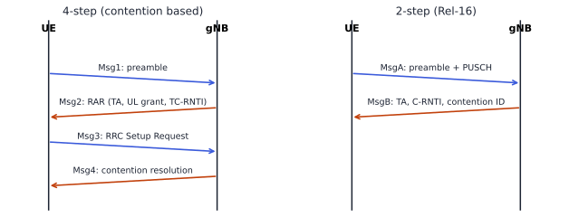
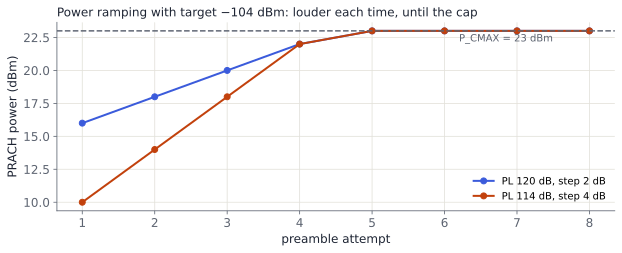

# Beginner · the idea

## Knocking on the door {#knock}



The phone now hears the cell, but the cell does not know the phone exists, and the phone does not know how early to transmit. **Random access** solves both.

1. **Msg1**: the phone knocks with a **preamble** (a known signal).
2. **Msg2**: the network answers: "I heard you; transmit this much earlier; here is your first grant."
3. **Msg3**: the phone says who it is.
4. **Msg4**: the network confirms. If two phones knocked with the same preamble, only one wins.

::: {.box}
[The one idea of this section]{.box-title}
Random access is the first uplink. If the uplink is weak, access fails, even when the downlink looks fine.
:::

## The pieces in plain words {#ra-pieces}

- **64 preambles** per cell and occasion: the phone picks one at random.
- **RACH occasions**: fixed moments when preambles may be sent. In NR each occasion is tied to an SSB beam.
- **Power ramping**: no answer? Try again a little louder (for example +2 or +4 dB) until a maximum.
- **2-step RACH** (Rel-16): Msg1 and Msg3 sent together (MsgA), answered by MsgB. Faster, used when the signal is good.

# Intermediate · how it works

## Msg2 addressing and windows {#ra-rnti}

$$
\text{RA-RNTI}=1+s_{id}+14\,t_{id}+14\cdot 80\,f_{id}+14\cdot 80\cdot 8\,ul_{carrier\_id}
$$

::: {.small}

$s_{id}$: first symbol of the occasion (0–13), $t_{id}$: first slot in the frame (0–79), $f_{id}$: FDM index (0–7), $ul_{carrier\_id}$: 0 normal UL, 1 SUL.

:::

- `ra-ResponseWindow`: sl1 … sl80 slots after the occasion, at most 10 ms in Rel-15.
- `preambleTransMax`, `powerRampingStep` (0, 2, 4, 6 dB), `ra-ContentionResolutionTimer` (8–64 subframes).
- Rel-16 2-step RACH: MsgA = preamble + PUSCH, MsgB = response. Selected when RSRP ≥ `msgA-RSRP-Threshold`, falls back to 4-step otherwise.

::: {.spec}

TS 38.321 §5.1.1–5.1.5 · TS 38.331 RACH-ConfigGeneric

:::

::: {.notes}
A UE that sent its preamble in occasion (s=0, t=19, f=1) on the normal UL looks for RA-RNTI = 1 + 0 + 14·19 + 1120·1 = 1387. Two UEs that chose different preambles in the same occasion share the RA-RNTI and read the same RAR PDU; each finds its own RAPID inside.
:::

## Four steps or two {#four-two}

{width="90%"}

## 2-step RACH in detail (Rel-16) {#two-step}

- **MsgA** = preamble + PUSCH (for example RRC Setup Request), the PUSCH a configured number of slots after the preamble.
- **MsgB** comes on PDSCH addressed by a MsgB-RNTI: contention ID, timing advance, C-RNTI, HARQ timing, TPC.
- The UE chooses 2-step only if RSRP ≥ `msgA-RSRP-Threshold`: good-signal UEs get the shortcut, weak UEs use 4-step.

::: {.columns}
::: {.column}
**Gains**

- half the round trips: lower latency
- fewer transmissions: less UE power, fewer LBT attempts in unlicensed bands
:::
::: {.column}
**Costs**

- MsgA PUSCH is sent **without timing advance**: harder to decode in larger cells
- PUSCH occasions are shared: collisions are possible even with different preambles
:::
:::

# Advanced · expert depth

## From prach-ConfigurationIndex to occasions {#ro-config}

- `prach-ConfigurationIndex` selects a row of TS 38.211 Tables 6.3.3.2-2/3/4 (FR1 paired, FR1 unpaired, FR2): format, period (x), subframe/slot, starting symbol, number of occasions per slot.
- `msg1-FDM` ∈ {1, 2, 4, 8} occasions side by side in frequency, starting at `msg1-FrequencyStart`.
- `ssb-perRACH-OccasionAndCB-PreamblesPerSSB`: $N$ SSBs per occasion (1/8 … 16) and $R$ contention-based preambles per SSB.

::: {.box}

[Mapping order (TS 38.213 §8.1)]{.box-title}SSB indices are mapped to preambles: first by preamble index inside one occasion, then by frequency (FDM), then by time within a PRACH slot, then across PRACH slots.

:::

::: {.small}

Example: 8 SSBs, msg1-FDM = 2, one SSB per occasion → 8 occasions are needed → 4 time instances. The association period must cover all SSBs at least once.

:::

::: {.spec}

TS 38.211 §6.3.3.2 · TS 38.213 §8.1 · TS 38.331 RACH-ConfigCommon

:::

::: {.notes}
This mapping is what lets the gNB learn the UE's best downlink beam from where the preamble arrives (ShareTechnote stresses this as the key NR difference from LTE RACH). It also means: if the gNB receive beam for each occasion matches the SSB beam, the PRACH gets beamforming gain on reception. Misaligned SSB-to-RO receive beams look like a pure uplink coverage loss.
:::

## PRACH power control {#prach-power}

$$
P_{PRACH}=\min\left\{P_{CMAX},\ P_{PRACH,\text{target}}+PL\right\}
$$

$$
P_{PRACH,\text{target}}=\texttt{preambleReceivedTargetPower}+\Delta_{\text{preamble}}+(\text{COUNTER}-1)\cdot\texttt{powerRampingStep}
$$

::: {.box}

[Example]{.box-title}Target −110 dBm, PL = 125 dB, format 0 ($\Delta=0$), first attempt: $P=15$ dBm. After 3 failures with 4 dB steps: 27 dBm → capped at $P_{CMAX}=23$ dBm.

:::

::: {.small}

- PL comes from ss-PBCH-BlockPower − filtered SS-RSRP (Section 1 of this chapter: watch the beam-gain trap).
- Msg3 power uses the RAR's TPC command and `msg3-DeltaPreamble` on top of the PRACH-derived open loop.

:::

::: {.spec}

TS 38.213 §7.4 · TS 38.321 §5.1.3

:::

::: {.notes}
A UE reaching P_CMAX on attempt n stops gaining from further ramping. If preambleTransMax is large, it keeps transmitting at max power, adding uplink interference for nothing. In UL-limited cells, the better levers are the target power (raise it only if UL noise rise allows) and reducing the pathloss error, not a bigger ramping step.
:::

## High speed: restricted sets {#restricted}

- A Doppler shift of $f_d$ moves the ZC correlation peak to a *different cyclic shift*: $d_u$ samples per $\Delta f_{RA}$ of frequency offset.
- With 1.25 kHz spacing, $f_d\approx 600$ Hz (≈ 190 km/h at 3.5 GHz) already creates strong aliased peaks and false detections.
- **Restricted set type A/B** (`restrictedSetConfig`) skip cyclic shifts that would alias, at the cost of fewer preambles per root.
- **Format 3** (5 kHz) quadruples the tolerance. It is the usual choice for railway cells with long preambles.

::: {.box .field}

[Field symptom]{.box-title}Many Msg1 detections with no Msg3 following, concentrated on cells along a railway or motorway: aliased or ghost preambles. Check restrictedSetConfig and root planning before touching power.

:::

::: {.spec}

TS 38.211 §6.3.3.1 (restricted sets)

:::

::: {.notes}
fd for 190 km/h at 3.5 GHz: 52.8 m/s · 3.5e9/3e8 = 616 Hz, about half of Δf_RA. Once the frequency offset approaches Δf_RA/2, the correlation peak at the shifted position becomes comparable to the true one. Restricted sets are defined only for L = 839.
:::

## Power ramping in numbers {#ramping}

{width="80%"}

- Each failed attempt adds `powerRampingStep` until P~CMAX~. After that, further attempts add only interference.
- A large step reaches the cap quickly but overshoots for UEs that would have succeeded one step later.

## Contention-free random access {#cfra}

- The gNB reserves a **dedicated preamble** for one UE: no collision, no contention resolution, so Msg3/Msg4 are not needed.
- Used for **handover** (to the target cell), **beam failure recovery**, and **PDCCH order** (the gNB asks a connected UE to re-acquire timing).
- Dedicated preambles can be tied to a specific SSB or CSI-RS beam in the target cell, so the UE accesses on the right beam immediately.

::: {.box .field}
[KPI tip]{.box-title}
Count contention-based and contention-free RACH separately. A drop in CFRA success points to handover or beam-recovery problems, not to idle-mode access.
:::

# Practice

## Exercises {#ex}

1. Compute the RA-RNTI for an occasion at symbol 0, slot 9, f~id~ = 0, normal UL.
2. A UE has PL = 132 dB, target −104 dBm, step 2 dB, P~CMAX~ = 23 dBm. On which attempt does it reach P~CMAX~?
3. 8 SSBs, msg1-FDM = 2, one SSB per occasion: how many occasions in time are needed per association period?

::: {.aside-note}
Answers in the speaker notes.
:::

::: {.notes}
1. 1 + 0 + 14·9 = 127.
2. −104 + 132 = 28 dBm > 23 dBm: capped from the first attempt. Ramping cannot help; the UE is uplink-limited.
3. 8 occasions / 2 in frequency = 4 time instances.
:::

## References {#refs}

::: {.refs}
- **3GPP** TS 38.211 §6.3.3 (PRACH)
- **3GPP** TS 38.213 §7.4 (PRACH power), §8 (random access)
- **3GPP** TS 38.321 §5.1 (random access)
- [ShareTechnote · RACH](https://www.sharetechnote.com/html/5G/5G_RACH.html){target="_blank"}
- [ShareTechnote · Power control](https://www.sharetechnote.com/html/5G/5G_PowerControl.html){target="_blank"}
- [ShareTechnote · SA initial attach](https://www.sharetechnote.com/html/5G/5G_CallProcess_InitialAttach.html){target="_blank"}
- [ShareTechnote · 2-step RACH](https://www.sharetechnote.com/html/5G/5G_RACH_2step.html){target="_blank"}
- [ShareTechnote · Two types of RACH procedure](https://www.sharetechnote.com/html/db/html/FAQ_5G_RACH_TwoTypeOfRachProcedure.html){target="_blank"}
- [ShareTechnote · Matlab 5G: PRACH FR2](https://www.sharetechnote.com/html/lte_toolbox/Matlab_LteToolbox_5G_PRACH_FR2_120.html){target="_blank"}
- [ShareTechnote · RNTI](https://www.sharetechnote.com/html/5G/5G_RNTI.html){target="_blank"}
- C. Johnson, *5G New Radio in Bullets*, independently published, 2019 (ISBN 978-1077484351)
- E. Dahlman, S. Parkvall, J. Sköld, *5G NR: The Next Generation Wireless Access Technology*, 2nd ed., Academic Press, 2020
:::
