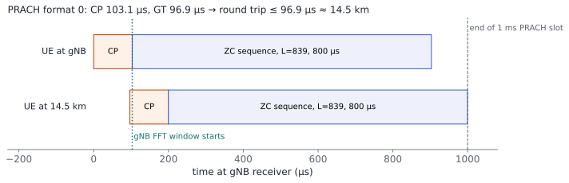
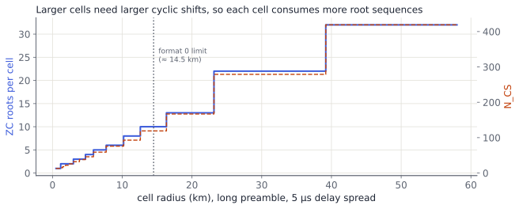

# Beginner · the idea

## Far away means late {#late}



Radio travels at the speed of light, but a phone 10 km away is still heard **66.7 µs later** than a phone next to the mast (there and back).

- If every phone transmitted on its own clock, far phones would land on top of near phones.
- **Timing advance (TA)**: the network tells each phone how much **earlier** to transmit, so all uplinks arrive together.
- The first TA comes in Msg2, measured from the preamble.

::: {.kpis}
::: {.kpi}
[6.67 µs]{.kpi-val}[round trip per km]{.kpi-label}
:::
::: {.kpi}
[≈ 39 m]{.kpi-val}[one TA step at 30 kHz]{.kpi-label}
:::
::: {.kpi}
[≈ 14.5 km]{.kpi-val}[max radius of the common PRACH format 0]{.kpi-label}
:::
:::

# Intermediate · how it works

## Long preamble formats (L = 839) {#long-formats}

::: {.compact}
| Format | ΔfRA | Sequence | CP | Duration | GT | Max radius |
|---|---|---|---|---|---|---|
| 0 | 1.25 kHz | 800 µs | 103.1 µs | 1 ms | 96.9 µs | ≈ 14.5 km |
| 1 | 1.25 kHz | 2 × 800 µs | 684.4 µs | 3 ms | 715.6 µs | ≈ 100 km |
| 2 | 1.25 kHz | 4 × 800 µs | 152.6 µs | 3.5 ms | 147.4 µs | ≈ 22 km |
| 3 | 5 kHz | 4 × 200 µs | 103.1 µs | 1 ms | 96.9 µs | ≈ 14.5 km |
:::

$$
R_{\max}\approx\frac{c}{2}\,\min\left(T_{CP},T_{GT}\right)
$$

{width="64%"}

::: {.spec}

TS 38.211 Table 6.3.3.1-1 (Nu, NCP in κ units)

:::

::: {.notes}
Derivations: format 0 N_u = 24576κ = 800 µs, N_CP = 3168κ = 103.1 µs, GT = 1000 − 903.1 = 96.9 µs → 14.5 km. Format 2 repeats the sequence 4 times for +6 dB energy (coverage), not range. Format 3's 5 kHz spacing makes it robust to Doppler (high-speed trains). Short formats (A1–A3, B1–B4, C0, C2) use L = 139 at 15–120 kHz, scaling all durations by 2^−μ: they target small and medium cells and are the only option in FR2.
:::

## Timing advance: initial and closed loop {#ta}

::: {.columns}

::: {.column}

**RAR**: 12-bit $T_A\in\{0,\dots,3846\}$

$$
N_{TA}=T_A\cdot 16\cdot 64/2^{\mu}
$$

::: {.small}

Max: 3846 steps × 520.8 ns = 2.0 ms of round trip at 15 kHz (≈ 300 km): never the limit, PRACH format is.

:::

:::

::: {.column}

**MAC CE**: 6-bit $T_A\in\{0,\dots,63\}$, relative

$$
N_{TA,\text{new}}=N_{TA,\text{old}}+(T_A-31)\cdot 16\cdot 64/2^{\mu}
$$

::: {.small}

±31 steps per command: ±8.1 µs at 30 kHz. Applied from slot $n+k+1$ after reception (TS 38.213 §4.2).

:::

:::

:::

::: {.kpis}

::: {.kpi}

[6.67 µs]{.kpi-val}[round trip per km]{.kpi-label}

:::

::: {.kpi}

[39 m]{.kpi-val}[one TA step at 30 kHz (one-way)]{.kpi-label}

:::

::: {.kpi}

[timeAlignmentTimer]{.kpi-val}[expiry → UE must redo RACH]{.kpi-label}

:::

:::

::: {.spec}

TS 38.213 §4.2 · TS 38.321 §5.2, §6.1.3.4

:::

::: {.notes}
TA as a geolocation tool: the RAR TA gives distance with ~39 m granularity at 30 kHz, but multipath (the first detected path is not always the direct path) biases it long in NLOS. Many vendors export TA distributions per cell: a long tail beyond the planned radius is the classic overshooting indicator.
:::

## Keeping the timing right after access {#ta-maintenance}

- **TA command MAC CE** (LCID 61): a 6-bit relative correction, sent whenever the gNB measures drift on PUSCH, PUCCH or SRS.
- **timeAlignmentTimer**: if no TA command arrives before it expires, the UE considers itself out of sync and must do random access again before transmitting.
- **Timing advance groups (TAGs)**: carriers from the same site share one TA; a remote radio at a different distance needs its own TAG.
- The new TA applies a few slots after it is received, so the gNB measures, commands and sees the effect with a delay.

## TA as a free measurement {#ta-measurement}

- The RAR timing advance gives every UE's distance with about **39 m** granularity at 30 kHz (78 m at 15 kHz).
- A TA **distribution per cell** is one of the best overshoot indicators: a tail far beyond the planned radius means the cell is serving users it should not.
- In NLOS the first detected path is not always the direct one, so TA distances read slightly long.

::: {.box .field}
[Practice]{.box-title}
Plot TA bins per cell next to the inter-site distance. Cells whose 95th-percentile TA exceeds about 70 % of the distance to the next site are uptilt or overshoot candidates.
:::

# Advanced · expert depth

## Zadoff-Chu roots and cyclic shifts {#zc}

$$
x_u(n)=e^{-j\pi u n(n+1)/L_{RA}},\qquad x_{u,v}(n)=x_u\big((n+C_v)\bmod L_{RA}\big),\quad C_v=vN_{CS}
$$

- Cyclic shifts of one root are orthogonal (ideal periodic autocorrelation). Different roots have cross-correlation $1/\sqrt{L}$.
- A delayed preamble appears as a shifted correlation peak. The shift must stay inside its own zone:

$$
N_{CS}\,\frac{T_{seq}}{L_{RA}}\ \ge\ \frac{2R}{c}+\tau_{ds}
$$

::: {.box}

[Worked example: 10 km, format 0]{.box-title} $T_{seq}/L=800/839=0.954\ \mu s$. RTD = 66.7 µs, delay spread 5 µs → $N_{CS}\ge 75.2$.\
 Pick $N_{CS}=76$ (zeroCorrelationZoneConfig = 10). Preambles per root $\lfloor 839/76\rfloor=11$ → $\lceil 64/11\rceil=6$ roots per cell.

:::

::: {.spec}

TS 38.211 §6.3.3.1, Table 6.3.3.1-5

:::

::: {.notes}
The unrestricted N_CS values for L = 839 are 0, 13, 15, 18, 22, 26, 32, 38, 46, 59, 76, 93, 119, 167, 279, 419. With 838 usable logical roots and 6 per cell, there are ~139 distinct root groups: root planning is a reuse problem like PCI planning. Neighbours sharing a root and N_CS produce 'ghost' preambles: the gNB detects a neighbour cell's UE.
:::

## Range costs root sequences {#ncs-chart}

{width="82%"}

- Below about 2 km one root sequence is enough for 64 preambles; at 25 km each cell needs 22.
- With 838 usable roots, large cells leave few distinct root groups: neighbouring rural cells may be forced to share.

## Root sequence planning {#root-plan}

1. From the cell radius, pick the PRACH format and `zeroCorrelationZoneConfig` (N~CS~).
2. Compute roots per cell: $\lceil 64/\lfloor 839/N_{CS}\rfloor\rceil$ (long preamble).
3. Assign each cell a starting `prach-RootSequenceIndex` so that neighbours do not overlap, like a PCI reuse plan.
4. Check for **ghost preambles** after changes: detections without Msg3 often mean a neighbour shares roots.

::: {.notes}
Example: N_CS = 76 → 11 preambles per root → 6 roots. Assign root indices 0, 6, 12, … to neighbouring cells so their sets do not overlap; reuse after the distance where preambles from the other cell cannot reach.
:::

# Practice

## Exercises {#ex}

1. Design PRACH for a 25 km coastal cell: format, N~CS~ and roots per cell (5 µs delay spread).
2. How many 30 kHz TA steps correspond to a UE 10 km away (ignore N~TA,offset~)?
3. Why does a too-small N~CS~ make a cell look smaller than its RF coverage?

::: {.aside-note}
Answers in the speaker notes.
:::

::: {.notes}
1. Format 1 (≈ 100 km). RTD 166.7 µs + 5 µs = 171.7 µs / 0.954 µs = 180 → N_CS = 279 (config 14); floor(839/279) = 3 preambles per root → 22 roots per cell.
2. 66.7 µs / 0.2604 µs ≈ 256 steps.
3. Preambles from far UEs arrive with a delay beyond their cyclic-shift zone and are detected as another preamble or not at all, so those UEs never complete access.
:::

## References {#refs}

::: {.refs}
- **3GPP** TS 38.211 §6.3.3.1 (formats, NCS)
- **3GPP** TS 38.213 §4.2 (TA)
- **3GPP** TS 38.321 §5.2, §6.1.3.4 (TA command)
- [ShareTechnote · Timing advance](https://www.sharetechnote.com/html/5G/5G_TimingAdvance.html){target="_blank"}
- [ShareTechnote · UL timing](https://www.sharetechnote.com/html/5G/5G_UL_Timing.html){target="_blank"}
- [ShareTechnote · RACH](https://www.sharetechnote.com/html/5G/5G_RACH.html){target="_blank"}
- [ShareTechnote · MAC CE overview](https://www.sharetechnote.com/html/5G/5G_MAC_CE.html){target="_blank"}
- [ShareTechnote · Carrier aggregation (TAGs)](https://www.sharetechnote.com/html/5G/5G_CarrrierAggregation.html){target="_blank"}
- C. Johnson, *5G New Radio in Bullets*, independently published, 2019 (ISBN 978-1077484351)
- E. Dahlman, S. Parkvall, J. Sköld, *5G NR: The Next Generation Wireless Access Technology*, 2nd ed., Academic Press, 2020
:::
