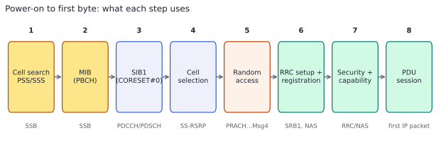
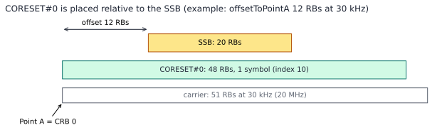

# Beginner · the idea

## Eight steps from power-on to data {#eight-steps}



1. **Cell search**: find an SSB, lock timing, read the cell ID.
2. **MIB**: frame number and where SIB1 is.
3. **SIB1**: access rules and RACH settings.
4. **Cell selection**: is the signal good enough to camp here?
5. **Random access**: Msg1 to Msg4, timing advance, an identity.
6. **RRC setup + registration**: the phone connects and registers with the core network.
7. **Security and capabilities**: encryption on, the network learns what the phone can do.
8. **PDU session**: the data path opens. The first byte flows.

::: {.notes}
This is the whole of Chapter 2 in order. Sections 1–3 covered steps 1–2, Sections 4–5 covered step 5. This section adds the system-information and RRC parts and, most importantly, how to use the sequence for troubleshooting.
:::

## The whole journey in one picture {#journey}

{width="96%"}

Yellow steps use the SSB, blue steps use broadcast control and data, orange is the first uplink, green is dedicated signalling with the core network.

# Intermediate · how it works

## What the MIB tells the UE {#mib-fields}

::: {.compact}
| Field | Bits | Use |
|---|---|---|
| systemFrameNumber | 6 (+4 PHY) | 10-bit SFN |
| subCarrierSpacingCommon | 1 | SCS of CORESET#0, SIB1, Msg2/4 |
| ssb-SubcarrierOffset | 4 (+1 PHY in FR1) | kSSB: SSB vs CRB grid |
| dmrs-TypeA-Position | 1 | first PDSCH DMRS in symbol 2 or 3 |
| pdcch-ConfigSIB1 | 8 | controlResourceSetZero (4) + searchSpaceZero (4) |
| cellBarred, intraFreqReselection | 1 + 1 | access control |
:::

::: {.box}

[No SIB1 here]{.box-title}In FR1, $k_{SSB}>23$ (FR2: $k_{SSB}>11$) tells the UE there is no CORESET#0 for this SSB: for example an NSA-only cell, or a secondary SSB. `pdcch-ConfigSIB1` then points the UE to where (in GSCN) to search next.

:::

::: {.spec}

TS 38.331 MIB · TS 38.213 §4.1, §13

:::

::: {.notes}
An NSA (EN-DC) NR cell does not need SIB1, because the UE gets all configuration through LTE RRC. Such cells broadcast k_SSB = 30/31 (FR1) so that SA UEs skip them quickly. Seeing SA-capable UEs camp on LTE next to a strong NR cell is often explained by this.
:::

## CORESET#0 and Type0-PDCCH {#coreset0}

- `controlResourceSetZero` indexes TS 38.213 Tables 13-1 … 13-10 (by SSB/PDCCH SCS and band): the SSB/CORESET multiplexing pattern, 24/48/96 RBs, 1–3 symbols, and the RB offset from the SSB.
- Pattern 1: SSB and CORESET#0 in different symbols (TDM), the FR1 case. Patterns 2/3: frequency-multiplexed, FR2 options.
- `searchSpaceZero` (Table 13-11 for pattern 1) gives $O$ and $M$: the monitoring slot for SSB index $i$ is

$$
n_0=\left(O\cdot 2^{\mu}+\lfloor i\cdot M\rfloor\right)\bmod N^{\text{frame},\mu}_{\text{slot}}
$$

::: {.small}

Each beam (SSB index) has its own Type0-PDCCH occasion, so SIB1 is beam-swept too.

:::

::: {.spec}

TS 38.213 §13, Tables 13-1 to 13-11

:::

::: {.notes}
CORESET#0 also defines the initial DL BWP until SIB1 provides initialDownlinkBWP: its RB span is the initial BWP. The 24-RB CORESET#0 at 30 kHz is 8.64 MHz wide, so an n78 cell's idle-mode traffic (SIB1, paging, Msg2/4) is confined to under 9 MHz of the 100 MHz carrier. This matters for idle-mode interference and for the RF test of receiver blocking during access.
:::

## Placing CORESET#0 {#coreset0-place}

{width="88%"}

- The CORESET#0 offset is counted **from the SSB**, because the UE does not know Point A yet.
- Example (30 kHz, 20 MHz carrier): index 10 → 48 RBs, 1 symbol, offset 12 RBs; with offsetToPointA = 12 RBs (at 30 kHz) CORESET#0 starts at Point A.
- The whole CORESET#0 must fit inside the carrier: an SSB too close to the band edge makes some indices invalid.

## How SIB1 is delivered {#sib1}

- PDCCH with DCI 1_0, CRC scrambled with **SI-RNTI** (0xFFFF), in Type0-PDCCH occasions: slot $n_0=(O\cdot 2^{\mu}+\lfloor iM\rfloor)\bmod N_{slot}$ and the next slot, for SSB index $i$.
- Aggregation levels 4, 8, 16 with 4, 2, 1 candidates: 7 blind decodes per occasion.
- PDSCH uses a **default** time-domain table (TS 38.214) because no RRC configuration exists yet; no HARQ feedback; SIB1 repeats within a 160 ms period.
- SIB1 carries cell selection thresholds, PLMN/TAC/cell ID, `servingCellConfigCommon` (offsetToPointA, carrier bandwidth, RACH, TDD pattern) and the scheduling of other SIBs (some on demand).

::: {.notes}
From ShareTechnote's Type0-PDCCH CSS and cell search pages. Example: μ = 1, O = 0, M = 1/2 gives n0 = 0, 1, 2, 3 for SSB indices 0, 2, 4, 6.
:::

# Advanced · expert depth

## Decomposing random access failures {#ra-tree}

::: {.compact}
| Failing step | Typical cause | Check first |
|---|---|---|
| Msg1 not detected | UL coverage, PL error, NCS too small for real distance | TA distribution, ss-PBCH-BlockPower, zeroCorrelationZoneConfig |
| Msg1 detected, no Msg3 | ghost/aliased preambles, RAR not received | root plan, restrictedSetConfig, RAR window, DL beam |
| Msg3 decode failure | Msg3 power too low, UL interference | msg3-DeltaPreamble, TPC in RAR, UL IoT per symbol |
| Msg4 / contention failure | DL quality at the edge, timer too short | ra-ContentionResolutionTimer, CORESET#0 robustness |
:::

::: {.box .field}

[Method]{.box-title}Compute per-step ratios: Msg3/Msg1, Msg4/Msg3 per cell. A low Msg3/Msg1 with normal UL IoT points to preamble-detection artefacts. A low Msg3/Msg1 with high UL IoT points to interference (remember remote interference, Chapter 1 Section 6).

:::

::: {.notes}
ShareTechnote's RACH page lists the RRC parameters with their spec references (prach-ConfigurationIndex 38.321 §5.1, prach-RootSequenceIndex and zeroCorrelationZoneConfig 38.211 §6.3.3). A good practice exercise is to take one cell's RACH-ConfigCommon and re-derive its maximum supported radius and the number of roots it consumes.
:::

## Every step is a KPI {#kpi-steps}

::: {.compact}
| Steps failing | Typical counter symptom | Look first at |
|---|---|---|
| 1–4 | UEs camp on LTE next to a strong NR cell | SSB/GSCN placement, k~SSB~, q-RxLevMin, SIB1 |
| 5 | low RACH success, many Msg1 per Msg3 | uplink coverage, PRACH config, ss-PBCH-BlockPower |
| 6 | RRC setup failures | Msg4/CORESET#0 robustness, core network, timers |
| 7–8 | registration / PDU session failures | core network, UE capability, security config |
:::

::: {.box .field}
[Method]{.box-title}
Never start from parameters. Find the first step that fails, then the cause is usually in that step's own configuration or radio condition.
:::

## After RACH: RRC and NAS in order {#rrc-nas}

::: {.compact}
| # | Message | Direction | Failure usually means |
|---|---|---|---|
| 1 | RRCSetupRequest (Msg3) | UE → gNB | UL coverage, Msg3 power |
| 2 | RRCSetup (SRB1) | gNB → UE | DL quality at edge, timers |
| 3 | RRCSetupComplete + Registration Request | UE → gNB → AMF | UL on PUSCH, core reachability |
| 4 | Authentication, NAS Security Mode | AMF ↔ UE | subscription / USIM / core |
| 5 | AS SecurityModeCommand / Complete | gNB ↔ UE | configuration mismatch |
| 6 | UECapabilityEnquiry / Information | gNB ↔ UE | large capability messages at the edge |
| 7 | RRCReconfiguration (DRB, measurements) | gNB → UE | config errors, BWP/TDD mismatch |
| 8 | PDU Session Establishment | UE ↔ SMF | DNN, QoS, IP allocation |
:::

# Practice

## Exercises {#ex}

1. SA phones stay on LTE next to a strong NR cell that broadcasts k~SSB~ = 31. Explain.
2. RACH success is 99 %, but RRC setup success is 85 %. Which steps would you examine?
3. Why is the initial BWP (CORESET#0) the most important part of the carrier for accessibility?

::: {.aside-note}
Answers in the speaker notes.
:::

::: {.notes}
1. k_SSB > 23 in FR1 means no CORESET#0 / no SIB1 for this SSB (for example an NSA-only cell): SA UEs cannot camp and skip it.
2. Step 6: Msg4 and RRC Setup delivery (DL quality at the edge, contention timer), then core-network registration.
3. All idle-mode signalling (SIB1, paging, Msg2/Msg4) lives in the initial BWP; if it is interfered or too narrow for the load, access fails for everyone.
:::

## References {#refs}

::: {.refs}
- **3GPP** TS 38.300 (overall description)
- **3GPP** TS 38.331 (MIB, SIB1, RRC setup)
- **3GPP** TS 38.213 §4.1, §13 · TS 38.304 §5.2
- [ShareTechnote · SA initial attach](https://www.sharetechnote.com/html/5G/5G_CallProcess_InitialAttach.html){target="_blank"}
- [ShareTechnote · Cell search](https://www.sharetechnote.com/html/5G/5G_CellSearch.html){target="_blank"}
- [ShareTechnote · MIB / SIB](https://sharetechnote.com/html/5G/5G_Mib_Sib.html){target="_blank"}
- [ShareTechnote · Cell selection criterion](https://www.sharetechnote.com/html/5G/5G_CellSelectionCriterion.html){target="_blank"}
- [ShareTechnote · Type 0 PDCCH common search space](https://www.sharetechnote.com/html/5G/5G_CommonSearchSpace_Type0_PDCCH.html){target="_blank"}
- [ShareTechnote · Registration](https://www.sharetechnote.com/html/5G/5G_Registration.html){target="_blank"}
- [ShareTechnote · Security mode setup](https://www.sharetechnote.com/html/5G/5G_SecurityModeSetup.html){target="_blank"}
- [ShareTechnote · PDU session establishment](https://www.sharetechnote.com/html/5G/5G_PDUSessionEstablishment.html){target="_blank"}
- [ShareTechnote · UE capability](https://www.sharetechnote.com/html/5G/5G_UE_Capability.html){target="_blank"}
- C. Johnson, *5G New Radio in Bullets*, independently published, 2019 (ISBN 978-1077484351)
- E. Dahlman, S. Parkvall, J. Sköld, *5G NR: The Next Generation Wireless Access Technology*, 2nd ed., Academic Press, 2020
:::
