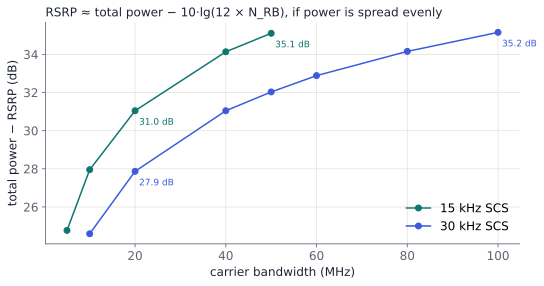

# Beginner · the idea

## One note, not the whole orchestra {#one-note}



**RSRP** (reference signal received power) is the power of **one** resource element of the SSB, not the power of the whole carrier.

- An orchestra can be loud while one violin is quiet. RSRP is that one violin.
- A 100 MHz carrier at 30 kHz has 3276 subcarriers. Spreading the power over all of them costs 35 dB.

::: {.kpis}
::: {.kpi}
[−60 dBm]{.kpi-val}[total power on the analyzer]{.kpi-label}
:::
::: {.kpi}
[− 35.2 dB]{.kpi-val}[10·lg(3276 subcarriers)]{.kpi-label}
:::
::: {.kpi}
[≈ −95 dBm]{.kpi-val}[SS-RSRP]{.kpi-label}
:::
:::

::: {.box}
[The one idea of this section]{.box-title}
RSRP shows coverage. It contains no noise and no interference, so it says nothing about quality.
:::

## A rule of thumb for drive tests {#rsrp-scale}

::: {.compact}
| SS-RSRP | Typical label |
|---|---|
| ≥ −80 dBm | excellent |
| −80 … −90 dBm | good |
| −90 … −100 dBm | fair |
| &lt; −100 dBm | poor |
:::

- Thresholds vary by operator, band and service. They are not in the standard.
- The phone can report from −156 to −31 dBm in 1 dB steps.
- In mmWave, the SSB is beamformed, so RSRP is a **per-beam** value.

## From analyzer power to RSRP {#rsrp-offset}

{width="78%"}

- The wider the carrier, the more subcarriers share the power, and the lower RSRP is for the same total power.
- A 100 MHz carrier at 30 kHz: RSRP sits about **35 dB** below the total. A 20 MHz LTE-like carrier: about 31 dB.
- So a "−95 dBm" RSRP on a 100 MHz cell is the same received power as about −60 dBm total.

# Intermediate · how it works

## SS-RSRP, SS-RSRQ, SS-SINR {#definitions}

::: {.compact}
| Quantity | Definition (TS 38.215 §5.1) | Reported range |
|---|---|---|
| SS-RSRP | linear average power (W) per RE of the SSS (optionally + PBCH DMRS), in the SMTC window | −156 … −31 dBm, 1 dB |
| SS-RSRQ | $N\times$SS-RSRP / NR carrier RSSI, $N$ = RBs in the RSSI bandwidth | −43 … 20 dB, 0.5 dB |
| SS-SINR | SSS power per RE / (noise + interference) per RE, same REs | −23 … 40 dB, 0.5 dB |
| L1-RSRP | RSRP per SSB or CSI-RS resource, for beam reports | −140 … −44 dBm, 1 dB (differential 2 dB) |
:::

::: {.small}

- FR1 reference point: the antenna connector. FR2: the combined signal of the antenna elements of one receiver branch, so the UE's own array gain is *inside* FR2 RSRP.
- Reported value $n$ for RSRP maps to roughly $[-157+n,\,-156+n)$ dBm: a threshold `rsrp 106` in RRC means ≈ −51 dBm.

:::

::: {.spec}

TS 38.215 §5.1.1–5.1.6 · TS 38.133 §10.1

:::

::: {.notes}
ShareTechnote's power-definition page lists the full family: SS-, CSI- and SRS-RSRP, SS- and CSI-RSRQ, SS- and CSI-SINR. Its CA example decodes a2-Threshold rsrp 16 as about −141 dBm, consistent with −157 + 16. Teams that compare UE logs with gNB counters must agree on whether they use the reported index or the dBm value.
:::

## How the UE measures it {#how-measured}

- Only the **SSS** REs (optionally plus PBCH DMRS) are used: the linear average power per RE, in watts, then converted to dBm.
- Only REs with the **same SSB index and the same PCI** are combined, so each beam has its own RSRP. Different beams are never averaged into one RSRP sample.
- The UE measures only inside the **SMTC** window that the network configures, except for L1 beam reports.
- FR1 reference point: the antenna connector. FR2: the combined signal of one receiver branch. With receive diversity, the reported value may not be lower than any single branch.

::: {.notes}
Summarized from ShareTechnote's RSRP page (TS 38.215 §5.1.1). CSI-RSRP exists only in RRC_CONNECTED; idle and inactive UEs only have SS-RSRP.
:::

## Reported numbers: index vs dBm {#rsrp-index}

::: {.compact}
| Report | Range | Step | Where |
|---|---|---|---|
| L3 RSRP (RRC MeasurementReport) | −156 … −31 dBm, RSRP_0 … RSRP_127 | 1 dB | events, handover |
| L1 RSRP (CSI report) | −140 … −44 dBm | 1 dB | beam management |
| L1 differential | 0 … −30 dB from the strongest beam | 2 dB | multi-beam reports |
:::

- Quick conversion: **RSRP_N ≈ N − 157 dBm**. RSRP_70 means −87 … −86 dBm.
- A differential L1 value means nothing without the absolute value of the strongest beam in the same report.
- RSRP_127 is used as "infinity" in thresholds, not as a measurement.

::: {.box .field}
[Practice]{.box-title}
When the gNB counter says "RSRP 70" and the drive-test tool says "−87 dBm", they agree. Make sure every report states which one it uses.
:::

# Advanced · expert depth

## Cell selection: the S-criterion {#s-criterion}

$$
S_{rxlev}=Q_{rxlevmeas}-(Q_{rxlevmin}+Q_{rxlevminoffset})-P_{compensation}-Q_{offsettemp}>0
$$

$$
S_{qual}=Q_{qualmeas}-(Q_{qualmin}+Q_{qualminoffset})-Q_{offsettemp}>0
$$

::: {.small}

- `q-RxLevMin` is signalled in 2 dB units (−70 … −22 → −140 … −44 dBm).
- FR1: $P_{compensation}=\max(P_{EMAX1}-P_{PowerClass},0)$ (simplified): a cell that limits UE power must require more DL margin.
- Reselection ranks $R_s=Q_{meas,s}+Q_{hyst}$ against $R_n=Q_{meas,n}-Q_{offset}$, held for `t-Reselection`. Inter-frequency uses absolute priorities and thresholds.

:::

::: {.box}

[Example]{.box-title}q-RxLevMin = −64 (−128 dBm), measured −120 dBm, no offsets, PEMAX = 23, power class 3 → Srxlev = +8 dB: suitable.

:::

::: {.spec}

TS 38.304 §5.2.3.2, §5.2.4 · TS 38.331 SIB1, SIB2–SIB4

:::

::: {.notes}
ShareTechnote's cell selection criterion page goes through every term and where the UE gets it: only Qrxlevmeas (RSRP) and Qqualmeas (RSRQ) come from the air. Setting q-RxLevMin too low makes UEs camp where they cannot complete RACH (UL-limited, Section 3); setting it too high creates artificial coverage holes in idle mode.
:::

## Cell RSRP from beam RSRPs {#cell-from-beams}

With several SSB beams, the UE builds one **cell** value for mobility:

- If `nrofSS-BlocksToAverage` is not set, or no beam passes `absThreshSS-BlocksConsolidation`: cell value = **best beam**.
- Otherwise: linear average of up to *N* best beams **above the threshold**.

::: {.columns}
::: {.column}
**Best beam only**

- reacts quickly to beam changes
- favours cells with narrow, strong beams
:::
::: {.column}
**Average of N beams**

- smoother, fewer ping-pongs
- penalises a cell where only one beam reaches the UE
:::
:::

::: {.notes}
TS 38.331 §5.5.3.3 (derivation of cell measurement results). ShareTechnote's power definition page shows these fields in MeasObjectNR. Both the serving and neighbour cells must use the same rule, otherwise A3 compares unlike quantities.
:::

## Worked S-criterion with power compensation {#s-example}

SIB1: `q-RxLevMin = −62` (→ −124 dBm), `q-QualMin = −18` dB, `p-Max = 26` dBm. UE: power class 3 (23 dBm).

::: {.compact}
| Term | Value |
|---|---|
| Qrxlevmeas (RSRP) | −110 dBm |
| Qrxlevmin | −124 dBm |
| Pcompensation = max(26 − 23, 0) | 3 dB |
| **Srxlev** = −110 + 124 − 3 | **+11 dB** ✓ |
| Qqualmeas (RSRQ) | −16 dB |
| **Squal** = −16 + 18 | **+2 dB** ✓ |
:::

If the RSRQ drops to −20 dB, Squal = −2 dB and the cell is not suitable, even with good RSRP. A cell planned for 26 dBm UEs asks a 23 dBm UE for 3 dB more downlink.

# Practice

## Exercises {#ex}

1. RRC sets `a2-Threshold rsrp 16`. Roughly what RSRP in dBm is that?
2. Total received power over a 20 MHz carrier at 15 kHz (1272 subcarriers) is −70 dBm, evenly spread. Estimate SS-RSRP.
3. Compute Srxlev for measured −126 dBm, q-RxLevMin −62, Qrxlevminoffset 0, P~compensation~ 3 dB.

::: {.aside-note}
Answers in the speaker notes.
:::

::: {.notes}
1. −157 + 16 ≈ −141 dBm.
2. 10·lg(1272) = 31.0 dB → ≈ −101 dBm.
3. q-RxLevMin −62 → −124 dBm; Srxlev = −126 − (−124) − 3 = −5 dB: not suitable.
:::

## References {#refs}

::: {.refs}
- **3GPP** TS 38.215 §5.1.1 (SS-RSRP)
- **3GPP** TS 38.133 §10.1 (reporting)
- **3GPP** TS 38.304 §5.2.3 (S-criterion)
- [ShareTechnote · RSRP / RSRQ / SINR definitions](https://www.sharetechnote.com/html/5G/5G_PowerDefinition.html){target="_blank"}
- [ShareTechnote · Measurement report](https://www.sharetechnote.com/html/5G/5G_MeasurementReport.html){target="_blank"}
- [ShareTechnote · Cell selection criterion](https://www.sharetechnote.com/html/5G/5G_CellSelectionCriterion.html){target="_blank"}
- [ShareTechnote · RSRP (reporting range, L1/L3)](https://www.sharetechnote.com/html/5G/5G_RSRP.html){target="_blank"}
- [ShareTechnote · Cell selection](https://www.sharetechnote.com/html/5G/5G_Cell_Selection.html){target="_blank"}
- C. Johnson, *5G New Radio in Bullets*, independently published, 2019 (ISBN 978-1077484351)
- E. Dahlman, S. Parkvall, J. Sköld, *5G NR: The Next Generation Wireless Access Technology*, 2nd ed., Academic Press, 2020
:::
