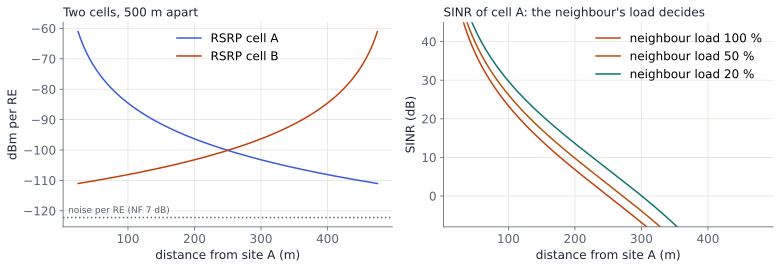
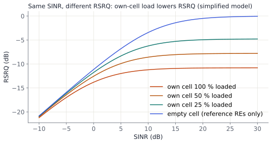

# Beginner · the idea

## Loud is not the same as clear {#loud-clear}



In a noisy café a friend can speak loudly and you still cannot understand. Radio is the same.

- **RSRP**: how loud the wanted cell is.
- **SINR**: how loud it is **compared to everything else** (other cells + noise). This decides the speed.
- **RSRQ**: a mix of both, which also changes with how busy the cells are.

::: {.box}
[The one idea of this section]{.box-title}
Always read RSRP and SINR together. High RSRP with low SINR means interference, not weak coverage.
:::

## Reading the two together {#two-metrics}

::: {.compact}
| RSRP | SINR | Likely cause |
|---|---|---|
| high | low | interference: overlapping cells, overshoot, pilot pollution |
| low | good | edge of coverage, noise-limited |
| low | low | cell edge with interference |
| high | high | healthy: if throughput is low, look at load or uplink |
:::

Rough speed guide: about 25–30 dB SINR is needed for 256QAM, around 0 dB only allows the most robust modulation.

# Intermediate · how it works

## What RSRQ can and cannot be {#rsrq-ceiling}

If the RSSI symbol is fully loaded by the serving cell only, with no noise, every RB carries 12 REs at RSRP:

$$
\text{RSRQ}=\frac{N\cdot\text{RSRP}}{N\cdot 12\cdot\text{RSRP}}=\frac{1}{12}\ \Rightarrow\ -10.8\ \text{dB}
$$

- One equally strong, fully loaded neighbour: −13.8 dB. RSRQ above −10.8 dB means the RSSI symbols were partly empty (low load).
- So RSRQ mixes interference *and* load: the same location reads differently at 3 a.m. and at busy hour.

::: {.box .warn}

[SS-SINR in synchronized networks]{.box-title}If all cells send SSBs in the same symbols, SSBs always collide with neighbours' SSBs, whatever the traffic. SS-SINR then reflects **full-load** interference and underestimates PDSCH SINR at low load. Staggering SSB positions between neighbours changes this, and also changes what the KPI means.

:::

::: {.notes}
This is the most common misreading in NR benchmarking. Ask students: two networks show the same SS-SINR distribution, one with aligned SSBs and one with offset SSBs. Which delivers better throughput at 30 % load? The offset one's SS-SINR already looks like low-load SINR; the aligned one's SS-SINR looks like full load, so at 30 % load its PDSCH SINR is better than its SS-SINR suggests.
:::

## SINR between two sites {#sinr-two}

{width="96%"}

- RSRP of the serving cell falls smoothly; SINR falls much faster because the neighbour **rises** at the same time.
- At the cell border, SINR ≈ 0 dB when the neighbour is fully loaded; a lightly loaded neighbour leaves several dB more.

## Why RSRQ moves with load {#rsrq-load}

{width="80%"}

- RSRQ = N × RSRP / RSSI. RSSI counts **all** power in the measured symbols, including your own cell's traffic.
- More traffic in your own cell → higher RSSI → **lower RSRQ**, although nothing is wrong with the radio.
- So RSRQ alone cannot separate "busy" from "interfered": always check SINR next to it.

# Advanced · expert depth

## Worked example: predicting SINR from RSRPs {#sinr-calc}

Noise per RE at the UE: $-174+10\lg(30\,\text{kHz})+7\ \text{dB NF}=-122.2$ dBm.

::: {.compact}
|  | Serving | Neighbour 1 | Neighbour 2 |
|---|---|---|---|
| SS-RSRP | −85 dBm | −88 dBm | −90 dBm |
:::

$$
\text{SINR}=\frac{P_s}{\eta\,(P_1+P_2)+N}
$$

::: {.kpis}

::: {.kpi}

[0.9 dB]{.kpi-val}[η = 100 % (SSB-on-SSB, or full load)]{.kpi-label}

:::

::: {.kpi}

[6.1 dB]{.kpi-val}[η = 30 % PDSCH load]{.kpi-label}

:::

::: {.kpi}

[37.2 dB]{.kpi-val}[η = 0, noise only]{.kpi-label}

:::

:::

::: {.small}

Three cells within 5 dB is the textbook definition of pilot pollution: no dominant server, low SINR at any load.

:::

::: {.notes}
Calculation: P1 + P2 = 10^(−8.8) + 10^(−9.0) = 1.585e-9 + 1.0e-9 = 2.585e-9 mW → −85.9 dBm. At η = 1: SINR = −85 − (−85.9) = 0.9 dB (noise is negligible). At η = 0.3: I = −91.1 dBm → 6.1 dB. Noise only: −85 + 122.2 = 37.2 dB. The same location spans 1 dB to 37 dB of SINR depending only on neighbour activity, which is why SINR maps must state the load (or SSB alignment) they were measured under.
:::

## SS-SINR vs traffic SINR {#ss-vs-traffic}

- SS-SINR is measured on the SSS. If **neighbour SSBs are time-aligned** (synchronised TDD network), SSS collides with SSS at **full power every time**, even when the neighbours carry no traffic.
- Traffic SINR (from CSI-RS, or from the CQI the UE reports) sees the neighbours' **actual load**.
- Result: in a lightly loaded network, SS-SINR looks worse than the SINR the user really gets.

::: {.box .field}
[Practice]{.box-title}
Use SS-SINR as a **worst case** (all neighbours at 100 % load). For throughput estimates, use CQI or CSI-RS SINR from the same log.
:::

::: {.notes}
ShareTechnote notes that in NR SINR became a formal measurement reported in RRC (SS-SINR, CSI-SINR), unlike LTE where it was a chipset value. Range −23 … 40 dB, 0.5 dB steps.
:::

## Pilot pollution: too many cells, none dominant {#pilot-pollution}

A common working definition: **more than 3 cells within 6 dB** of the best server, all with usable RSRP.

- Symptoms: good RSRP, poor SINR, frequent A3 events and ping-pong, low rank.
- Causes: high sites, uptilted antennas, open water or hills that let distant cells in.
- Fixes, in order: **downtilt** the intruders → adjust azimuth → reduce SSB / reference power → as a last resort, remove the cell from neighbour lists.

$$
\text{SINR}_{\max}\approx -10\lg\Big(\sum_{n} 10^{(R_n-R_s)/10}\Big)
$$

Three neighbours at −3 dB relative to the server already cap SINR at about −1.8 dB.

# Practice

## Exercises {#ex}

1. A cell shows SS-RSRQ of −8 dB at night and −14 dB at busy hour at the same spots. Explain both.
2. Serving −90 dBm, one neighbour −93 dBm, 50 % load, UE noise −122 dBm per RE. Estimate SINR.
3. Why can two networks with identical SS-SINR maps deliver different throughput at low load?

::: {.aside-note}
Answers in the speaker notes.
:::

::: {.notes}
1. Night: RSSI symbols mostly empty → above the −10.8 dB full-load ceiling. Busy hour: own and neighbour data REs fill RSSI → about −14 dB.
2. I = 0.5 × 10^(−9.3) mW → −96.0 dBm; noise −122 dBm negligible → SINR ≈ 6 dB.
3. If one network aligns SSBs across cells, its SS-SINR reflects full-load interference; the other staggers SSBs, so its SS-SINR already looks like low-load SINR.
:::

## References {#refs}

::: {.refs}
- **3GPP** TS 38.215 §5.1.3, §5.1.5 (SS-RSRQ, SS-SINR)
- **3GPP** TS 38.133 §10.1
- [ShareTechnote · RSRP / RSRQ / SINR definitions](https://www.sharetechnote.com/html/5G/5G_PowerDefinition.html){target="_blank"}
- [ShareTechnote · Measurement report](https://www.sharetechnote.com/html/5G/5G_MeasurementReport.html){target="_blank"}
- [ShareTechnote · Field test example](https://www.sharetechnote.com/html/5G/5G_FieldTest.html){target="_blank"}
- C. Johnson, *5G New Radio in Bullets*, independently published, 2019 (ISBN 978-1077484351)
- E. Dahlman, S. Parkvall, J. Sköld, *5G NR: The Next Generation Wireless Access Technology*, 2nd ed., Academic Press, 2020
:::
