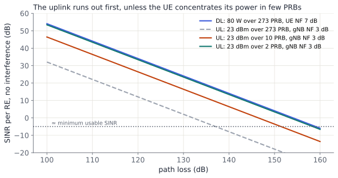
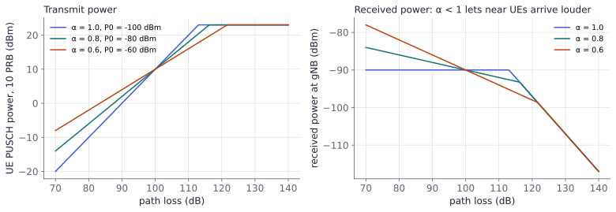

# Beginner · the idea

## A loudspeaker and a whisper {#whisper}



::: {.kpis}
::: {.kpi}
[200 W]{.kpi-val}[gNB at 3.5 GHz (53 dBm)]{.kpi-label}
:::
::: {.kpi}
[0.2 W]{.kpi-val}[typical phone (23 dBm)]{.kpi-label}
:::
::: {.kpi}
[≈ 1000×]{.kpi-val}[30 dB less power going up]{.kpi-label}
:::
:::

- The mast shouts with a loudspeaker; the phone answers in a whisper, with a tiny antenna.
- So the phone usually stops being heard **before** it stops hearing the mast.
- That is why video calls freeze and uploads fail at the edge while the signal bars still look fine.

::: {.box}
[The one idea of this section]{.box-title}
Plan coverage from the uplink. The downlink almost always reaches farther.
:::

## Ways to help the uplink {#ul-fixes}

- **Lower band for uplink**: carrier aggregation, supplementary uplink (SUL) or an LTE anchor in a low band.
- **More uplink time**: a TDD pattern with more U slots where uplink matters.
- **Repetition**: send the same uplink data several times (Rel-17 coverage enhancements).
- **Fewer resource blocks per edge user**: the same power over less bandwidth gives more power per Hz.
- **Higher-power phones**: power class 2 (26 dBm, 0.4 W) in some bands.

## Where the uplink runs out {#ul-dl-chart}

{width="80%"}

- The gNB has 80 W, the phone 0.2 W: about **26 dB** less power in the uplink.
- The phone wins back much of it by sending in **few PRBs**: all its power in a narrow band gives a high SINR per RE.
- But few PRBs means a low data rate: at the cell edge the uplink is slow before it fails.

# Intermediate · how it works

## The asymmetry: where the uplink ends, RSRP still looks fine {#dl-vs-ul}

Same location (PL + margins = 119.9 dB), 200 W carrier, 17.8 dBm per RE:

::: {.kpis}

::: {.kpi}

[−87 dBm]{.kpi-val}[SS-RSRP with a 15 dBi broadcast beam]{.kpi-label}

:::

::: {.kpi}

[−78 dBm]{.kpi-val}[PDSCH RSRP with a 24 dBi traffic beam]{.kpi-label}

:::

::: {.kpi}

[44 dB]{.kpi-val}[DL SNR per RE (UE NF 7 dB)]{.kpi-label}

:::

:::

::: {.box .warn}

[Consequence]{.box-title}The uplink of a 10-PRB PUSCH ends at an SS-RSRP of about −87 dBm in this scenario, a value most drive-test colour scales show as "good". Coverage thresholds must be derived from the UL budget, then translated into an RSRP threshold, not the other way round.

:::

::: {.small}

- Fixes: lower-band UL (CA, SUL, EN-DC anchor), UL MIMO, PC2 UEs (26 dBm), PUSCH repetition (Rel-17), fewer PRBs per edge UE.

:::

::: {.notes}
The 9 dB difference between SSB and traffic beam gain is typical for 64T64R with a wide broadcast beam; vendors differ. This slide is the quantitative version of the LinkedIn Episode 15 message. A good exercise: find the SS-RSRP at which your own network's UL BLER exceeds 10 % from drive-test data, and compare it with the planning threshold.
:::

## Supplementary uplink (SUL) {#sul}

- A cell keeps its DL (for example n78, 3.5 GHz) and adds a **second, lower UL carrier** (for example n80 at 1.8 GHz or n83 at 700 MHz).
- The UE uses **one uplink at a time**; PUCCH is configured on only one of them.
- Selection: if the measured RSRP is **below** `rsrp-ThresholdSSB-SUL`, the UE starts random access on SUL; otherwise on the normal UL. Later grants carry a 1-bit UL/SUL indicator.

::: {.columns}
::: {.column}
**SUL**

- switched, one carrier at a time
- uplink-only bands, all below 2 GHz
:::
::: {.column}
**UL carrier aggregation**

- simultaneous transmission
- needs paired or second TDD carrier and power sharing
:::
:::

::: {.notes}
From ShareTechnote's SUL page: SUL bands n80–n86 (and later n89, n97–n99) have no downlink; the configuration is broadcast in SIB1 (supplementaryUplink in ServingCellConfigCommon). Coexistence with LTE on the same uplink band needs care.
:::

## Power headroom: how much is left {#phr}

$$
PH = P_{CMAX} - P_{PUSCH,\text{required}}
$$

- The UE reports PH in a MAC CE (when PL changes by more than a threshold, periodically, or on activation).
- **Positive PH**: the scheduler may give more PRBs or a higher MCS.
- **Negative PH**: the UE is already at P~CMAX~ and the requested power is not reached. More PRBs would only lower the SINR per PRB.

::: {.box .field}
[KPI tip]{.box-title}
The share of PHR reports ≤ 0 dB per cell is a direct **uplink coverage** indicator. Compare it with the RSRP distribution: high PHR-negative share with fair RSRP means UL-limited cells.
:::

# Advanced · expert depth

## PUSCH power control {#pusch-pc}

$$
P_{PUSCH}=\min\left\{P_{CMAX},\ P_{O\_PUSCH}+10\lg\!\left(2^{\mu}M_{RB}\right)+\alpha\,PL+\Delta_{TF}+f\right\}
$$

::: {.small}

- $P_{O\_PUSCH}$: nominal (cell, `p0-NominalWithGrant`) + UE-specific part.
- $\alpha\in\{0,0.4,0.5,\dots,1\}$: fractional compensation. α < 1 lets edge UEs arrive weaker, protecting neighbours.
- $f$: closed-loop TPC accumulation, {−1, 0, +1, +3} dB per command (accumulated mode).
- PHR reports $P_{CMAX}-P_{PUSCH}$: the scheduler's signal to shrink $M_{RB}$ when the UE runs out of power.

:::

::: {.box}

[Example]{.box-title}$P_0=-90$ dBm, α = 0.8, 10 PRB at 30 kHz ($10\lg 20=13$ dB): PL = 120 dB → 19 dBm. The UE hits 23 dBm at PL = (23 + 90 − 13)/0.8 = 125 dB. Beyond that, every dB of extra path loss is lost SINR unless $M_{RB}$ shrinks.

:::

::: {.spec}

TS 38.213 §7.1.1 · TS 38.321 §5.4.6 (PHR)

:::

::: {.notes}
ShareTechnote's power-control page shows a lab trace with p0-NominalWithGrant −90, preambleReceivedTargetPower −110 and powerRampingStep dB4, and the RAR TPC command feeding the first PUSCH. Emphasize the link to Chapter 2 Section 1: PL in this formula comes from ss-PBCH-BlockPower minus filtered RSRP, so a wrong ss-PBCH-BlockPower shifts every UE's PUSCH power by the same error.
:::

## Choosing α and P0 {#alpha}

::: {.compact}
| Setting | Edge UE SINR | Inter-cell interference | Use |
|---|---|---|---|
| α = 1, P0 high | high | high | isolated cells, coverage-limited rural |
| α = 0.8, P0 ≈ −90 dBm | medium | medium | typical urban starting point |
| α = 0.6, P0 higher | lower at edge | low | dense, interference-limited clusters |
:::

Received power at the gNB for a non-capped UE:

$$
P_{rx}=P_{PUSCH}-PL=P_0+10\lg(2^{\mu}M_{RB})-(1-\alpha)\,PL
$$

::: {.small}

With α = 0.8, a UE 20 dB farther away arrives 4 dB weaker per PRB. Uplink noise rise (IoT) from the whole cell is what P0 must balance.

:::

::: {.notes}
Practical tuning loop: measure UL IoT per cell (busy hour) and UL BLER/MCS distributions. If IoT is low and edge MCS is poor, raise P0 or α. If IoT is high everywhere in a cluster, lower P0 first, then α. Always change one cluster at a time and compare neighbouring clusters as control.
:::

## α and P0 in a picture {#alpha-chart}

{width="96%"}

- α = 1 keeps every UE at the same received level until it hits 23 dBm.
- α < 1 lets near UEs arrive louder (more throughput) and far UEs quieter (less interference to neighbours). P0 is raised to keep the cell-edge level.

## Worked example: all uplink channels {#pc-example}

ss-PBCH-BlockPower = 8 dBm, measured SS-RSRP = −74 dBm → **PL = 82 dB**. μ = 1.

::: {.compact}
| Channel | Formula | Result |
|---|---|---|
| PRACH | target −110 dBm + PL | −28 dBm |
| PUCCH format 1 | P0 −90 + 10·lg(2·1) + PL | −5 dBm |
| PUSCH, 29 PRB, α = 1 | −90 + 10·lg(2·29) + 82 | ≈ 9.6 dBm |
| PUSCH, 29 PRB, at PL 115 dB | −90 + 17.6 + 115 | 42.6 → capped at 23 dBm |
:::

TPC (accumulated): field 0, 1, 2, 3 → −1, 0, +1, +3 dB. The closed loop corrects what the open-loop estimate misses (fading, antenna, body loss).

::: {.notes}
Numbers follow ShareTechnote's power control page (its worked example with PL = 82 dB). Absolute TPC mode maps 0–3 to −4, −1, +1, +4 dB. 10·lg(2^μ·M_RB) is the bandwidth term in 15 kHz-equivalent PRBs.
:::

# Practice

## Exercises {#ex}

1. For P0 = −95 dBm, α = 0.7, 20 PRB at 30 kHz, at what path loss does the UE reach 23 dBm?
2. UL BLER exceeds 10 % at SS-RSRP ≈ −95 dBm, but the plan assumed −105 dBm. Give three possible causes.
3. With α = 0.8, how much weaker per PRB does a UE 20 dB farther away arrive (not power-capped)?

::: {.aside-note}
Answers in the speaker notes.
:::

::: {.notes}
1. 10·lg(40) = 16 dB; 23 = −95 + 16 + 0.7·PL → PL ≈ 145.7 dB.
2. SSB beam gain lower than assumed; UL interference above the planned margin; worse building penetration; wrong ss-PBCH-BlockPower biasing power control; more PRBs per UE than the budget assumed.
3. (1 − α)·20 = 4 dB.
:::

## References {#refs}

::: {.refs}
- **3GPP** TS 38.213 §7.1 (PUSCH power control)
- **3GPP** TS 38.321 §5.4.6 (PHR)
- **3GPP** TS 38.101-1 §6.2 (UE output power)
- [ShareTechnote · Power control](https://www.sharetechnote.com/html/5G/5G_PowerControl.html){target="_blank"}
- [ShareTechnote · RSRP / RSRQ / SINR definitions](https://www.sharetechnote.com/html/5G/5G_PowerDefinition.html){target="_blank"}
- [ShareTechnote · SUL](https://www.sharetechnote.com/html/5G/5G_SUL.html){target="_blank"}
- [ShareTechnote · Power class](https://www.sharetechnote.com/html/5G/5G_PowerClass.html){target="_blank"}
- [ShareTechnote · Coverage enhancement](https://www.sharetechnote.com/html/5G/5G_CE.html){target="_blank"}
- C. Johnson, *5G New Radio in Bullets*, independently published, 2019 (ISBN 978-1077484351)
- E. Dahlman, S. Parkvall, J. Sköld, *5G NR: The Next Generation Wireless Access Technology*, 2nd ed., Academic Press, 2020
:::
