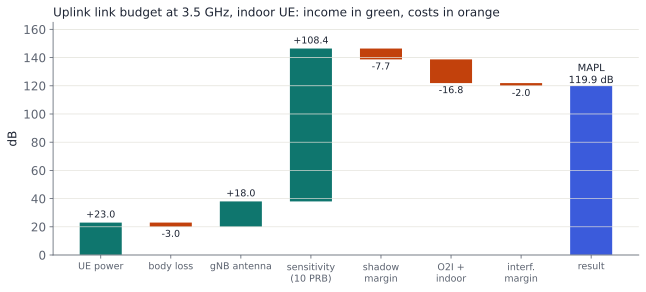
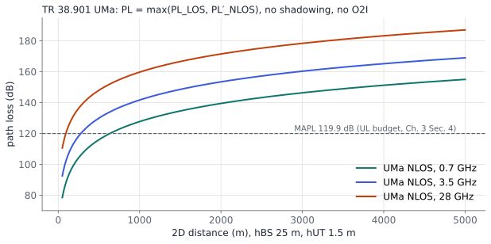
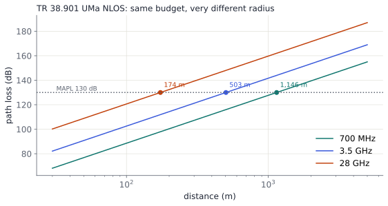
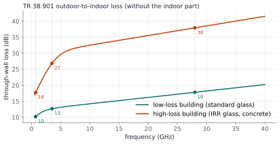

# Beginner · the idea

## A link budget is a money budget {#money}



::: {.columns}
::: {.column}
**Income** (what you have)

- transmit power
- antenna gains
:::
::: {.column}
**Expenses** (what you lose)

- body loss, cable loss
- receiver noise and the SINR you need
- margins: fading, walls, interference
:::
:::

What is left is the **maximum allowed path loss (MAPL)**: how much loss the radio path may have. A propagation model then turns that loss into a distance.

::: {.box}
[The one idea of this section]{.box-title}
Every line is an assumption. Change one (for example the wall type) and the cell size changes a lot.
:::

## The three numbers to know {#lb-numbers}

::: {.kpis}
::: {.kpi}
[−174 dBm/Hz]{.kpi-val}[thermal noise at room temperature]{.kpi-label}
:::
::: {.kpi}
[+10·lg(B)]{.kpi-val}[noise grows with bandwidth]{.kpi-label}
:::
::: {.kpi}
[≈ 12 dB]{.kpi-val}[per distance doubling in urban NLOS]{.kpi-label}
:::
:::

- 3.6 MHz of bandwidth (10 RBs at 30 kHz) → noise −108.4 dBm before the receiver noise figure.
- In free space, doubling the distance costs 6 dB. In a city without line of sight it costs about 12 dB: walls and streets eat the signal.

## The budget as a waterfall {#lb-waterfall}

{width="88%"}

- Income: transmit power, antenna gain, and the receiver's sensitivity (how weak a signal it can still use).
- Costs: body loss, margins for shadowing, walls and interference.
- What is left is the **maximum allowed path loss** (MAPL).

# Intermediate · how it works

## Uplink budget, 3.5 GHz, indoor UE {#ul-budget}

::: {.compact}
| Item | Value | Note |
|---|---|---|
| UE power − body loss | 23 − 3 = 20 dBm | power class 3 |
| gNB RX gain | +18 dBi | conservative, before MIMO combining |
| Sensitivity, 10 PRB (3.6 MHz) | −108.4 dBm | −174 + 65.6 + 3 dB NF − 3 dB SINR |
| Path loss before margins | 146.4 dB |  |
| Shadowing (90 % edge, σ = 6) | −7.7 dB | 1.28 σ |
| O2I low-loss + indoor | −16.8 dB | 12.7 + 0.5 × 8.3 m |
| Interference margin | −2 dB |  |
| **MAPL** | **119.9 dB** |  |
:::

Invert UMa NLOS at 3.5 GHz: $119.9=13.54+39.08\lg d+10.88\Rightarrow d\approx 278$ m. With 2 PRB instead of 10: +7 dB → ≈ 419 m.

::: {.notes}
8.3 m is the mean of min(U(0,25), U(0,25)), the indoor-distance model in TR 38.901. 1.28σ gives 90 % location probability at the edge; area reliability is higher (around 95–97 % depending on σ/n). Each assumption here is a lever and must be stated when comparing vendors' budgets.
:::

## Sensitivity step by step {#sensitivity}

$$
S = -174 + 10\lg B + NF + \text{SINR}_{req}\quad[\text{dBm}]
$$

::: {.compact}
| Term | Example (UL, 10 PRB at 30 kHz) | Meaning |
|---|---|---|
| thermal noise density | −174 dBm/Hz | kT at 290 K |
| bandwidth | 10·lg(3.6 MHz) = +65.6 dB | only the PRBs used |
| noise figure | +3 dB | gNB receiver |
| required SINR | −3 dB | low MCS with HARQ |
| **sensitivity** | **−108.4 dBm** |  |
:::

- Halving the PRBs improves sensitivity by 3 dB, but halves the data rate.
- Required SINR depends on MCS, BLER target and HARQ: state it, it is the most arguable line.

# Advanced · expert depth

## TR 38.901 path loss, UMa {#uma}

$f_c$ in GHz, distances in m, $h_{BS}=25$ m:

$$
PL_{LOS}=28.0+22\lg d_{3D}+20\lg f_c\quad(10\ \text{m}\le d_{2D}\le d'_{BP})
$$

$$
PL_{NLOS}=\max\left(PL_{LOS},\ 13.54+39.08\lg d_{3D}+20\lg f_c-0.6\,(h_{UT}-1.5)\right)
$$

::: {.small}

$d'_{BP}=4h'_{BS}h'_{UT}f_c/c$ with effective heights $h'=h-1$ m: 560 m at 3.5 GHz for a 1.5 m UE. Shadow fading σ: 4 dB LOS, 6 dB NLOS.

:::

{width="46%"}

::: {.spec}

TR 38.901 §7.4.1, Table 7.4.1-1

:::

::: {.notes}
The NLOS slope (39.08 dB/decade) is the number to remember: doubling distance costs 11.8 dB in NLOS UMa, versus 6 dB in free space. For UMi street canyon NLOS: PL' = 35.3 lg d3D + 22.4 + 21.3 lg fc − 0.3 (hUT − 1.5), σ = 7.82 dB. Note the different frequency coefficient (21.3 vs 20).
:::

## Outdoor-to-indoor penetration {#o2i}

$$
PL=PL_b+PL_{tw}+PL_{in}+N(0,\sigma_P^2),\qquad PL_{in}=0.5\,d_{2D\text{-}in}
$$

::: {.columns}

::: {.column}

::: {.small}

**Low-loss** (standard glass, concrete):\
$PL_{tw}=5-10\lg\left(0.3\cdot 10^{-L_{glass}/10}+0.7\cdot 10^{-L_{concrete}/10}\right)$

:::

::: {.small}

**High-loss** (IRR glass, concrete):\
$PL_{tw}=5-10\lg\left(0.7\cdot 10^{-L_{IRR}/10}+0.3\cdot 10^{-L_{concrete}/10}\right)$

:::

::: {.small}

$L_{glass}=2+0.2f$, $L_{IRR}=23+0.3f$, $L_{concrete}=5+4f$ (dB, f in GHz)

:::

:::

::: {.column}

::: {.compact}
| f | Low-loss PLtw | High-loss PLtw |
|---|---|---|
| 0.7 GHz | 10.2 dB | 17.7 dB |
| 3.5 GHz | 12.7 dB | 26.8 dB |
| 28 GHz | 17.8 dB | 37.9 dB |
:::

:::

:::

::: {.box .warn}

[Energy-efficient buildings]{.box-title}Metal-coated (IRR) glass adds ≈ 14 dB at 3.5 GHz and ≈ 20 dB at 28 GHz over standard glass. A single building type assumption can swing the plan by a factor of 3–5 in site count.

:::

::: {.spec}

TR 38.901 §7.4.3, Tables 7.4.3-1/2

:::

::: {.notes}
The low-loss model is a parallel combination: 30 % of the wall is glass (weak loss) and dominates the result, which is why 'low-loss' is only 12.7 dB at 3.5 GHz despite 19 dB of concrete loss. In high-loss, the 70 % IRR glass and 30 % concrete are both lossy, so there is no weak path. σ_P = 4.4 dB (low-loss) and 6.5 dB (high-loss).
:::

## Same budget, three bands {#uma-bands}

{width="82%"}

- Path loss grows with 20·lg f: from 700 MHz to 3.5 GHz +14 dB, to 28 GHz +32 dB.
- In TR 38.901 UMa NLOS, distance enters with about 39·lg d: every **+10 dB** of budget gives only about **1.8×** the radius.

## Walls: the biggest unknown {#o2i-chart}

{width="80%"}

- Low-loss building (standard glass): 10–18 dB. High-loss (energy-saving coated glass, concrete): 18–38 dB.
- Coated (IRR) glass costs about 23 dB already at low frequency: **modern offices are hard to serve from outside at any band**.
- Add an indoor part (0.5 dB/m in TR 38.901) and the body loss.

## Margins: what probability do you want? {#margins}

::: {.compact}
| Edge coverage probability | Margin (σ = 6 dB) | Margin (σ = 8 dB) |
|---|---|---|
| 50 % | 0 dB | 0 dB |
| 75 % | 4.0 dB | 5.4 dB |
| 90 % | 7.7 dB | 10.3 dB |
| 95 % | 9.9 dB | 13.2 dB |
:::

- Margin = z × σ (z = 1.28 for 90 %, 1.645 for 95 %). The **area** probability is higher than the edge probability.
- Indoor users see larger σ (more variation between rooms and buildings): one more reason indoor budgets are pessimistic.

# Practice

## Exercises {#ex}

1. Redo the UL budget for high-loss buildings at 3.5 GHz. What is the new indoor range?
2. Halve the PRBs from 10 to 5. How many dB does the budget gain, and how much range (UMa NLOS)?
3. What shadowing margin gives 90 % edge reliability with σ = 8 dB?

::: {.aside-note}
Answers in the speaker notes.
:::

::: {.notes}
1. PL_tw 26.8 dB instead of 12.7 → MAPL ≈ 105.8 dB → lg d = (105.8 − 24.42)/39.08 = 2.083 → ≈ 121 m.
2. +3 dB → lg d increases by 3/39.08 = 0.077 → ×1.19 range (about +19 %).
3. 1.28 × 8 ≈ 10.2 dB.
:::

## References {#refs}

::: {.refs}
- **3GPP** TR 38.901 §7.4.1 (path loss), §7.4.3 (O2I)
- **3GPP** TS 38.101-1 §6.2
- [ShareTechnote · Power control](https://www.sharetechnote.com/html/5G/5G_PowerControl.html){target="_blank"}
- [ShareTechnote · Propagation model (TR 38.901)](https://www.sharetechnote.com/html/5G/5G_PropagationModel.html){target="_blank"}
- [ShareTechnote · EIRP](https://www.sharetechnote.com/html/5G/5G_EIRP.html){target="_blank"}
- [ShareTechnote · Power class](https://www.sharetechnote.com/html/5G/5G_PowerClass.html){target="_blank"}
- [ShareTechnote · Coverage enhancement](https://www.sharetechnote.com/html/5G/5G_CE.html){target="_blank"}
- C. Johnson, *5G New Radio in Bullets*, independently published, 2019 (ISBN 978-1077484351)
- E. Dahlman, S. Parkvall, J. Sköld, *5G NR: The Next Generation Wireless Access Technology*, 2nd ed., Academic Press, 2020
:::
