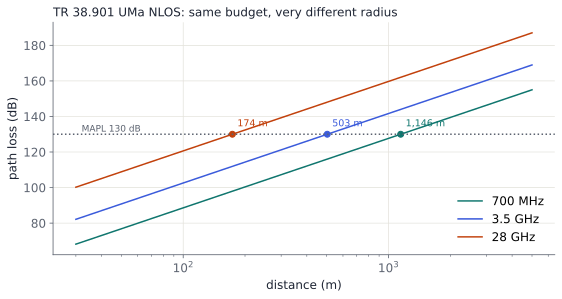
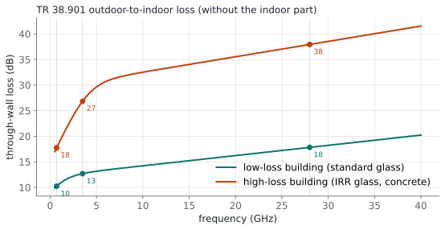

# Beginner · the idea

## Long waves travel, short waves carry {#waves}



- **Low band (700 MHz)**: long waves, travel far and through walls. Little spectrum, so limited speed.
- **Mid band (3.5 GHz)**: the balance. Up to 100 MHz per carrier: the 5G capacity layer.
- **High band (26/28 GHz, mmWave)**: huge bandwidth (up to 400 MHz per carrier), but short range and easily blocked.

::: {.box}
[The one idea of this section]{.box-title}
No band does everything. Networks stack layers: low band for coverage, mid band for capacity, mmWave for hotspots.
:::

## The numbers side by side {#bands-table}

::: {.compact}
| Band | Typical bandwidth | Wavelength | Free-space loss at 1 km | Role |
|---|---|---|---|---|
| 700 MHz | 10–20 MHz | 43 cm | 89.3 dB | wide area, deep indoor |
| 3.5 GHz | up to 100 MHz | 8.6 cm | 103.3 dB | capacity layer |
| 26/28 GHz | up to 400 MHz | 1.1 cm | 121.4 dB | hotspots, fixed wireless |
:::

$$
\text{FSPL [dB]}=20\lg d_{\text{km}}+20\lg f_{\text{MHz}}+32.44
$$

## The three layers in one picture {#layers}

::: {.compact}
| | Low band (600–900 MHz) | Mid band (2.5–4.9 GHz) | mmWave (24–71 GHz) |
|---|---|---|---|
| Job | coverage, indoor, IoT | capacity + coverage | peak rate, hotspots, FWA |
| Typical BW | 10–20 MHz | 40–100 MHz | 100–400 MHz per carrier |
| Antennas | 2–4T | 32–64T massive MIMO | 256+ elements, analogue beams |
| Duplex | mostly FDD | TDD | TDD |
| Cell size (urban) | km | several hundred m | 100–200 m, LOS |
:::

A smartphone in a city often uses two layers at once: low band for the uplink and coverage, mid band for downlink capacity (carrier aggregation or EN-DC).

# Intermediate · how it works

## What really changes with frequency {#what-changes}

::: {.compact}
| Effect | 700 MHz | 3.5 GHz | 28 GHz |
|---|---|---|---|
| O2I loss, low-loss building | 10.2 dB | 12.7 dB | 17.8 dB |
| O2I loss, high-loss (IRR glass) | 17.7 dB | 26.8 dB | 37.9 dB |
| Indoor UL range, same budget* | ≈ 613 m | ≈ 278 m | small cell only |
| Phase noise vs 3.5 GHz (same reference) | −14 dB | 0 | +18 dB |
:::

- Free-space loss grows 20 dB per decade of frequency, but a fixed antenna area holds more elements at short wavelengths and wins much of it back as array gain.
- The real mmWave limits are **penetration** and **blockage** by bodies, vehicles and foliage.

::: {.aside-note}
*From Section 4's uplink budget with low-loss buildings (15 dBi gNB antenna at 700 MHz). TR 38.901 O2I models.
:::

## Free space is only the beginning {#beyond-fspl}

{width="72%"}

- Free-space loss alone puts 28 GHz 32 dB behind 700 MHz. In real streets, add **foliage** (several dB at mmWave), **body blockage** (15–25 dB at 28 GHz) and **rain** at long distances.
- Diffraction around corners becomes weak at mmWave: coverage depends on line of sight and reflections.

## Bands in 3GPP language {#band-names}

::: {.compact}
| Band | Frequency | Duplex | Typical use |
|---|---|---|---|
| n28 | 703–803 MHz | FDD | wide-area, often DSS with LTE |
| n71 | 600 MHz | FDD | US coverage layer |
| n41 | 2.5 GHz | TDD | US and China mid band |
| n77 / n78 | 3.3–4.2 / 3.3–3.8 GHz | TDD | main mid band worldwide |
| n79 | 4.4–5.0 GHz | TDD | Japan, China |
| n257 / n258 / n261 | 26.5–29.5 / 24.25–27.5 / 27.5–28.35 GHz | TDD | mmWave |
| FR2-2 | 52.6–71 GHz | TDD | Rel-17, 480/960 kHz SCS |
:::

::: {.notes}
Operating band tables are in TS 38.101-1 (FR1) and 38.101-2 (FR2); ShareTechnote's "FR / Operating Band" page lists them with GSCN ranges.
:::

# Advanced · expert depth

## Aperture: why mmWave is not hopeless {#aperture}

For a fixed antenna area $A$, the gain of an aperture antenna is

$$
G=\frac{4\pi A\,\eta}{\lambda^2}
$$

- Going from 3.5 to 28 GHz shortens λ by 8×, so the **same panel** has $20\lg 8=18$ dB more gain, on each end of the link.
- With arrays at both gNB and UE, the 18 dB extra free-space loss can be more than compensated in line of sight.
- What arrays cannot fix: a wall with 38 dB of IRR-glass loss, or a hand over the phone's antenna module.

::: {.box .field}
[Planning consequence]{.box-title}
mmWave coverage is a line-of-sight problem, not a path-loss problem: plan it street by street, with blockage in mind.
:::

::: {.notes}
Aperture gain relation: G = 4πAη/λ². For A and η constant, G ∝ f². The free-space loss between isotropic antennas grows as f², so with a fixed aperture on one end the link loss is frequency-independent, and with fixed apertures on both ends it improves with frequency. This is the classic Friis argument for mmWave, and it holds only in line of sight.
:::

## Walls by frequency {#o2i-bands}

{width="76%"}

At 700 MHz a high-loss building costs about 18 dB; at 3.5 GHz about 27 dB; at 28 GHz about 38 dB. This, more than free-space loss, is why mmWave stays outdoors or needs indoor cells.

## Same antenna size, more gain {#aperture-math}

For a fixed panel area $A$, antenna gain grows with frequency squared:

$$
G = \frac{4\pi A\,\eta}{\lambda^2}\quad\Rightarrow\quad +20\lg\frac{f_2}{f_1}\ \text{dB}
$$

- Going from 3.5 to 28 GHz: +18 dB gain per side for the same area, **+36 dB** if both ends keep their area.
- This more than cancels the 18 dB extra free-space loss, but only in **one direction** at a time: hence beam sweeping and beam management (Chapter 4).

# Practice

## Exercises {#ex}

1. Compute FSPL at 2 km for 700 MHz and 28 GHz.
2. Repeat Section 4's uplink budget at 700 MHz with a 15 dBi antenna and low-loss buildings. Compare with 3.5 GHz.
3. How much more gain does the same panel area give at 28 GHz than at 3.5 GHz?

::: {.aside-note}
Answers in the speaker notes.
:::

::: {.notes}
1. 700 MHz: 6.0 + 56.9 + 32.44 = 95.3 dB; 28 GHz: 6.0 + 88.9 + 32.44 = 127.4 dB.
2. MAPL ≈ 119.4 dB; lg d = (119.4 − 13.54 + 3.10)/39.08 = 2.787 → ≈ 613 m, about 2.2× the 3.5 GHz range.
3. 20·lg(28/3.5) = 18 dB.
:::

## References {#refs}

::: {.refs}
- **3GPP** TR 38.901 §7.4 (path loss, O2I)
- **3GPP** TS 38.101-1 / 38.101-2 (bands, channel bandwidths)
- [ShareTechnote · FR / bandwidth, ARFCN and GSCN](https://www.sharetechnote.com/html/5G/5G_FR_Bandwidth.html){target="_blank"}
- [ShareTechnote · FR2-2 (52.6–71 GHz)](https://www.sharetechnote.com/html/5G/5G_FR2_2.html){target="_blank"}
- [ShareTechnote · SUL](https://www.sharetechnote.com/html/5G/5G_SUL.html){target="_blank"}
- C. Johnson, *5G New Radio in Bullets*, independently published, 2019 (ISBN 978-1077484351)
- E. Dahlman, S. Parkvall, J. Sköld, *5G NR: The Next Generation Wireless Access Technology*, 2nd ed., Academic Press, 2020
:::
