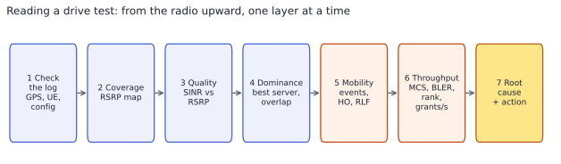
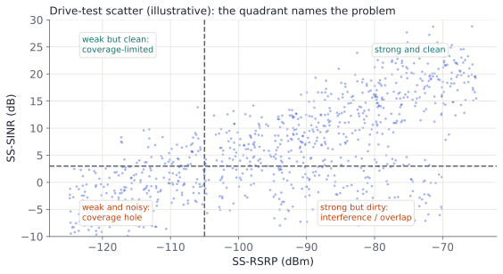
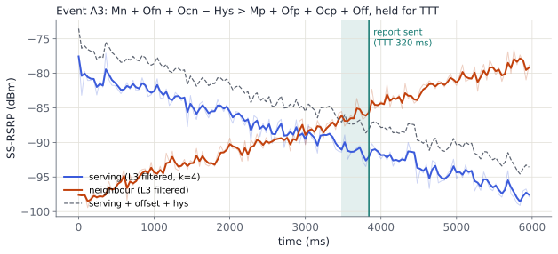
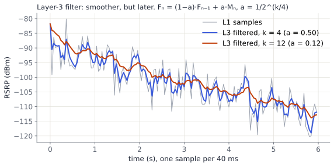

# Beginner · the idea

## Be a detective: always two clues {#detective}



1. **Map RSRP**: where is the coverage? Look for holes and cells reaching too far.
2. **Map SINR**: where is the interference? Compare with the RSRP map.
3. **Compare downlink and uplink**: phone TX power, UL errors, DL errors. Which breaks first?
4. **Check the serving cell and beam**: is the expected cell serving? Look for crossed feeders or wrong tilt.
5. **Follow the handovers**: late, early, back and forth?
6. **Correlate with parameters**: tilt, power, TDD pattern, neighbours. Change one thing at a time.

::: {.box}
[The one idea of this section]{.box-title}
One metric shows a symptom. Two metrics together point to a cause.
:::

## Symptom → first suspect {#symptoms}

::: {.compact}
| What you see | First suspect |
|---|---|
| UE TX power at max, UL errors high | uplink coverage limit |
| Low SINR close to the site | a neighbour reaching too far (overshoot) |
| Serving cell far away | uptilt or a missing neighbour relation |
| Handover back and forth (ping-pong) | hysteresis, time-to-trigger, filtering |
| Good RSRP, SINR capped near 15–20 dB in one area | long echoes (delay spread, Chapter 1) |
:::

## The method in seven steps {#dt-method}

{width="98%"}

Do not start with throughput. A low throughput is a symptom; the cause is almost always found one or two steps earlier.

## The two-metric scatter {#scatter}

{width="80%"}

Plot every sample as RSRP against SINR. The quadrant tells you the kind of problem before you look at a map.

# Intermediate · how it works

## Measurement events {#events-table}

::: {.compact}
| Event | Entering condition (Mn: neighbour, Mp: serving, Ms: SpCell) | Typical use |
|---|---|---|
| A1 | Ms − Hys > Thresh | stop inter-freq measurements |
| A2 | Ms + Hys < Thresh | start gaps / inter-RAT search |
| A3 | Mn + Ofn + Ocn − Hys > Mp + Ofp + Ocp + Off | intra-freq handover |
| A4 | Mn + Ofn + Ocn − Hys > Thresh | load balancing, SCell add |
| A5 | Mp + Hys < Thresh1 and Mn + Ofn + Ocn − Hys > Thresh2 | inter-freq handover |
| A6 | Mn + Ocn − Hys > Ms + Ocs + Off | SCell replacement |
| B1 / B2 | inter-RAT neighbour (and serving) vs thresholds | EN-DC SgNB add, NR→LTE |
:::

{width="48%"}

::: {.spec}

TS 38.331 §5.5.4

:::

::: {.notes}
Ocn is the cell individual offset (CIO), the main tool to move a handover border for one neighbour pair without touching the rest. Ofn/Ofp are frequency-specific offsets. The figure is generated from synthetic RSRP traces with L3 filtering (k = 4), Off = 3 dB, Hys = 1 dB, TTT = 320 ms.
:::

## Layer-3 filtering {#l3}

$$
F_n=(1-a)\,F_{n-1}+a\,M_n,\qquad a=\frac{1}{2^{k/4}},\ \ k=\texttt{filterCoefficient}
$$

::: {.compact}
| k | a | Effective memory (samples) | Effect |
|---|---|---|---|
| 0 | 1 | 1 | no filtering |
| 4 | 0.5 | ≈ 2 | default: light smoothing |
| 8 | 0.25 | ≈ 4 | smoother, slower |
| 11 | 0.15 | ≈ 7 | for fast fading suppression, delays HO |
:::

::: {.small}

The filter runs per measurement period of the UE's L1 (which depends on SMTC and DRX), so the same k means different time constants on different cells.

:::

::: {.spec}

TS 38.331 §5.5.3.2 · QuantityConfig

:::

::: {.notes}
Effective memory ≈ 1/a samples. With an L1 measurement period around 200 ms (DRX or relaxed measurement), k = 8 gives ~800 ms of smoothing: plus a 320 ms TTT, the handover decision lags the radio by more than a second. At 120 km/h that is 33 m: fine in a macro cell, too slow at a street corner in FR2.
:::

## Layer-3 filtering in a chart {#l3-chart}

{width="80%"}

- A larger k smooths fading but **delays** the reaction: with 40 ms samples, k = 12 needs several hundred ms to follow a drop.
- Too much filtering + long TTT = late handover (Section 6, "too late").

## A3 in RRC: decoding an example {#a3-decode}

::: {.compact}
| Field | Value in RRC | Meaning |
|---|---|---|
| a3-Offset | 6 | 3 dB (units of 0.5 dB) |
| hysteresis | 2 | 1 dB (units of 0.5 dB) |
| timeToTrigger | ms320 | condition must hold 320 ms |
| reportInterval / reportAmount | ms120 / r1 | one report |
| rsType | ssb | measure SS-RSRP |
| filterCoefficientRSRP | fc4 | k = 4 |
:::

Entering: $M_n + O_{fn} + O_{cn} - Hys > M_p + O_{fp} + O_{cp} + Off$. With no other offsets, the neighbour must be **4 dB** better (3 + 1) for 320 ms.

# Advanced · expert depth

## Handover failures and how to read them {#mro}

::: {.compact}
| Failure | What happened | Typical fix |
|---|---|---|
| Too late | RLF in source before HO completes; UE re-establishes in target | lower Off/TTT, raise CIO toward target |
| Too early | HO succeeds, RLF soon after in target; UE returns to source | raise Off/TTT, lower CIO |
| Wrong cell | RLF in target, re-establishment in a third cell | neighbour relations, CIO, antenna tilt |
| Ping-pong | A→B→A within a short time (for example < 1 s) | Hys, TTT, L3 filter |
:::

::: {.box .field}

[FR2 specifics]{.box-title}Beam-level mobility inside a cell (Chapter 4, Section 3) absorbs most fast changes. Cell-level parameters in FR2 often need shorter TTT and lighter filtering than FR1, otherwise blockage events turn into RLFs before the A3 report is sent.

:::

::: {.spec}

TS 38.300 §15.5 (MRO) · TS 38.331 RLF-Report

:::

::: {.notes}
The RLF report (and from Rel-16 the successful HO report) lets the network classify these cases automatically: it contains the last measurement results and the cell where the UE re-established. SON MRO algorithms use exactly these counters to adjust CIO pairwise.
:::

## Conditional handover (CHO) {#cho}

1. The source prepares **one or more target cells** in advance and sends the UE their configuration plus a condition (for example CondEvent A3 or A5).
2. The UE keeps measuring. When the condition is met for a candidate, it **executes immediately**: RACH to that target, no waiting for a command.
3. The target confirms, the core switches the path, the source releases.

- Removes the "too late" failure caused by a report or command lost at the degrading cell edge: useful for trains, highways, FR2 blockage.
- Costs: resources reserved in several candidates, more preparation signalling.

::: {.notes}
From ShareTechnote's CHO page (Rel-16). Two trigger events can be combined (condHandoverTwoTriggerEvents). For NTN, conditions based on location (D1) or time (T1) were added in Rel-17.
:::

## Throughput: what the scheduler did {#tput-chain}

$$
\text{DL rate}\approx \underbrace{\tfrac{\text{grants}}{\text{s}}}_{\text{scheduling}}\times\underbrace{\tfrac{\text{RB}}{\text{grant}}}_{\text{load}}\times\underbrace{\text{bits/RB}}_{\text{MCS, rank}}\times(1-\text{BLER})
$$

- In a field test documented on ShareTechnote, two sectors had the **same MCS and BLER**, yet one had far lower throughput: it received **fewer grants per second**. The radio was fine; the scheduling was not.
- Rank stuck at 3 of 4 points to the channel or to one weak UE receive branch: log **per-antenna RSRP**.

::: {.box .field}
[Rule]{.box-title}
Check MCS and BLER first. If they match the SINR, look at grants/s and RBs per slot before touching the antennas.
:::

# Practice

## Exercises {#ex}

1. `a3-Offset` = 6 and `hysteresis` = 2 (0.5 dB units), CIO 0, serving −95 dBm. Above what neighbour RSRP does A3 enter?
2. With filterCoefficient k = 8 and a 40 ms L1 period, estimate the filter's memory. What TTT suits a 120 km/h motorway?
3. A drive test shows many RLFs followed by re-establishment in the target cell. Too late or too early? What would you change?

::: {.aside-note}
Answers in the speaker notes.
:::

::: {.notes}
1. Off 3 dB, Hys 1 dB: Mn − 1 > −95 + 3 → Mn > −91 dBm.
2. a = 0.25 → memory ≈ 4 samples ≈ 160 ms; a short TTT (80–160 ms) keeps total lag around 300 ms (≈ 10 m at 33 m/s).
3. Too late: lower Off/TTT or raise the CIO toward the target for that cell pair.
:::

## References {#refs}

::: {.refs}
- **3GPP** TS 38.331 §5.5.3 (L3 filtering), §5.5.4 (events)
- **3GPP** TS 38.300 §15.5 (MRO)
- **3GPP** TS 38.215 §5.1
- [ShareTechnote · Measurement report](https://www.sharetechnote.com/html/5G/5G_MeasurementReport.html){target="_blank"}
- [ShareTechnote · RSRP / RSRQ / SINR definitions](https://www.sharetechnote.com/html/5G/5G_PowerDefinition.html){target="_blank"}
- [ShareTechnote · Field test (drive-test analysis)](https://www.sharetechnote.com/html/5G/5G_FieldTest.html){target="_blank"}
- [ShareTechnote · Handover](https://www.sharetechnote.com/html/5G/5G_Handover.html){target="_blank"}
- [ShareTechnote · Conditional handover](https://www.sharetechnote.com/html/5G/5G_CHO.html){target="_blank"}
- [ShareTechnote · MDT](https://www.sharetechnote.com/html/5G/5G_MDT.html){target="_blank"}
- C. Johnson, *5G New Radio in Bullets*, independently published, 2019 (ISBN 978-1077484351)
- E. Dahlman, S. Parkvall, J. Sköld, *5G NR: The Next Generation Wireless Access Technology*, 2nd ed., Academic Press, 2020
:::
