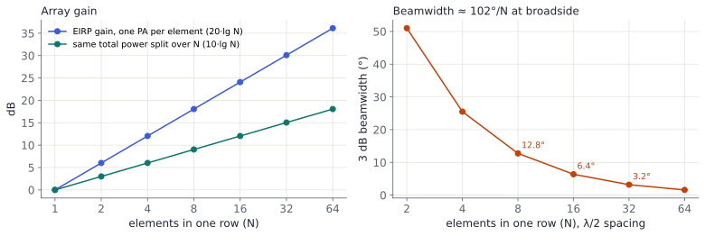

# Beginner · the idea

## Many small speakers instead of one big one {#speakers}



**64T64R** means 64 transmit and 64 receive chains, each with its own amplifier feeding part of the antenna.

- Working together, many small transmitters can aim their energy at one user: a **beam**.
- They can also serve several users on the same frequencies at once, one beam each: **multi-user MIMO**.
- On the uplink, 64 receivers add up a phone's weak signal: up to **18 dB** better than one receiver.

::: {.box}
[The one idea of this section]{.box-title}
More chains = more gain and more simultaneous beams, but more weight, power and cost.
:::

## Ideal array gain in one table {#gain-table}

::: {.compact}
| Configuration | Ideal array gain, 10·lg N | Typical use |
|---|---|---|
| 2T2R / 4T4R | 3 / 6 dB | low band, rural |
| 8T8R | 9 dB | low/mid band macro |
| 32T32R | 15 dB | suburban mid band |
| 64T64R | 18 dB | dense urban mid band |
:::

A typical 64T64R panel drives about 192 antenna elements: each chain feeds a small vertical group of elements.

## Gain and beamwidth in two charts {#gain-charts}

{width="94%"}

- Each doubling of elements: **+6 dB EIRP** if every element has its own PA, +3 dB if the total power stays the same.
- And the beam gets **half as wide**: 8 elements in a row ≈ 13°, 32 elements ≈ 3°.

# Intermediate · how it works

## What 64T64R buys: gain and EIRP {#eirp}

With $N$ PAs of power $P_{PA}$ combining coherently, and element/sub-array gain $G_e$:

$$
\text{EIRP}=P_{PA}+20\lg N+G_e
$$

::: {.box}

[Illustrative 64T64R AAU at 200 W]{.box-title} $P_{PA}=200/64=3.1$ W = 34.9 dBm; $20\lg 64=36.1$ dB; 3-element vertical sub-array + element ≈ 9.8 dBi → EIRP ≈ 80.8 dBm in the beam peak.

:::

::: {.small}

- Total conducted power grows as $10\lg N$, EIRP as $20\lg N$: half of the array gain comes from more PAs, half from directivity.
- Uplink: maximum-ratio combining over 64 receivers gives up to $10\lg 64=18$ dB of SNR gain, more than any DL change can return to an UL-limited cell.
- MU-MIMO: users separated in angle share the same RBs. Capacity gain depends on user angular spread and CSI accuracy, not on N alone.

:::

::: {.spec}

TS 38.104 §6.2 (BS output power), §9 (radiated requirements, OTA)

:::

::: {.notes}
EIRP limits for AAS base stations are specified as OTA requirements (TS 38.104 radiated part, TS 38.141-2 for conformance). In the field, EMF compliance often caps the actual EIRP below the hardware maximum, using statistical power-limiting features. That affects both coverage (Chapter 3, Section 4) and the SSB/traffic-beam gain gap.
:::

## What is inside a 64T64R AAU {#aau-inside}

::: {.compact}
| Item | Typical value | Why it matters |
|---|---|---|
| Antenna elements | 192 (e.g. 12 rows × 8 columns × 2 polarisations) | sets the aperture and gain |
| TRX chains | 64 | how many independent signals can be shaped |
| Sub-array | 3 vertical elements per TRX | fixed vertical gain, limited vertical steering |
| Total power | 200–320 W | shared by all PAs |
| Bandwidth | 100–200 MHz instantaneous | one carrier or several in n77/n78 |
| Weight | 25–45 kg | mast load, installation cost |
:::

- **64T64R** = 64 transmit and 64 receive chains, not 64 antennas. More elements than chains means some gain is fixed (analogue) and only the rest is steerable.

# Advanced · expert depth

## 32T or 64T? A quantitative look {#t32-t64}

With the same total power $P_{tot}$ split over $N$ PAs, element gain $G_e$:

$$
\text{EIRP}=\underbrace{P_{tot}-10\lg N}_{\text{per PA}}+20\lg N+G_e=P_{tot}+10\lg N+G_e
$$

- 64T → 32T at the same total power: EIRP −3 dB, beams twice as wide.
- Uplink: MRC gain −3 dB (32 instead of 64 receivers): this matters in uplink-limited cells.
- MU-MIMO: capacity gain depends on how many users are separated in angle at busy hour, not on N alone. In suburban areas with few, scattered users, 32T often delivers most of the benefit.

::: {.box .field}
[Decision rule]{.box-title}
Choose 64T where traffic is high, users are spread over angles and heights (high-rise), and the uplink is the limit. Elsewhere, 32T or 8T saves weight, power and cost.
:::

## SU-MIMO vs MU-MIMO {#su-mu}

::: {.columns}
::: {.column}
**SU-MIMO**

- one user, up to 4 layers (DL) in today's phones
- limited by the **UE's** antennas and the channel rank
- gives peak rate to one user
:::
::: {.column}
**MU-MIMO**

- several users on the **same RBs**, each in its own beam
- 64T: up to 16 (sometimes 24–32) DL layers in total
- gives **cell capacity**, if users are separated in angle
:::
:::

- MU-MIMO needs accurate channel knowledge: **SRS reciprocity** in TDD or **Type II CSI** (Section 3).
- Pairing fails when users are close in angle, CSI is old (moving users) or the scheduler has too few active users to choose from.

::: {.box .field}
[KPI tip]{.box-title}
Track "average paired layers per TTI" at busy hour. Values near 1 mean the 64T hardware is working as an expensive 8T.
:::

# Practice

## Exercises {#ex}

1. 200 W over 64 PAs, element plus sub-array gain 9.8 dBi: what is the peak EIRP?
2. How does EIRP change when replacing 64T with 32T at the same total power and element gain?
3. Why does 64-receiver combining help an uplink-limited cell more than any downlink upgrade?

::: {.aside-note}
Answers in the speaker notes.
:::

::: {.notes}
1. 34.9 dBm per PA + 36.1 dB (20·lg 64) + 9.8 dBi ≈ 80.8 dBm.
2. −3 dB (10·lg 64 − 10·lg 32).
3. The uplink budget gains up to 18 dB of SNR directly at the receiver, while extra downlink power or gain does not change how well the phone is heard.
:::

## References {#refs}

::: {.refs}
- **3GPP** TS 38.104 §6.2 (BS output power), §9 (radiated requirements)
- **3GPP** TS 38.214 §5.2 (CSI)
- [ShareTechnote · CSI-RS](https://www.sharetechnote.com/html/5G/5G_CSI_RS.html){target="_blank"}
- [ShareTechnote · CSI-RS codebook](https://mail.sharetechnote.com/html/5G/5G_CSI_RS_Codebook.html){target="_blank"}
- [ShareTechnote · Massive MIMO](https://www.sharetechnote.com/html/5G/5G_MassiveMIMO_Definition.html){target="_blank"}
- [ShareTechnote · EIRP](https://www.sharetechnote.com/html/5G/5G_EIRP.html){target="_blank"}
- [ShareTechnote · SRS](https://www.sharetechnote.com/html/5G/5G_SRS.html){target="_blank"}
- [ShareTechnote · MIMO overview](https://www.sharetechnote.com/html/5G/5G_MIMO.html){target="_blank"}
- C. Johnson, *5G New Radio in Bullets*, independently published, 2019 (ISBN 978-1077484351)
- E. Dahlman, S. Parkvall, J. Sköld, *5G NR: The Next Generation Wireless Access Technology*, 2nd ed., Academic Press, 2020
:::
